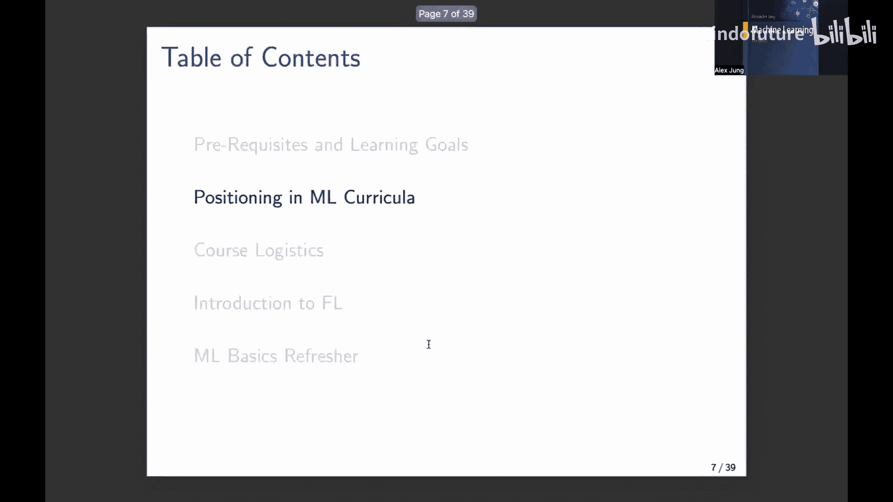
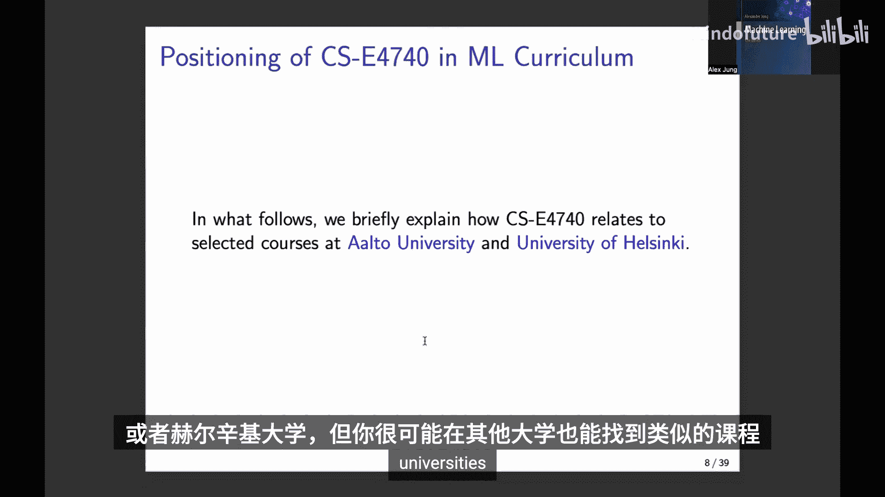
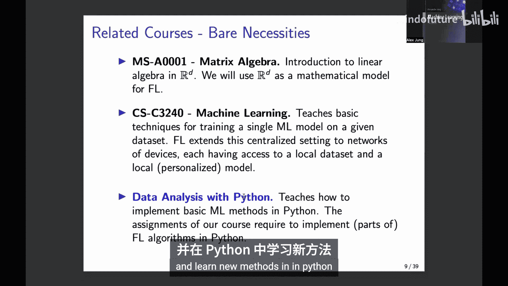
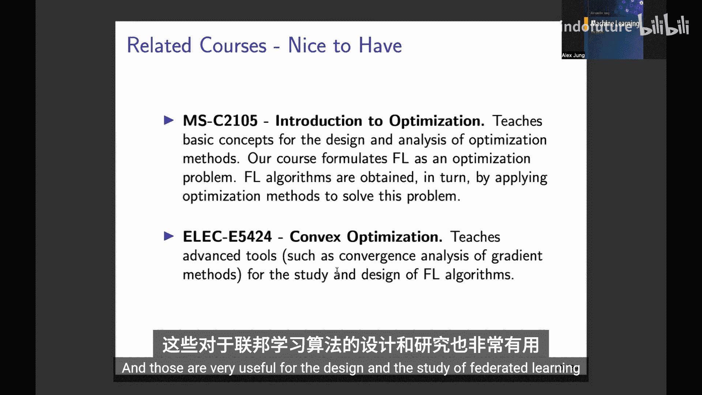
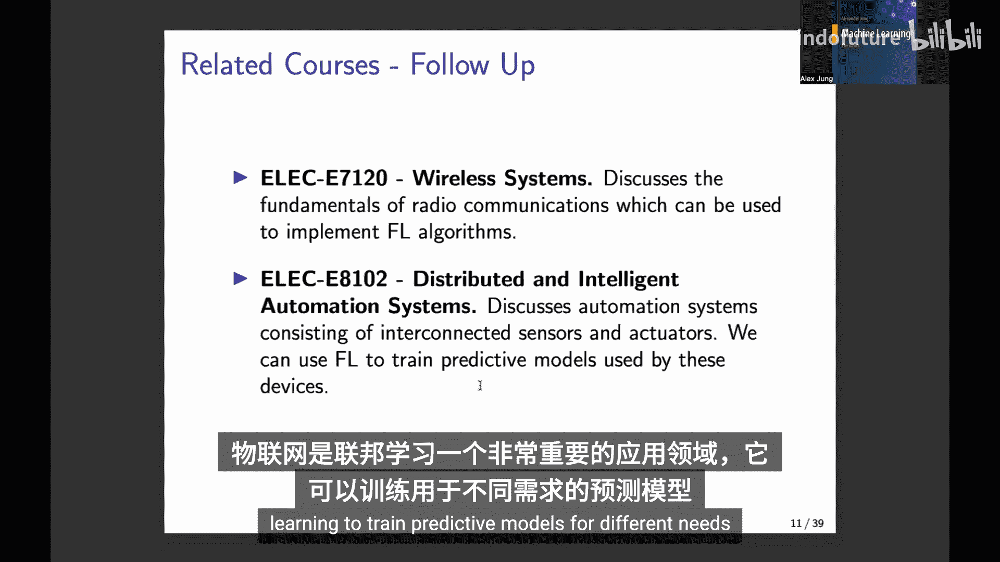

# 004：课程定位与相关课程 📚

在本节课中，我们将了解《联邦学习》这门课程在整个机器学习课程体系中的定位，并梳理其先修课程与后续相关课程。这有助于你明确学习路径，并为深入理解联邦学习内容做好准备。

---

## 课程定位

上一节我们介绍了联邦学习的基本概念，本节中我们来看看这门课程在更广泛的机器学习课程体系中的位置。

以下是在阿尔托大学或赫尔辛基大学开设的一些示例课程，其他大学或在线平台也很可能提供类似的课程。

---

## 先修课程 🧱

要顺利学习本课程，你需要具备一些基础知识。以下是必要的先修知识：

*   **线性代数/矩阵代数**：我们假设你熟悉矩阵的基本性质、矩阵的合成以及矩阵的特征值分解。这些知识将在课程中频繁使用。例如，我们可能会用到矩阵乘法公式：`C = A * B`。
*   **机器学习入门**：你应该了解如何训练和验证一个模型。了解一些正则化技术也会很有帮助。
*   **应用机器学习或Python数据分析**：如果你曾学习过使用Python进行应用机器学习或数据分析的课程，将会非常有帮助。即使没有，只要你能够快速适应并学习Python中的新方法，也不会有太大问题。

---

## 推荐课程（非必需但有益）✨

在掌握了必要的基础后，以下课程虽然不是强制要求，但能让你在本课程中学习得更深入、更轻松。

*   **优化导论**：本课程将联邦学习表述为一个优化问题。如果你学习过优化导论课程，对优化问题的基本构建模块有所了解，这将为你提供一个非常好的起点。如果没有，我们也会在需要时逐步介绍这些优化问题的构建模块。
*   **凸优化**：这门更高级的课程教授更先进的技术，例如研究不同梯度方法的收敛速率。这些技术对于联邦学习算法的设计与研究同样非常有用。

---

## 后续相关课程 🚀

学完本联邦学习课程后，你可以考虑以下相关领域的课程，以拓展知识面或深入特定应用。

*   **无线系统**：在某个阶段，我们需要将课程中讨论的联邦学习算法，通过物理通信网络（尤其是使用无线通信的移动网络）在硬件上实现。这门课程与此密切相关。
*   **分布式智能自动化系统**：物联网是联邦学习一个非常重要的应用领域，用于训练满足不同需求的预测模型。这门课程提供了深入探索该领域的机会。

---

## 总结

本节课中，我们一起梳理了《联邦学习》课程在整体课程体系中的定位。我们明确了必要的先修知识（如线性代数、机器学习基础），了解了有益的推荐课程（如优化理论），并展望了可能的后续学习方向（如无线系统、物联网）。这为你规划学习路径和充分准备本课程内容提供了清晰的指引。