# 005：课程大纲与安排 📋

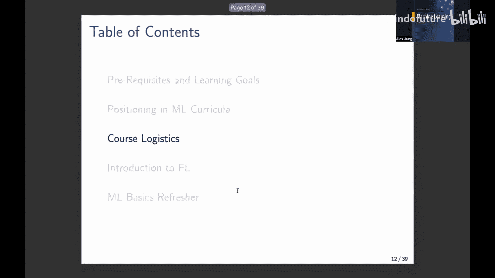

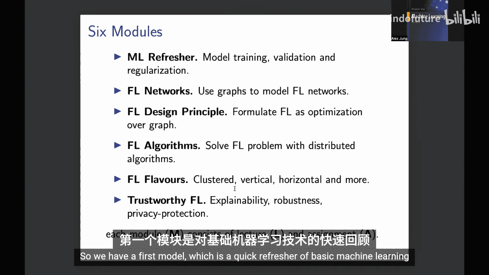

在本节课中，我们将详细介绍《联邦学习》课程的整体结构、学习模块、考核方式以及重要的时间安排和课程规则。通过本节内容，你将清晰地了解整个学期的学习路径和需要完成的任务。

## 课程模块概览 🧩

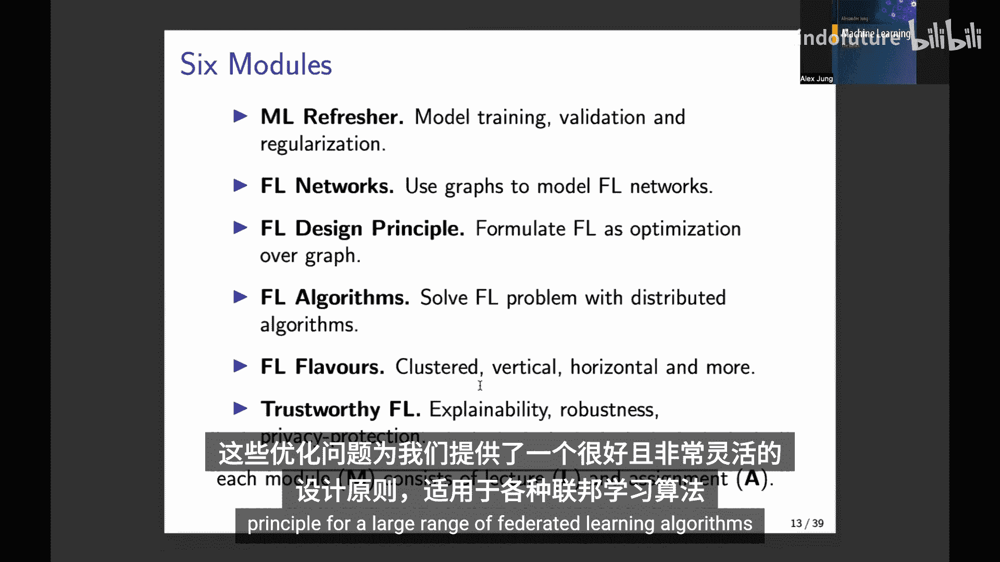

本课程内容主要分为六个核心模块，它们构成了从基础到高级的完整知识体系。

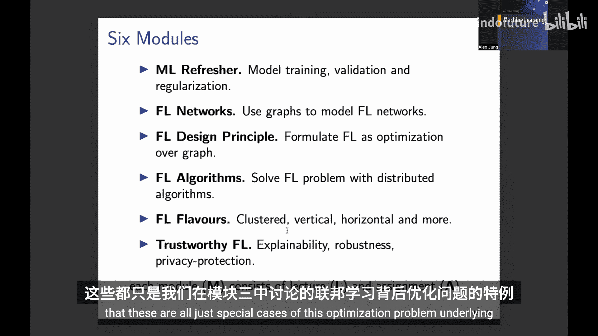

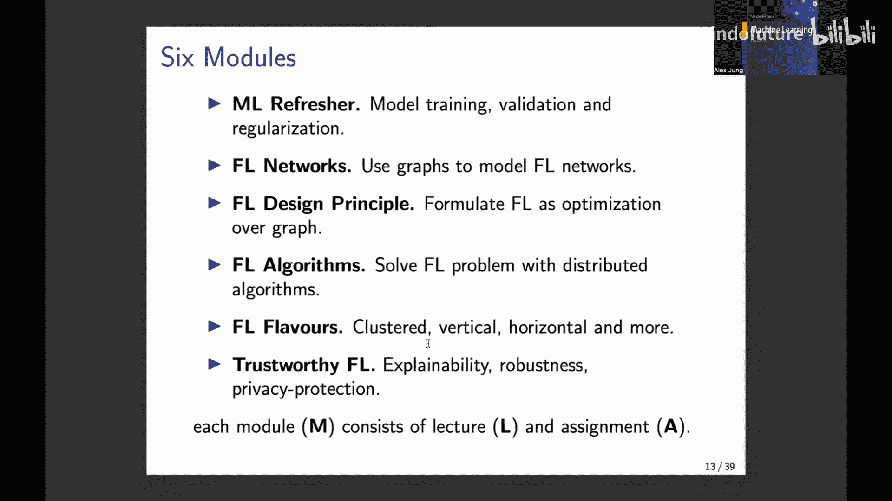

上一节我们介绍了课程的基本背景，本节中我们来看看课程的具体内容是如何组织的。

### 模块一：机器学习基础回顾 🔄
第一个模块是对基础机器学习技术的快速回顾，特别是**模型训练、验证和正则化**。这为后续学习联邦学习打下坚实的理论基础。

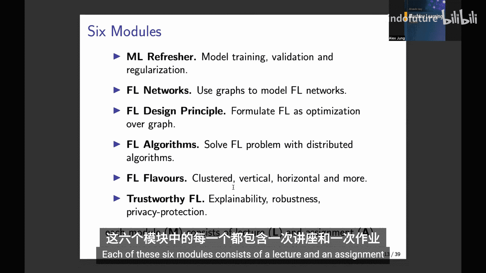

### 模块二：联邦学习网络介绍 🌐
第二个模块将介绍网络模型。我们将使用**无向图**来表示联邦学习网络。这是理解联邦学习系统通信和协作方式的关键。

### 模块三：联邦学习的优化问题建模 ⚙️
在第三个模块中，我们将利用这些联邦学习网络，在其上**构建优化问题**。这些优化问题为我们设计广泛的联邦学习算法提供了一个非常灵活的原则。

### 模块四：联邦学习算法设计 🧠
基于模块三的优化问题，我们将在模块四中看到，联邦学习算法可以通过应用优化方法来解决联邦学习底层的优化问题，从而以一种**有原则的方式**获得。

### 模块五：联邦学习的变体 🔀
在模块五中，我们将探讨不同的联邦学习类型，例如**聚类联邦学习、纵向联邦学习和横向联邦学习**。我们将看到，这些都是我们在模块三中讨论的联邦学习底层优化问题的**特例**。

### 模块六：可信联邦学习 🛡️
最后一个模块建立在所有先前技术之上，内容是关于**可信联邦学习**。我们将学习如何衡量或确保联邦学习方法的可解释性，研究其鲁棒性（例如抵御数据投毒攻击），并学习不同的措施和方法来确保联邦学习方法的**隐私保护**。

每个模块都包含讲座和一项作业。

## 考核活动与评分 📝

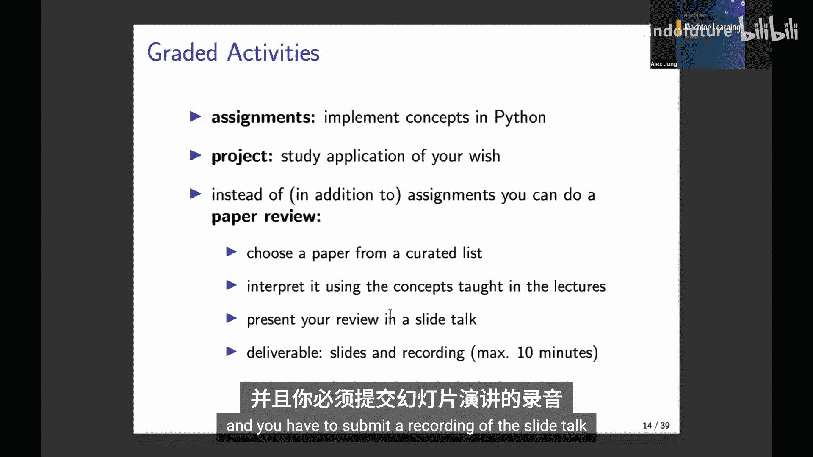

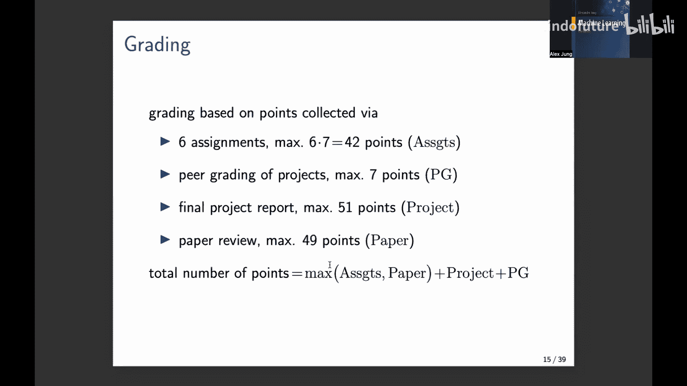

本课程的评分基于以下三项主要活动。以下是各项活动的具体说明：

### 1. 编程作业
共有六项作业，每个模块对应一项。在每项作业中，你需要使用Python实现讲座中提到的概念。这是一种通过实践学习的好方法。

### 2. 学生项目
学生项目是第二项主要活动。你可以将讲座中学到的技术应用到你希望研究的任何应用领域。这是一个**个人项目**，你可以完全自由地选择想要研究的联邦学习应用场景。

### 3. 论文评述
第三项活动是论文评述，可以作为编程作业的替代或补充。这项活动面向希望深入了解联邦学习前沿的更高级学生。你需要从提供的列表中选择一篇论文（也欢迎你提出建议），然后根据讲座中教授的概念来解读这篇论文。

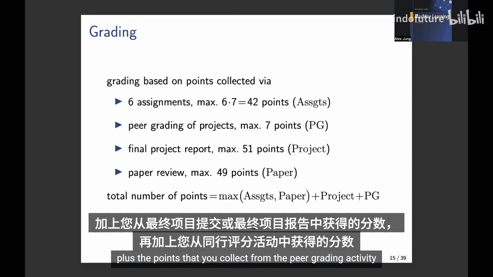

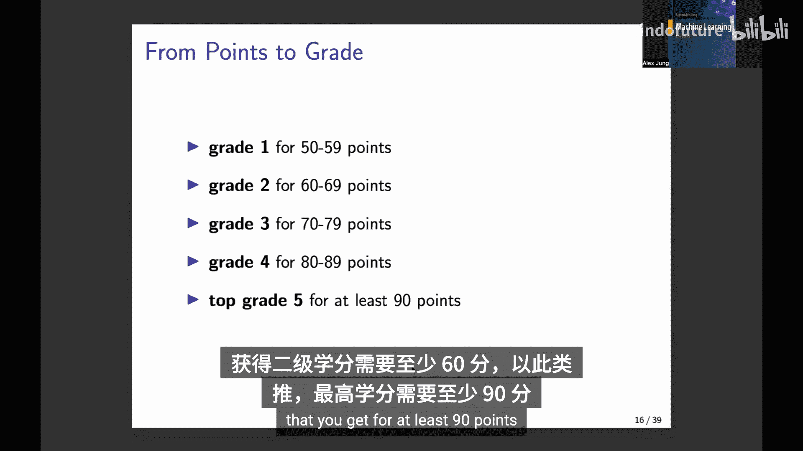

例如，我们教你如何将联邦学习表述为一个优化问题，那么在你的评述中，你就需要告诉我们这篇论文中使用或研究的是该优化问题的哪个具体实例。

这项活动的交付成果是一个**演示文稿**。你需要用幻灯片进行讲解，并提交一段不超过10分钟的录制视频。

## 评分细则与等级划分 📊

在你从上述不同考核活动中获得分数后，我们将按照以下方案进行汇总：

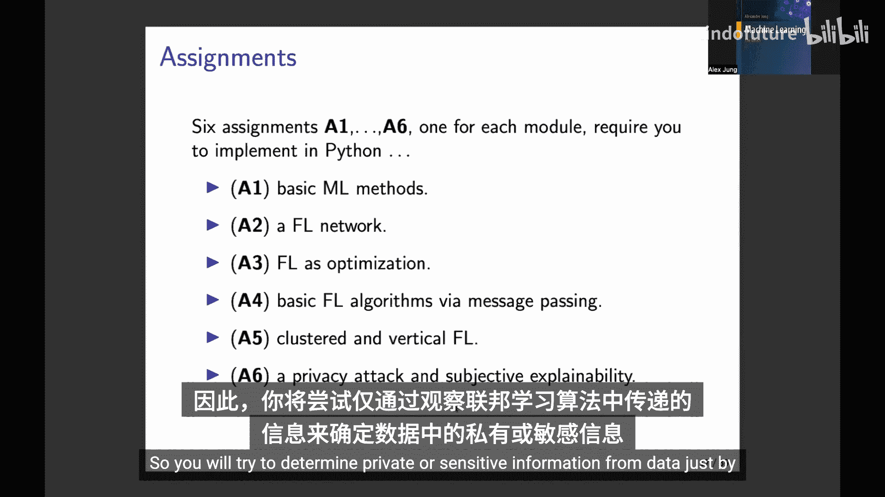

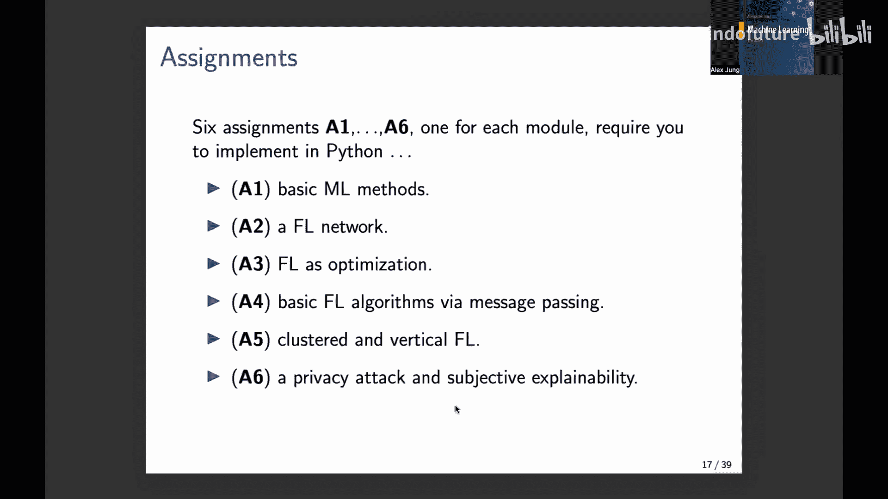

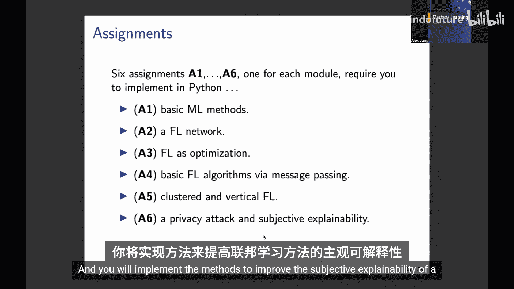

以下是各项活动的最高分：
*   每项作业最高**7分**，六项作业总计最高**42分**。
*   项目同伴互评最高**7分**。
*   个人最终项目报告最高**51分**。
*   论文评述最高**49分**。

论文评述的分数将与作业分数按以下公式结合：
**课程总得分 = max(作业总得分， 论文评述得分) + 最终项目报告得分 + 同伴互评得分**

最后，我们将根据总得分划分等级：
*   **等级1**：至少50分
*   **等级2**：至少60分
*   **等级3**：至少70分
*   **等级4**：至少80分
*   **等级5**：至少90分

## 作业内容详解 💻

如前所述，我们有六项作业。以下是各项作业的核心任务：

*   **作业1**：实现基础的机器学习方法（对许多同学来说是复习）。
*   **作业2**：使用名为 **`networkx`** 的Python包实现一个联邦学习网络。
*   **作业3**：在Python中实现联邦学习底层的优化问题。
*   **作业4**：使用联邦学习算法在Python中求解该优化问题。
*   **作业5**：实现聚类和纵向联邦学习方法。
*   **作业6**：研究或实现一种隐私攻击（例如，尝试仅通过观察联邦学习算法中传递的消息来确定私有或敏感信息），并实现提高联邦学习方法可解释性的方法。

## 学生项目流程 📑

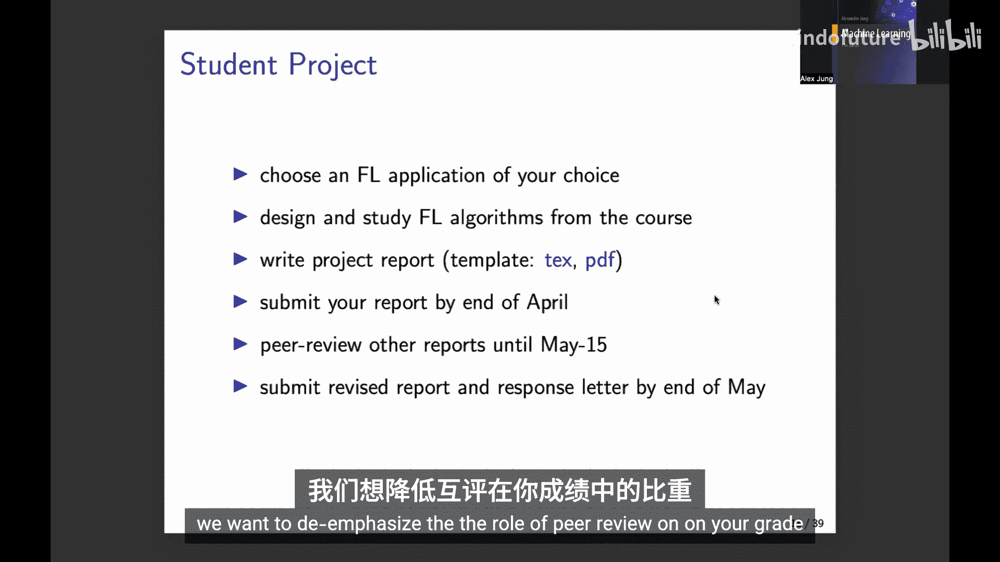

对于学生项目，你需要选择任何你感兴趣的应用方向。唯一的要求是必须使用讲座中讨论的联邦学习算法。

以下是项目的主要步骤：
1.  **撰写报告**：你需要撰写一份项目报告。我们将提供一个报告模板，其结构基本固定，包括背景介绍、方法描述、数值实验与结果分析等标准部分。
2.  **初稿提交**：报告初稿需在**四月底前**提交。
3.  **同伴互评**：初稿提交后，将有大约两周的同伴评审期。每位同学需要评审一定数量（约3-5份）的其他同学的报告。
4.  **终稿提交**：项目需要提交最终版本。你必须在**五月底前**提交修订后的最终报告以及一份回应信，在回应信中需明确解释你如何考虑了其他同学给出的反馈。

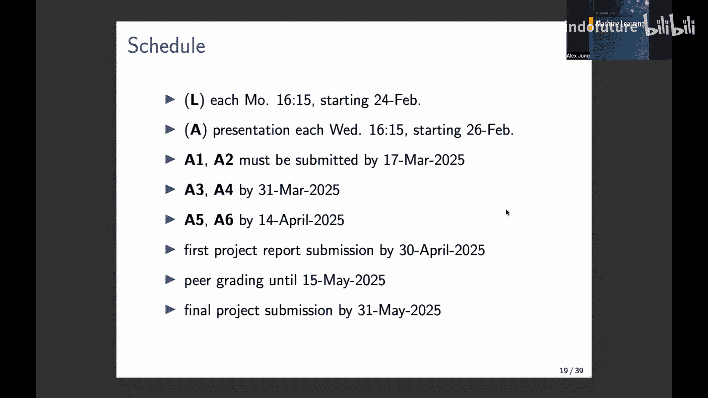

我们根据你的最终提交（包括修订后的项目报告和回应信）来为你的项目评分。如前所述，你也会通过同伴评审任务获得少量分数。

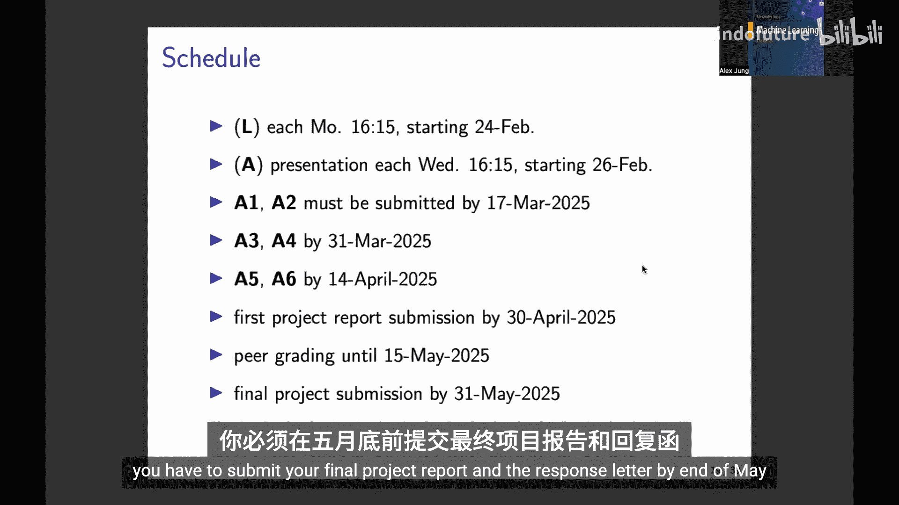

## 课程时间表 🗓️

以下是本课程的重要时间节点：

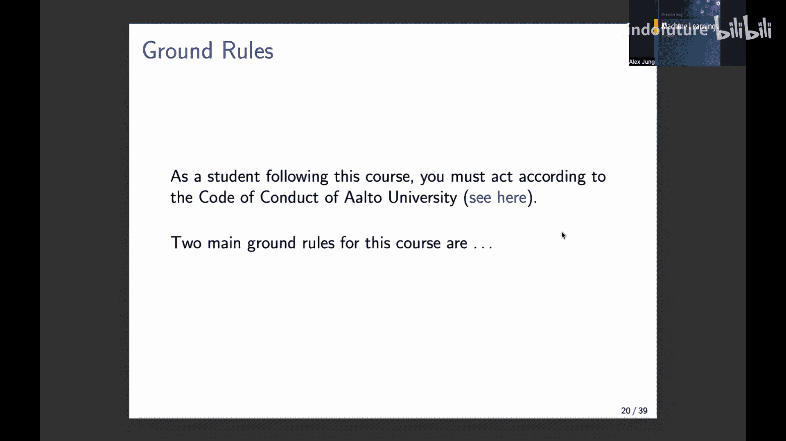

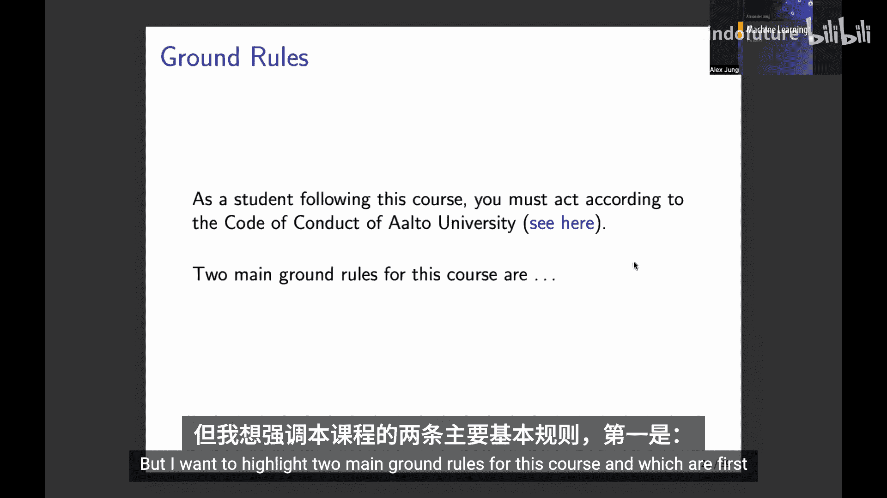

*   **讲座**：每周一16:15开始，共六讲，从2月24日开始。
*   **作业讲解**：每次讲座后的周三16:15，进行对应作业的讲解，从2月26日开始。
*   **作业提交截止日期**：
    *   作业1和2：3月17日
    *   作业3和4：3月底
    *   作业5和6：4月14日
*   **项目时间节点**：
    *   项目报告初稿：4月底
    *   同伴评审期：截至5月15日
    *   项目终稿及回应信：5月底

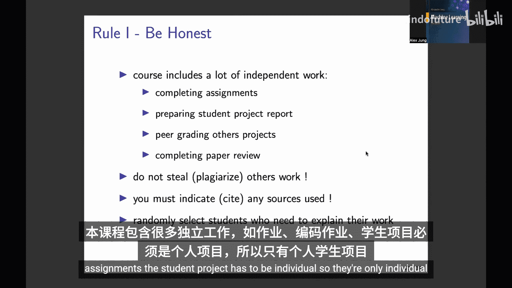

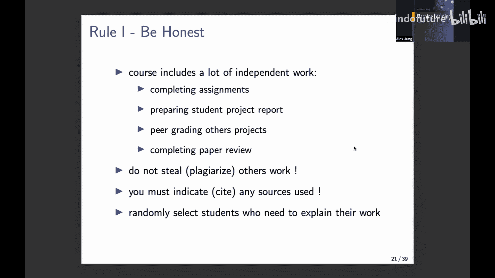

## 课程基本规则 ⚖️

最后，我想强调本课程的两条主要基本规则：

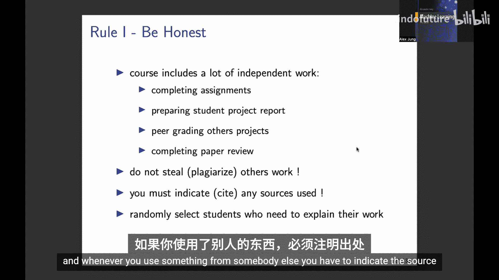

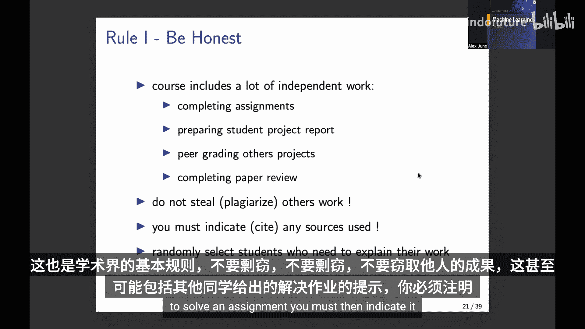

### 1. 诚实守信
本课程包含大量独立工作，如编程作业、个人学生项目和论文评述。我们默认信任你会独立完成。**严禁抄袭**。无论何时使用了他人成果（包括其他同学提供的解题思路），都必须注明来源。为了核查，我们可能会在课程期间或结束时随机抽取学生，要求其详细解释任何已提交的作业或报告。如果我们认为你并不了解自己的解决方案，将考虑采取纪律措施。

### 2. 相互尊重
我个人的期望是，本课程能为每位参与者提供一个安全、愉快的学习空间。任何形式的不尊重行为，包括在课程相关交流平台上的不当言行，都将受到严肃处理，包括向大学当局报告。

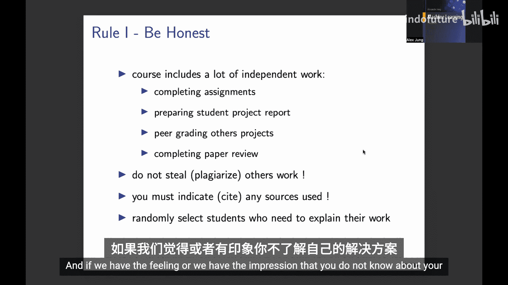

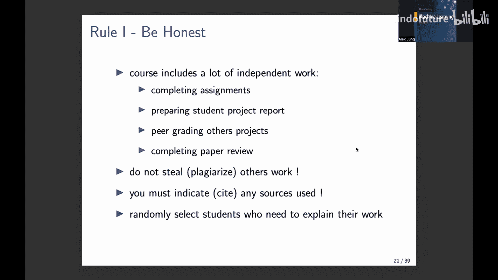

---

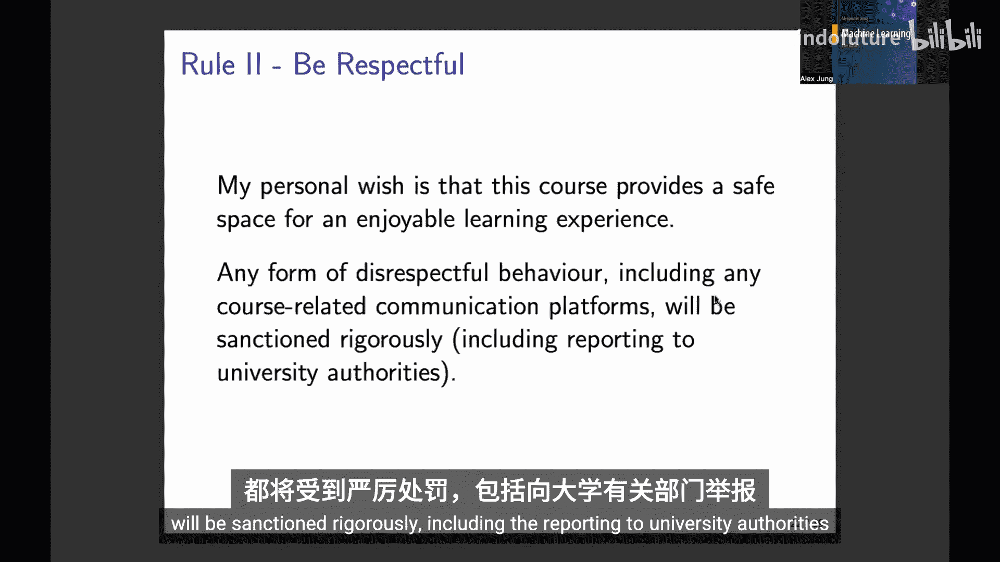

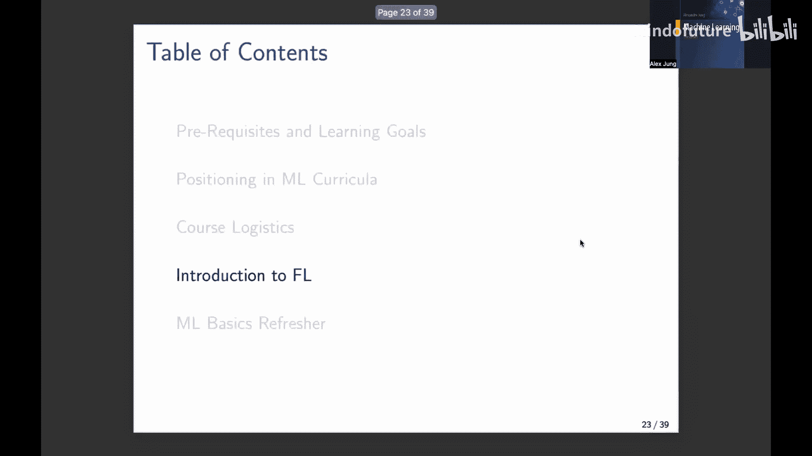

本节课中我们一起学习了《联邦学习》课程的整体框架，包括六个核心知识模块、三种考核方式（作业、项目和论文评述）及其详细的评分标准。我们还明确了各项任务的时间安排，并强调了诚实与尊重这两条至关重要的课程规则。理解这些信息将帮助你更好地规划整个学期的学习。