# 006：联邦学习应用

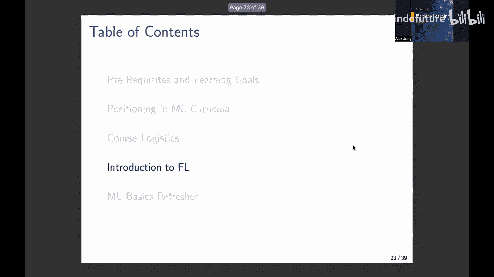

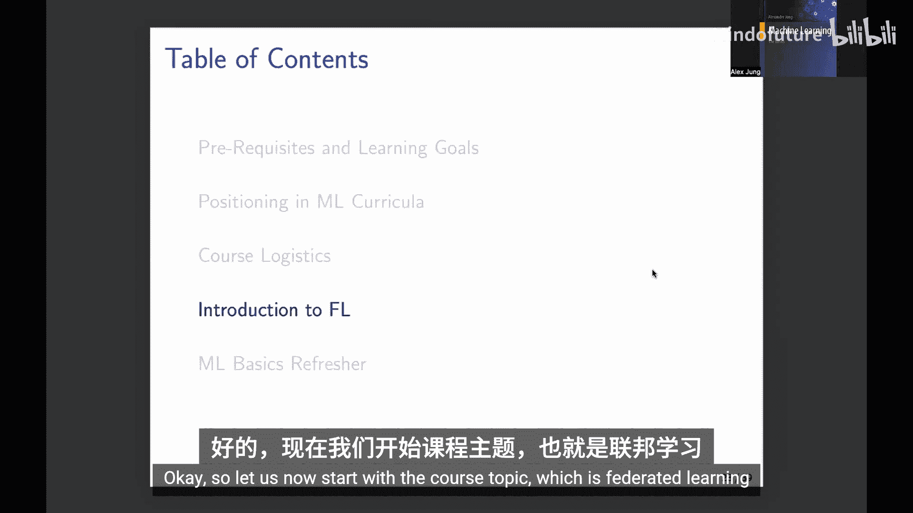

在本节课中，我们将要学习联邦学习的基本概念及其核心特征，并探讨其在多个领域中的实际应用案例。

## 什么是联邦学习？🤔

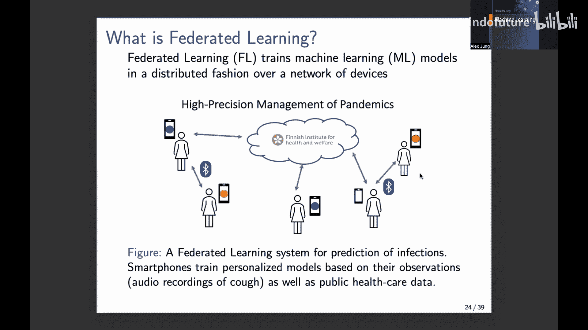

联邦学习是一种在设备网络上以分布式方式训练机器学习模型的方法。

上一节我们介绍了联邦学习的定义，本节中我们来看看一个具体的应用示例。

下图展示了一个联邦学习的应用实例：高精度疫情管理。在新冠疫情期间，一个挑战是如何找到隔离人员或限制人员流动的最佳方式。一种可能的解决方案是使用运行联邦学习算法的智能手机应用，为用户提供“今天是否适合外出”的最优预测。如果预测结果为“绿色”，则表示安全；如果为“红色”，则表示不安全，类似于天气预报。

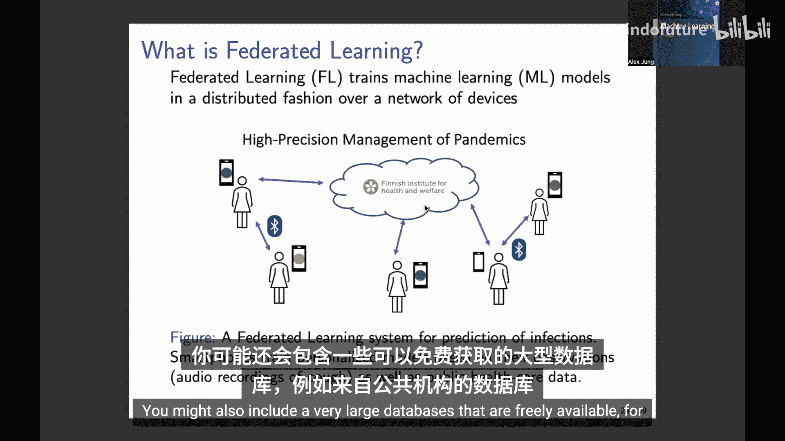

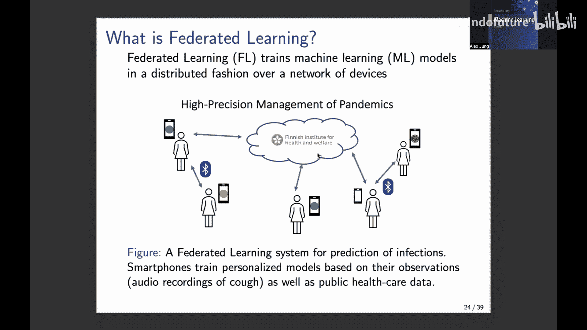

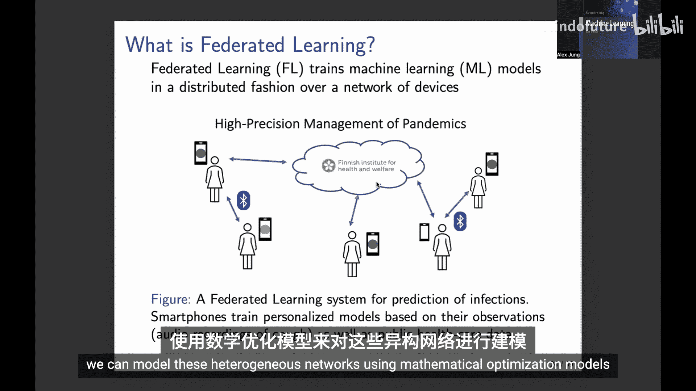

在这个联邦学习系统中，每个设备（即每部智能手机）都训练自己的模型，为用户提供个性化的预测。为了学习如何进行这些预测，这些联邦学习组件会相互协作。用户可以利用来自其他用户或其他潜在患者的一点信息，来为自己获得更好的模型。系统也可能整合来自公共机构等来源的大型公开数据库。联邦学习通常可以涉及不同类型的设备，即异构网络，我们将在后续课程中学习如何使用数学优化模型来建模这些异构网络。

## 联邦学习的核心特征 🔑

上一节我们看了一个应用示例，本节中我们来深入了解联邦学习的关键特征。

以下是联邦学习的几个核心特征：

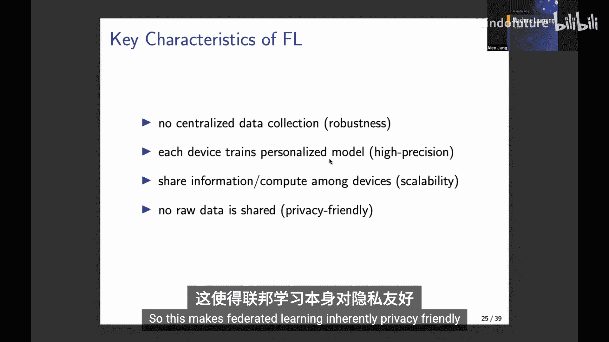

*   **去中心化与鲁棒性**：联邦学习不一定需要集中式的数据收集，这使其具有鲁棒性。在集中式服务器存储所有数据的模式下，服务器是单点故障。一旦数据存储被破坏，所有数据都会丢失。而在联邦学习中，信息和知识分布在数百万甚至数十亿个节点上。
*   **个性化模型**：每个设备训练一个个性化模型，这是实现个性化的自然方式。为每个独立用户或设备训练的模型，其精确度或准确性远高于一个平均模型。例如，预测一次自行车骑行需要多长时间，你会希望得到一个根据你的体能水平和自行车状况定制的预测，而不是一个平均预测。
*   **协作方法**：联邦学习具有协作性，它在设备间共享信息和计算能力。其他设备进行一些计算，这些计算的结果可以以某种形式发送回来，帮助我获得更好的模型。这些计算结果也承载着信息。因此，我们不仅分散了计算负担，还从其他节点共享或收集信息。
*   **可扩展性**：协作使得联邦学习能够解决比任何单一设备（如一部智能手机）独自处理时规模大得多的机器学习问题。
*   **隐私友好**：通常，联邦学习不共享原始数据。在典型的联邦学习系统中，我们不交换图像等原始数据，只共享一些汇总统计量或机器学习算法完成的计算结果。这些共享的结果所携带的关于私有属性或敏感数据的信息，远少于原始数据，这使得联邦学习天生具有隐私友好性。

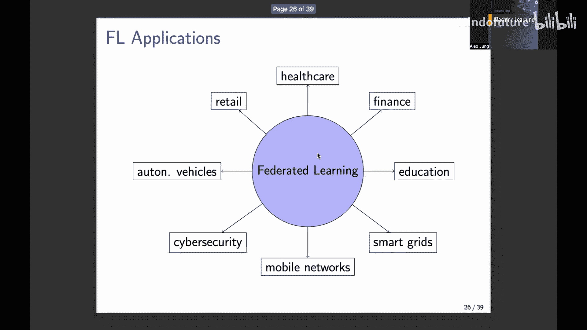

## 联邦学习的应用领域 🏥💳⚡

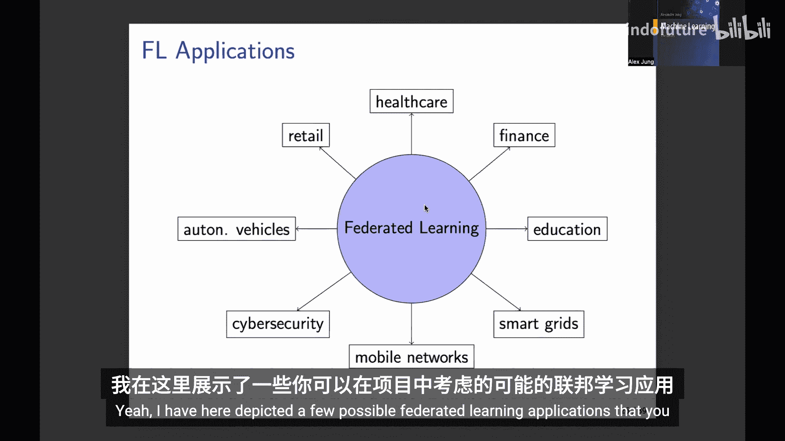

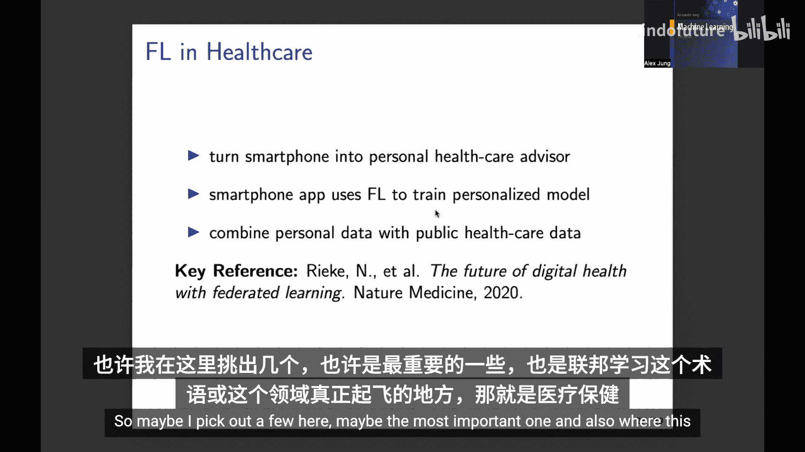

了解了联邦学习的特征后，本节我们来看看它的一些潜在应用领域。下图展示了一些可能在你的项目中考虑的联邦学习应用。

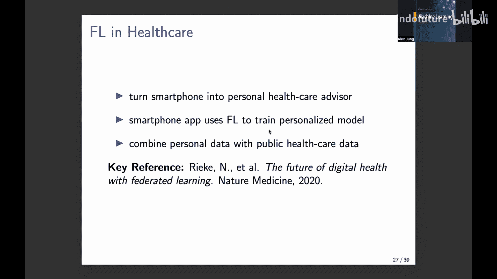

以下是几个重要的应用领域：

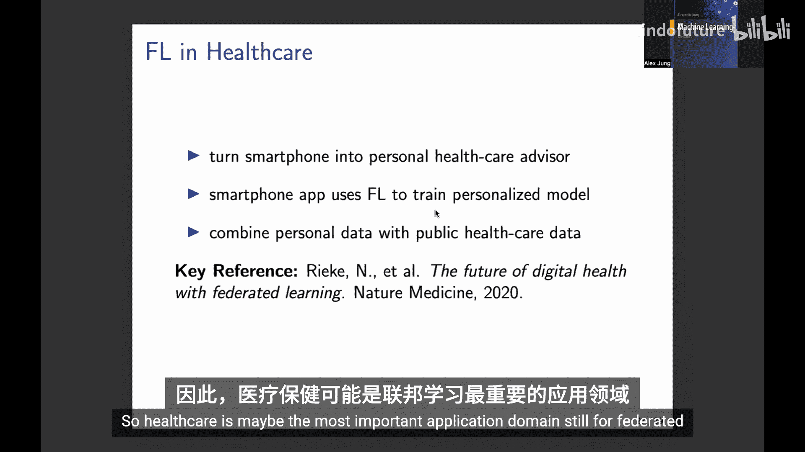

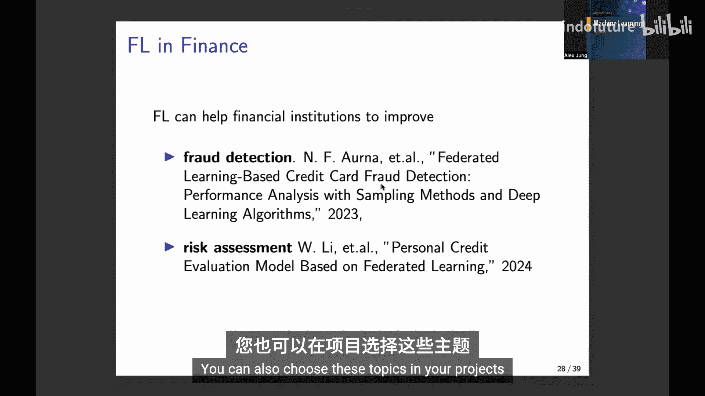

*   **医疗保健**：这可能是联邦学习最重要且真正兴起的领域。医疗保健领域有非常严格的隐私法规，人们不希望个人健康记录被随意共享。然而，人们可能愿意分享健康记录中包含的信息，以训练更好的疾病预测模型。联邦学习的要求与医疗保健领域的需求完全吻合：存在大量敏感且受保护的原始数据（如健康记录），无法轻易共享；但每位医生拥有的患者数据库蕴含着大量信息，可用于为每个人获得更好的预测模型或治疗建议。你可以在论文列表中找到相关的最新参考文献，用于论文评述或项目选题。
*   **金融**：联邦学习技术也出现在金融领域，用于改进欺诈检测或风险评估。
*   **智能电网**：另一个日益受到关注的新兴应用领域是智能电网。电力供应越来越以异构网络的形式存在，例如许多人拥有自己的风力涡轮机或太阳能电池板。以太阳能电池板为例，用户可能想知道启动洗衣机的最佳时间，以确保在接下来的一两个小时内仍有阳光。如果突然多云，太阳能电池板就无法提供足够的电力，用户将不得不从传统电网获取成本更高的能源。为此，用户可能希望有一个联邦学习应用，为其房屋所在区域提供未来两小时内是否有阳光的高精度预测。联邦学习或许能够实现这一点。

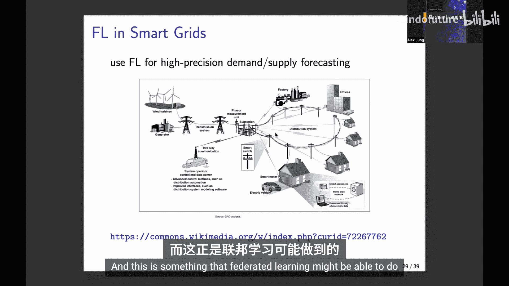

## 总结 📝

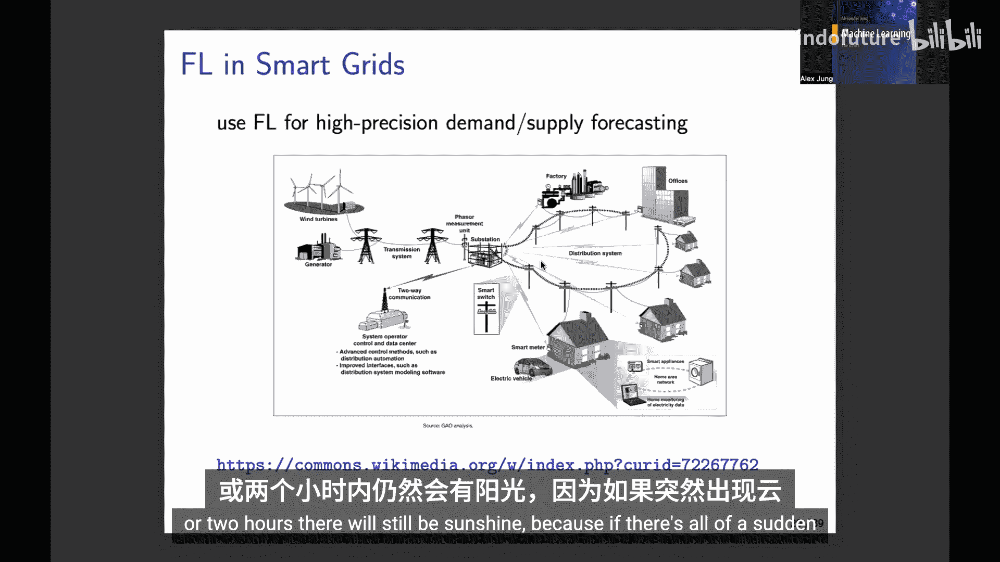

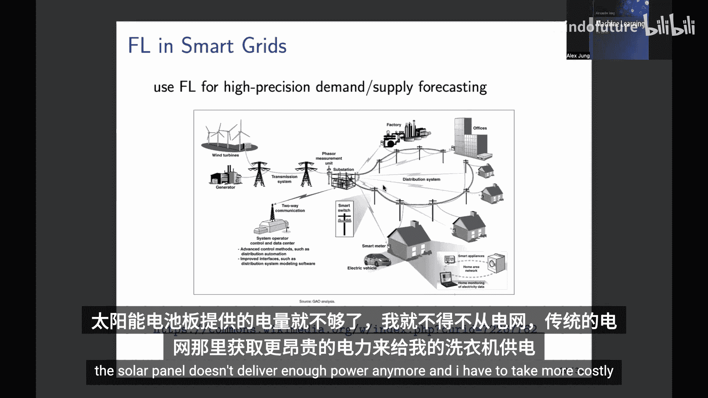

本节课中我们一起学习了联邦学习的基本概念。我们了解到联邦学习是一种分布式机器学习方法，其核心特征包括去中心化、个性化、协作性、可扩展性和隐私友好性。我们还探讨了联邦学习在医疗保健、金融和智能电网等多个领域的实际应用案例，这些案例展示了联邦学习在保护隐私的同时利用分散数据价值的巨大潜力。