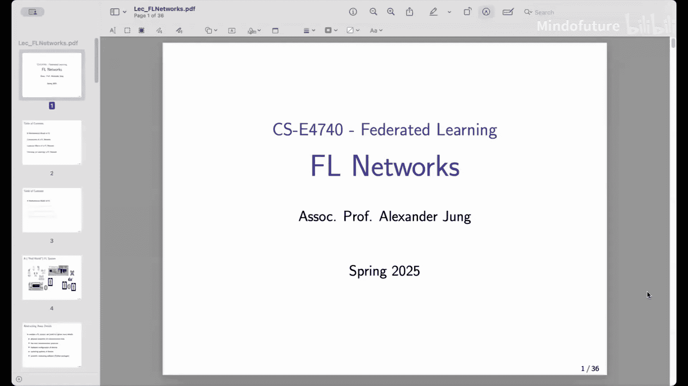
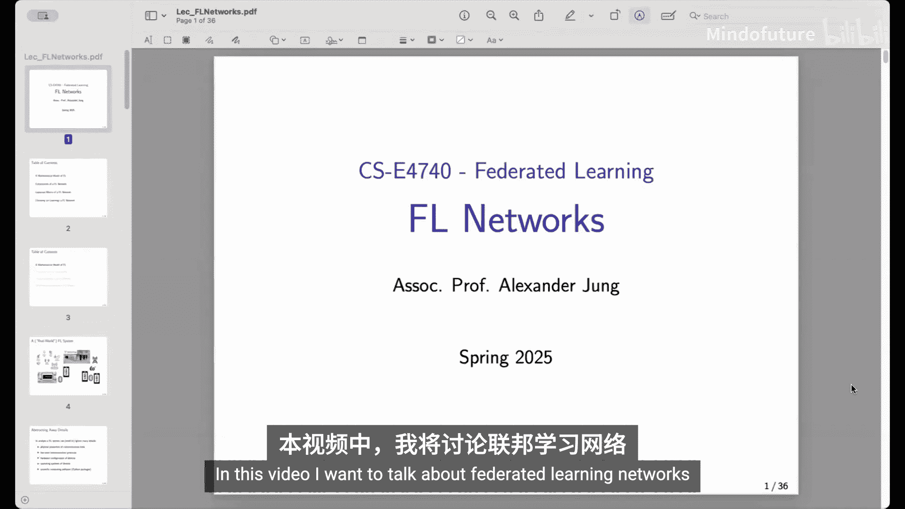
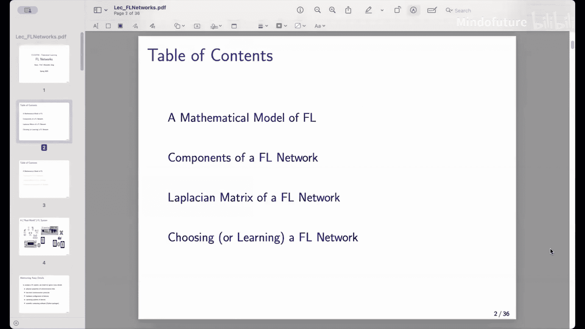
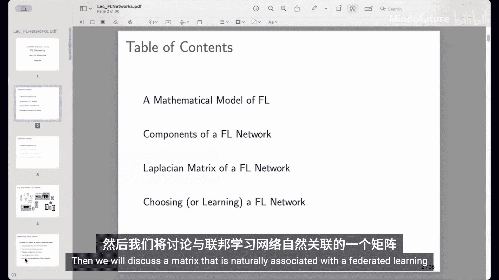
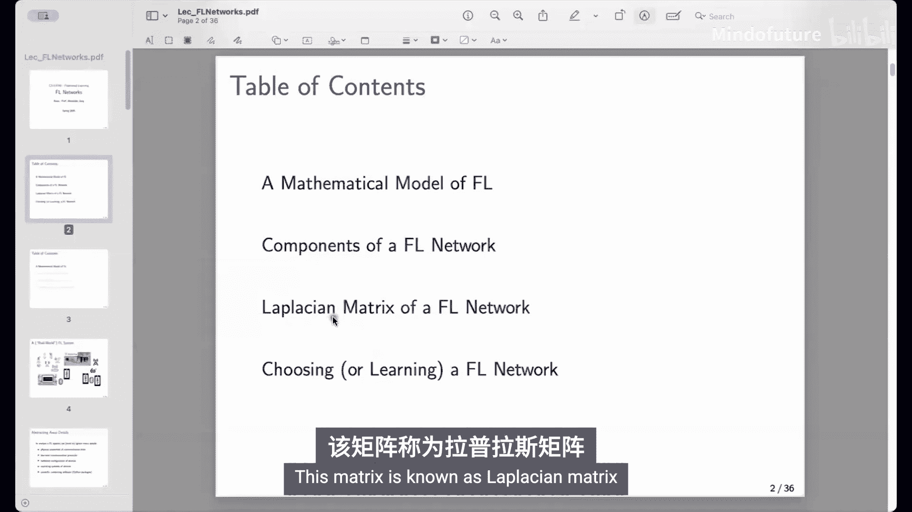
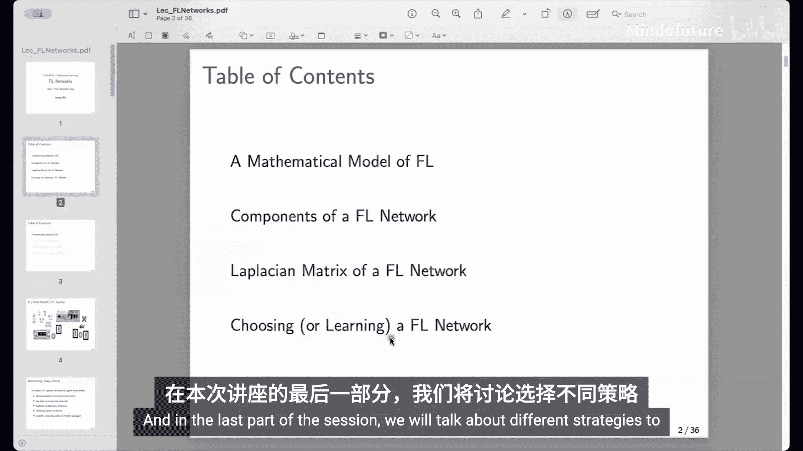
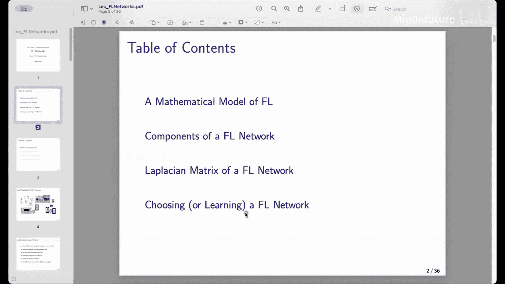

联邦学习：P09：联邦学习网络简介 🕸️

在本节课中，我们将学习联邦学习网络。联邦学习网络是描述联邦学习应用和系统的主要数学模型。我们将讨论联邦学习网络的组成部分，介绍与之相关的拉普拉斯矩阵，并探讨选择和构建联邦学习网络的不同策略。

---

### 联邦学习网络的组成部分

上一节我们介绍了课程主题，本节中我们来看看联邦学习网络的具体构成。一个联邦学习网络由多个参与方（例如设备或组织）以及它们之间的连接关系构成。

以下是联邦学习网络的核心组成部分：

*   **节点**：代表参与联邦学习的各个实体，例如移动设备、数据中心或组织。每个节点 `i` 拥有自己的本地数据集 `D_i`。
*   **边**：代表节点之间的通信连接或协作关系。如果节点 `i` 和节点 `j` 之间存在一条边，意味着它们可以直接交换模型更新信息。
*   **邻接矩阵**：这是一个数学工具，用于形式化描述网络中节点之间的连接关系。对于一个有 `n` 个节点的网络，其邻接矩阵 `A` 是一个 `n x n` 的矩阵。如果节点 `i` 和节点 `j` 相连，则矩阵元素 `A_{ij} = 1`，否则 `A_{ij} = 0`。公式表示为：
    `A_{ij} = 1` 如果 `(i, j)` 是边，否则 `A_{ij} = 0`

---

### 拉普拉斯矩阵

了解了网络的基本构成后，我们需要一个更强大的数学工具来分析网络的整体性质，这就是拉普拉斯矩阵。

拉普拉斯矩阵 `L` 可以从邻接矩阵 `A` 和度矩阵 `D` 推导得出。度矩阵 `D` 是一个对角矩阵，其对角线元素 `D_{ii}` 表示与节点 `i` 相连的边的数量（即节点的度）。拉普拉斯矩阵的定义为：
`L = D - A`

这个矩阵在联邦学习中至关重要，因为它编码了网络的连接结构，并可用于分析信息传播的效率、网络的连通性以及设计去中心化的优化算法。

---

### 网络选择与学习策略

最后，我们探讨如何为联邦学习任务选择合适的网络结构。网络结构直接影响通信成本、学习效率和隐私保护程度。

以下是几种常见的网络构建策略：

*   **中心化星型网络**：所有节点只与一个中心服务器通信。这是最经典的联邦学习设置，通信简单，但服务器可能成为瓶颈。
*   **去中心化对等网络**：节点只与相邻的少数节点通信。这种结构更健壮，通信负载分散，但协调和收敛可能更复杂。
*   **基于任务需求设计**：根据数据分布、设备能力或隐私要求，手动设计特定的网络拓扑。
*   **动态学习网络**：网络结构本身也可以在联邦学习过程中进行优化或自适应调整，以提升整体性能。

---

本节课中我们一起学习了联邦学习网络的基础知识。我们首先了解了其基本组成部分——节点和边，并通过邻接矩阵进行形式化描述。接着，我们引入了关键的拉普拉斯矩阵 `L = D - A` 作为分析网络性质的工具。最后，我们概述了从集中式到分布式，再到动态自适应的多种网络构建策略。理解这些概念是设计和分析高效、鲁棒联邦学习系统的重要基础。