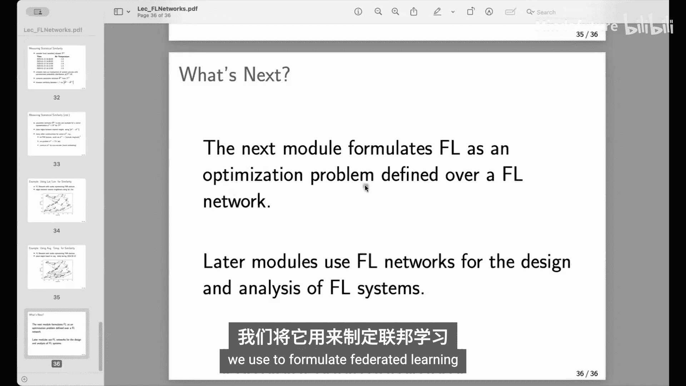

# 017：联邦学习网络的设计与构建 🧠

在本节课中，我们将探讨如何为一个给定的联邦学习任务设计和构建网络。我们将通过一个具体的例子——芬兰气象研究所（FMI）的天气站网络——来理解设计决策背后的计算与统计考量。

上一节我们介绍了联邦学习网络的性质，特别是拉普拉斯矩阵及其谱（特征值集合）的重要性。本节中，我们来看看如何实际构建一个联邦学习网络。

## 网络构建：一个设计选择

构建联邦学习网络在某种程度上是一个设计选择。我们需要决定如何选择网络中的节点以及如何连接它们。

以下是一个使用芬兰气象研究所（FMI）天气站数据的具体例子。FMI在全芬兰运营着超过200个气象站，我们可以获取其观测数据。我的第一个设计决策是选择一个子集的气象站作为联邦学习网络的节点。

## 如何连接节点：添加边的影响

接下来的核心问题是：应该连接哪些节点？为了建立直觉，我们可以从系统的最小部分——一对节点——开始分析。

考虑两个不同的气象站 `i` 和 `i'`。在这两个节点之间添加一条边会产生两方面的影响。

### 计算方面的影响

添加边意味着联邦学习算法需要通过这条边交换消息或计算更新。这带来了计算和通信开销。

*   **增加开销**：每条边在算法的每次迭代中都会引入额外的通信和计算。
*   **影响收敛速度**：联邦学习算法通常是迭代式的。网络的连通性，特别是拉普拉斯矩阵的**第二小特征值 λ₂**，是算法收敛速度的关键驱动因素。**λ₂ 越大，算法通常收敛得越快**。
    *   对于一个完全断开的图，λ₂ 为0，算法无法收敛。
    *   对于一个完全连接的图，λ₂ 达到最大，每个节点在每次迭代中都能利用所有其他节点的信息，从而可能加速收敛。

因此，在计算方面存在一个权衡：添加边会增加单次迭代的开销，但也可能通过增大 λ₂ 来减少所需的总迭代次数。一个自然的设计目标是：**在给定总边数的情况下，通过合理放置边来最大化 λ₂**。

### 统计方面的影响

联邦学习算法通常利用节点间的连接作为正则化器。简单来说，一条边会**迫使相连两个节点的模型参数趋于相似**。

如果两个节点的本地数据集（例如天气观测数据）具有非常不同的统计分布，那么强制它们的模型相似可能不是一个好主意。因此，我们需要一种方法来衡量节点间的统计相似性。

## 衡量节点相似性的方法

如何判断两个气象站的统计特性是否相似？以下是几种可能的向量化表示方法，用于计算节点间的“距离”或相似度：

*   **概率模型参数**：将本地数据（如温度测量值）视为某个随机过程的实现。用一个参数化的概率模型（参数记为 **θ**）来描述其分布。通过统计推断方法（如最大似然估计）估计出 **θ̂**，然后使用 **||θ̂_i - θ̂_i‘||** 这样的范数作为相似性度量。
*   **领域知识（如地理位置）**：一个直观的想法是，地理位置相近的气象站应有相似的数据。可以使用经纬度坐标作为向量表示，连接地理上最近的节点。但这种方法可能并不总是准确。
*   **损失函数梯度**：为每个节点的本地数据定义一个损失函数。在某个模型参数 **w**（例如来自预训练模型）处计算该损失函数的梯度 **∇ℓ(w)**。这个梯度向量封装了本地数据的信息，可作为该节点的向量表示。
*   **嵌入学习**：使用更通用的方法，如自动编码器，为整个数据集学习一个嵌入向量。

在本课程中，我们不会深入探讨这些统计特性，但需要知道有多种方式可以定义节点间的相似性，而不同的定义会显著影响最终网络的拓扑结构。

## 网络构建实例对比

为了展示设计选择的影响，这里对比两个为FMI气象站构建的网络：

1.  **基于地理相似性（经纬度）的网络**：连接地理坐标最接近的气象站。得到的网络结构主要反映地理邻近性。
2.  **基于统计相似性（平均温度）的网络**：计算每个气象站在2024年5月中旬一段10小时内的平均气温，然后连接平均温度最接近的气象站。得到的网络结构与地理网络有根本不同。例如，一些沿海的气象站（如13、14、7、11号站）可能地理上不近，但由于都位于海岸线，气候和温度特征相似，因此在这个网络中会被连接起来。

这个例子清晰地展示了**如何衡量节点相似性并据此定义边，会深刻影响整个数学模型以及由此衍生的联邦学习算法的性质**。

## 总结与展望

本节课中，我们一起学习了联邦学习网络的设计与构建。我们了解到，添加边需要在**计算开销**与**收敛速度**之间进行权衡，并且需要考虑节点间数据的**统计相似性**。我们介绍了几种衡量节点相似性的方法，并通过FMI气象站的例子看到了不同设计选择如何导致截然不同的网络结构。

在下一讲中，我们将以此联邦学习网络为定义域，构建一个优化问题。这个优化问题将成为我们设计联邦学习算法的主要模型和原则，因为联邦学习算法本质上就是将现有的分布式优化方法应用于这个特定的优化问题。