# 022：作为电路的联邦学习

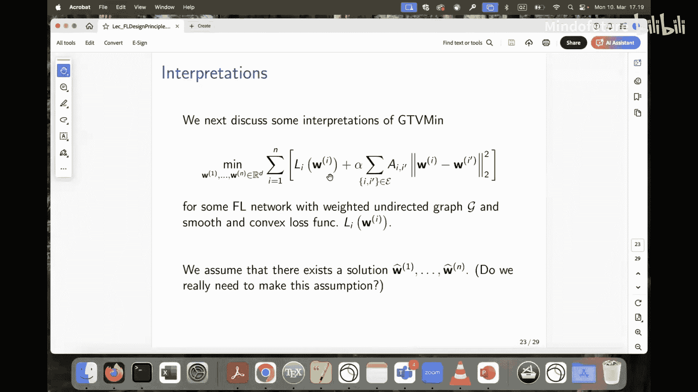

在本节课中，我们将学习如何将联邦学习问题类比为一个电路系统。我们将看到，在特定假设下，联邦学习网络的优化过程可以直观地通过电阻、电压和电流等电路概念来理解。

---

上一节我们介绍了联邦学习的基本框架，本节中我们来看看一个有趣的物理类比。

在特定的假设下，联邦学习网络可以被解释为一个电路。我们可以将联邦学习网络中的每一条边看作一个**电阻**。这个电阻连接在两个具有特定**电势**的节点之间。

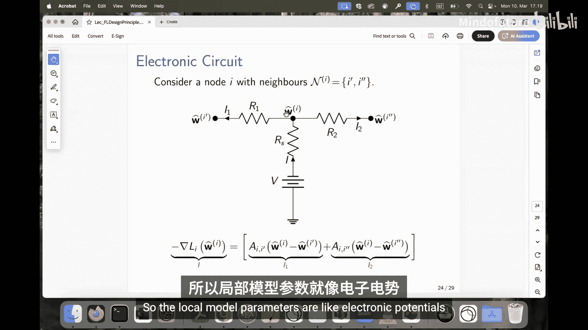

在这里，每个设备的本地模型参数 `θ_i` 就像是电路中的**电势**。

这些电势差会驱动电流流过电阻。这个抽象电流 `I_ij` 的值由边权重 `w_ij` 与本地模型参数之间的差值共同决定。

**电流公式：**
`I_ij = w_ij * (θ_i - θ_j)`

本地模型参数之间的差值就像是**电压**，它驱动着电流流过电阻。

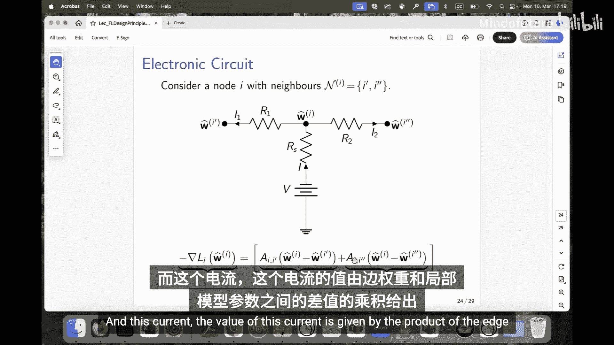

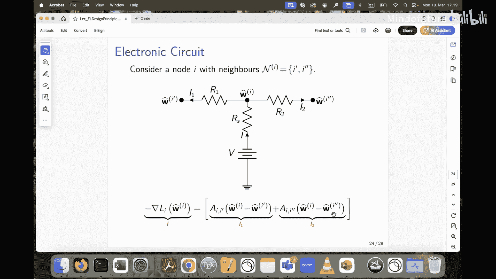

---

上一部分我们将边类比为电阻，接下来我们引入电路理论中的核心定律。

对于那些学习过电路理论的人，会熟悉**基尔霍夫电流定律**。该定律指出，流入一个节点的所有电流之和必须为零，即电流是守恒的。

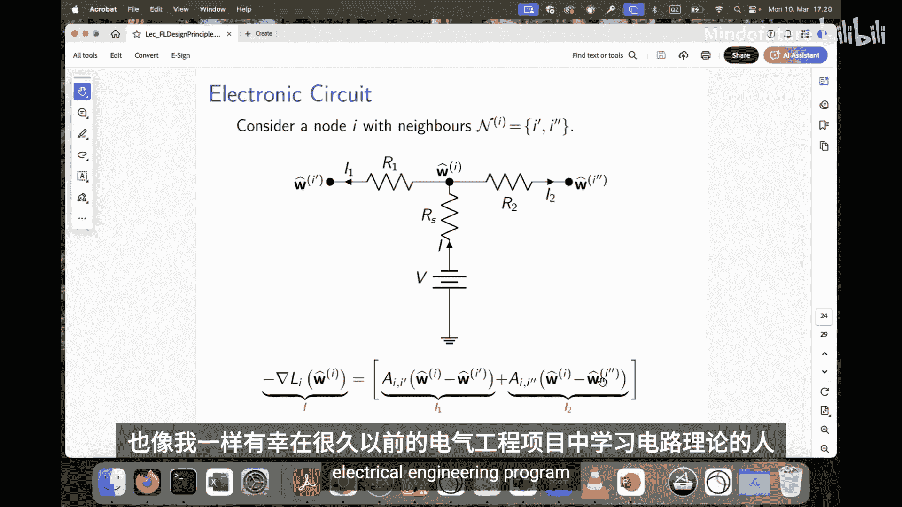

在联邦学习的电路类比中，流入一个节点的电流必须由另一个来源补偿。这个来源就是**损失函数**，或者更准确地说，是损失函数的梯度。

**节点电流平衡公式：**
`∑_j I_ij = ∇L_i(θ_i)`

损失函数的梯度在某种意义上就像是**电流发生器**，它们将电流“推入”电路网络。

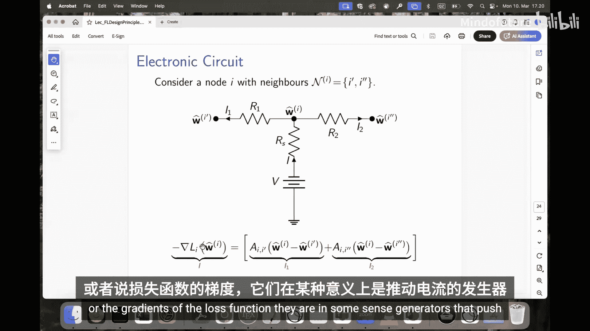

---

理解了电路类比的基本构成后，我们来看看这个类比为何有用。

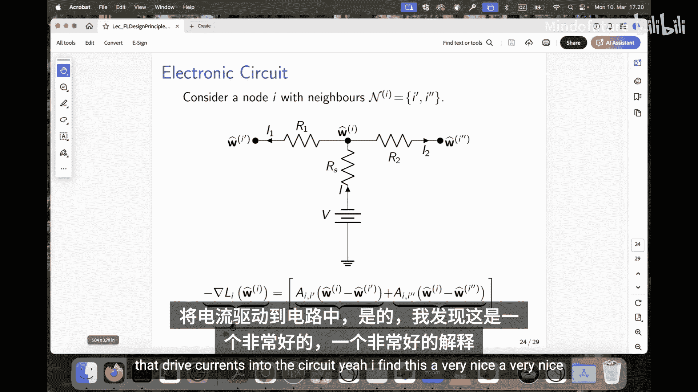

我认为这是一个非常精妙的解释，这源于我的电气工程背景。在我转型为机器学习专家之前，对此有深刻体会。

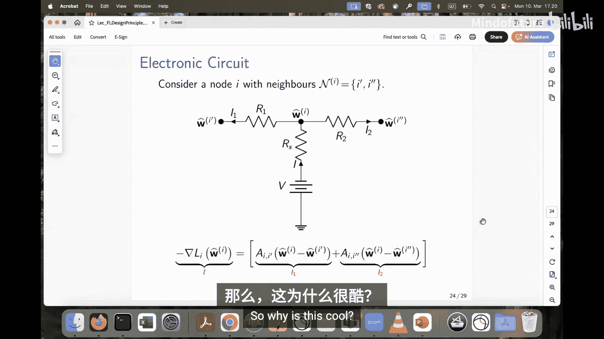

那么，这个类比酷在哪里？有人能想到吗？

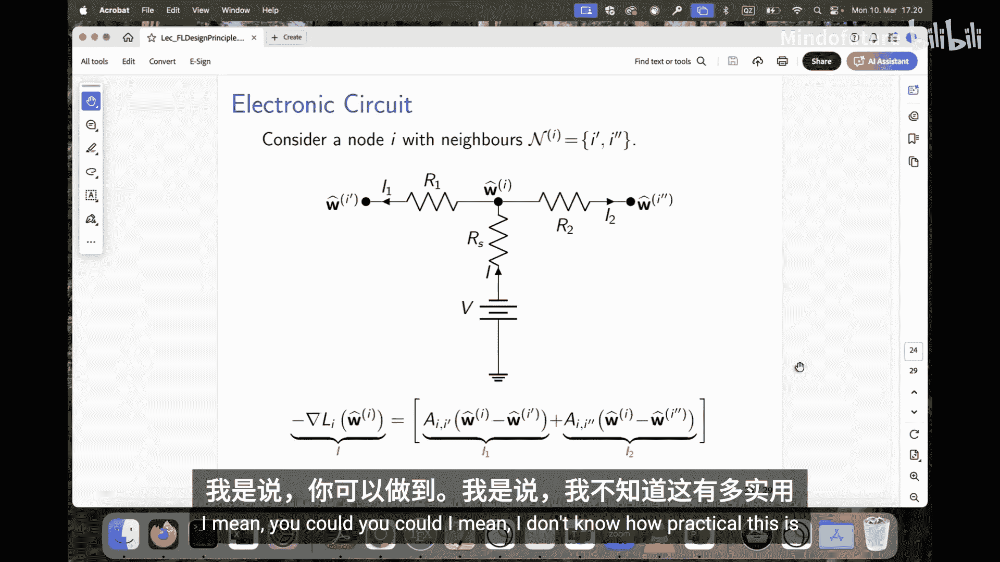

它的一个潜在应用是，我们可以通过构建真实的物理电路来求解优化问题。

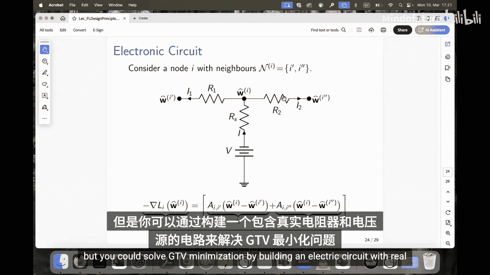

具体来说，你可以通过用真实的电阻和电压源搭建一个电路来解决图总变差最小化问题。然后测量每个连接点（节点）的电势，这些电势值就是GTV最小化问题的解。

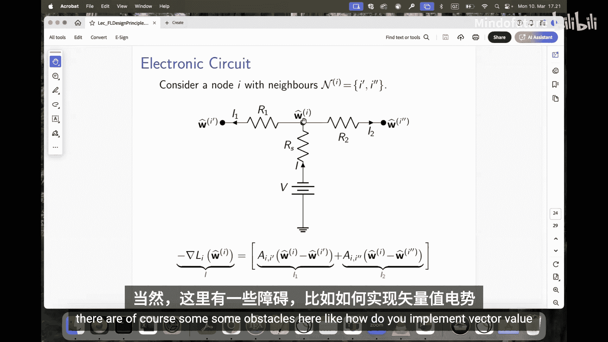

当然，这里存在一些障碍，例如如何实现向量值的电势。但也许我们可以找到解决方法。

因此，一种解决优化问题的方法是：将问题具体化为一个物理系统（如带有电压的电阻网络），然后让物理过程自然发生。当你连接上电压源后，系统会达到一个稳态，此时电流和电势都稳定下来。

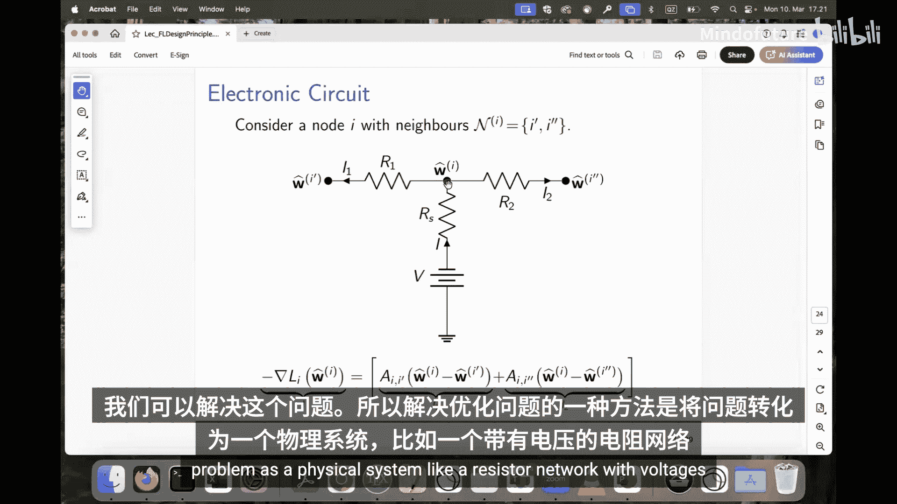
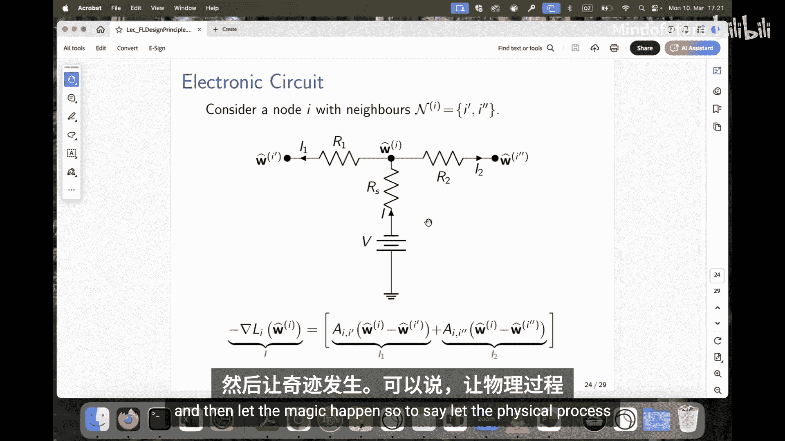
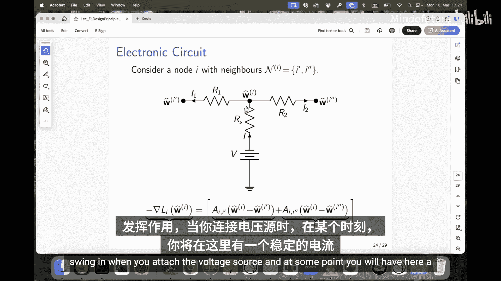

这些稳态的电势就是图总变差最小化问题的解。

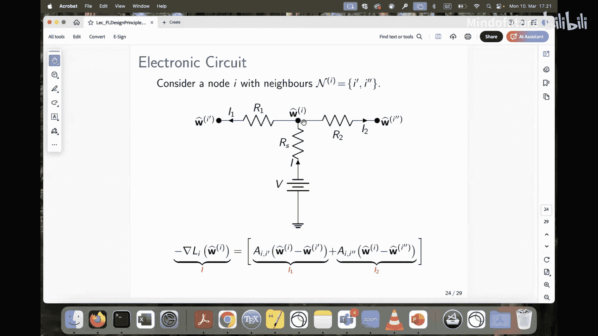

---

本节课中我们一起学习了如何将联邦学习模型优化过程类比为一个电路系统。我们了解到：
1.  本地模型参数 `θ_i` 可类比为**节点电势**。
2.  设备间的连接边可类比为**电阻**，其电流 `I_ij` 由权重和电势差决定。
3.  损失函数的梯度 `∇L_i(θ_i)` 充当了**电流源**的角色，遵循基尔霍夫电流定律。
4.  这种类比揭示了一种可能性：通过构建真实的物理电阻网络并测量其稳态电势，来直接求解联邦学习中的优化问题。

这个电路视角为理解分布式优化提供了一个直观且跨学科的框架。