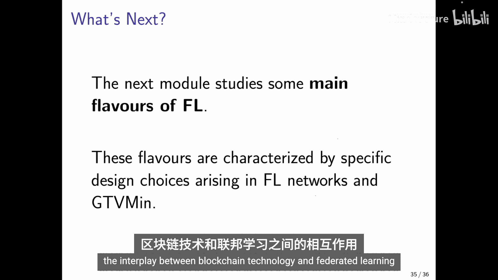
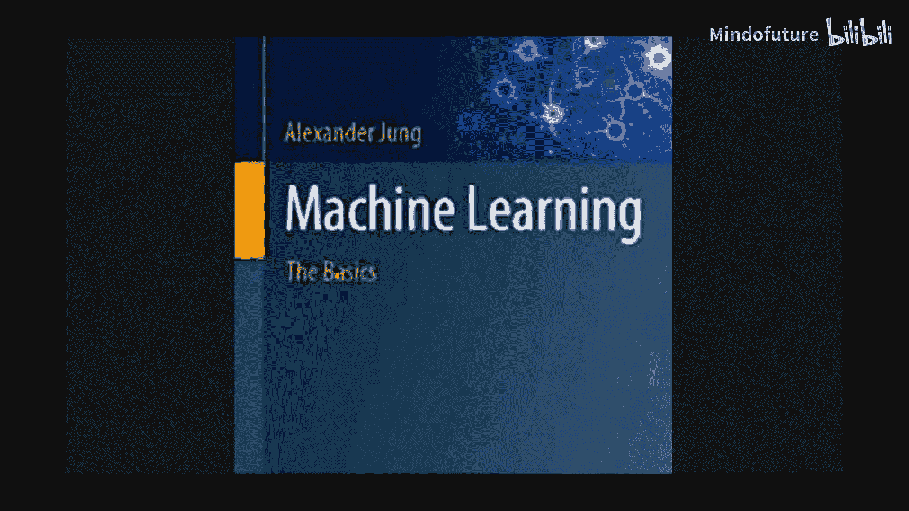

# 030：联邦学习算法 🧠

在本节课中，我们将学习如何从数学优化问题出发，推导出具体的联邦学习算法。我们将看到，许多著名的联邦学习算法都可以统一在一个名为“广义全变差最小化”的优化框架下，并通过梯度下降等迭代方法求解。

---

## 联邦学习网络回顾 📡

上一讲我们介绍了联邦学习网络的概念。本节中，我们来看看如何基于这个网络来构建学习问题。

我们使用网络，特别是联邦学习网络，来为联邦学习应用建模。一个联邦学习网络由节点组成。例如，这里有三个蓝色节点和三个红色节点，它们代表设备。每个节点可以是一部智能手机、一台笔记本电脑或一台超级计算机。我们并不限制实际的物理设备或设备类型，只是用网络中的一个节点来表示它。

这些节点中的一部分通过边或链接连接，每条边还有一个边权重。这个边权重有两个作用：
1.  我们用它在这些联邦学习算法中的节点之间传递中间结果。因此，如果两个节点由一条边连接，它们之间应该存在某种通信手段。
2.  我们用边来耦合相连节点处的模型或模型训练，使得由一条边连接的节点拥有某种程度上相似的模型。

因此，一条边有两个方面：计算方面（我们通过该边共享中间结果，需要通信手段）和统计方面（它耦合了由这条边连接的节点处的模型训练）。

---

## 优化问题：广义全变差最小化 🎯

基于这个联邦学习网络，我们以优化问题的形式来建立一个学习问题。这就是我一直在谈论的核心设计原则。设计原则就是这个优化问题。

以下是该优化问题的一个特例，称为**广义全变差最小化**。这个实例是针对参数化模型表述的。这里，每个节点 `i` 都有一组模型参数 `w_i`。这意味着我们为每个节点训练单独的或个性化的模型。

但是，这些模型训练是耦合的。我们如何耦合呢？我们要求这些模型参数具有较小的“变差”。测量这种变差有不同的方式，这在某种意义上是一种设计选择。一种测量变差的方法是使用相连节点间模型参数差的平方欧几里得范数。对于联邦学习网络中的每一条边，我们都有这样一个项。如果我们有更多的边，这个求和项就有更多的组成部分，这意味着更多的计算。

这是一个特例。当我们选择这里的正则化参数 `α = 0` 时，耦合就消失了。我们基本上分别最小化每个局部损失函数，即仅在各自的局部数据集上独立训练个性化模型。

这总是个坏主意吗？或者有时使用 `α = 0`（即完全跳过边上的耦合）实际上是一个好的选择？你能想出一个场景或设定，其中训练这些模型的最佳方式就是独立或分别训练局部模型吗？

换句话说，我们为什么要费心加入这个耦合项？为什么我们希望耦合模型训练？为什么我们希望节点或某些节点拥有相似的训练模型？

**关于 `α` 与边权重的区别**：这里的 `α` 可以看作是一个全局缩放因子。通过 `α`，我们可以以相同的方式使所有权重变大。当然，你也可以总是定义 `α = 1` 并固定它，然后为边权重选择不同的值。这只是记法上的便利。

**关于耦合的目的**：我们希望向邻居学习。我们希望耦合。我们希望从邻居那里汇集信息。这就是为什么我们希望耦合局部模型的训练。

**关于何时独立训练**：当边缘设备拥有大量样本且它们非常异构时，每个设备 `i` 的局部数据集很大，使得其损失函数是一个良好的学习目标（不会导致过拟合），那么分别训练每个模型于其自身的局部数据集，完全不考虑耦合，可能是最佳选择。

但这可能过于理想。在许多应用中，我们通常没有足够大的局部数据集，因此我们需要以某种方式汇集数据。

**关于 `α` 的作用**：这个调节参数 `α` 决定了我们允许模型独立（个性化）的程度。当 `α` 非常大或足够大时，可以证明这个优化问题的解（即模型参数）在网络的所有连通分量内的节点处是近似相同的。如果网络是连通的，并且你选择 `α` 非常大，那么广义全变差最小化的解实际上是每个节点近似恒定的模型参数。这在某些应用中很有用，因为你希望所有节点拥有相同的模型（即一个全局模型），但希望以分布式方式使用局部数据集进行训练。实现这一目标的一种方法（无需任何服务器-客户端架构）就是使用足够大的 `α` 进行广义全变差最小化，并通过分布式优化方法求解。

`α` 可以看作是广义全变差最小化的一个超参数，可以通过交叉验证等技术来选择。

**关于为何参数应相似**：因为当你选择 `α` 非常大时，为了最小化目标函数，你必须使用在边上变化不大的局部模型参数。如果任意两个节点由一条路径连接，你可以迭代地或归纳地证明它们必须彼此接近，因为在连接两个节点的路径上的任何边都不能有大的变差。

---

## 本讲学习目标 🎓

在完成本模块（包括作业）后，你应该能够或应该知道：
1.  联邦学习算法如何从梯度下降法推导出来。
2.  如何使用消息传递来实现这些梯度下降步骤。
3.  如何将梯度下降（其定义仅适用于参数化模型）推广到非参数化模型。
4.  异步算法的重要概念。

---

## 梯度下降法 📉

现在，让我们从梯度下降法开始。这只是针对广义全变差最小化的普通梯度下降。

我们假设损失函数是平滑、可微的，因此可以计算梯度。一旦你能计算这些损失函数的梯度，你就能计算整个目标函数的梯度，因为第二项（耦合项）在构造上总是平滑的。

当你计算出梯度后，会得到如下表达式。一旦有了梯度，就可以进行梯度下降步。我们使用当前局部模型参数的选择来计算梯度，并用它来更新某个节点 `i` 的当前模型参数。整个梯度下降步包括对网络中所有节点并行应用此类更新。这里的更新步骤是同步或同时应用于网络中所有节点的。

当你这样推导出梯度下降步时，会得到一个很好的解释，它基于两项：
1.  **局部损失函数的梯度**：这一项试图将节点 `i` 处的当前局部模型参数推向该节点损失函数的局部最小值。这是任何机器学习的基本思想：选择模型参数以最小化损失。
2.  **来自邻居的耦合项**：第二项确保你学习的模型参数与邻居的模型参数不会相差太大。这一项促使网络中连接良好的节点间的局部模型参数达成一致。在某种意义上，这一项相当于以隐私友好的方式汇集来自邻居的局部数据集。我们不在邻居之间汇集所有局部数据集，而是仅使用涉及局部模型参数的耦合项。我们在邻居之间共享的唯一东西是当前模型参数。当然，这些参数通常携带关于局部数据的信息，因此不可避免地会存在信息泄漏。但通常，你可以选择这些模型参数，使它们不会泄露关于局部数据特定属性的太多信息。

这里的 `α` 乘以边权重，它调节了这两种效应之间的平衡。如果 `α` 乘以边权重的乘积非常小，那么邻居之间的协调或合作就很少，该联邦学习算法主要是在为每个节点进行独立的模型训练。你选择的 `α` 越大，就越耦合邻居节点或相邻节点处的训练。当 `α` 选择得非常大时，第二项占主导地位，并确保最终在所有节点处得到相同或几乎相同的模型参数。

**关于整体效应**：整体效应在很大程度上取决于整体网络结构。虽然这里的更新只涉及网络的局部结构（即节点 `i` 的邻域），但梯度下降在每个节点上产生的结果也取决于网络的整体结构，特别是网络的聚类结构。梯度下降步可能会收敛到这些节点处近似相同的模型参数，以及那些节点处近似相同的模型参数，因为它们由许多权重较大的边紧密连接，而这两个聚类之间只有一条边。整体效应是什么，很大程度上取决于实际的网络结构。

---

### 消息传递实现 🔄

这个梯度下降步需要来自其邻居的信息，因此你无法在不与邻居交换信息的情况下计算一个节点的梯度下降步，因为第二项需要这些信息。

因此，在进行梯度下降步之前，每个节点必须将其当前的局部模型参数广播给所有邻居。在这个简单情况下，节点 `i` 只有一个邻居节点 `i'`。另一方面，节点 `i'` 需要将其局部模型参数发送给它的邻居节点 `i`。在这些节点交换了它们的模型参数之后，每个节点可以同时执行这个更新步骤。然后下一次迭代开始：你与邻居共享新的模型参数，再次进行梯度下降步，依此类推。

---

## 联邦梯度下降 🚀

现在我们已经讨论了梯度下降步，让我们看看基于此梯度下降步的、使用其变体或扩展的一些著名联邦学习算法示例。

第一个是**联邦梯度下降**，它本质上是使用这些同步梯度下降步来构建完整算法。

一个算法通常包括对初始化的精确描述。例如，我们可以用所有模型参数的零向量初始化。但这可能不是最佳选择。你也可以通过随机选择来初始化模型参数。另一种选择是，你可以在自己的数据集上独立训练模型（不与邻居耦合），并使用这个训练好的模型作为初始选择。但这可能不是最优的，因为你可能会过拟合。

使用零初始化并没有数学上的理由或 justification，它只是一种可能的初始化方式。

然后你开始重复这些梯度下降步。但这对算法来说是一个有点草率的表述，或者说是一个不太实用的算法，因为我没有说明停止准则。这是一个只启动一次但永不停止的算法，这当然不太实用。人们（包括现在的我）喜欢避免或不谈论停止准则。但你有某种直觉吗？我们如何知道何时停止这些迭代？我们如何将这个算法草图发展成一个包含停止准则的更实用的算法？

**可能的停止准则**：
*   你可以跟踪进度。在每次梯度下降步之后，观察它减少了多少局部损失函数。你可以监控局部损失函数。
*   如果你有一个足够大的局部数据集，你可以将部分局部数据集用作验证集（不用于构建局部损失函数），当验证误差/损失不再下降时停止。这实际上是最广泛使用的实用停止准则方法。
*   如果权重本身不再有太大变化，那么继续迭代似乎没有意义，因为更多迭代不会产生太大效果。
*   你可以进行数学分析，以限定特定迭代次数下的次优性。然后你选择最小迭代次数，使得你处于广义全变差最小化目标函数实际最优值的某个范围内。但这需要数学分析，并且你需要做出假设（例如，假设你的局部损失函数具有某些凸性性质）。

我想再次强调同步执行此步骤的困难。当我在这里写“进行梯度下降步”时，这是非常简化的，几乎掩盖了你必须在所有节点同时进行此梯度下降步的复杂性。

**关于同步的挑战**：为了同步这些梯度下降步，我们需要一个时钟。这个时钟包括向所有节点发送一个同步信号。每个节点只有在收到同步信号后才开始进行梯度下降步。它执行梯度下降步并发回更新后的局部模型参数。只有在服务器从所有节点收到这些更新后的局部模型参数后，它才使时钟滴答一次并发出新的同步信号。

在一个简单的 Python 演示中（针对两个节点），如果为一百万个节点实现这个，你会遇到许多问题。首先，这个算法规定，只有在收到所有更新后的模型参数后才能发出新的同步信号。这意味着你必须知道联邦学习网络中有多少客户端或节点。你必须进行一些簿记或管理，每个节点都需要在服务器注册。在某些更随意的系统中，这可能非常不实用，可能没有中央服务器来维护参与联邦学习网络的所有节点的列表。

**关于信号丢失**：如果任何同步信号或模型参数更新未能到达目的地，整个算法就会崩溃。例如，如果服务器发出的同步信号由于某种原因未能到达某个节点，该节点将永远不会继续执行另一个梯度下降步，因此也永远不会发回另一个更新，这反过来意味着服务器将无限期地等待时钟滴答，因为它不再从该节点收到更新。我们应该避免这种情况。但如何在实际硬件和软件中实现这个算法，远远超出了本课程的范围。

我强烈鼓励你下载并尝试运行这个启动 Python 脚本，你会看到这些状态消息（同步信号和局部模型参数的更新）被打印在 Python 控制台中。

---

## 联邦随机梯度下降 🎲

接下来是**联邦随机梯度下降**，它只是联邦梯度下降的一个小变体，区别在于我们使用梯度的估计值而不是精确梯度。

计算梯度可能需要大量计算（例如，在线性回归设置中计算求和），即使数据点不多，计算本身也可能成本高昂。此外，访问这些数据点可能具有挑战性。因此，使用梯度的近似值可能是有用的。

一种计算近似值的方法是使用训练集中随机选择的数据点子集（或批次）。你只需在梯度计算中用这个随机子集或批次的和替换原来的求和。这样，你就得到了联邦随机梯度下降。这里没有太多额外的挑战。

---

## 联邦平均 🤝

现在，我们来看可能是联邦学习中最广为人知的算法：**联邦平均**。

联邦平均实际上是联邦梯度下降的一个变体。在联邦平均中，我们希望在每个节点学习相同的模型参数。我们希望学习一个可用于所有节点的单一模型，但希望通过使用分布式局部数据集中的信息来学习这个模型，并且不希望收集所有局部数据集来训练这个单一模型。

实现这一目标的一种方法是使用带有硬约束的广义全变差最小化。在广义全变差最小化中，我们只惩罚相连节点之间的差异，但在这里我们要求任何两个节点的局部模型参数完全相同。可以证明，在所有局部数据集上一起训练一个单一模型，等同于在这些约束下最小化局部损失函数之和。

对于这种约束优化问题，梯度下降有一个很好的变体，称为**投影梯度下降**。它的基本思想是：为这个优化问题计算一个梯度下降步，然后将结果投影到允许的局部模型参数集合中。允许的局部模型参数集合是那些在所有节点都相同的集合，这些约束定义了一个常数局部模型参数的子集。我们可以通过计算平均值轻松地投影到这个子集。

投影梯度下降中的投影步骤包括：独立地对这些局部损失函数进行梯度下降步，然后将得到的更新后的局部模型参数投影到这个约束集上。

然后我们写出算法：首先需要一个服务器来协调整个训练或学习算法，该服务器还维护全局模型参数。我们用零初始化一组全局模型参数，并将其广播给所有客户端或节点。然后每个节点独立进行一个梯度下降步（就像每个节点仅在其本地数据上本地训练其模型一样）。但我们通过让服务器收集所有这些更新后的模型参数并计算平均值来耦合它们。这个平均值就是投影梯度下降中的投影步骤。因此，联邦平均是投影梯度下降的一个实例。

**关于掉队者**：掉队者是指未能跟上节奏的客户端或节点。例如，在某个迭代中，一个节点停止更新（如电量耗尽）。如果服务器严格要求所有节点都返回局部模型参数，那么整个系统就会崩溃。我们可以做的是只要求至少一定比例（如10%）的节点返回局部模型参数，一旦收到就进行更新。但这可能会破坏收敛性质。掉队者可能不会完全使系统崩溃，你可能仍然有一个运行的算法在某些节点更新模型参数，但局部模型参数序列可能不再收敛到优化问题的最小值。

同样，你可以在我的 GitHub 仓库中找到这个演示，其中包含一个说明各个部分的小 readme markdown 文件、一个启动 Python 脚本、一个服务器和多个工作器脚本实例。我强烈鼓励你尝试运行这些脚本。

**联邦平均的要点**：它是投影梯度下降的一种形式。在创造“联邦平均”这个术语的实际论文中，作者使用了一些变体，例如他们使用梯度的随机近似，并且他们使用多个梯度下降步（因为计算能力更强的节点可能能够取得更多进展）。

---

## 联邦近端算法 🔧

接下来要讨论的算法叫做 **FedProx**。它用另一个更新步骤替代了梯度下降步。

这个更新使用当前全局模型参数的选择来构建一个正则化项，然后求解一个正则化的经验风险最小化问题。这里的第二项确保了这个更新步骤的解接近于当前的全局模型参数。因此，第二项促使更新不会偏离当前全局模型参数太远。另一方面，更新应该试图使局部损失变小。这实际上与梯度下降的想法相同：你想找到一个新的模型参数选择，使损失函数变小一些，但你不允许更新过于剧烈，只进行小的更新。

我们在这里使用一个近端步骤，即使用这个惩罚化的局部损失函数。你可以将这个近端步骤解释为梯度下降或梯度步骤的推广。通过使用损失函数的局部线性近似，你可以重新得到梯度下降步。

关于这个近端步骤的好处是，它为我们如何将梯度方法推广到非参数化模型提供了一些思路。你可以尝试为非参数化模型实现这个正则化。例如，在第一次作业中，你不得不为决策树实现一个正则化项。你使用测试集上的预测来构建惩罚项。这为你提供了一种技术，可以为像决策树这样的非参数化模型实现或推广这个惩罚项，从而可以在 FedProx 算法中使用这些近端算子。

一旦你使用近端算子表述，为像决策树这样的非参数化模型表述整个算法就不太具有挑战性，因为你可以像在第一次作业中那样，通过使用带有特定标签或伪标签的额外数据点来增强损失函数的训练集，从而实现这个惩罚项。

**关于模型假设**：在 FedProx、联邦平均和联邦梯度下降中，它们只适用于使用相同参数空间（即使用相同形状、相同大小的参数向量）的参数化模型的联邦学习网络。否则，它们可以是不同的。有些节点可以使用线性模型，其他节点可以使用逻辑回归，还有一些节点可以使用深度神经网络，只要所有这些模型使用相同长度的参数向量，你就可以使用 FedProx 和联邦平均。但你甚至可以进一步摆脱这个限制，一种方法是使用下面介绍的联邦松弛算法或其非参数化形式。

**关于 FedProx 的实践**：有论文报告称，FedProx 似乎更容易使用（在需要更少超参数调优的意义上），在实践中似乎更容易处理或调优。但我没有找到真正有说服力的理论论证，表明 FedProx 在广泛的环境中比联邦平均收敛得更快。

---

## 联邦松弛算法 🛋️

现在介绍联邦松弛算法。思路如下：为了最小化广义全变差最小化，需要考虑两个部分：局部损失函数之和以及全变差最小化项。如果这些耦合项消失，最小化这个目标函数会容易得多。

让它们消失的一种方法是固定除一个节点外所有节点的模型参数，然后仅针对节点 `i` 的模型参数进行优化。这类似于块坐标下降或坐标下降。我相信你们许多人在线性代数或数值线性代数课程中遇到过这个优化思想，因为它与求解线性方程组的雅可比迭代法思想相同。

你假设已经找到了除节点 `i` 外所有模型参数的最优选择。那么你现在应该做什么？你仅针对 `w_i` 优化这个目标函数。这变得非常容易，因为优化变量之间没有耦合了，只剩下这个一个优化变量 `w_i` 的二次项，这就很容易求解了。

这就是得到的算法：你从每个节点 `i` 的某个初始选择开始，然后为 `w_i` 计算这个更新。这实际上又是一个近端步骤或近端算子，这个近端项包含了所有邻居的当前局部模型参数估计值。

同样，我们看到了这种算法模式：你必须在邻居之间交换模型参数。然后每个节点使用其邻居的模型参数来计算更新，以改进自己的局部模型参数。在这个算法中，我们通过使用由所有邻居之和给出的惩罚项来实现。

这看起来很自然：我们想要最小化局部损失函数，但同时也要确保节点 `i` 的局部模型参数不会离邻居的当前局部模型参数太远。

一个很好的练习是：你可以将这个求和项重新表述为另一个没有求和的惩罚项，即 `w_i` 与某个 `w_tilde` 的平方欧几里得距离，而这个 `w_tilde` 正是所有邻居模型参数的平均值。因此，你可以用 `α` 乘以这个优化变量（即我们要更新的节点 `i` 的模型参数）与邻居模型参数当前平均值之差的平方欧几里得范数来替换这个求和项。

顺便说一下，这又是一个正则化训练问题，是岭回归的一种形式。在岭回归中，你最小化当前权重向量的训练误差（如均方误差）加上正则化参数乘以平方欧几里得范数。在联邦松弛算法中，我们使用的不是模型参数的平方欧几里得范数，而是模型参数与某个其他参数向量（即邻居模型参数的平均值）之差的平方欧几里得范数。

**FedProx 与 FedRelax 的主要区别**：FedProx 学习所有节点相同的模型参数，适用于单一模型的联邦学习设置。而 FedRelax 学习每个节点不同的模型参数，适用于完全分布式、去中心化的个性化联邦学习。如果 `α` 很大且网络连接良好，我们最终也可能得到几乎相同的模型参数，但通常不会总是得到相同的模型参数，这取决于网络的聚类结构。

**推广到非参数模型**：FedRelax 非常自然地允许推广到非参数模型。我们只需要一种方法来扩展或重新表述这个惩罚项（即变差项）以适用于非参数模型。一种方法是使用测试集上预测的平方差来比较两个模型（例如两个决策树），如果它们在测试集上给出近似相似的预测，我们就说两个模型相似。

这意味着不同节点处的模型不一定都是决策树。它们只需要在其预测中具有相同的值域。节点 `i` 处的假设可以是决策树，而节点 `i'` 处的假设可以是深度神经网络，只要它们都输出可比较的数值量。因此，不同节点处的模型可以完全不同，它们只需要在其预测中具有相同的值域（例如，都需要是回归模型，输出可比较的数值量）。

---

## 异步算法 ⏱️

本节课要介绍的最后一个概念是**异步算法**。

为了解释或介绍异步算法，有必要意识到到目前为止我讨论的所有算法（联邦梯度下降、联邦平均、联邦随机梯度下降、FedProx）都是同一类型的，因为它们都基于**不动点迭代**。你可以为它们找到一个算子，将这些算法写成不动点迭代：在每次迭代中，你应用某个算子，这个算子对于不同节点可以不同。你将这个算子应用于节点当前使用的所有局部模型参数。

每个节点 `i` 的更新可以用一个算子 `F^i` 来数学表示。找出联邦梯度下降、联邦平均、FedProx 的算子具体是什么，将是一个很好的练习。例如，对于梯度下降，算子看起来像这样，它使用了局部损失函数的梯度和耦合项。如果你使用这个选择，得到的算法就是联邦梯度下降。如果你用其他选择替换它，就会得到联邦平均。

因此，到目前为止讨论的所有算法都基于这种**同步不动点迭代**，因为它们在每个节点同时或同步地计算这个不动点迭代。

一个联邦学习算法由其不动点算子决定。与其写出伪代码，你可以直接说明你的不动点算子是什么，这样就明确地定义或确定了一个联邦学习算法。

但是，实现这种同步更新在许多应用中是不切实际的。例如，执行这些更新的设备可能非常不同（有些是高速处理器，有些是低速处理器）。此外，要实现这种同步更新，你需要这些当前的局部模型参数可用。节点 `i` 原则上需要知道其所有邻居（或在极端情况下所有其他节点）的局部模型参数。因此，每次迭代后，你都需要用你的新模型参数更新所有邻居。如果存在带宽限制，或者在某些时候没有连接（如蓝牙或无线链路中断），这可能无法实现。你可能只有过时的信息，只有邻居在之前第10次迭代时的局部模型参数，而没有当前的，因为已经有10次迭代没有连接了。

因此，我们可能希望使用一种**异步算法**，它工作方式如下：它看起来与同步算法非常相似，也使用这些不动点，但方式略有不同。首先，它使用的不动点迭代不是使用当前的局部模型参数，而是使用来自过去其他节点的局部模型参数。具体来说，存在一个延迟。这个延迟由当前迭代计数器 `k` 减去这里的变量 `s` 给出。这个 `s^{k}_{i,i'}` 是第 `k` 个时间步从节点 `i'` 到节点 `i` 的延迟。这个延迟可能随 `k`、`i`、`i'` 变化，这实际上提供了很大的自由度。这是一个非常通用、广泛适用的异步模型，可以涵盖许多应用或计算设置。

在异步算法中，我们允许使用过时的信息。节点 `i` 的每次更新可以使用其他节点在10次或100次迭代前的模型参数。这个延迟可以非常大。事实证明，对于某些算法，可以容忍无限大的延迟，算法仍然有效。

与同步算法的第二个区别是，这里我们只在某些时间步对某些节点进行更新。换句话说，节点 `i` 仅在某些时间步（用 `T^i` 表示）使用这个更新算子，这些时间步表示节点活跃（唤醒或有电量）的时间。否则，我们假设它只是保持其已有的局部模型参数不变，只是存储模型参数直到它能够再次进行更新。

设计异步算法现在变得相当简单。你首先需要找出这些不动点算子是什么，它们看起来像什么。对于联邦梯度下降，它们看起来像这样。然后你只需插入这些过时的信息，使用这些过时的局部模型参数进行更新，并且只在这些活跃时间步进行更新。

同样，我准备了一个演示，你可以查看，并强烈鼓励你运行这个异步梯度下降的演示。

在准备这些演示时，我深刻意识到实现异步算法是多么美好或容易，因为异步本质上意味着你不需要确保同步操作。实现异步算法比实现同步算法要容易得多、好得多。但当然，拥有异步算法很好。

**关于内存要求**：例如，每当节点 `i` 收到来自另一个节点的局部模型参数时，它需要将其存储在某个地方，直到它从该节点收到新的更新。这是一个要求，节点必须有一些内存，而且这个内存必须是非易失性的，以便在节点不活跃时也能持久保存。

正如我所说，与同步算法相比，实现异步算法是小菜一碟，因为你需要为同步开发大量基础设施（如同步服务器）。如果你不需要这样做，实现这些分布式算法就变得容易得多。然而，你可能没有相同的性能或统计性质。

根据它们能容忍的程度，我们有不同的异步算法概念。

*   **完全异步算法**：如果它最终仍能收敛到广义全变差最小化的解，我们就说它“有效”。那么，一个完全异步算法在以下条件下有效：
    1.  每个节点的活跃集是无限的。这意味着没有节点在某个时间点完全停止。如果我们等待足够长的时间，每个节点都会在某个时间点再次活跃。它永远不会“死亡”。
    2.  这些延迟的更新时间也是无界的。这意味着在某个时间点，每个节点都会再次向它的每个邻居发送一次更新。没有哪个时间步之后，一个节点不再向它的某个邻居发送任何更新。
    这两个要求基本上是说算法持续工作，没有节点完全死亡，没有连接完全中断。然而，连接可能非常差，导致大量延迟。延迟的大小不一定需要有界，但节点必须永远不会停止偶尔向其邻居发送更新。

*   **部分异步算法**：这是介于完全异步和同步之间的一种概念。如果每个节点至少每 `B` 个时间步唤醒一次，我们就说一个算法是部分异步的。这个 `B` 是异步性的度量，`B` 越大，算法异步性越强。极端情况下，如果 `B=1`，则意味着同步。部分异步算法的要求是：每个工作器在每 `B` 个时间步或事件中至少唤醒一次，并且从每个节点到其他每个节点的延迟不能大于 `B`（即有界延迟）。

我们有一个异步算法的层次结构：完全异步是一个大类，包含各种算法；然后是具有不同异步性度量 `B` 的部分异步算法。

---

### 异步算法的收敛性 📈

现在我们已经描述了完全异步和部分异步算法，这很好，但它们何时有效？一个部分异步算法何时收敛到广义全变差最小化的解？

这取决于两件事：
1.  **不动点算子**：这些算子由你使用的算法以及损失函数或边（即联邦学习网络）定义。联邦学习网络包括损失函数和边作为设计选择，所有这些设计选择都会影响这些不动点算子的样子。例如，联邦梯度下降的不动点算子涉及算法参数（步长 `η`）、局部损失函数以及通过邻域和边权重体现的联邦学习网络结构。所有这些组件决定了不动点迭代的样子，决定了算子的性质。
2.  **异步计算**：算法异步的程度，由更新时间 `T^i` 和延迟来表征。

为了节省时间（时间快到了），我们快速过一下。事实证明，为异步算法提供充分条件的一种方法是使用**伪压缩**的概念。如果这些不动点算子是伪压缩的，意味着当你将这些算子应用于给定的局部模型参数选择时，算子会将它们更多地推向广义全变差最小化的解，这是非常自然的。最终，这些联邦学习算法重复应用不动点算子，你当然希望不动点算子的结果越来越接近广义全变差最小化的解。

事实证明，如果这些不动点算子是伪压缩的，那么一旦你证明了对于局部损失函数、边和联邦学习算法的任意选择，所产生的不动点算子 `F` 是伪压缩的，你就有了一个完全异步算法。有一篇来自斯德哥尔摩 KTH 作者的精彩近期论文表明，只要这是伪压缩的，它就是完全异步的。

你还可以根据异步性度量计算出明确的收敛速率。你可以说明这个联邦学习算法的局部模型参数以多快的速度收敛到广义全变差最小化的解，这个收敛速率很自然地包含了异步性度量 `B`。`B` 越大，这个指数就越小，收敛到距离零（即与广义全变差最小化解的距离）的速度就越慢。毕竟，我们的原则是学习最小化广义全变差的模型参数，我们求解广义全变差最小化，因此我们希望从这个算法中得到的迭代值越来越接近广义全变差最小化的解。

**如何确保伪压缩性**：这是困难的工作。你需要针对你特定的局部损失函数选择、联邦学习网络中的边集等，分析这个不动点算子。所有这些属性或设计选择都会影响所产生的不动点算子是否是伪压缩的，以及压缩参数 `κ` 是多少（`κ` 应该非常小，越小越好）。

---

## 总结 📝

本节课中，我们一起学习了几种广为人知或流行的联邦学习算法。事实证明，它们都属于同一类型或形式，即都是不动点迭代。联邦梯度下降、联邦平均、FedProx 都可以写成这样的不动点迭代。

这个算子 `F` 的不动点是广义全变差最小化的一个解。我们希望通过重复应用 `F` 来计算这个解。这个不动点迭代的收敛性取决于算子 `F` 的压缩性质，特别是它是否是伪压缩的。如果它是伪压缩的，事实证明它对异步实现效应具有相当的容忍度，特别是可以处理客户端之间任意大的延迟。它基本上是一个完全异步算法，只要求每个客户端持续工作一段时间（没有客户端在某个时间后完全退出联邦学习算法），并且联邦学习网络中两个邻居之间的连接不会在某个时间后完全中断。在足够长的时间后，节点总会再次唤醒并进行更新，节点也总能够再次向它的每个邻居发送更新。

---

## 下节预告 🔮

下一讲的悬念是，我们将研究联邦学习的一些主要类型，包括横向和纵向联邦学习。我们将看到这些如何再次成为广义全变差最小化的特例。我希望你们会越来越体会到广义全变差最小化对于各种联邦学习模型、设置和算法的多功能性和灵活性。

另外，正如我所宣布的，下周一的一半讲座时间将用于一位来自加拿大的研究人员的客座演讲，内容是关于区块链技术与联邦学习之间的相互作用。

感谢大家的关注！