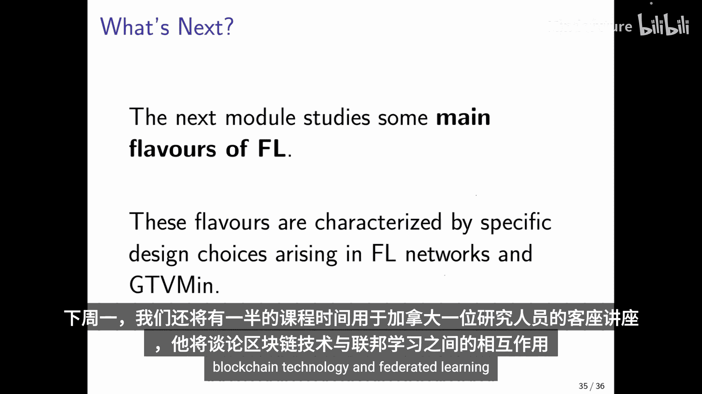
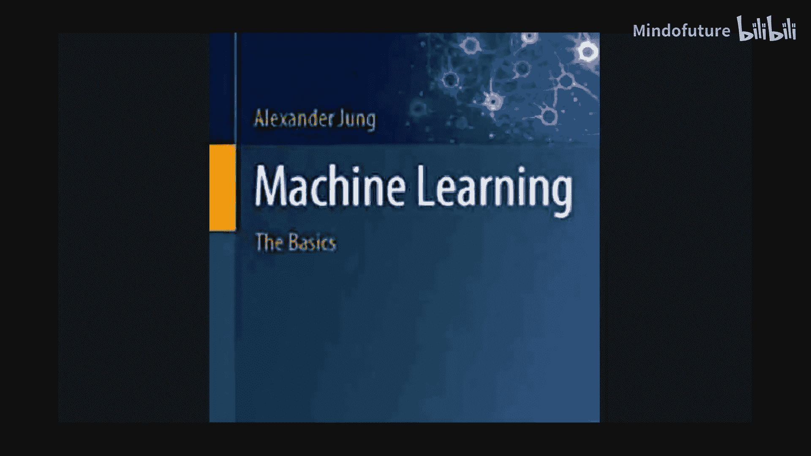

# 032：异步联邦学习算法

## 概述
在本节课中，我们将要学习联邦学习中的异步算法。我们将了解到，之前讨论的联邦梯度下降、联邦平均等算法都属于同步固定点迭代算法。然而，在实际应用中，由于设备性能差异、网络连接不稳定等因素，同步更新往往难以实现。因此，本节将重点介绍异步算法的概念、模型及其收敛性条件。

---

## 同步算法的固定点迭代表示

上一节我们介绍了多种联邦学习算法。本节中我们来看看这些算法的一个共同数学框架。

之前讨论的所有算法，包括联邦梯度下降、联邦平均和联邦近端算法，本质上都属于同一类型：它们都基于**固定点迭代**。这意味着，对于每个节点 `i`，其更新过程可以用一个算子 `F^i` 来描述。该算子作用于所有节点当前使用的本地模型参数上。

具体而言，每个节点 `i` 的更新可以表示为：
`w_i^{k+1} = F^i(w_1^k, w_2^k, ..., w_n^k)`

以下是联邦梯度下降算子的一个示例：
`F^i(w) = w_i - η * [∇f_i(w_i) + Σ_{j∈N(i)} a_{ij} (w_i - w_j)]`

如果使用上述算子，得到的算法就是联邦梯度下降。如果替换为其他算子，则可以得到联邦平均等算法。所有这些算法都基于**同步固定点迭代**，因为它们在每个节点上同时（或同步地）计算这个固定点迭代。

因此，一个联邦学习算法可以通过其固定点算子来定义。与其编写伪代码，不如直接说明所使用的固定点算子是什么。

---

## 同步算法的挑战与异步算法的引入

然而，实现这种同步更新在许多应用中是不切实际的。原因如下：

以下是导致同步更新困难的主要因素：
1.  **设备异构性**：参与设备的计算能力差异巨大（例如，高性能笔记本电脑与低速树莓派）。
2.  **通信约束**：节点需要知道其所有邻居（甚至所有其他节点）的当前本地模型参数。每次迭代后都需要向邻居广播更新，这在带宽受限或连接不稳定的情况下难以实现。
3.  **信息过时**：由于网络中断，节点可能只能获得邻居在很久以前（例如10次迭代前）的模型参数，而非最新参数。

因此，我们需要引入**异步算法**。异步算法的工作方式与同步算法类似，也使用固定点迭代，但有两个关键区别。

---

## 异步算法模型

异步算法的更新公式如下：
`w_i^{k+1} = { F^i(..., w_j^{k - d_{ji}^k}, ...), 如果 k ∈ T^i; w_i^k, 如果 k ∉ T^i }`

这个模型包含两个核心要素：

1.  **使用过时信息**：节点 `i` 在更新时，使用的不是邻居节点 `j` 的当前参数 `w_j^k`，而是其过去某个时刻的参数 `w_j^{k - d_{ji}^k}`。这里的 `d_{ji}^k` 表示从节点 `j` 到节点 `i` 在时间步 `k` 的**延迟**。这个延迟可以很大，并且可能随时间、节点对而变化。
2.  **节点激活时间**：节点 `i` 只在特定的时间步集合 `T^i` 中才执行更新操作。`T^i` 表示节点“激活”或“唤醒”的时刻（例如，当设备有电、恢复连接时）。在非激活时间步，节点只是保持其本地模型参数不变。

这个模型非常通用，能够涵盖许多实际的计算场景。设计异步算法变得相对直接：首先确定同步版本下的固定点算子 `F^i`（例如联邦梯度下降的算子），然后在更新时直接代入过时的邻居参数，并且仅在该节点激活时才执行此更新。

从实现角度看，异步算法通常比同步算法更简单，因为它**消除了同步要求**。你不需要构建复杂的基础设施（如同步服务器）来协调所有节点同时更新。

---

## 异步算法的类型与要求

并非所有异步设置都能保证算法收敛。我们根据算法对延迟和激活的容忍度，定义了两类异步算法。

以下是两种主要的异步算法类型及其要求：

*   **完全异步算法**：
    *   **要求1（无限激活）**：每个节点的激活时间集 `T^i` 是无限的。即，没有节点会永久停止工作。只要算法运行得足够久，每个节点最终都会再次被激活。
    *   **要求2（无限更新）**：任意两个邻居节点之间的信息延迟 `d_{ji}^k` 的上限可以是无界的（即延迟可以任意大），但必须保证，对于任意一对邻居，发送方最终总能在某个时刻成功将更新发送给接收方。没有连接会永久失效。
    *   **核心**：算法在即使存在**任意大但有限**的延迟，且节点仅保证**最终会激活**的条件下，仍能收敛到全局目标（GTV最小化）的解。

*   **部分异步算法**：
    *   **要求1（有界激活间隔）**：存在一个常数 `B`，使得每个节点在任意长度为 `B` 的时间窗口内至少激活一次。`B` 被称为**异步度量**，`B=1` 对应同步情况，`B` 越大表示异步程度越高。
    *   **要求2（有界延迟）**：所有延迟 `d_{ji}^k` 都有一个共同的上界 `B`。即，信息不会过于陈旧。
    *   **核心**：对延迟和激活频率提出了更严格、有界的限制，通常能带来更可预测的收敛性能。

完全异步算法构成了一个更大的算法家族，而部分异步算法是其中的一个子集，其异步度量 `B` 可以不同。

---

## 异步算法的收敛性

那么，异步算法在什么条件下能够收敛呢？这主要取决于两个方面。

收敛性由以下两个因素共同决定：
1.  **固定点算子的性质**：这由你选择的联邦学习算法（如梯度下降、平均）、本地损失函数以及联邦学习网络的图结构（边和权重）共同决定。所有这些设计选择影响了算子 `F` 的数学特性。
2.  **异步计算模式**：这由节点的激活时间 `T^i` 和信息延迟 `d_{ji}^k` 来描述，即算法的“异步程度”。

一个关键且强大的分析工具是**伪压缩映射**的概念。如果组合所有节点算子的整体固定点算子 `F` 是一个伪压缩映射，那么意味着每次应用该算子都会将模型参数向GTV最小化问题的解推近一步。这是一个非常自然的要求。

研究表明，只要固定点算子 `F` 是伪压缩映射，那么对应的联邦学习算法就是**完全异步**的。也就是说，即使在允许任意大延迟和仅要求节点最终激活的条件下，算法也能保证收敛。

此外，对于部分异步算法，我们可以推导出明确的**收敛速率**。收敛速度与异步度量 `B` 密切相关。通常，`B` 越大（异步程度越高），收敛速度越慢。收敛速率公式可以表示为与 `B` 相关的指数衰减形式。

因此，确保算法收敛的“硬功夫”在于：针对你特定的损失函数、网络结构和算法选择，分析并证明其导出的固定点算子 `F` 是一个伪压缩映射，并尽可能获得一个较小的压缩系数。

---

## 总结与下节预告

本节课中我们一起学习了联邦学习异步算法的核心内容。

我们了解到，联邦梯度下降、联邦平均等流行算法都可以统一为**同步固定点迭代**的形式。这种迭代的固定点就是GTV最小化问题的解。

然而，同步更新在实际中面临挑战。因此我们引入了**异步算法模型**，它允许节点使用过时的邻居信息，并在自身激活时才进行更新。我们区分了**完全异步**和**部分异步**算法，前者对延迟和激活的要求最弱，后者则有更严格的有界要求。

算法的收敛性关键在于其固定点算子是否为**伪压缩映射**。如果是，则算法能容忍极大的异步性（完全异步），并且可以分析其收敛速率。

最后，留下一个悬念：在下一讲中，我们将探讨联邦学习的几种主要类型，包括**横向联邦学习**和**纵向联邦学习**。大家将会看到，这些不同类型也不过是GTV最小化框架下的特例。这将进一步展现GTV最小化框架在描述各种联邦学习模型、设置和算法时的**通用性与灵活性**。

此外，下节课的一部分时间将用于一场关于**区块链技术与联邦学习交互**的嘉宾讲座。

---

感谢大家的关注。

