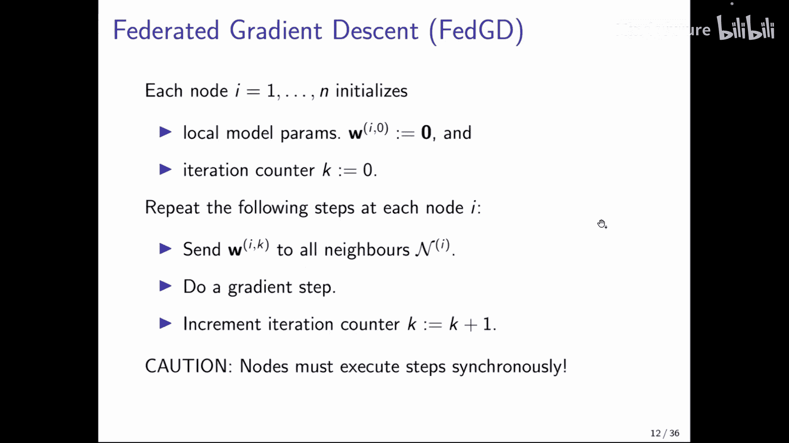
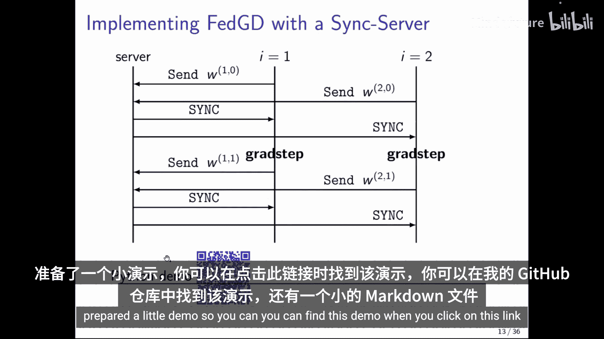
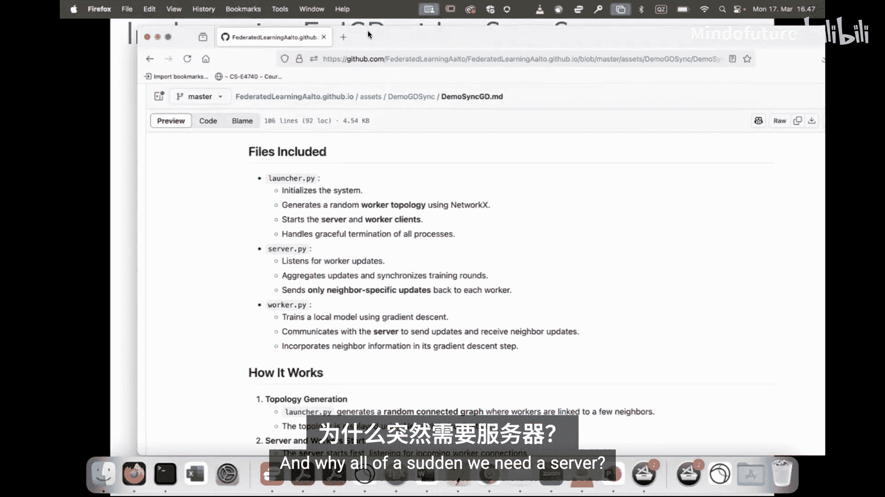
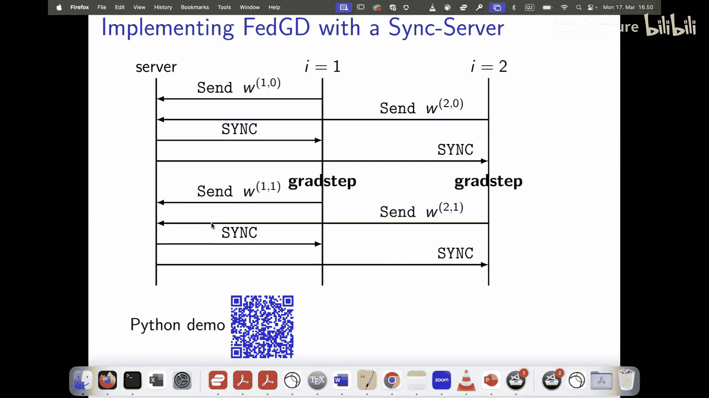
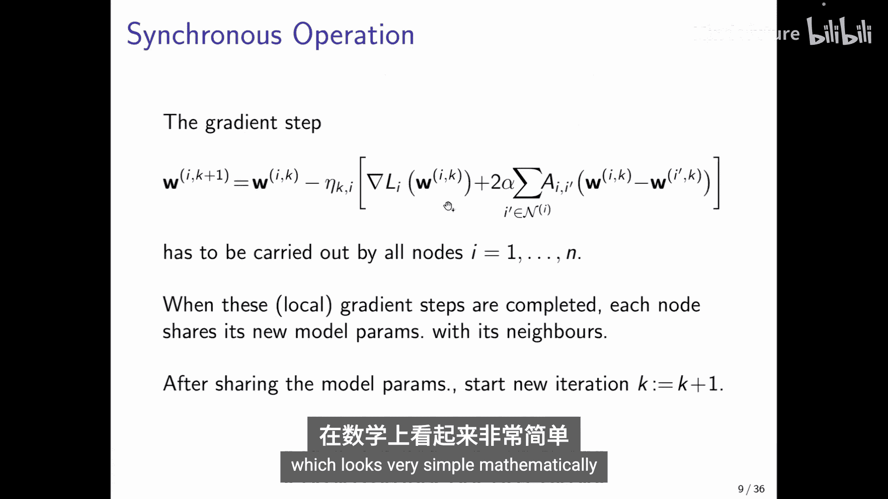
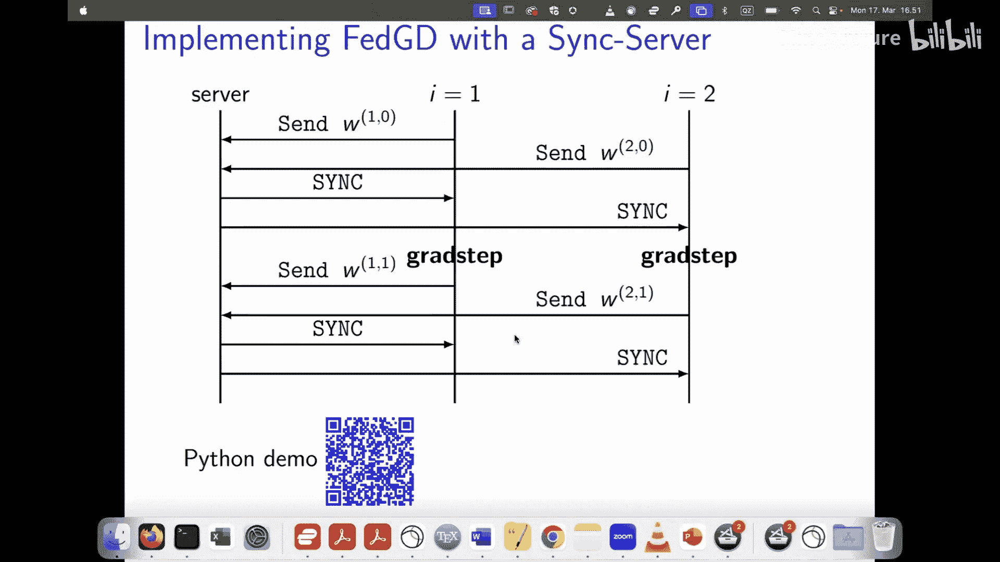
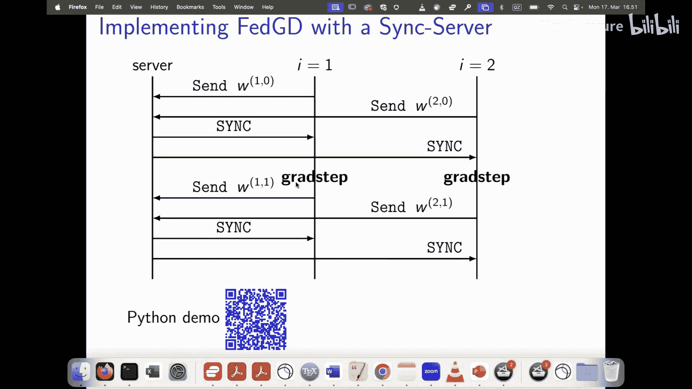
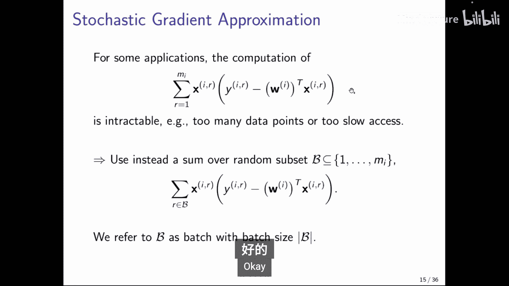

# 034：联邦梯度下降算法详解 🧠

在本节课中，我们将学习联邦学习中的核心优化算法——联邦梯度下降。我们将从基础的梯度下降步骤开始，逐步剖析其组成部分、工作原理、实现挑战以及一些常见的变体。

## 概述

联邦梯度下降旨在解决一个分布式优化问题，即在保护数据隐私的前提下，让网络中的多个节点协同训练一个机器学习模型。其核心思想是结合本地数据拟合与邻居节点间的模型参数一致性。

## 梯度下降步骤解析

上一节我们介绍了联邦学习的基本优化目标。本节中，我们来看看如何通过梯度下降来求解该问题。

对于一个平滑可微的损失函数，我们可以计算其梯度。整个目标函数的梯度可以通过基础微积分得到，表达式如下：

`∇F_i(w_i) = ∇L_i(w_i) + α * Σ_{j∈N_i} A_{ij} (w_i - w_j)`

一旦计算出梯度，就可以用它来更新当前节点的本地模型参数 `w_i`。整个梯度下降步骤由网络中所有节点的并行更新组成。

这个更新步骤可以同步或同时应用于网络中的所有节点。

### 梯度项的双重作用

梯度步骤可以基于两项进行解释：

1.  **本地损失函数梯度 `∇L_i(w_i)`**：该项试图将本地模型参数 `w_i` 推向其本地损失函数的最小值。这是任何机器学习的基本思想：选择模型参数以最小化损失。

2.  **耦合项 `α * Σ A_{ij} (w_i - w_j)`**：仅最小化本地损失函数可能因样本量过小而信息不足，导致过拟合。此项通过引入邻居信息来提供更多信息。它确保学习到的模型参数不会与邻居的模型参数有太大差异，从而驱动网络连接节点间本地模型参数的一致性。

从某种意义上说，此项相当于以隐私友好的方式汇集邻居的本地数据集。节点 `i` 不是要求所有邻居共享原始数据，而是通过这个仅涉及本地模型参数的耦合项来共享信息。虽然模型参数不可避免地会携带一些本地数据集的信息，但通常可以选择不泄露特定敏感属性的模型。

参数 `α` 与边权重 `A_{ij}` 的乘积控制着这两种效应之间的平衡。如果乘积很小，则邻居间的协调或合作很少，算法主要在各个节点上进行独立的模型训练。`α` 越大，邻居节点间的训练耦合就越强。当 `α` 非常大时，第二项占主导地位，确保所有节点最终获得相同或几乎相同的模型参数。

### 同步更新的挑战与消息传递

虽然用纸笔或幻灯片很容易写下梯度步骤，但在实际中需要以同步方式执行。这意味着网络中的所有节点（可能多达数百万或数十亿）必须在任何节点进行下一步梯度更新之前，完成当前的更新步骤。在物联网等连接质量差、可靠性低的网络中，这可能根本无法实现。

此外，节点 `i` 的梯度步骤需要其邻居的信息（用于第二项）。因此，在执行梯度步骤之前，节点必须与邻居交换当前的模型参数。

以下是消息传递的实现方式：

1.  每个节点将其当前的本地模型参数广播给所有邻居。
2.  交换信息后，每个节点可以（同时）执行梯度更新步骤。
3.  然后下一次迭代开始：节点与邻居共享新的模型参数，再次执行梯度步骤，依此类推。

### 网络结构对整体效果的影响

梯度更新虽然只涉及节点的局部网络结构（即邻居），但最终在每个节点上产生的结果也取决于网络的整体结构，特别是其聚类结构。例如，梯度下降可能使紧密连接（通过许多高权重边）的节点群收敛到大致相同的模型参数，而不同集群之间可能因连接稀疏而保持差异。整体效果无法一概而论，它高度依赖于实际的网络拓扑。

## 联邦梯度下降算法构建

现在我们已经讨论了梯度步骤，让我们看看基于此梯度步骤或其变体/扩展的几个著名联邦学习算法示例。

第一个是**联邦梯度下降**，它本质上是利用同步梯度步骤展开的一个完整算法。

一个算法通常需要精确描述初始化方式。例如，我们可以用零向量初始化所有模型参数，但这可能不是最佳选择。也可以随机初始化，或者先在本地数据集上独立训练一个模型作为初始值，但这可能导致过拟合。需要指出，使用零初始化并没有严格的数学理由，它只是众多可能选择之一。

然后算法开始重复这些梯度步骤。然而，这种描述有些笼统，因为它没有说明停止准则。一个只启动但永不停止的算法显然不实用。

### 可能的停止准则

那么，如何为梯度方法设计停止准则呢？以下是一些可能的选择：

*   **跟踪进度**：在每次梯度步骤后，观察本地损失函数减少了多少。可以监控本地损失函数。
*   **使用验证集**：如果本地数据足够大，可以留出一部分作为验证集（不用于构建本地损失函数），当验证损失不再下降时停止。这可能是最广泛使用的实用方法。
*   **参数变化微小**：如果模型参数本身不再发生太大变化，那么继续迭代似乎没有意义。
*   **理论分析**：通过数学分析，确定达到目标函数最优值一定范围内所需的最小迭代次数。但这需要假设本地损失函数具有某些凸性等性质。

## 算法实现的复杂性

再次强调，实现同步梯度步骤 `do a gradient step` 的描述过于简化，几乎掩盖了必须在所有节点同时执行此步骤的复杂性。

为了同步这些梯度步骤，我们需要一个时钟。这个时钟可以通过服务器向所有节点发送同步信号来实现。每个节点只有在收到同步信号后才开始执行梯度步骤，完成后将更新后的本地模型参数发送回服务器。只有在服务器收到所有节点的更新后，时钟才“滴答”一声，并发出新的同步信号。

然而，这种实现方式面临许多挑战：
1.  **节点管理**：服务器需要知道网络中有多少节点，每个节点需要向服务器注册。
2.  **信号丢失**：如果任何同步信号或模型参数更新在传输中失败，整个算法就会崩溃。例如，如果服务器发出的同步信号未能到达某个节点，该节点将永远不会继续执行梯度步骤，服务器也将无限期等待，导致死锁。

将这些数学上看似简单的更新规则转化为实用的算法，需要考虑所有这些细节。如何在真实硬件和软件中实现它，远远超出了本课程的范围。

## 联邦随机梯度下降

最后，我们来看一个变体：**联邦随机梯度下降**。它只是联邦梯度下降的一个小变体，区别在于用梯度的估计值代替了精确梯度。

计算精确梯度可能成本很高。例如，在线性回归中需要计算涉及大量数据点的求和，即使数据点不多，计算本身也可能很耗时，或者访问数据（如从传感器读取）具有挑战性。

因此，使用梯度的近似值是有益的。一种常见的近似方法是使用训练集中随机选择的数据点子集（即一个批次）来计算梯度。只需将梯度计算中的求和替换为对这个随机批次求和的近似值，就得到了联邦随机梯度下降。这并没有引入太多额外的挑战。

## 总结

本节课我们一起学习了联邦梯度下降算法。我们从其数学基础——梯度下降步骤开始，深入分析了由本地损失梯度和邻居耦合项构成的双重优化目标。我们探讨了算法同步执行的挑战、消息传递的必要性，以及网络结构对最终模型的影响。接着，我们讨论了如何构建一个完整的算法，包括初始化和停止准则的选择，并指出了将简洁的数学公式转化为鲁棒实用系统所面临的工程复杂性。最后，我们简要介绍了通过使用随机批次来近似梯度的联邦随机梯度下降变体。理解这些基本原理是设计和实现有效联邦学习系统的关键。