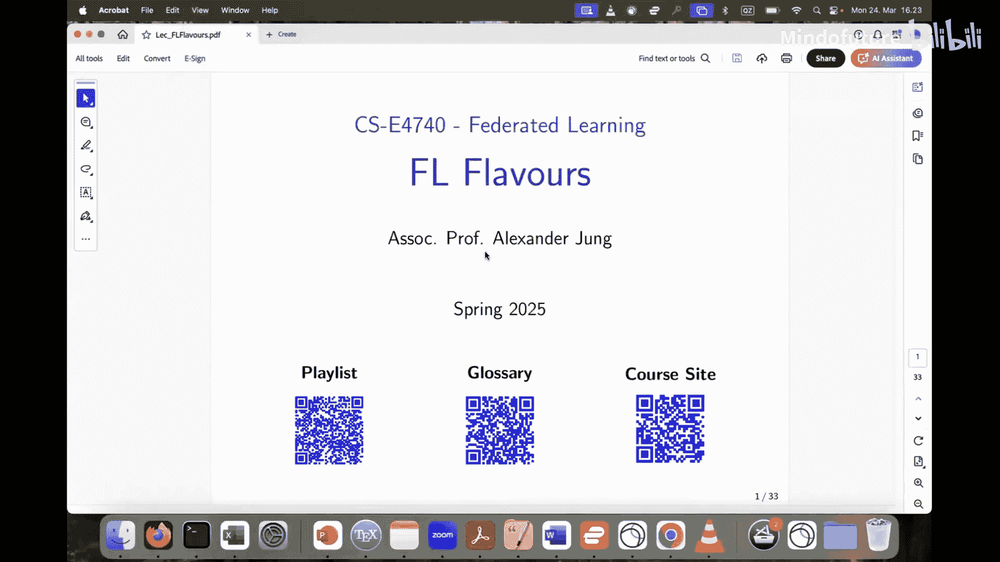
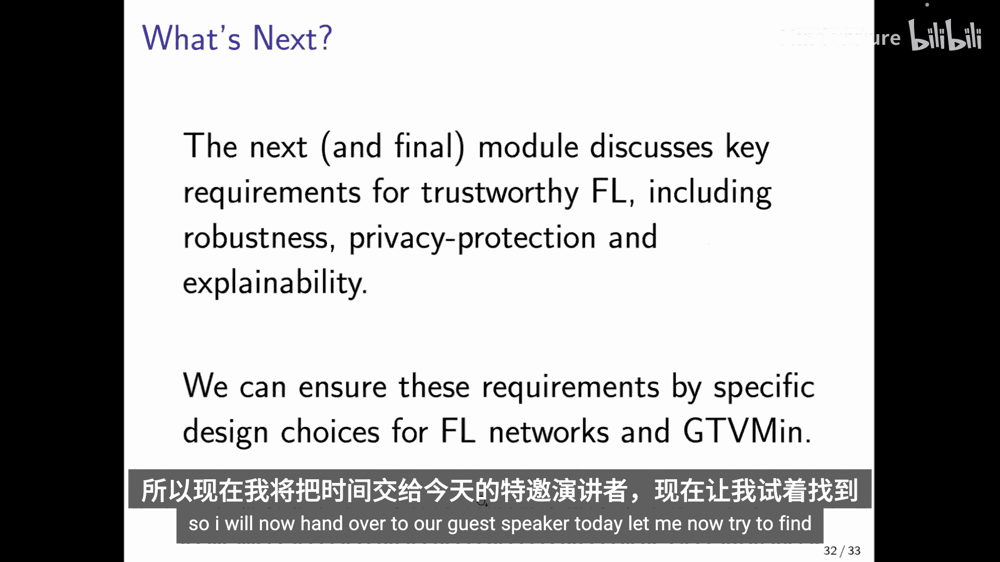

# 036：联邦学习的主要类型 🧩

在本节课中，我们将学习联邦学习的几种主要类型。我们将看到，这些不同类型都可以通过一个统一的优化框架——广义全变分最小化——来理解和构建。课程内容将涵盖单模型联邦学习、横向联邦学习、纵向联邦学习、聚类联邦学习以及个性化联邦学习。

## 课程信息与项目安排 📅

在开始正式课程之前，先提供一些关于本课程和项目的重要信息。

我们将安排两次答疑辅导课，时间定于4月14日和4月21日下午4点15分开始，形式与本次讲座类似，均在Zoom上进行。在这些辅导课上，你可以随时加入，询问关于课程项目的任何问题。

本课程的基础课程版本包含一个强制性的项目部分。项目的大部分信息已发布在课程网站上。最重要的信息是提交截止日期：**4月30日**。整个4月都可以用来完成项目报告。

项目报告模板已发布，其中包含了详细的撰写说明。报告必须遵循该模板的结构，不得更改章节标题和章节选择。此外，报告字体大小不得小于9磅，总页数最多为5页，其中第5页仅能包含参考文献，正文内容必须限制在4页以内。这个格式要求参考了顶级学术会议（如ICLR）的投稿规范。

我们强烈建议使用LaTeX来撰写报告，以练习排版数学文本和技术报告。模板文件夹中提供了.tex文件和一些辅助样式文件，将它们放在同一目录下即可编译。如果遇到问题，请通过邮件或课程讨论论坛联系课程团队。

项目评审表也已发布。你可以提前查看评审时将被问及的问题，例如“报告是否清晰定义了联邦学习网络的节点和加权边？”等。根据描述的清晰程度，每个问题可获得2分、1分或0分，总计约12个问题。

我们计划使用两个提交系统。对于阿尔托大学的注册学生，可以在MyCourses平台上提交项目和进行同行评审。同时，我们也为所有参与者（包括非阿尔托学生）提供了通过EasyChair会议管理系统提交和评审报告的选项。这将模拟完整的学术会议论文提交与评审流程。EasyChair的提交入口将于下周开放。

关于项目，目前有任何问题吗？

关于辅导课日期，原计划定于4月2日和7日，但后来得知那周是考试周，因此已调整至4月14日和21日。对于由此造成的困惑，我们表示歉意。请放心，课程团队（包括我和助教）会通过Slack或邮件提供充分的支持，也乐意安排一对一的Zoom会议解答疑问。

如果没有其他问题，我们现在开始今天的正式主题：联邦学习的类型。

## 联邦学习网络与GTV最小化框架 🔗

回忆一下，在本课程中，我们将联邦学习建模为一个在联邦学习网络上定义的优化问题。

联邦学习网络本身是一个数学模型，它近似于现实世界的联邦学习系统。这个模型由**节点**和**边**组成。节点以抽象的方式代表设备，例如个人、智能手机、服务器等。边则代表节点之间的连接，其设计选择会影响联邦学习的类型。

每个设备都能生成数据，并具备训练模型的计算能力。对于参数化模型，我们通过求解以下形式的广义全变分最小化问题来进行训练：

**minimize Σ_i f_i(w_i) + α Σ_{(i,j)∈E} ||w_i - w_j||^2**

其中，`f_i(w_i)` 是节点 `i` 的本地损失函数，`α` 是正则化参数，求和项 `Σ_{(i,j)∈E} ||w_i - w_j||^2` 被称为广义全变分。如果选择 `α = 0`，那么GTV最小化问题就分解为各个节点独立的训练问题。当 `α > 0` 时，这些学习问题就通过边耦合在了一起。

今天，我们将看到如何通过对本地损失函数、本地模型、边以及用于计算损失的本地数据集做出不同的设计选择，从而衍生出联邦学习的不同类型。这些类型包括：单模型联邦学习、横向联邦学习、纵向联邦学习、聚类联邦学习和个性化联邦学习。

## 单模型联邦学习 🌐

我们从单模型联邦学习开始，这可以说是联邦学习领域的起点。

在这种类型中，我们的目标是训练一个单一的全局模型。例如，训练一个大型语言模型。训练模型需要数据，而数据通常分布在许多不同的客户端上。在单模型联邦学习中，我们希望通过使用本地数据集来迭代改进全局模型参数 `w^k`（`k` 代表迭代步骤）。

一个基本的方法是：服务器在时间 `k` 将当前全局模型参数的猜测值广播给所有客户端。每个客户端利用自己的一小部分本地数据计算一个本地更新。然后，这些更新后的本地模型参数被发送回服务器，服务器以某种方式（例如计算平均值或更复杂的聚合方法如裁剪均值）进行聚合，从而得到新的全局模型参数估计。

一个关键问题是：客户端如何利用本地数据来改进模型参数？一个广泛使用的更新技术是**梯度下降**或**随机梯度下降**。这是一种将数据集信息转化为模型参数更新的基本方法。

这种服务器-客户端的实现方式有一个明显的缺点：服务器是单点故障。如果服务器宕机，整个联邦学习系统就会失效。因此，采用更分布式或去中心化的方法可能更好，这正是GTV最小化所做的。实际上，我们可以将这种服务器-客户端设置转化为一个等价的GTV最小化实例，只需确保网络是连通的（例如星型拓扑），并选择足够大的 `α` 值。当 `α` 足够大时，GTV最小化的解将是常数，即所有节点的模型参数相同，我们可以将其解释为全局模型参数的副本。

因此，单模型联邦学习只是GTV最小化的一个特例，它使用连通图和一个足够大的正则化参数 `α`。

## 横向联邦学习 ↔️

接下来，我们看看横向联邦学习。

在横向联邦学习中，本地数据集是某个底层全局数据集的子集。网络中的节点只能访问这些数据点的不同子集，但每个数据点的所有特征都是可用的。这些子集可能存在重叠。

例如，在医疗保健领域，本地数据集 `D1` 可能是赫尔辛基某家医院的病人数据库，另一个本地数据集 `D2` 可能是维也纳某家医院的病人数据库。他们测量了标准化的指标，如血压、体温、体重等（特征相同），但测量的是不同的人群（数据点不同）。我本人可能恰好是这两个数据集重叠部分中的少数人之一。

横向联邦学习对应于对损失函数和边权重的特定选择。损失函数是这些本地数据集上的平均损失，且本地数据集部分重叠。边权重的选择似乎很自然：如果两个本地数据集（例如两家医院）有很多共同的数据点（病人），那么我们可能希望训练相似的预测模型，因此可以设置较大的边权重。如果两家医院记录的人群差异很大，则可能不希望强制它们训练相似的模型。

因此，在横向联邦学习中，我们可以使用本地数据集之间的**重叠程度**来构建边权重。如果两个本地数据集有很多共同数据点，则赋予较大的边权重。

当然，构建边权重还有其他方式。例如，即使没有共同数据点，也可以比较两个本地数据集的统计特性（如年龄分布、疾病频率等）。如果统计数据相似，则认为它们相似。这是一个重要的设计选择，不同的边权重构造方法会导致不同的联邦学习方法。

关于隐私的一个问题是：如何以保护隐私的方式衡量两个数据集的相似性或重叠度？直接共享完整数据库显然会泄露过多隐私。这是一个在构建优化问题（即选择边权重）的预处理阶段就需要谨慎处理的隐私泄露问题，可能超出了本学生项目的范围，但如果能在报告中讨论这一点将非常出色。

## 纵向联邦学习 ↕️

现在，我们来看纵向联邦学习，这在概念上更具挑战性。

在纵向联邦学习中，所有本地数据集都包含关于**相同数据点**的信息，但使用的是**不同的特征**。例如，考虑所有拥有芬兰社会保险号的人。关于我的信息存储在不同的地方：我的银行有我的财务信息，我的医疗保健提供商有我的健康信息，我的雇主有我的职业信息，超市的会员卡系统有我的购物信息。这些不同的机构或公司都拥有芬兰人口的不同类型信息。

纵向联邦学习的目标是：如何在不违反隐私法律的前提下，利用所有这些信息来训练一个模型？例如，如何开发一个最优的购物推荐应用，同时利用Kela（芬兰社保机构）、税务部门、零售商等的信息？

为了将纵向联邦学习简化为GTV最小化的一个特例，我进行了一个假设：**所有节点都能访问标签**。在某些应用中，这可能并非不合理，因为所有拥有相同人群数据的节点可能对该人群有共同的了解。

以线性回归为例，我们可以将这个线性回归问题写成一个共识问题的形式。我们希望训练一个全局线性模型，但要以分布式的方式进行。为此，我引入辅助模型参数 `s_i`，它应该是全局线性模型预测值的副本。为了确保这些辅助变量在所有节点上一致，我将它们放在一个连通联邦学习网络的节点上，并选择足够大的 `α`。当最小化GTV问题时，这些辅助变量 `s_i` 将趋于一致，其共识值正是全局线性模型的预测。

这个技巧是分布式凸优化中一个非常通用的设计模式：将集中式问题克隆到所有节点，并强制它们达成一致。然而，必须强调，这个GTV最小化技巧仅在**每个节点都能访问标签**时才有效，因为节点需要标签来构建其本地损失函数。

## 聚类联邦学习 🧩

近年来受到广泛关注的另一种类型是聚类联邦学习。

在聚类联邦学习中，我们假设联邦学习网络的节点自然地形成了聚类。一种理解方式是，同一聚类内的节点，其本地数据集的统计分布是近似独立同分布的。例如，芬兰的所有医院可能具有相似的统计数据，或者在流感爆发期间，所有医院的数据分布可能相似。

问题在于，在实践中，我们并不知道哪些设备属于同一个聚类。我们只观察到小规模的本地数据集，需要从中推断出聚类结构。

有趣的是，GTV最小化本身就很适合聚类联邦学习。正如我们之前讨论的，GTV最小化的解往往具有聚类结构。`α` 值越大，越大的节点子集最终会拥有近似相同的模型参数。特别是，如果我们使用某些范数（而非本课程主要使用的平方欧几里得范数）来衡量连接节点间模型参数的差异，那么在大节点子集上，模型参数可能完全相同。

然而，GTV最小化产生的聚类结构 `Ĉ` 仅取决于本地数据集和网络结构，可能与真实的聚类假设 `C` 不同。为了最小化这种估计误差，我们可以使用统计检验来判断两个本地数据集是否来自同一分布，或者使用概率分布之间的距离度量（如KL散度）来选择边权重。另一种方法是使用在给定模型参数下评估的深度神经网络梯度，如果梯度向量相似，则认为两个节点之间应有较大的边权重。

## 个性化联邦学习 🎯

最后，我们简要介绍个性化联邦学习。

在个性化联邦学习中，我们允许每个本地模型都不同，不再强制任何聚类结构。实现方式是我们只耦合本地模型的一部分。例如，假设本地模型是一个人工神经网络。我们只使用输入层的参数（如输入神经元和隐藏层神经元之间的权重）来构建全变分项，而完全不使用输出层的参数。这意味着在GTV最小化中，我们强制所有节点的输入层相同（即从特征到隐藏层的转换相同），但输出层（即如何从隐藏层得到输出）则根据本地数据集自由变化，从而实现了模型的个性化。

## 总结 📝

本节课我们一起学习了联邦学习的几种主要类型。我们看到，单模型联邦学习、横向联邦学习、纵向联邦学习、聚类联邦学习和个性化联邦学习都可以被视为广义全变分最小化框架的特例。它们之间的区别源于对联邦学习网络的边结构、本地损失函数的构建方式以及衡量模型参数差异的惩罚项所做的不同设计选择。理解这些类型及其与统一框架的关系，有助于我们根据具体应用场景设计和实现合适的联邦学习系统。