# 【阿尔托大学 - 中英】联邦学习 CS-E4740（Federated Learning，spring 2025） p01 P01 CS E4740 Federated Learning - Course Overview -BV1cojRzDEfQ_p1-

Welcome to the course Feerated learning。My name is Alexander Youngung。

 I'm an associate professor at the University。And this course runs between February and May 2025。

 It has no mandatory attendance， so it can be completed fully remote or online。

It consists of lectures， assignments and project。Alto students can register as usual via Cu。

T students at Nordic tech universities like KitH Stockholm， Chalmers。

Can register possibly via the local administration。

And everybody else can subscribe to this course via a simple Google form。

 which is linked here by a Q R code。

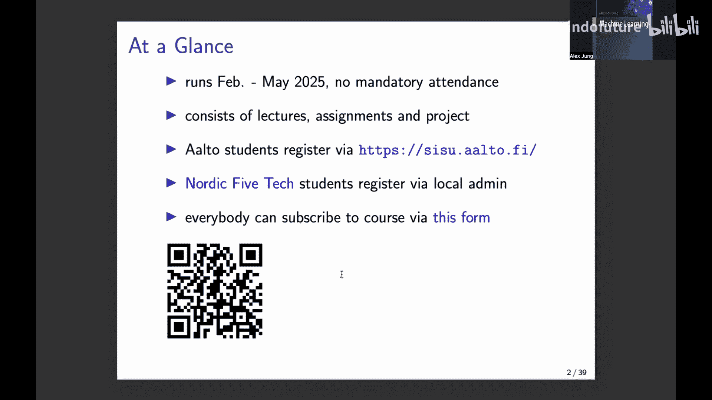

Yeah， in what follows I will first discuss the prerequisites and learning goals of this course。

 I will then discuss the positioning of this course in larger wider curricula。

I will then detail the course， contents and logistics。

Before I start to give an introduction to federated learning and brief refresher of machine learning concepts。

Okay， so regarding the prerequisites， this course assumes that you are familiar with linear algebra。

 so you should be aware what the vector is a real valued vector。

Should have experience with the properties of matrices， matrix operations。

 and norms of vectors and matrices。We will also use basic tools from calculus。

 so you should be somewhat familiar with the concept of。Differentation or gradients。

We will also assume that you had a first course on machine learning。

 so you are familiar with the concept of empirical risk minimization。

And the practical parts of the course， the assignments they will make use of Python。

 so we assume basic familiarity with Python and some packages like Ny or Skiky Learn or their ability to acquire those skills independently during the course。

Yeah， the learning goals of this course are that after completing this course。

 you can model federated learning applications using network models。

You can formulate federated learning as an optimization problem。

You can use optimization methods to construct federated learning algorithms。

 and you will have some tools or some knowledge about that design and how to diagnose federated learning systems。

Okay， so how is this course positioned in the wider machine learning curriculum？

So I will list here some example courses that I found offered at other University or University of Helsinki。

 but most likely we'll find similar courses at other universities or。

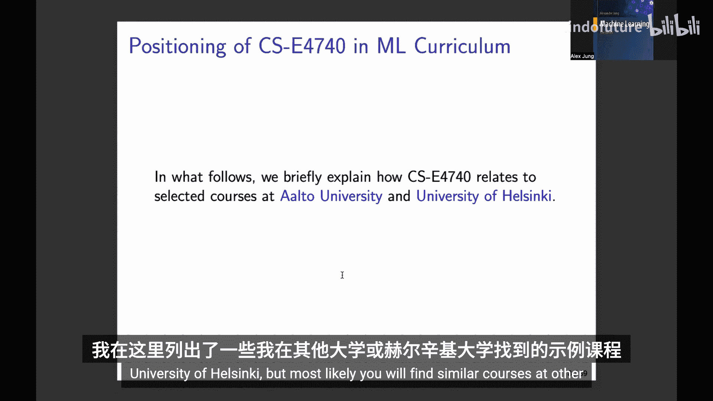

In online form， so the pair necessities， they are covered in a course on on matrix algebra or linear algebra。

So we， we assume that you are familiar with basic properties of matrices。

 the compositions of matrices， Ivalue the compositions。Of matrices。

 as we will use them in our course。Then you should have a first course on machine learning。

 so you should know how to train a model and how to validate a model。 Also。

 some knowledge about regularization techniques can be helpful。

And it would also be very useful if you had a course on applied machine learning or data analysis using Python。

It will be not too much of a problem if you didn't have such a course if you are able to quickly adapt and learn new methods in Python。

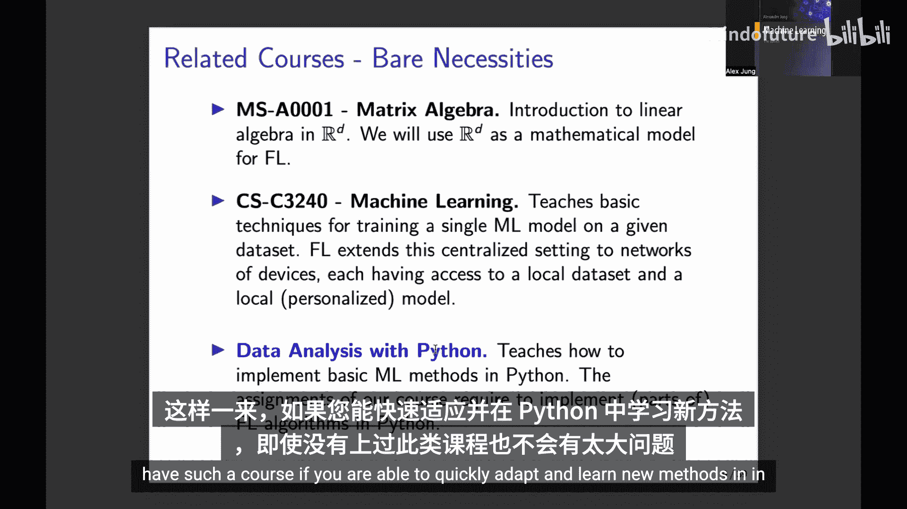

Okay， what is nice to have， but not absolutely necessary is courses on optimization So we have here one course at auto introduction to optimization。

 which is nice to get a first exposure to this concept of building blocks of optimization problems and our course formulates federated learning as an optimization problems。

 so if you had such a course， this gives you a good a very good start for our course。

 but if not we will slowly introduce all the building blocks of these optimization problems as we need them。

Okay then there's another more advanced course on Comvex optimization at Alto University。

 which teaches more advanced techniques to， for example study the convergence rate。

 the convergence speed of different gradient methods。

 and those are very useful for the design and the study of federated learning algorithms as well。

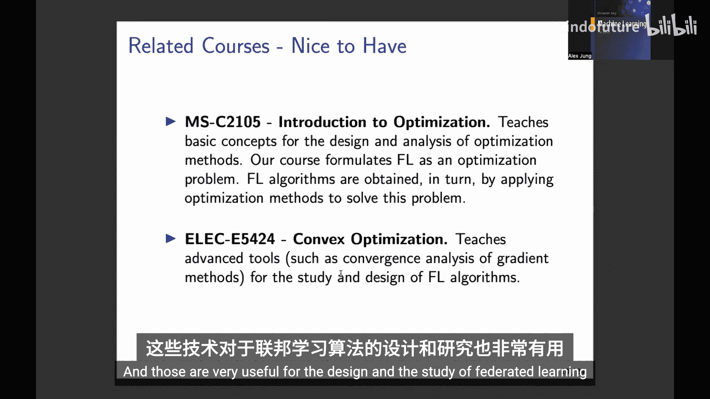

Yeah， as follow up courses， so after completing our Feerated learning course。

 I could recommend a course on wireless systems because at some point we need to implement our federated learning algorithms that we discuss in our course in hardware using physical communication networks and bunch of physical communication networks and mobile networks which use wireless communication。

And I also found another very interesting follow up course at Alto。

 which is distributed in intelligent automation systems。

 So this internet of things is a very important application domain for federated learning to train predictive models for different needs。

Okay now about the course logistics， this course is organized roughly in six models。

 so we have a first model which is a quick refresher of basic machine learning techniques in particular model training validation and regularization。

 then the second model then introduces network model in particular we will use an undirected graph to represent federated learning networks。

We will then in the third model， use these federated learning networks to formulate optimization problems over these networks。

And these optimization problems， they provide us a nice。

 very flexible design principle for a large range of federated learning algorithms。

 so we will then see in Model 4 federated learning algorithms can be obtained in a principled fashion by applying optimization methods to solve this optimization problem underlying federated learning。

Then in Model 5， we will see different federated learning flavors， which for example。

 class at federated learning， vertical Feerated learning， horizontal federated learning。

 and we will see that these are all just special cases of this optimization problem underlying Feerated learning that we discuss in Model 3。

On the final model model， a very important model which builds on all the previous techniques is about trustworth federated learning so here we will see how we can measure or ensure explainability of federated learning methods。

 we will see how we can study the robustness for example。

 against data poisoning attacks and we will learn different measures and methods to ensure privacy protection of federated learning methods Yeah and each of these six modelss consists of a lecture and an assignment。

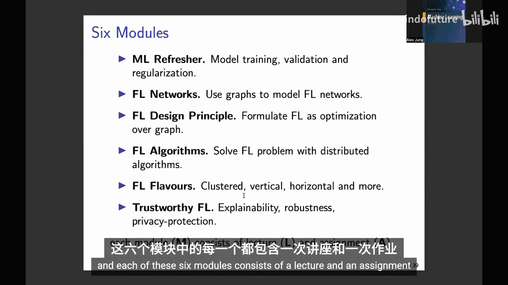

Yeah and these assignments are one of the graded activities。

 so I guess those of you who want to get a certificate for this course are interested in how we grade you。

 so this grading is based on the following activities we have the assignments。

 one assignment for each module and roughly speaking in each assignment you have to implement the concepts from the module or the lecture in Python。

This is also a good way to learn by doing。A second main activity will be a project。

 so we will have student projects where you can apply the techniques that you learn in the lectures to any application that you wish。

 so you are completely free to choose some federated learning application that you study within this project and this is an individual project and you will hear more about the project later on。

Yeah and a third activity that you can do instead of or in addition to the coding assignments is a paper review so from the last edition we got the feedback that some students felt the course could be more advanced so and this paper review activity is meant to serve those more advanced students who want to really dive deep into the state of the machine learning and here you can choose a paper from a curated list。

 we are also open to you as suggestion so if you have a paper in mind。

 a recent paper published paper that you want to review let us know and the task here in this activity is that you have to interpret this paper that you choose in terms of the concept taught in the lectures for example。

 we teach you how to formulate federated learning as an optimization problem so you have to tell us than in your review what is the optimization problem what specific instance of this optimization problem is used or studied in the paper。

The deliverable for this activity will be a presentation。

 so you have to present your review in a slide talk and you have to submit a recording of the slide talk into the slides。

 The recording should be no longer than 10 minutes。

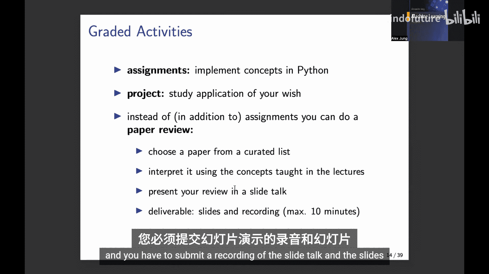

Okay， and after you have collected points in these different graded activities。

 we will add them up according to this scheme here。

 so we have for each assignment maximum  seven points so in each each of these six assignments you can earn maximum  seven points in total maximum 42 points from the assignments。

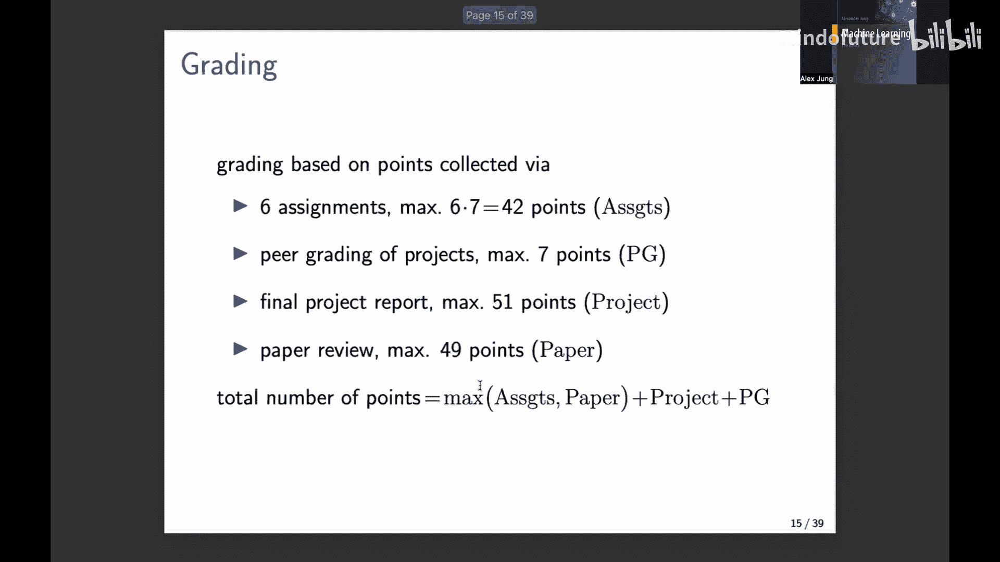

The peer grading of the project will also be evaluated so you can earn up to seven points from the peer grading。

 so how well or how useful are your reviews for the other student projects。

And your own final project report is worth maximum 51 points。Yeah。

 and the paper review can give you up to 49 points。 And this。

 this points from the paper review will be combined with the points you collect from the assignments。

 according to this formula here。 So the total number of points that you get in the course is the maximum of the points from the assignments。

And the points you get from the paper review。Plus， the points you get from the final project submission or final project report plus the points that you collect from the peer grading activity。

 and then we map the the collected points into grades like this。 So grade 1。

 you get for at least 50 points， grade 2， you get for at least 60 points and so on and so forth until the top grade that you get for at least 90 points。

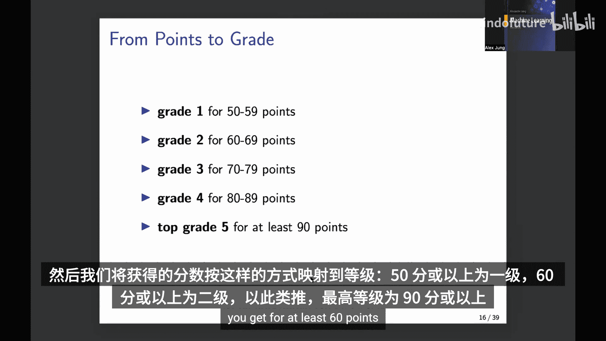

Okay so now briefly discuss the assignments， as I mentioned we have six assignments。

 one assignment for each model and each assignment requires you to implement in Python in the first assignment basic machine learning methods so this is for many of you a refresher of other courses then in the second assignment you have to implement a federated learning network using a certain Python package called network X in the third model you will see how you can implement optimization problem underlying federated learning in Python then you will solve this optimization problem using a federated learning algorithms in Python in the fifth assignment you will implement clustered and vertical federated learning methods and in the last assignment you will study or implement a privacy attack so you will try to determine private or sensitive information from data。

Just by observing the， the messages that are passed in a federal learning algorithm。

And you will implement the methods to improve the subjective explainability of a federated learning method。

对。Yes， for the student project， you have to choose any application of your choice so you can choose whatever you want。

 You can apply federated learning to it。The only requirement is that you have to use the algorithms。

 those Ferate learning algorithms that we discuss in the lectures。Then you have to write a report。

 we will give you a template for this report so the structure of the report is pretty much pretty much fixed。

 it's like a standard structure where you have to first describe the background of your application then you have to describe your methods and then there will be some section where you describe the numerical experiments and the results。

Then you have to submit your report by end of April。And after this submission。

 we will have the peer review， or peer grading period for around two weeks where each one of you has to review and grade a certain number of other reports。

 this might be three to five other reports depending on how many students we have in the course finally and yeah。

 the report then includes a final submission so the project then requires a final submission。

 so you have to submit a revised report where you take into account the feedback。

 the reviews that you get from the other students and a response letter where you explain explicitly how you took this feedback into account by end of May。

So this this is then what we grade for you for your own final for your own student project。

 this final submission， this includes the final revised project report and the response letter。

 both will be used for grading your project or for determining the number of points you got from this project and as mentioned。

 you will also get points by this peer review task， but only a much smaller number。

 so we want to de-emphasize the role of peer review on your grade。Okay， so for the schedule。

 we will have lectures each Monday at quarter past four， starting on the 24th of February。

 we will have six lectures。Then we will have interleaved with the lectures。

 we will have assignment presentations， so we will present each assignment after the corresponding lecture each Wednesday at quarter past four。

 starting on the 26th of February。Then the first submission deadlines will be the 17th of March where you have to submit your solutions for assignment 1 and two。

 you have then to submit the solutions for assignment3 and four by end of March。

And the final submission deadline for assignment 5 and6 is 14th of April。The first project report。

 as I mentioned already， has to be submitted by end of April。

 so this will then be peer reviewed or peer graded by you so you review and grade up to five other project reports until 15th of May and based on the feedback that you get on your project。

 you have to submit your final project report and the response letter by end of May。

For the ground rules， so I just want to remind you those of you who are by registered to this course by a university like Alto University。

 you must act according to the code of conduct at Alto University I have placed here in the slides a link you can then find a link to the slides in the YouTube description of this video。

 but I want to highlight two main ground rules for this course and which are first be honest so this course includes a lot of independent work like the assignment coding assignments the student project has to be individual。

 so there are only individual student projects and this paper I view and we really not stand next to you in all these assignments and check if you do it yourself So we trust you by default that this is independent work and whenever you use something from somebody else you have to indicate the source So this is the basic rule also of academia。

Not plagiarize， do not plagiarize the do not steal others work。

 This could also be a hint from another student for how to solve an assignment。

 you must then indicate it。 and in order to to double check this。

 we will at the end of the course or during the course。

 randomly select students who need to explain any as any activity in detail。

 So whenever you submit something。You can then be asked to explain it to us， for example。

 you submit solutions to an assignment and you might be randomly selected at some point。

 then you have to explain to us your solutions。And if we have the feeling or we have the impression that you do not know about your own solution。

 then we need to consider more disciplinary actions。

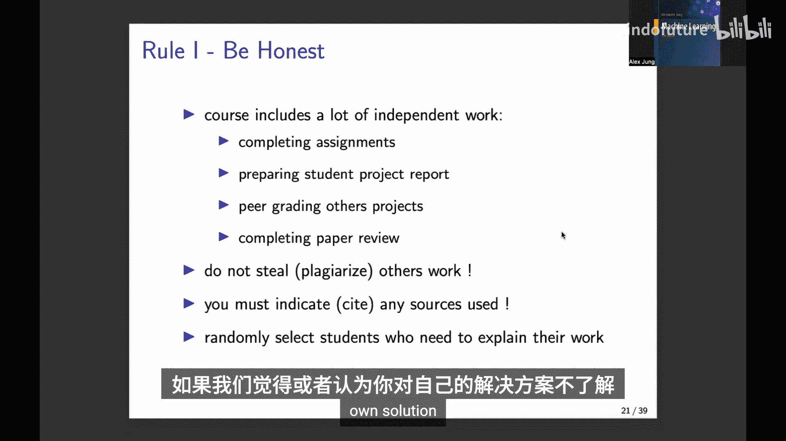

Okay， and the second rule is that you must be respectful。

 so my personal wish is that this course provides a safe space for an enjoyable learning experience for everybody in this course and any form of disrespectful behavior。

 including on the course related communication platforms， will be sanctioned rigorously。

 including the reporting to university authorities。Okay， so let us now start with the course topic。

 which is federated learning。So what is federated learning。

 And one explanation could be Feerated learning trains machine learning models in a distributed fashion over a network of devices。

 So here I have shown one one example application of federated learning。

 which could be the high precision management of pandemic， So maybe you remember while ago。

 we all suffered from this covid restrictions， And one challenge was to find out the best way to isolate people or to reduce the mobility of people。

 And one way could be to use a smartphone app which runs a federated learning algorithm and gives you the optimal prediction for。

 is it safe to go out， Yes or no， is it safe to go out of the house， if。

 if you get a green prediction and it's safe to leave the house。 if read， then it's not safe today。

 almost like a weather forecast。 So this is an example of a federated learning system where each。

Devicice， each smartphone here trains its own model。 It trains a personal model for you。

 Each one of these。 So if you have a smartphone with this app。

 you get optimal predictions for you and to learn how to do these predictions。

 these federated learning components cooperate with each other。 So there's a cooperative。

 cooperative aspect， cooperative aspect。Collaborative aspect in federated learning。

 you you use a bit of information from the other users or the other potential patients to get a better model for yourself。

 You might also include very large databases that are freely available， for example。

 from public institutions。 So federated learning can often involve very different types of devices。

 So heterogeneous networks。 and we will see how we can model these heterogeneous networks using mathematical optimization models。

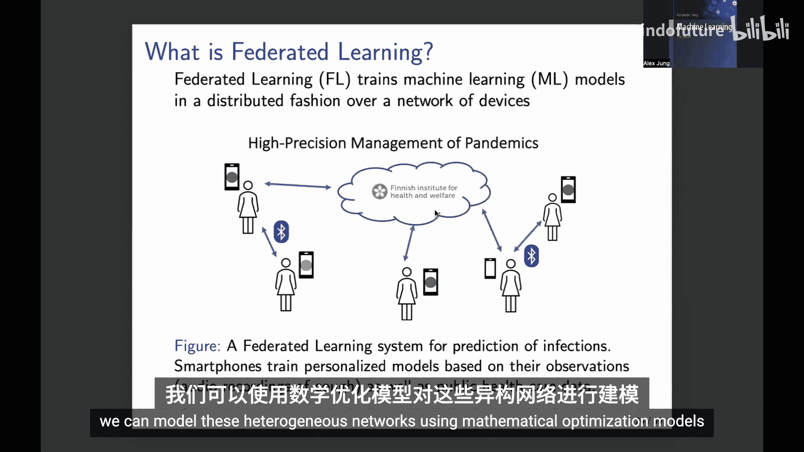

Okay， some of the key characteristics of federated learning is that we do not necessarily need a centralized data collection。

 which makes it robust。 if you have a centralized server which holds all the data。

 then you have a single point of failure。 So if if this single data storage goes south gets destroyed it's gone everything is gone。

 but infeerated learning， the information and the knowledge is distributed over many， many nodes。

 millions， billions of node。So a second characteristic is that each device trains a personalized model。

 so this this is a natural way to obtain personalization。

 You train a model for each individual user or device and these models can then be way more precise or way more accurate than an average model。

Like if you， if you want a prediction for how long does a certain bicycle ride take you。

 then you want to make a prediction， then you want to get a prediction that is tailored to you。

 Give your fitness level and your bike。 and you don't want an average prediction。As an example。

Another key characteristic is this collaborative approach or collaborative aspect。

 so in federated learning， we share information and computational power。 so this goes hand in hand。

 we share data and compute among devices some other devices compute a bit and the results of this computation can be sent back in some form to me and help me to get a better model and also the results of this computation。

 carry information， So not only we spread the computational burden。

 but we also share or collect information from other nodes。And this allows scalability。

 so we can then solve way larger machine learning problems than each one of us alone with。

 with a single smartphone。😊，Yeah， and the last key characteristic is that no typically no raw data is shared。

 we do not exchange images in a federated learning system typically。

 but only some summary statistic or some result of computations that are done by a machine learning algorithm and this results that we then share they carry way less information about private attributes or sensitive data than the raw data。

 so this makes federated learning inherently privacy friendly。Yeah。

 have you depicted a few possible federated learning applications that you might consider in your project。

 so maybe I pick out a few here。 maybe the most important one and also where this term federated learning or the field really took off is in healthcare because in healthcare we have very strict privacy regulations。

 I don't want my personal healthcare records to be shared with all of you still I would be willing to share the information that is contained in my healthcare records to train a better model for cancer prediction or something so this is actually this is the requirements for federated learning are exactly the requirements in like what we have in healthcare we have a lot of data around raw data like our healthcare records which are very sensitive so we cannot easily share it。

 they are very much protected， but this collection of data。

Each one physician has our own database of his patients， his or her patients。

 carries a lot of information that can be used for each one of us to get a better predictive model or better therapy predictions for each one of us。

So healthcare is maybe the most important application domain mean intill for federated learning。

 Theres also federated learning techniques coming up in finance to improve fraud detection or risk assessment。

 Ive found here some recent references that you can also find most likely in the paper list for a candidate paper for doing a paper review。

 You can also choose these topics in your projects。

Another recent application domain that's maybe gaining more and more traction is in smart grids。

 So the power supply is more and more in the form of heaterchs network。

 So you have renewable energy every some of us might have their own wind turbine or solar panel yet So you want to know。

 for example， in in my case， we have a solar panel and it would be interesting to know when is the best time to start a washing machine because when I start a washing machine。

 I should be pretty sure that within the next one or two hours。

 there will still be sunshine because if there's all of a sudden clouds the solar panel doesn't deliver enough power anymore And I have to take more costly or more expensive energy from the power grid from the conventional power grid to serve my washing machine。

 So for this， I would like to have a federated learning app that delivers for me。

 the perfect prediction。My area， from my house， how likely is there sunshine in the next two hours。

 So I really with high precision predictions。 And this is something that federated learning might be able to do。

Okay so federated learning is of course a subfield of machine learning and what it sets apart is that instead of this basic machine learning setting where we train a single model by minimizing an average loss on a single data。

 we now have a whole network of different models， personal models and each of these models is trained by its own local data so we in Python for example。

 maybe some of you have implement machine learning Python so this picture here might be familiar you this is a standard codenippet where you read in data you read in data somehow you store it in anumpiary X for the features and y for the labels。

 you choose a model which is some Python object。And you fit the model。 So you。

 this dot fit does in the end， nothing but trying to minimize the training error by tuning the parameters of this model。

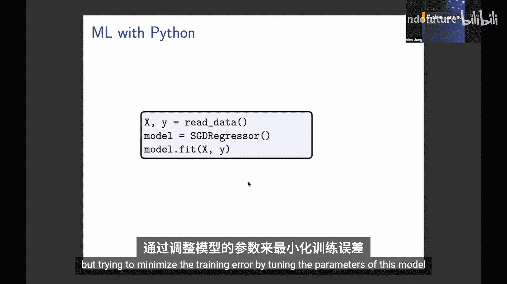

And now from federated learning， we go sorry from machine learning we go to federated learning with Python by just having several instances of this workflow。

 So you have one of these Python called snippets running on different machines each machine here is indicated by a different I address and so how do they collaborate Well they can collaborate via read data function。

 So in this read data function and this you will see then later in the course。

 how to implement this this read data function could be， for example。

 reading data from this IP address and the information that is shared here is not raw data is not the raw data from this。

 but it's for example， a model parameter update like a delta W a model parameter update that is used somehow in in this read data function to generate new feature matrix and and label vector can you can turn model。

Pmeters into data。 you will see this later。 So like machine learning machine learning training turns data into a trained model。

 but you can also do it the other way。 and we will use this to to implement and construct federated learning systems which which just exchange this model parameter updates and similar。

 you could use here and this rate data function on this device。

 you could read in the data from here and from here。And of course。

 you typically cannot communicate with all devices。

 but you have some network structure and we will encode this network structure or represent this network structure or communication structure of a federated learning system using this concept of federated learning networks。

 which we will see later。So you see it's really a natural evolution of machine learning。

 Machine learning with Python is you have one data set。You have one data and one model。

 you trained the model on this data In federated learning， you have several。Models， so each one。

 and yeah， by the way here， we have here different models。

 So we will also see federated learning systems that can use different models for different devices。

 So this device here has SD stochastic gradient decent regressiongressor model type of model。

 This here has a linear regression model。 And this here is a decision tree。

 So this quite different models。 But you will see how we can still couple them。

 how they still can collaborate with each other to get to train down each of these models spec。

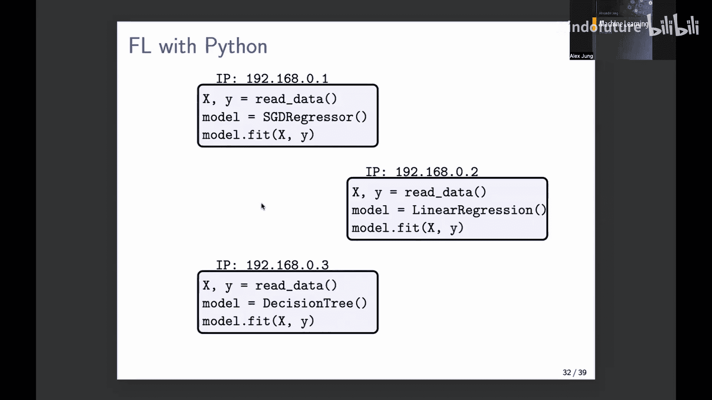

Yeah， and more， more abstract depiction of this generalization is you have here a single point cloud。

 This is。 this is machine learning here on the left。We have your machine learning。And。On the right。

 we have federated learning， so we have several point clouds。And for each point cloud。

 we want to train a different model， but somehow we want to also share information between those model training instances。

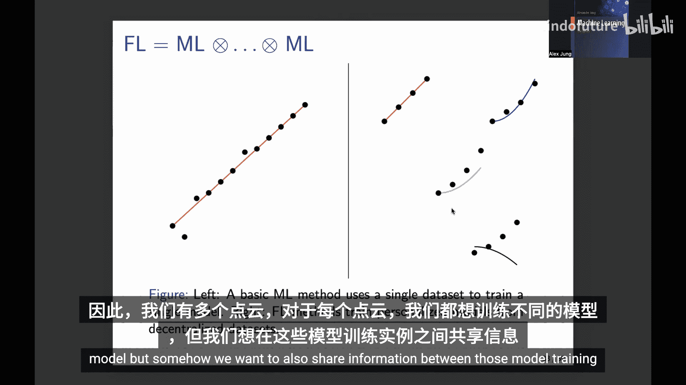

Okay， so now the final part of this first lecture is just a quick recap for some of you。

 for most of you， maybe this will be redundant。 but for some of you。

 it might be useful to have a quick recap of machine learning。

 So machine learning is all about learning a hypothesistheesis map。

 this can be a very complex hypothesis map， for example， song recommendation。

 And the goal of this recommendation is to find the best song to lift the mood up。 So， for example。

 and Finland in November， it's very dark here。 and people are very tired。 it's very tough。

 but sometimes a good song can really lift up the mood。 And here is a machine learning problem。

 So you want to learn for a data point， which is a specific user like me in this case。

 and you have certain features。 So the mood tired。 You have the daytime。 It's currently evening。

 So what should you play。To lift the mood of this user and the prediction is like the song Pohemian Rpsody and just to point out that there's a reasonable or serious work about this here is a reference to some work on the effect of music therapy。

 so this could be actually quite useful application of ma learning。

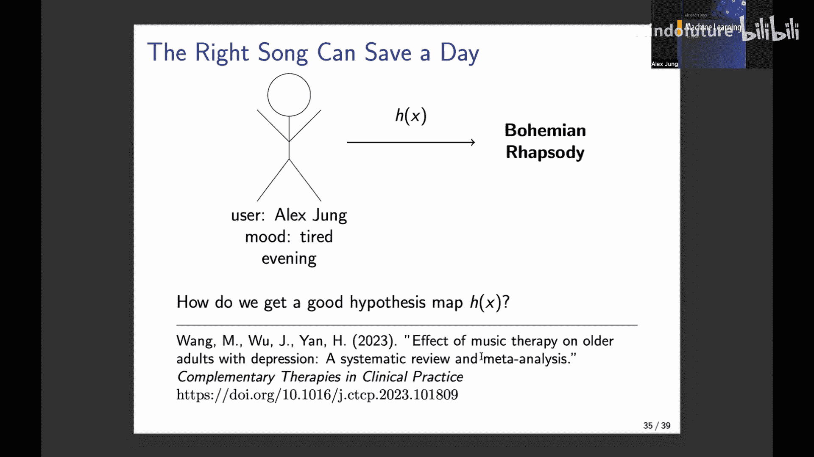

And how， how do we learn this hypothesis， Well， we learn a hypothesis by evaluating its usefulness and its usefulness is in machine in most machine learning methods evaluated by。

Measuring the prediction error。 So we have here here。 for example， we have a data point。

 a blue data point。 and we want to， we measure the prediction error as the difference between the the true label of the data point and the predicted label。

 This is the the function value， H of x， so。We then average these losses。

 and we can use different types of loss functions。 This a design choice。 For example。

 we can use the squared error loss here。 Squared error loss is a popular choice for measuring predictions errors。

 And then what machine learning does， what model training is is solving this optimization problems。

 So here you also see how machine learning is formulated as an optimization problem。

 and in this course， you will see how to formulate federated learning as an optimization problem。

 So we will extend this this formulation， which is called empirical risk minim to cover or to introduce this coupling with other nodes。

 because if if we would not collaborate in a federated learning systems among the devices。

 then we could just look at each device independently and started using machine learning techniques。

 But what makes federated learning is the collaboration between different such learning problems。

 And the way we do it， we will see later is actually a form of。

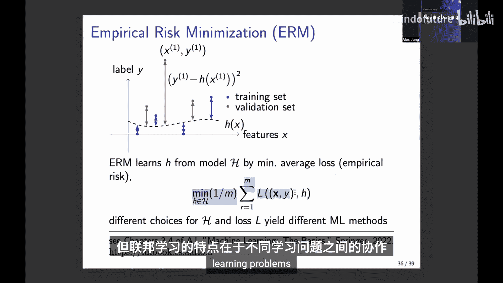

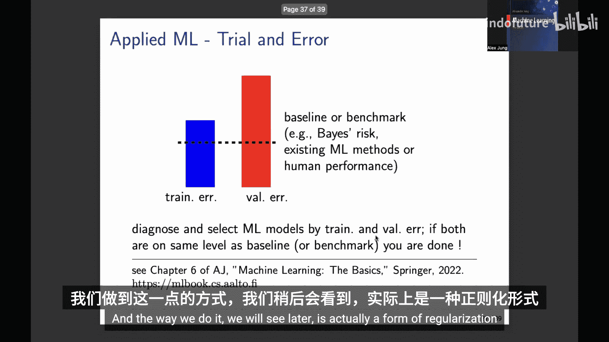

Regularization。 but before I talk about regularization。

 I just want to complete the discussion of the basic machine learning workflow。

 So after we have solved this training problem， for example。

 using a dot fit function in Python we get a training error and one of the most important rules in applied machine learning is never ever stop after model training。

 you must always validate the trained model and we validate the trained model by computing the prediction errors or the average loss on a validation set that has not been used has not been used in this training problem。

 So this red red dots here， this red data points， they are not used in this training problem。

 But we use this red dots to compute the validation error。

 and then you can analyze to a large degree or quite a lot。

 you can diagnose machine learning methods just by comparing this training error with the validation error。

 you can then see if the model overfi。

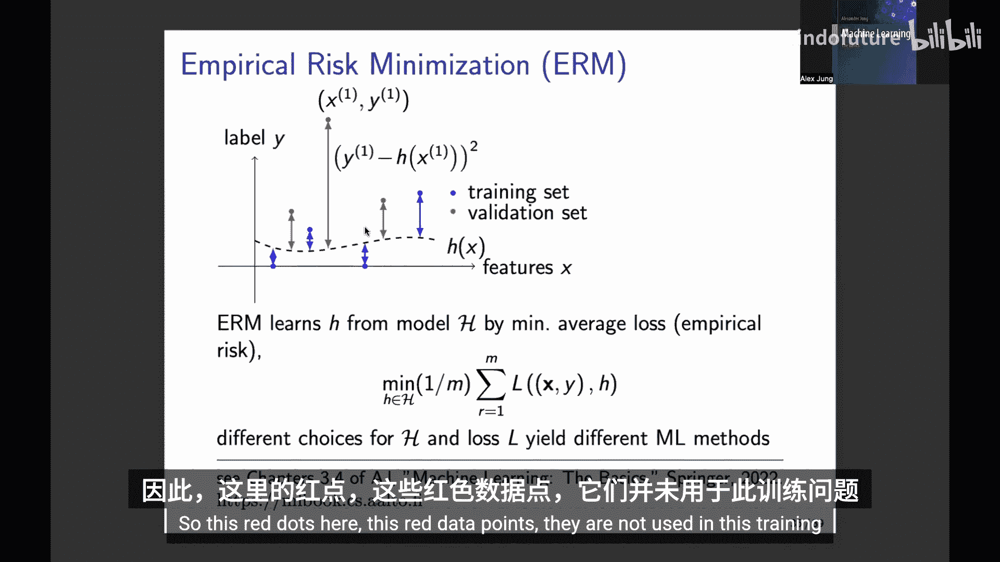

If you should use more training data。Or if it underfits， you should use more complicated models。

And this is then the， I would say， the day to day loop of an applied machine learning scientist。

 So you， you try out different models。Or increase or you use different training data sets and see what what you get for the training error and validation error。

 And as soon as the training error and the validation error are on the same level as a benchmark or your target performance。

 then you are done。 So this is then an iterative loop to that each iteration includes a change of the model。

 hyperparit or change of the training data， gather more data or replace some data points because they might be poisoned。

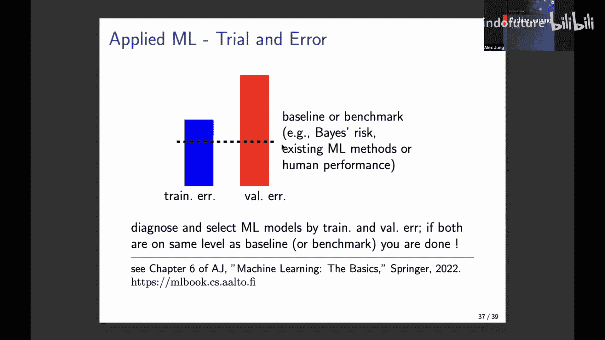

And instead of of this， let's say trial discrete trial and error approach。

 you could use a more smooth approach， which is regularization。

 So applied machine learning is many applied machine learning techniques are based on the idea of artificially extending the training set by data augmentation So you say instead of observing a data point with feature value3。

 I could also have observed a data point with feature value 3。

2 because this feature values might come from a noisy sensor。

 which by itself has some only some some tolerance level up to 2% error tolerance or something So you could say naturally it would make sense to add to each original data point a slightly perturbed version and this is the idea of data augmentation So in data augmentation we augment each original data point by several perturbations and different data augmentation methods are obtained。

But different choices for this perturbation。 So this perturbation could be just add some random noise。

 or if a data point is an image， it could mean to to rotate an image because often when you rotate an image。

 its label， for example， if it shows a cat， doesn't change。

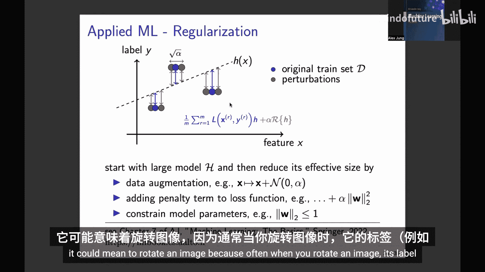

Okay so this was just a very quick overview of the machine learning basics and in the next model we will see how we can extend this basic machine learning setting to federated learning by using networks or in particular we will introduce the concept of federated learning networks which will be our main mathematical model for federated learning applications and in the later models we will see how we can use this federated learning networks to design and to analyze federated learning systems。

Thanks for your attention。

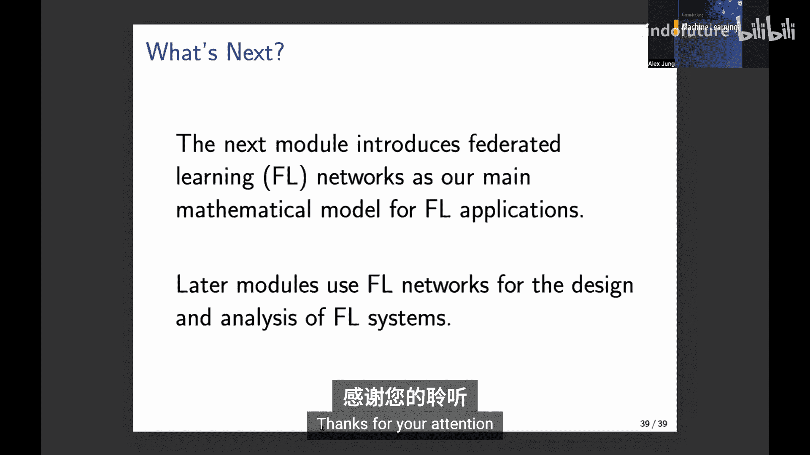