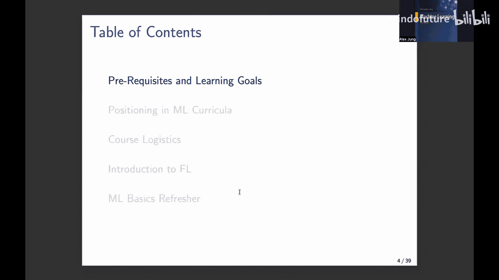
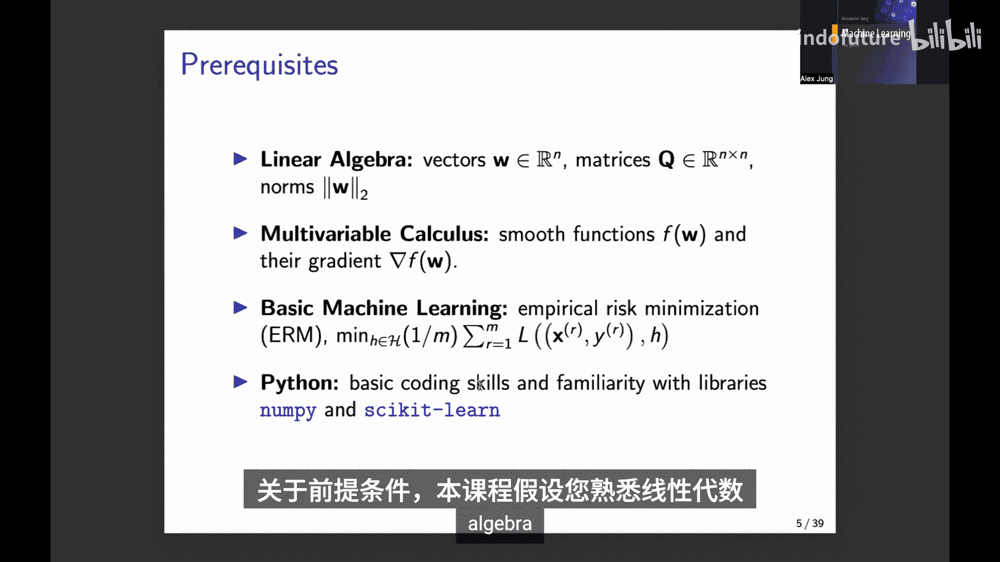
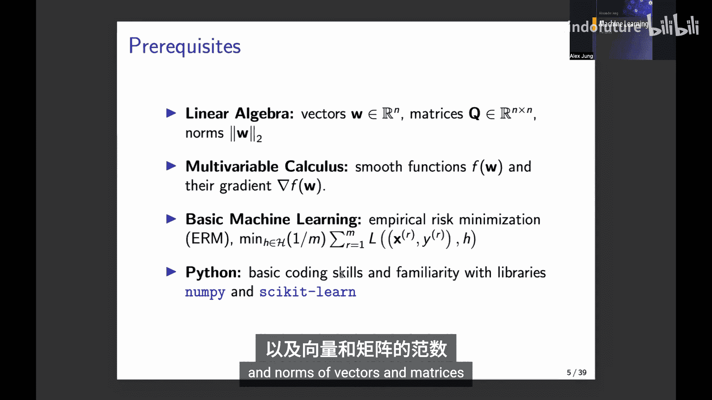
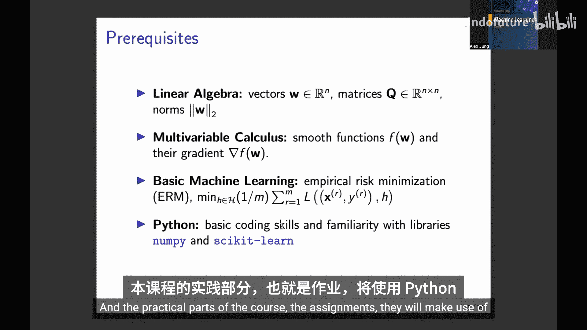
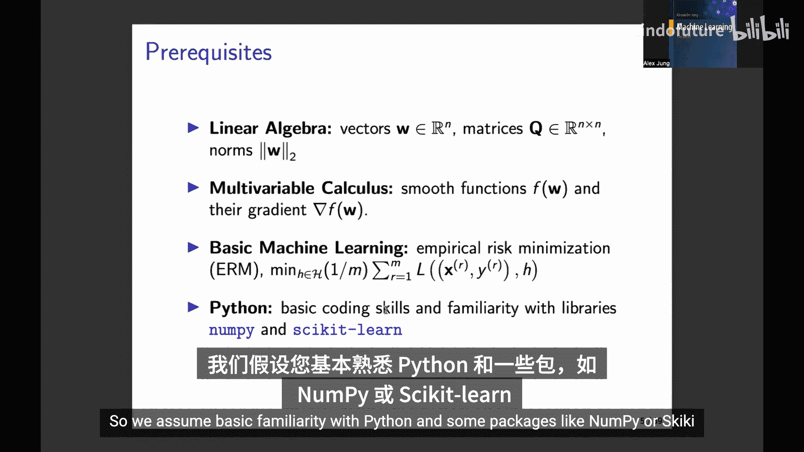
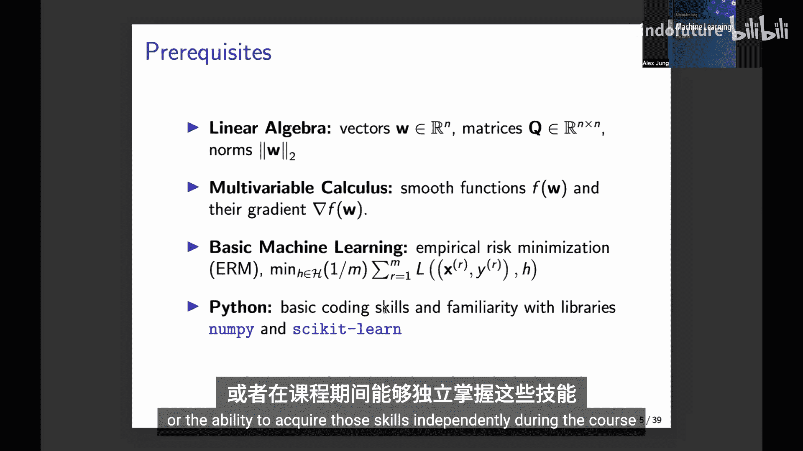

# 【阿尔托大学 - 中英】联邦学习 CS-E4740（Federated Learning，spring 2025） p02 P02 CS-E4740 Federated Learning - Course Prerequisites -BV1cojRzDEfQ_p2-

So regarding the prerequisites， this course assumes that you are familiar with linear algebra。

 So you should be aware what a vector is， a real valued vector。

Should have experience with the properties of matrices。

 matrix operations and norms of vectors and matrices。

We will also use basic tools from calculus， So you should be somewhat familiar with the concept of。

Differentation or gradients。We will also assume that you had a first course on machine learning。

 so you are familiar with the concept of empirical risk minimization。

And the practical parts of the course， the assignments， they will make use of Python。

 so we assume basic familiarity with Python and some packages like numpy orkiky learn or their ability to acquire those skills independently during the course。

Yeah。