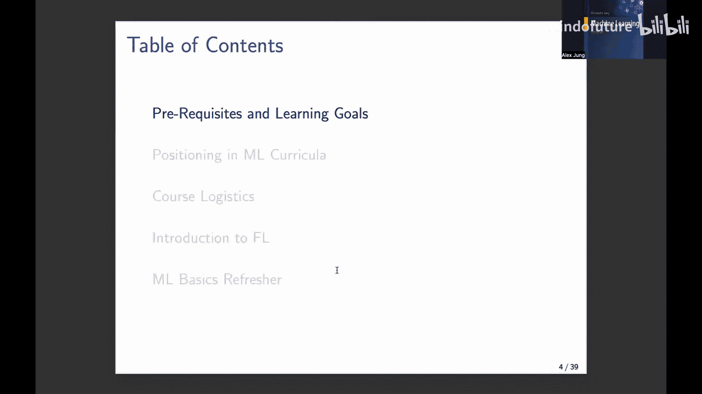
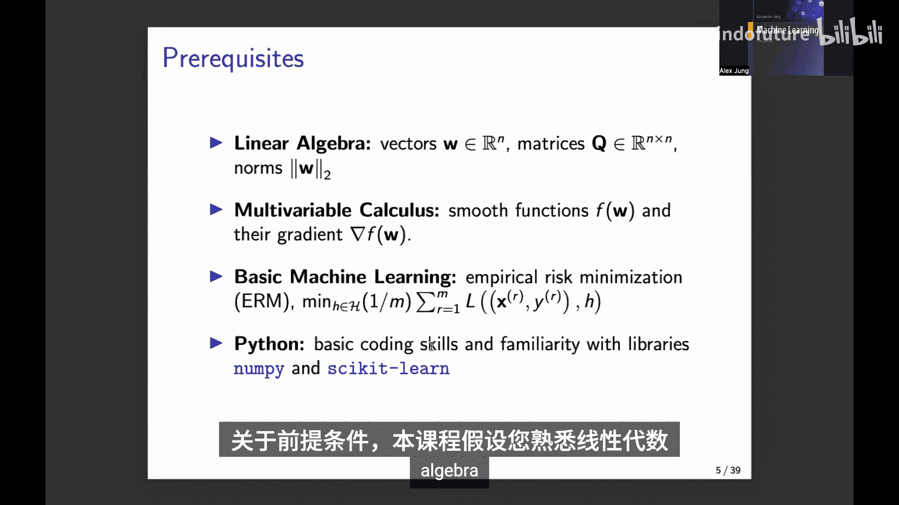
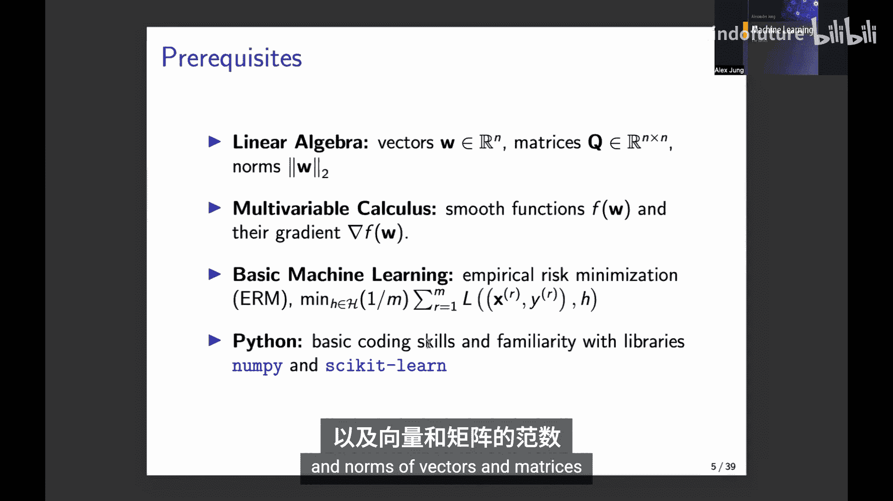
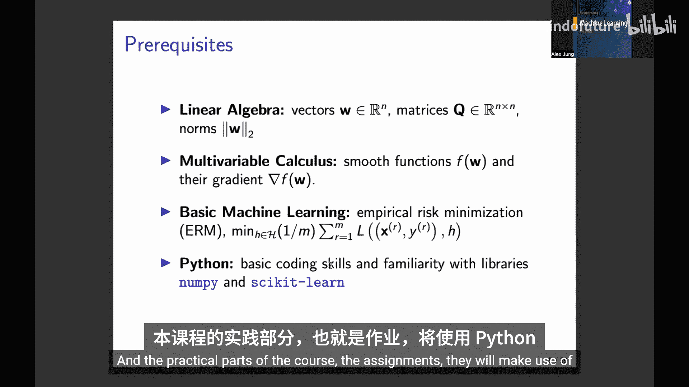
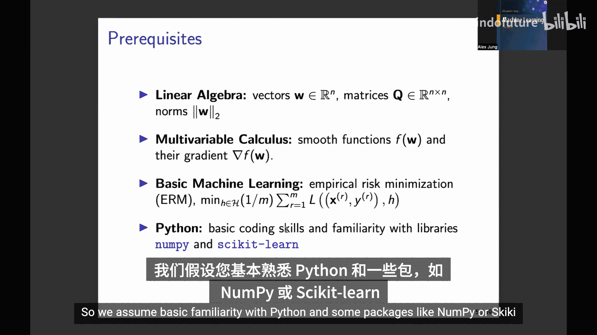
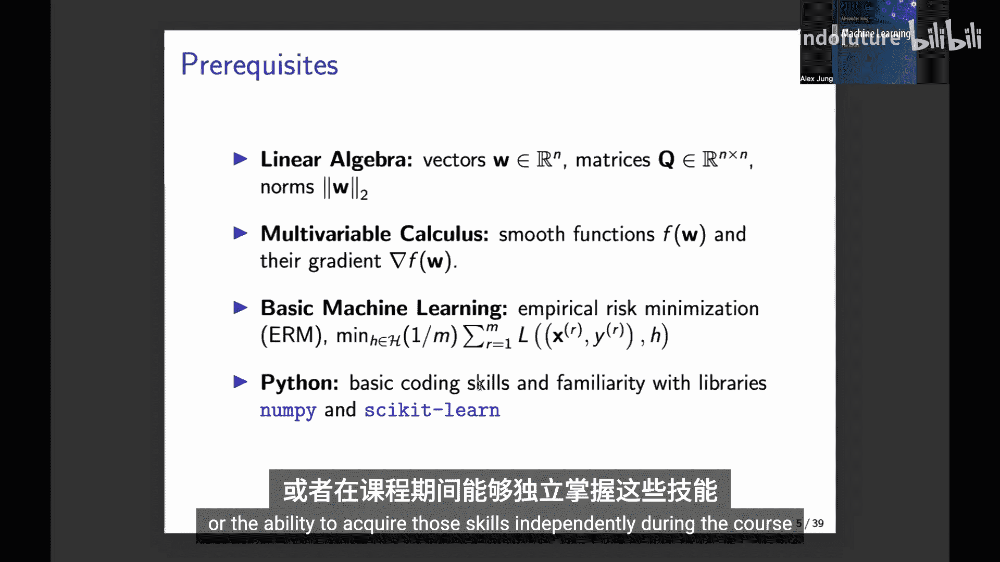

# 联邦学习 CS-E4740：P02：课程先修知识 📚

在本节课中，我们将介绍学习本课程（联邦学习）所需具备的先修知识。了解这些基础知识将帮助你更顺利地跟上后续的课程内容。

---

## 线性代数基础





上一节我们介绍了课程概述，本节中我们来看看所需的数学基础。本课程假定你熟悉线性代数。

以下是需要掌握的核心概念：
*   你应该了解什么是**向量**，特别是实值向量。在数学中，一个n维实值向量可以表示为：**x ∈ ℝⁿ**。
*   你应该具备矩阵性质的相关知识。
*   你需要熟悉矩阵运算，以及向量和矩阵的**范数**。例如，向量的L2范数计算公式为：**||x||₂ = √(Σᵢ xᵢ²)**。

---



## 微积分与机器学习基础

掌握了线性代数后，我们还需要一些其他数学和理论基础。

我们将使用微积分中的基本工具，因此你应该对**微分**或**梯度**的概念有所了解。梯度是一个向量，指向函数值增长最快的方向。

同时，我们假定你已经学习过机器学习入门课程，熟悉**经验风险最小化**的概念。其核心目标是找到最小化训练集上平均损失的模型参数，公式可表示为：**min (1/n) Σᵢ L(f(xᵢ; w), yᵢ)**，其中 `L` 是损失函数，`f` 是模型，`w` 是参数。

---

## 编程技能要求

理论需要实践来巩固，本课程的实践部分将涉及编程。



在课程的实践环节和作业中，我们将使用 **Python** 语言。因此，我们假定你具备基本的Python编程能力，并且对 `numpy`、`scikit-learn` 等常用科学计算库有所了解。或者，你应具备在课程期间独立掌握这些技能的能力。例如，你需要会用 `numpy` 进行向量和矩阵操作：
```python
import numpy as np
vector = np.array([1, 2, 3])
matrix = np.array([[1, 2], [3, 4]])
```



---



本节课中我们一起学习了联邦学习课程所需的先修知识，主要包括线性代数、微积分与机器学习基础理论，以及Python编程实践能力。确保掌握这些内容将为后续深入学习联邦学习算法和完成课程实践打下坚实基础。