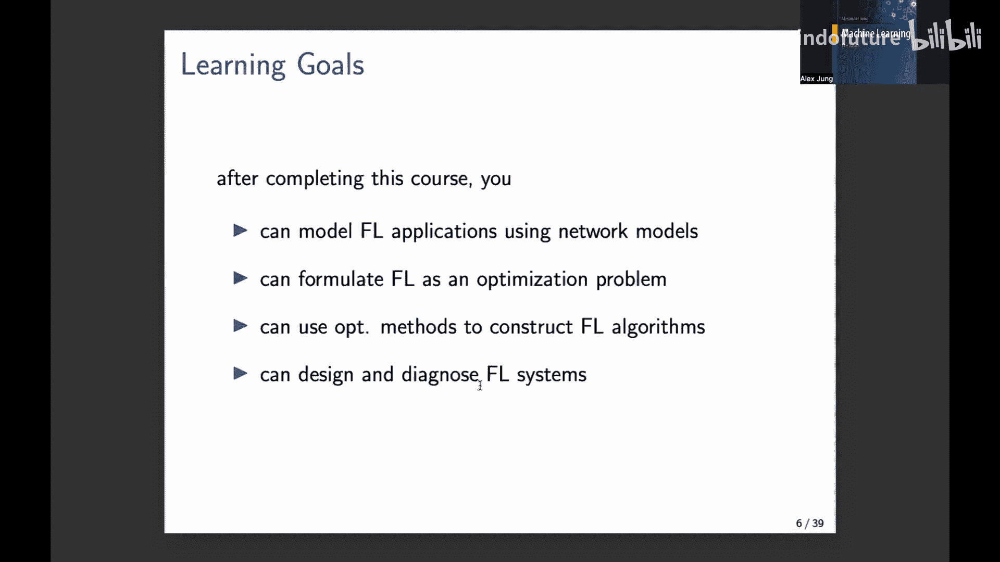
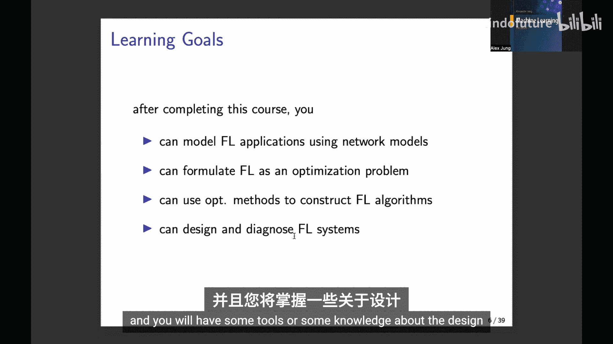

# 【阿尔托大学 - 中英】联邦学习 CS-E4740（Federated Learning，spring 2025） p03 P03 CS-E4740 Federated Learning - Learning Goals -BV1cojRzDEfQ_p3-

The learning goals of this course are that after completing this course。

 you can model federated learning applications using network models。

You can formulate federated learning as an optimization problem。

You can use optimization methods to construct federated learning algorithms。

 and you will have some tools or some knowledge about the design and how to diagnose federated learning systems。

