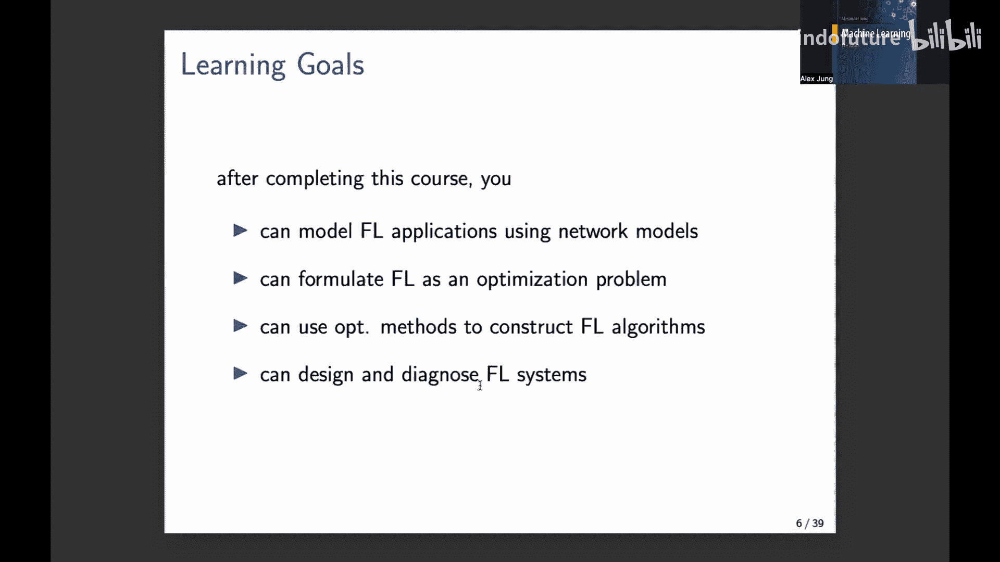
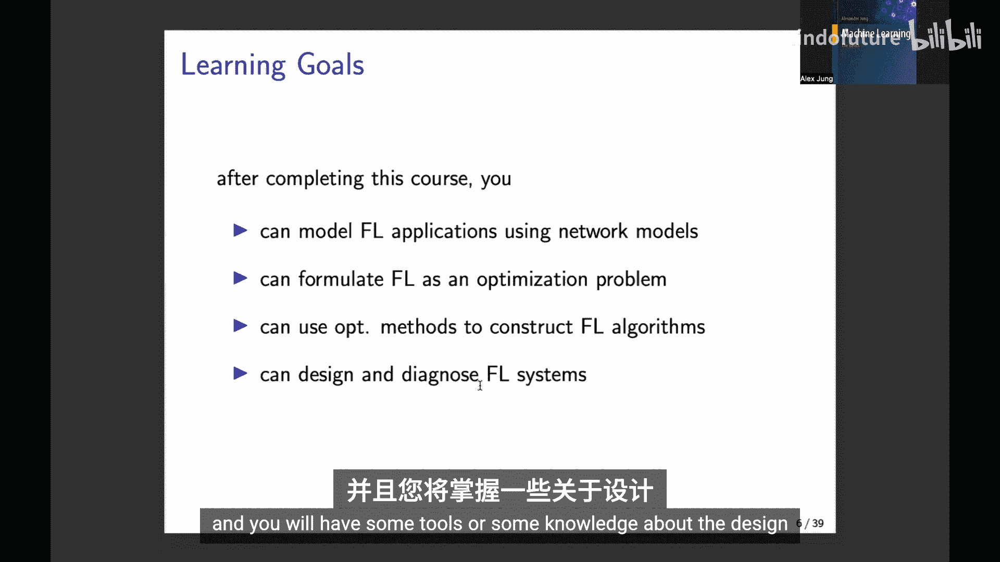

# 联邦学习 CS-E4740：P03：课程学习目标 🎯

在本节课中，我们将明确本课程的学习目标。完成本课程后，你将能够掌握联邦学习的基本建模、问题构建与算法设计能力。

---



## 概述

本课程旨在使你掌握联邦学习的核心知识与实践技能。具体而言，课程结束后你将达成以下四个主要学习目标。

---

## 学习目标详解

上一节我们概述了课程的整体方向，本节中我们来详细看看每一个具体的学习目标。

以下是本课程的四个核心学习目标：

1.  **使用网络模型为联邦学习应用建模**
    你将能够识别和描述联邦学习场景中的参与方（如客户端、服务器）及其通信拓扑，并使用图论或网络模型来形式化表示这些关系。

2.  **将联邦学习表述为一个优化问题**
    你将理解如何把分散在多个设备上的机器学习任务，抽象为一个统一的数学优化问题。其核心形式通常为：
    **`min_{w} [ Σ_i (n_i / N) * F_i(w) ]`**
    其中，`w` 是全局模型参数，`F_i(w)` 是第 `i` 个客户端上的局部损失函数，`n_i` 是其数据量，`N` 是总数据量。

3.  **运用优化方法构建联邦学习算法**
    你将学会应用和改编经典的优化算法（如随机梯度下降SGD）来解决联邦学习中的优化问题。例如，联邦平均（FedAvg）算法的核心更新步骤可以用以下伪代码描述：
    ```python
    # 服务器端执行
    for each round t:
        w_t_global = aggregate(client_updates) # 聚合来自客户端的模型更新
    # 客户端k执行
    w_{t+1}^k = w_t_global - η * ∇F_k(w_t_global) # 进行本地训练
    ```

4.  **掌握联邦学习系统的设计与诊断工具**
    你将了解设计一个实用联邦学习系统时需考虑的关键要素（如通信效率、隐私保护、异构性处理），并学会使用相关指标和方法来评估、调试系统性能。

---



## 总结

本节课中我们一起学习了本课程的四大学习目标。总结来说，你将从**建模**、**问题构建**、**算法实现**到**系统设计**，逐步建立起对联邦学习的完整知识体系与实践能力。接下来的课程将围绕这些目标展开深入讲解。