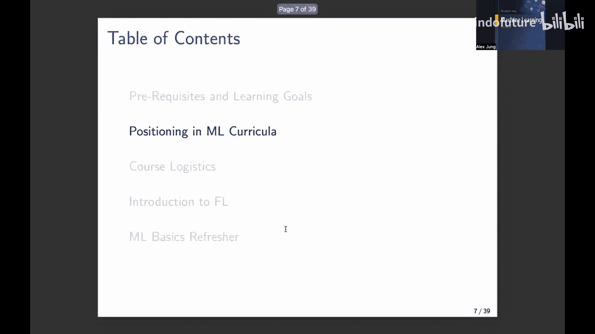
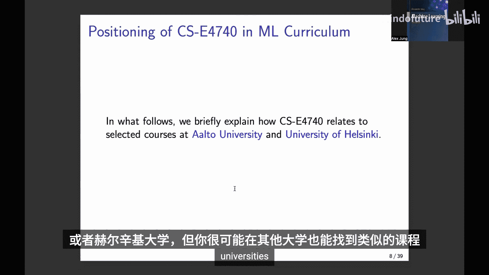
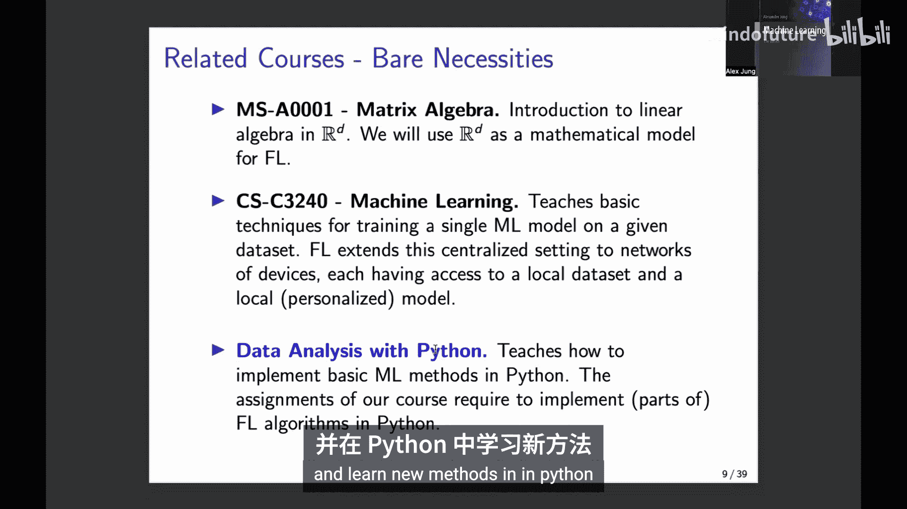
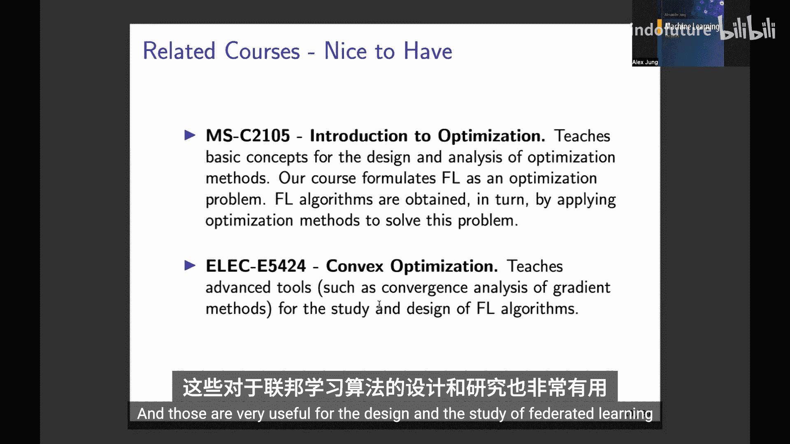
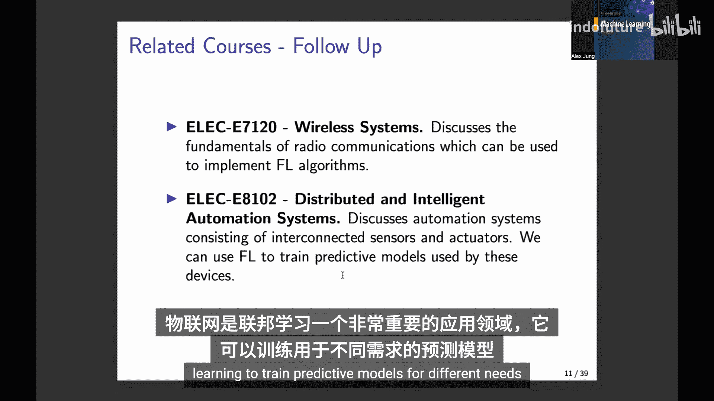

# 【阿尔托大学 - 中英】联邦学习 CS-E4740（Federated Learning，spring 2025） p04 P04 CS-E4740 Federated Learning - Related Courses -BV1cojRzDEfQ_p4-

Okay， so how is this course positioned in in the wider machine learning curriculum。

So I will list here some example courses that I found offered at El University or University of Helsinki。

 but most likely well find similar courses at other universities or。

In online form， so the pair necessities， they are covered in a course on on matrix algebra or linear algebra。

So we， we assume that you are familiar with basic properties of matrices。

 the compositions of matrices， Ivalue the compositions。Of matrices。

 as we will use them in our course。Then you should have a first course on machine learning。

 so you should know how to train a model and how to validate a model。 Also。

 some knowledge about regularization techniques can be helpful。

And it would also be very useful if you had a course on applied machine learning or data analysis using Python。

It will be not too much of a problem if you didn't have such a course if you are able to quickly adapt and learn new methods in Python。

Okay， what is nice to have， but not absolutely necessary is courses on optimizations we have here one course at auto introduction to optimization。

 which is nice to get a first exposure to this concept of building blocks of optimization problems and our course formulates federated learning as an optimization problems So if you had such a course。

 this gives you a good a very good start for our course。

 but if not we will slowly introduce all the building blocks of these optimization problems as we need them。

Okay， then there's another more advanced course on Comx optimization at Alto University。

 which teaches more advanced techniques to， for example， study the convergence rate。

 the convergence speed of different gradient methods。

 and those are very useful for the design and the study of federated learning algorithms as well。

Yeah， as follow up courses， so after completing our federative learning course。

 I could recommend a course on wireless systems because at some point we need to implement our federated learning algorithms that we discuss in our course in hardware using physical communication networks and bunch of physical communication networks and mobile networks which use wireless communication。

And I also found another very interesting follow up course at Alto。

 which is distributed in intelligent automation systems。

 So this internet of things is a very important application domain for federated learning to train predictive models for different needs。

