# 【阿尔托大学 - 中英】联邦学习 CS-E4740（Federated Learning，spring 2025） p05 P05 CS-E4740 Federated Learning - Course Outline -BV1cojRzDEfQ_p5-

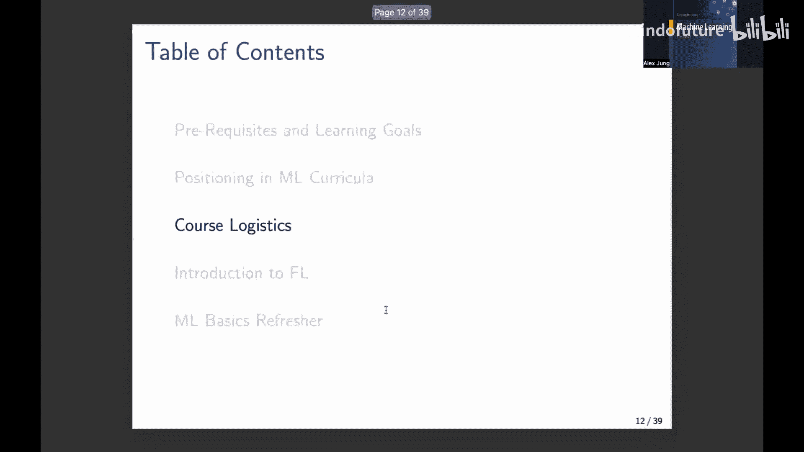

Okay now about the course logistics， this course is organized roughly in six models。

 so we have a first model which is a quick refresher of basic machine learning techniques in particular model training validation and regularization then the second model then introduces network model in particular we will use an undirected graph to represent federated learning networks。

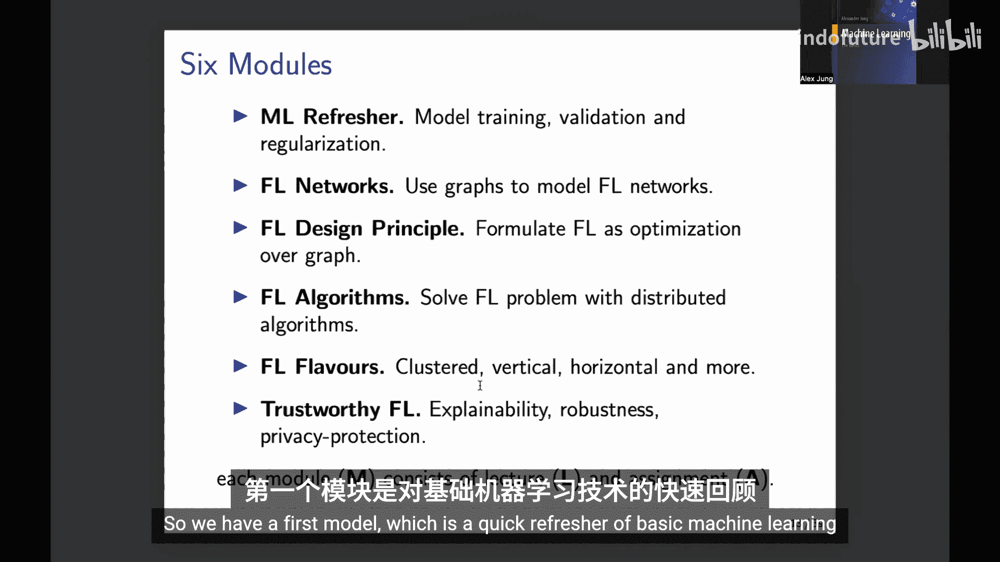

We will then in the third model， use these Feerated learning networks to formulate optimization problems over these networks。

And these optimization problems， they provide us a nice。

 very flexible design principle for a large range of federated learning algorithms。

 so we will then see in Model 4 federated learning algorithms can be obtained in a principled fashion by applying optimization methods to solve this optimization problem underlying federated learning。

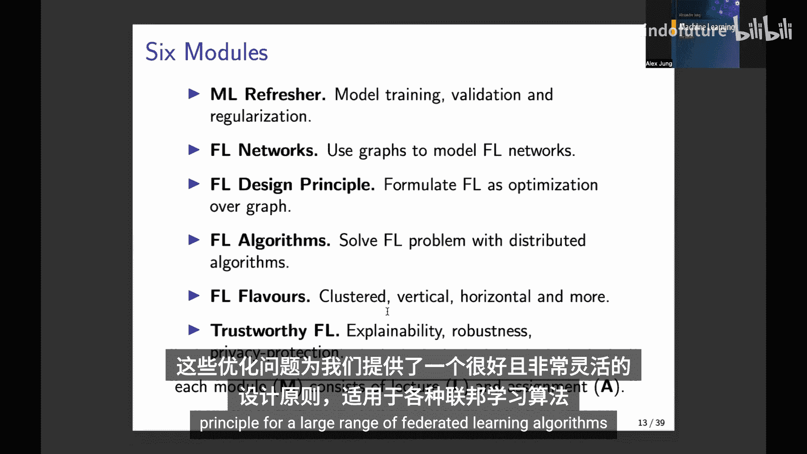

Then in Model 5， we will see different federated learning flavors， which for example。

 class at federated learning， vertical federated learning， horizontal federated learning。

 and we will see that these are all just special cases of this optimization problem underlying federated learning that we discuss in Model 3。

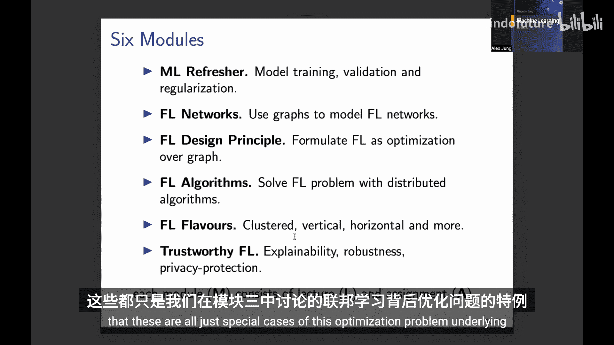

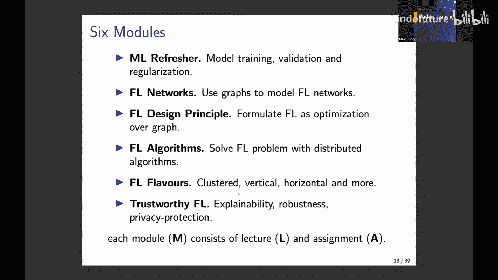

On the final model model， a very important model which builds on all the previous techniques is about trustworth federated learning。

 so here we will see how we can measure or ensure explainability of federated learning methods we will see how we can study the robustness for example。

 against data poisoning attacks and we will learn different measures and methods to ensure privacy protection of federated learning methods Yeah and each of these six modelss consists of lecture and an assignment。

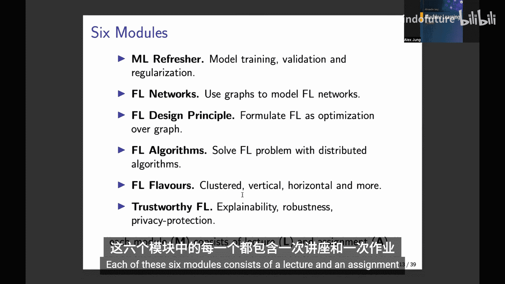

Yeah and these assignments are one of the graded activities。

 so I guess those of you who want to get a certificate for this course are interested in how we grade you。

 so this grading is based on the following activities we have the assignments one assignment for each model and roughly speaking in each assignment you have to implement the concepts from the model or the lecture in Python。

This is also a good way to learn， by doing。A second main activity will be a project。

 so we will have student projects where you can apply the techniques that you learn in the lectures to any application that you wish。

 so you are completely free to choose some federerate learning application that you study within this project and this is an individual project and you will hear more about the project later on。

Yeah and a third activity that you can do instead of or in addition to the coding assignments is a paper review so from the last edition we got the feedback that some students felt the course could be more advanced so and this paper review activity is meant to serve those more advanced students who want to really dive deep into the state of the machine learning and here you can choose a paper from a curated list we are also open to your a suggestion so if you have a paper in mind。

 a recent paper published paper that you want to review let us know and the task here in this activity is that you have to interpret this paper that you choose in terms of the concept taught in the lectures。

 for example， we teach you how to formulate federated learning as an optimization problem so you have to tell us then in your review what is the optimization problem what specific instance of this optimization problem is used or studied in the paper。

The deliverable for this activity will be a presentation。

 so you have to present your review in a slide talk and you have to submit a recording of the slide talk into the slides。

 The recording should be no longer than 10 minutes。

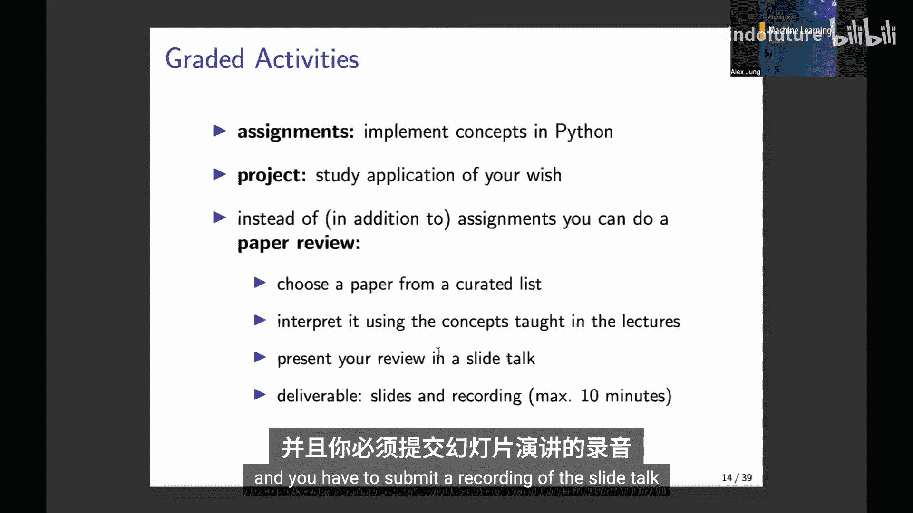

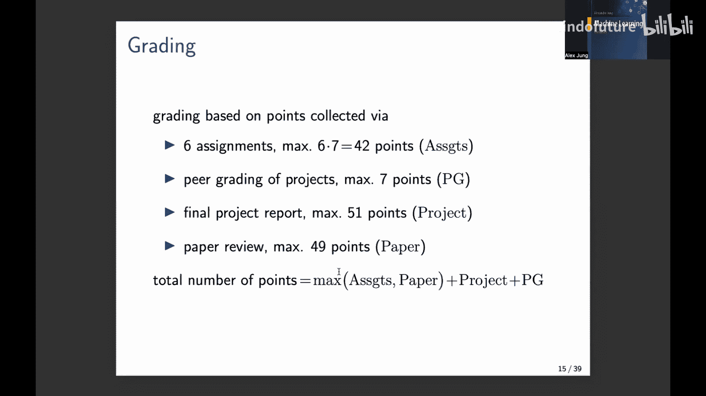

Okay， and after you have collected points in these different graded activities。

 we will add them up according to this scheme here。

 so we have for each assignment maximum seven points so in each of these six assignments you can earn maximum  seven points in total maximum 42 points from the assignments。

The peer grading of the project will also be evaluated so you can earn up to seven points from the peer grading。

 so how well or how useful are your reviews for the other student projects。

And your own final project report is worth maximum 51 points。Yeah。

 and the paper review can give you up to 49 points。 And this。

 this points from the paper review will be combined with the points you collect from the assignments。

 according to this formula here。 So the total number of points that you get in the course is the maximum of the points from the assignments。

And the points you get from the paper review。Plus， the points you get from the final project submission or final project report plus the points that you collect from the peer grading activity。

 and then we map the the collected points into grades like this。 So grade1。

 you get for at least 50 points， grade 2， you get for at least 60 points and so on and so forth until the top grade that you get for at least 90 points。

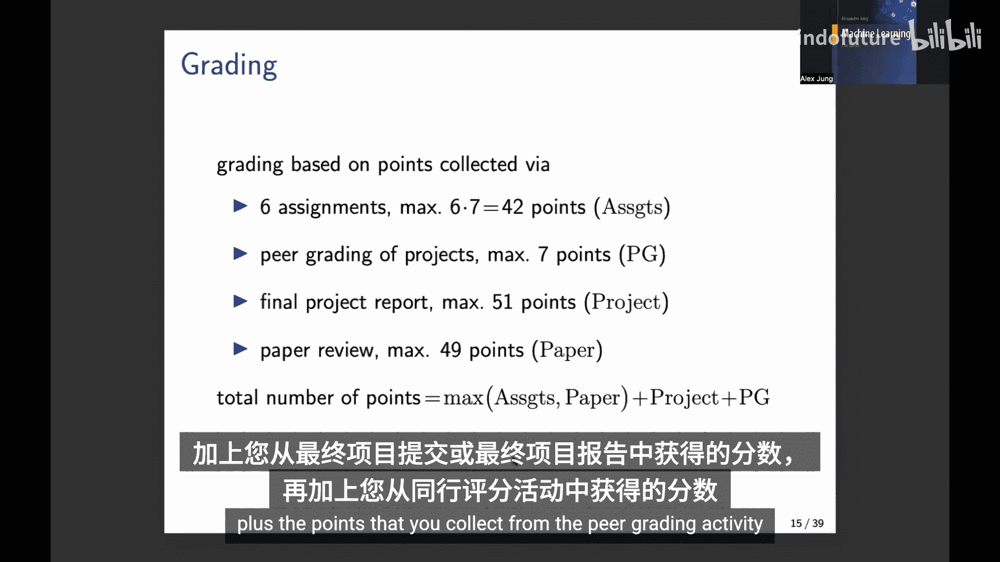

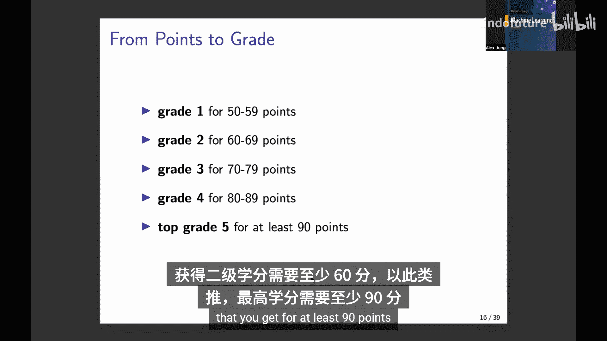

Okay so now briefly discuss the assignments， as I mentioned we have six assignments。

 one assignment for each model and each assignment requires you to implement in Python in the first assignment a basic machine learning methods so this is for many of you a refresher of other courses then in the second assignment you have to implement a federated learning network using a certain Python package called network X in the third model you will see how you can implement optimization problem underlying federated learning in Python then you will solve this optimization problem using a federated learning algorithms in Python in the fifth assignment you will implement clustered and vertical federated learning methods and in the last assignment you will study or implement a privacy attack so you will try to determine private or sensitive information from data。

Just by observing the， the messages that are passed in a federal learning algorithm。

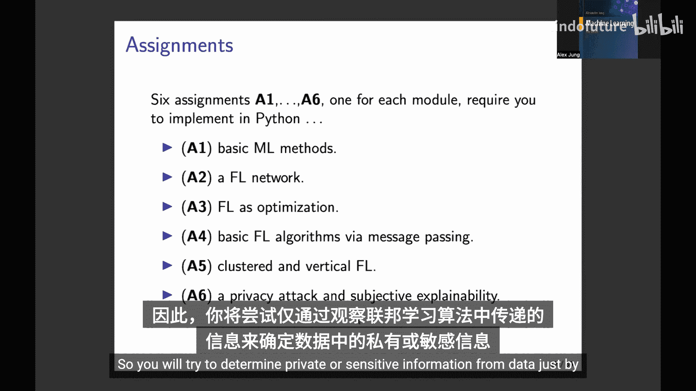

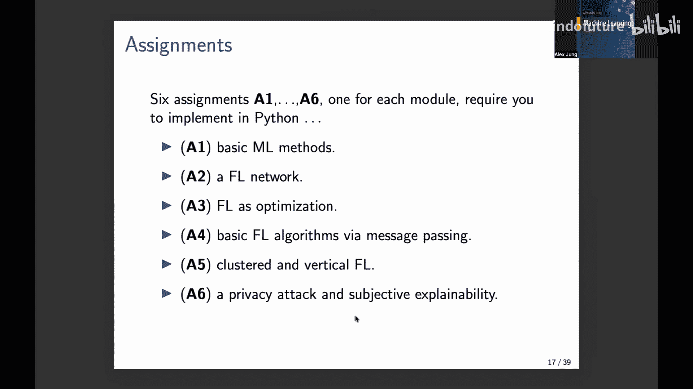

And you will implement the methods to improve the subjective explainability of a federated learning method。

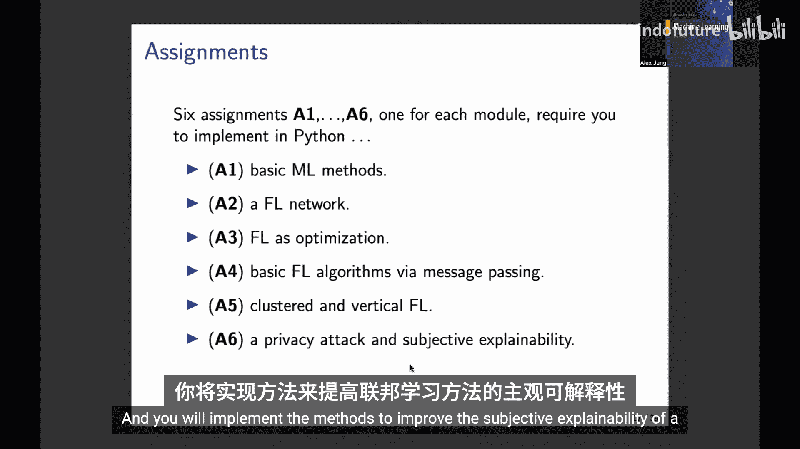

嗯。Yes， for the student project， you have to choose any application of your choice so you can choose whatever you want。

 You can apply federated learning to it。The only requirement is that you have to use the algorithms。

 those Ferate learning algorithms that we discuss in the lectures。Then you have to write a report。

 we will give you a template for this report so the structure of the report is pretty much pretty much fixed。

 it's like a standard structure where you have to first describe the background of your application and you have to describe your methods and then there will be some section where you describe the numerical experiments and the results。

Then you have to submit your report by end of April。And after this submission。

 we will have the peer review or peer grading period for around two weeks。

 where each one of you has to review and grade a certain number of other reports。

 This might be 3 to 5 other reports， depending on how many students we have in the course， finally。

And yeah， the report then includes a final submission。

 so the project then requires a final submission， so you have to submit a revised report where you take into account the feedback。

 the reviews that you get from the other students and the response letter where you explain explicitly how you took this feedback into account by end of May。

So this this is then what we grade for you for your own final for your own student project。

 this final submission， this includes the final revised project report and the response letter。

 both will be used for grading your project or for determining the number of points you got from this project and as mentioned。

 you will also get points by this peer review task， but only a much smaller number。

 so we want to de-emphasize the role of peer review on your grade。

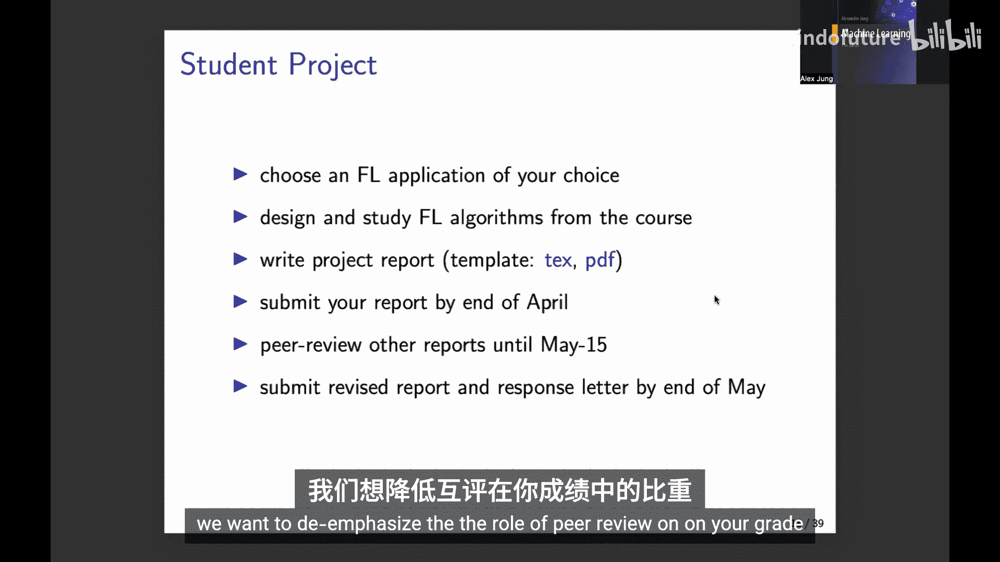

Okay， so for the schedule， we will have lectures each Monday at quarter past four。

 starting on the 24th of February， we will have six lectures。

Then we will have interleaved with the lectures， we will have assignment presentations。

 so we will present each assignment after the corresponding lecture each Wednesday at quarter past 4。

 starting on the 26th of February。Then the first submission deadlines will be the 17th of March where you have to submit your solutions for assignment 1 and two。

 you have then to submit the solutions for assignment three and four by end of March。

And the final submission deadline for assignment 5 and6 is 14th of April。

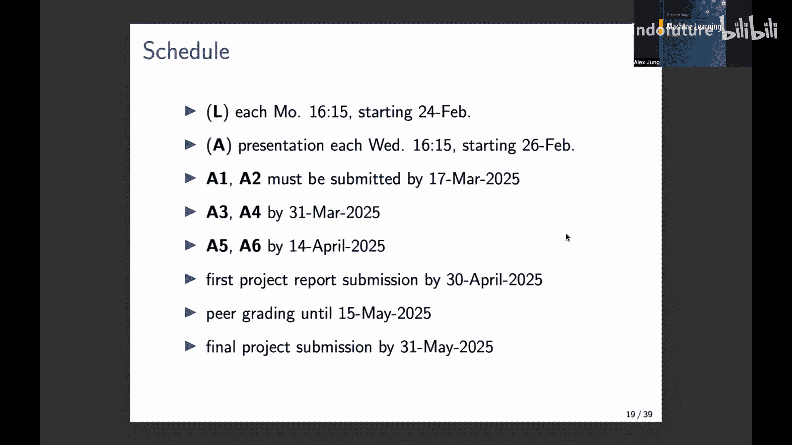

The first project report， as I mentioned already， has to be submitted by end of April。

 so this will then be peer reviewed or peer graded by you so you review and grade up to five other project reports until 15th of May and based on the feedback that you get on your project。

 you have to submit your final project report and the response letter by end of May。

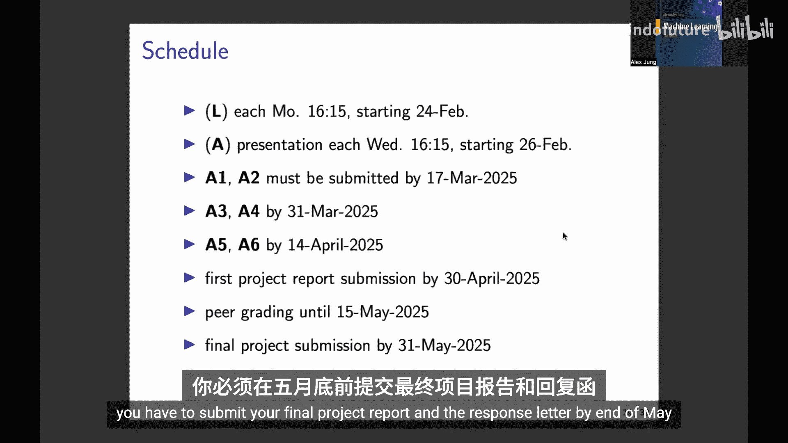

For the ground rules， so I just want to remind you those of you who are by registered to this course via a university like Alto University。

 you must act according to the code of conduct at Alto University have placed here in the slides a link you can then find a link to the slides in the YouTube description of this video but I want to highlight two main ground rules for this course and which are first be honest。

 so this course includes a lot of independent work like the assignments coding assignments the student project has to be individual so there are only individual student projects。

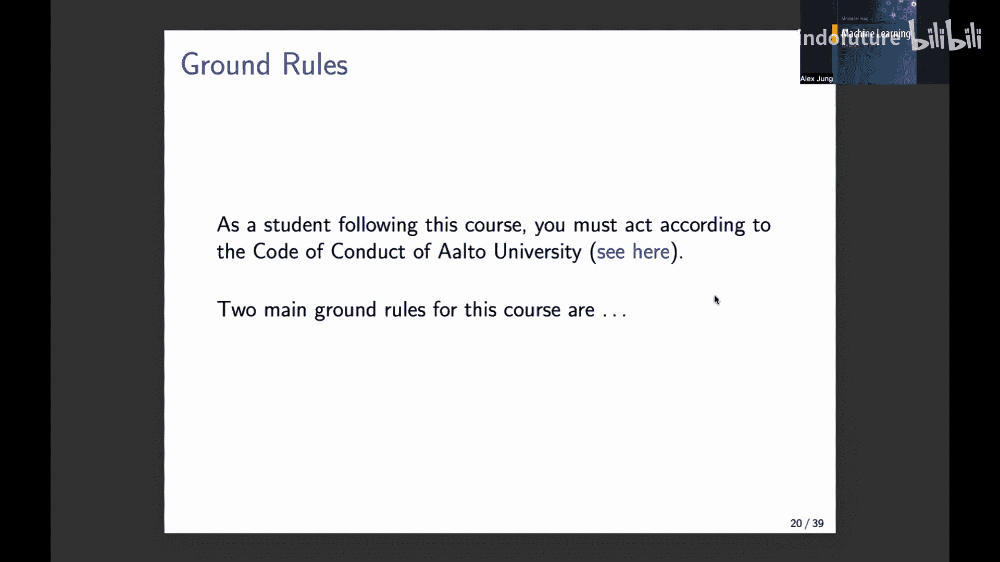

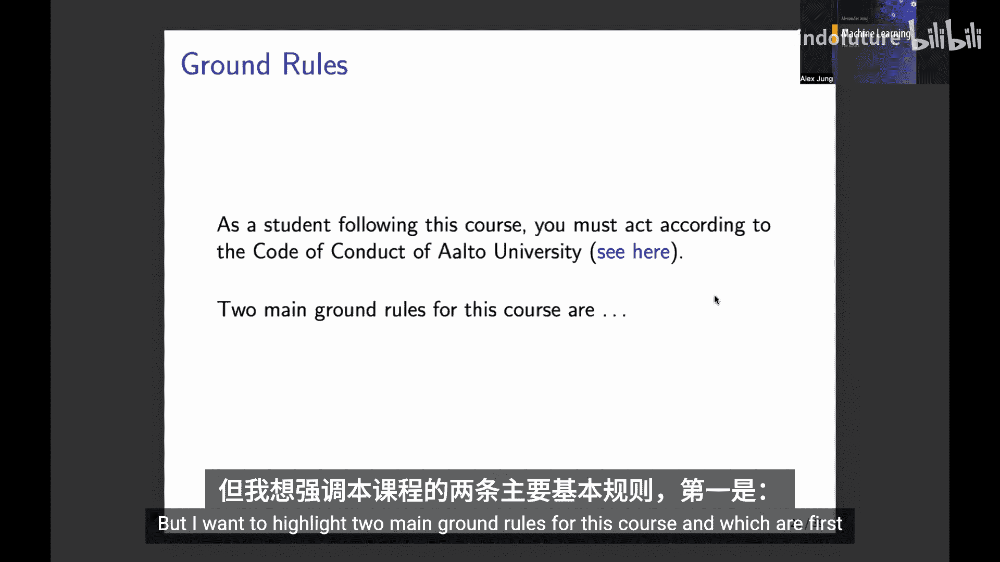

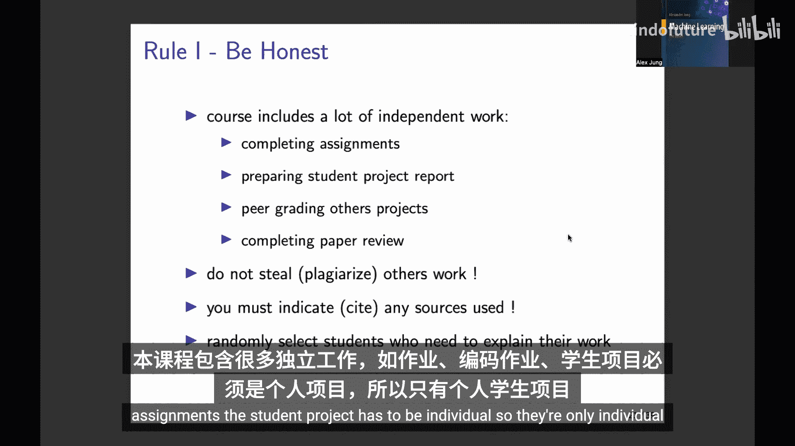

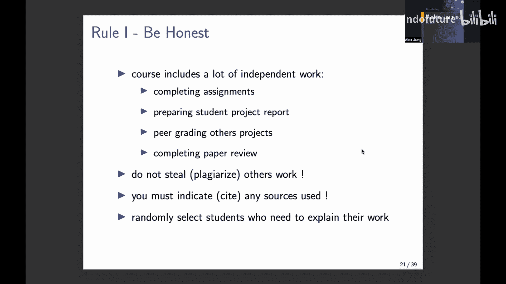

And this paper review。 And we， we really not stand next to you in all these assignments and check if you do it yourself。

 So we we trust you by default that this is independent work。

 And whenever you use something from somebody else， you have to indicate the source。

 So this is the basic rule also of academia。 Do not plagiarize。

 do not plagiarize the do not steal others's work， this could also be a hint from another student for how to solve an assignment。

 you must indicate it。 And in order to， to double check this， we will。

 at the end of the course or during the course， randomly select students who need to explain any as any activity in detail。

 So whenever you submit something。

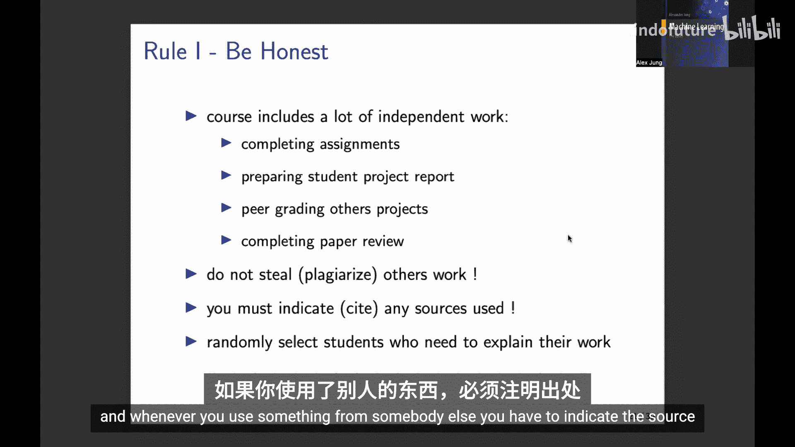

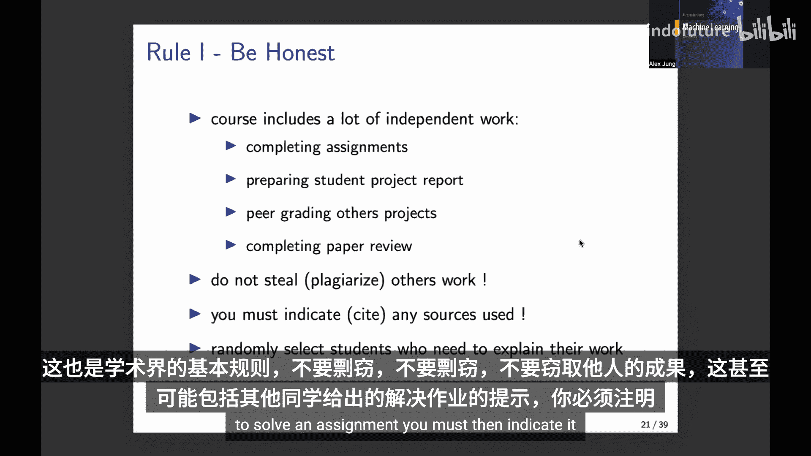

You can then be asked to explain it to us， for example。

 you submit solutions to an assignment and you might be randomly selected at some point。

 then you have to explain to us your solutions。And if we have the feeling or we have the impression that you do not know about your own solution。

 then we need to consider more disciplinary actions。

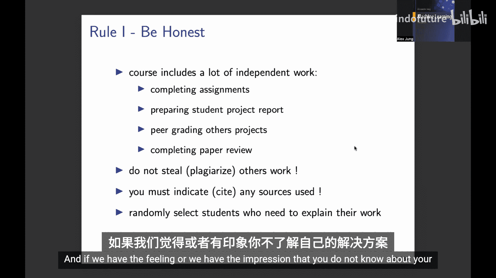

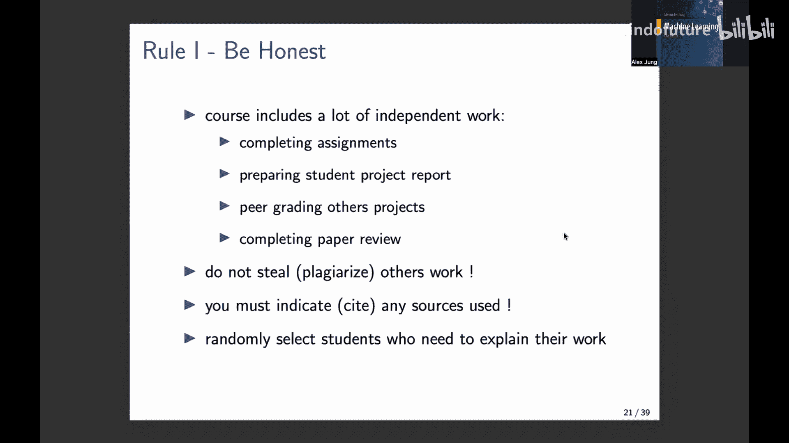

Okay， and the second rule is that you must be respectful。

 so my personal wish is that this course provides a safe space for an enjoyable learning experience for everybody in this course and any form of disrespectful behavior。

 including on the course related communication platforms， will be sanctioned rigorously。

 including the reporting to university authorities。

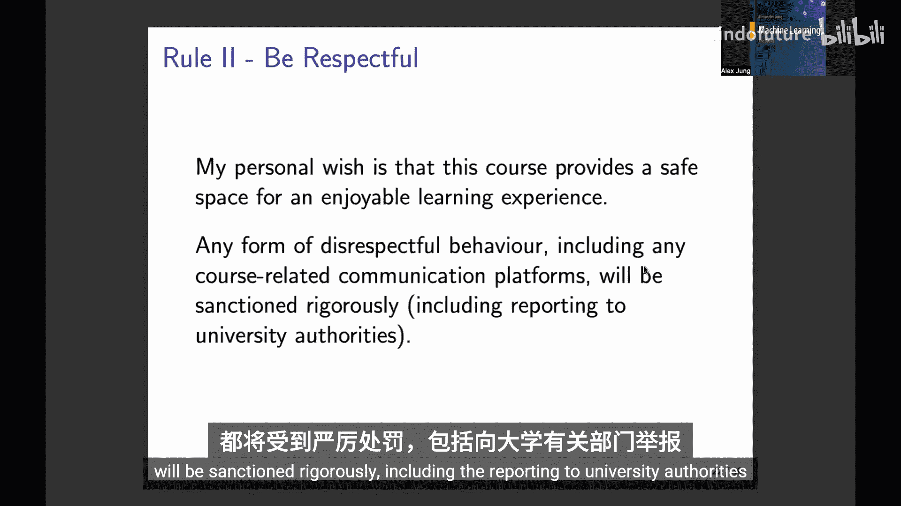

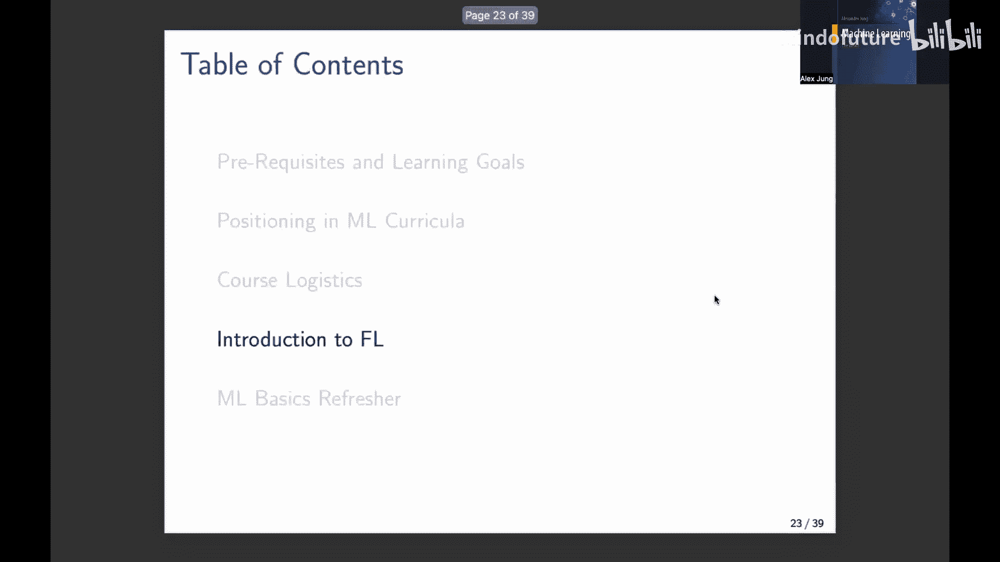