# 【阿尔托大学 - 中英】联邦学习 CS-E4740（Federated Learning，spring 2025） p06 P06 CS-E4740 Federated Learning - FL Applications -BV1cojRzDEfQ_p6-

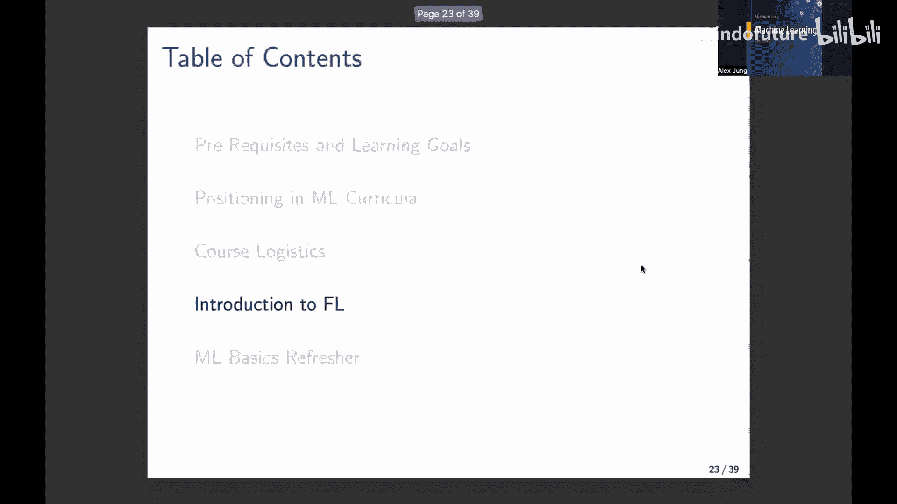

Okay， so let us now start with the course topic， which is federated learning。

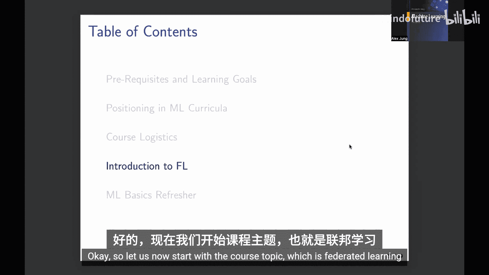

So what is federated learning。 and one explanation could be Feerated learning trains machine learning models in a distributed fashion over a network of devices。

 So here I have shown one one example application of federated learning。

 which could be the high precision management of pandemic。 So maybe you remember while ago。

 we all suffered from this covid restrictions。 And one challenge was to find out the best way to isolate people or to reduce the mobility of people。

 And one way could be to use a smartphone app which runs a federated learning algorithm and gives you the optimal prediction for is it safe to go out。

 Yes or no， is it safe to go out of the house， if， if you get a green prediction and it's safe to leave the house。

 if read， then it's not safe today， almost like a weather forecast。

 So this is an example of a federated learning system where each。

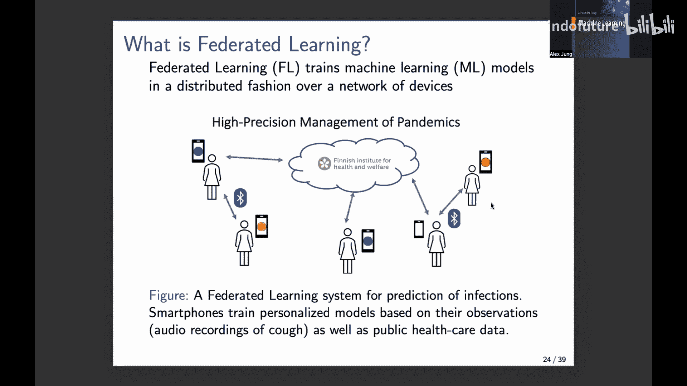

Devicice， each smartphone here trains its own model。 It trains a personal model for you。

 Each one of these。 So if you have a smartphone with this app。

 you get optimal predictions for you and to learn how to do these predictions。

 these federated learning components cooperate with each other。

 So there's a cooperative cooperative aspect， cooperative aspect。

Collaborative aspect in federated learning， you you use a bit of information from the other users or the other potential patients to get a better model for yourself。

 You might also include a very large databases that are freely available， for example。

 from public institutions。 so federated learning can often involve very different types of devices。

 So heterogeneous networks， and we will see how we can model these heterogeneous networks using mathematical optimization models。

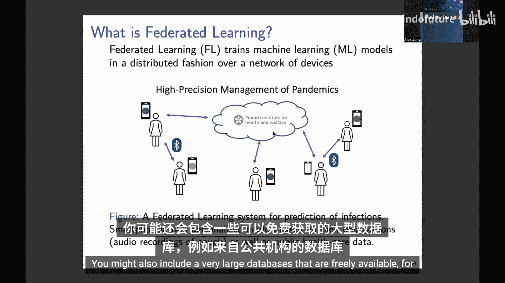

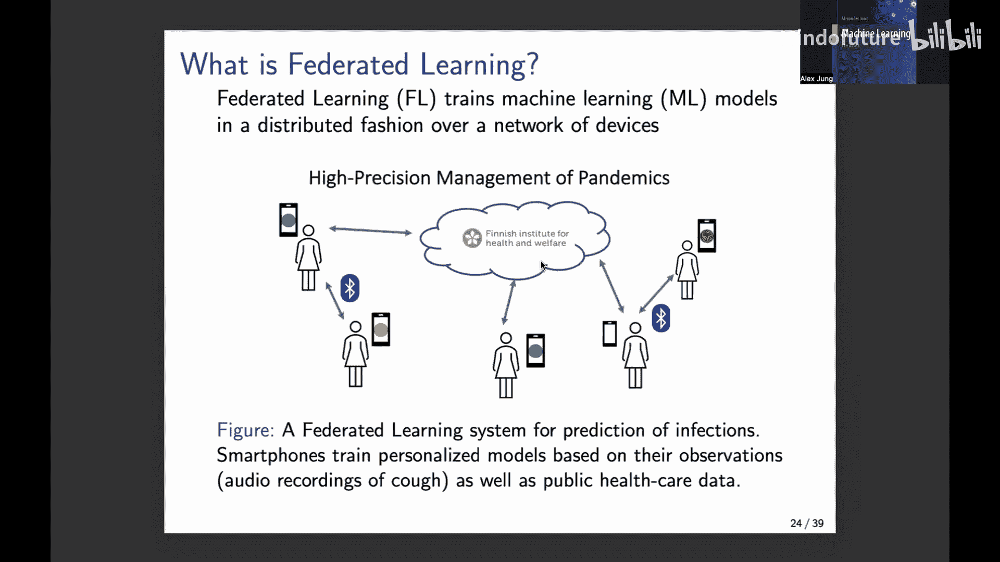

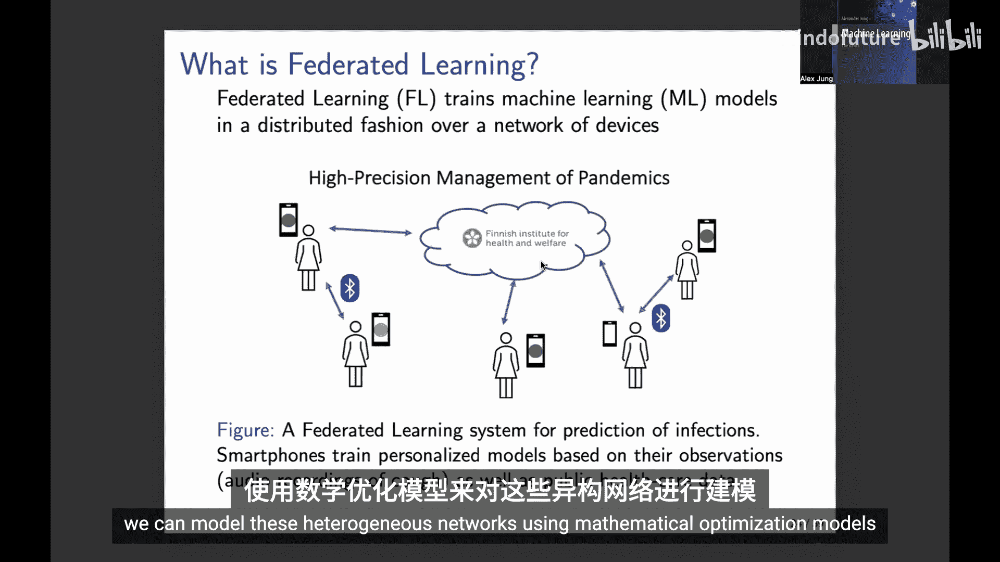

Okay， some of the key characteristics of federated learning is that we do not necessarily need a centralized data collection。

 which makes it robust。 If you have a centralized server which holds all the data。

 then you have a single point of failure。 So if， if this single data storage goes south gets destroyed。

 it's gone， everything is gone。 but infeerated learning。

 the information and the knowledge is distributed。 were many， many nodes， millions。

 billions of nodes。So a second characteristic is that each device trains a personalized model。

 so this this is a natural way to obtain personalization。

 you train a model for each individual user or device and these models can then be way more precise or way more accurate than an average model。

Like if you， if you want a prediction for how long does a certain bicycle ride take you。

 then you want to make a prediction， then you want to get a prediction that is tailored to you。

 Give your fitness level and your bike。 and you don't want an average prediction。As an example。

Another key characteristic is this collaborative approach or collaborative aspect。

 so in federated learning we share information and computational power， so this goes hand in hand。

 we share data and compute among devices some other devices compute a bit and the results of this computation can be sent back in some form to me and help me to get a better model。

 and also the results of this computation， carry information。

 so not only we spread the computational burden， but we also share or collect information from other nodes。

And this allows scalability so we can then solve way larger machine learning problems than each one of us alone with。

 with a single smartphone。😊，Yeah， and the last characteristic is that no typically no raw data is shared。

 we do not exchange images in a federated learning system typically but only some summary statistic or some result of computations that are done by a machine learning algorithm and this results that we then share they carry way less information about private attributes or sensitive data than the raw data。

 so this makes federated learning inherently privacy friendly。

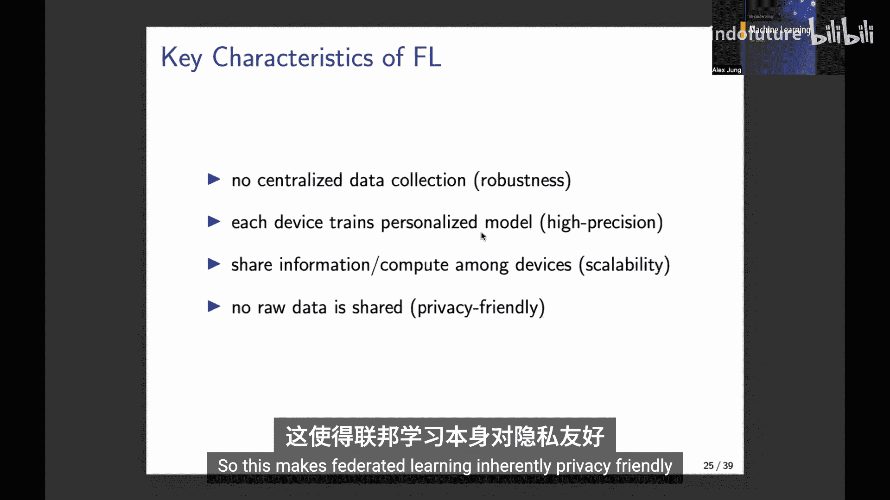

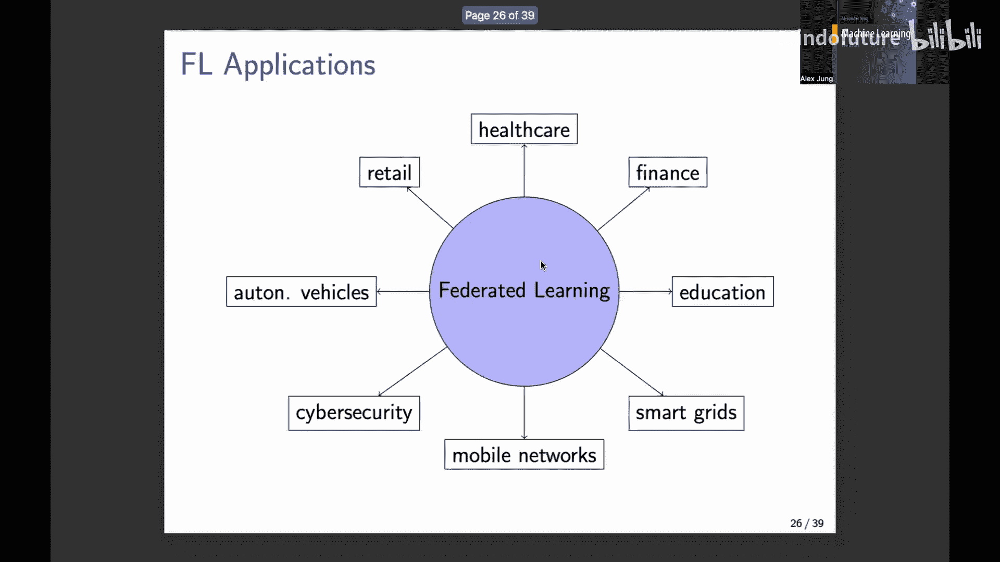

Yeah， have you depicted a few possible federated learning applications that you might consider in your project。

 so maybe I pick out a few here， maybe the most important one and also where this term federated learning or the field really took off is in healthcare because in healthcare we have very strict privacy regulations。

 I don't want my personal healthcare records to be shared with all of you still I would be willing to share the information that is contained in my healthcare records to train a better model for cancer prediction or something so this is actually this is the requirements for federated learning are exactly the requirements in like what we have in healthcare we have a lot of data around raw data like our healthcare records which are very sensitive so we cannot easily to share it。

 they are very much protected， but this collection of data。

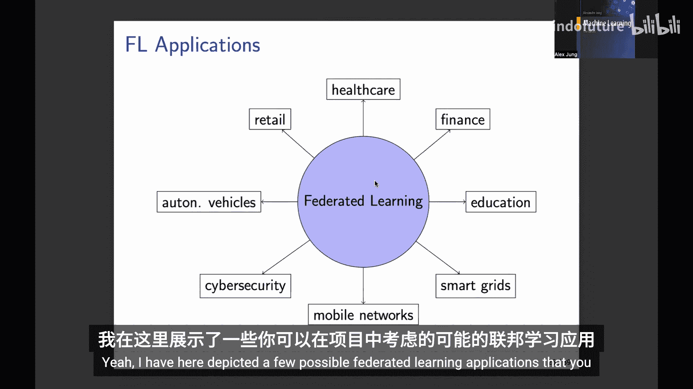

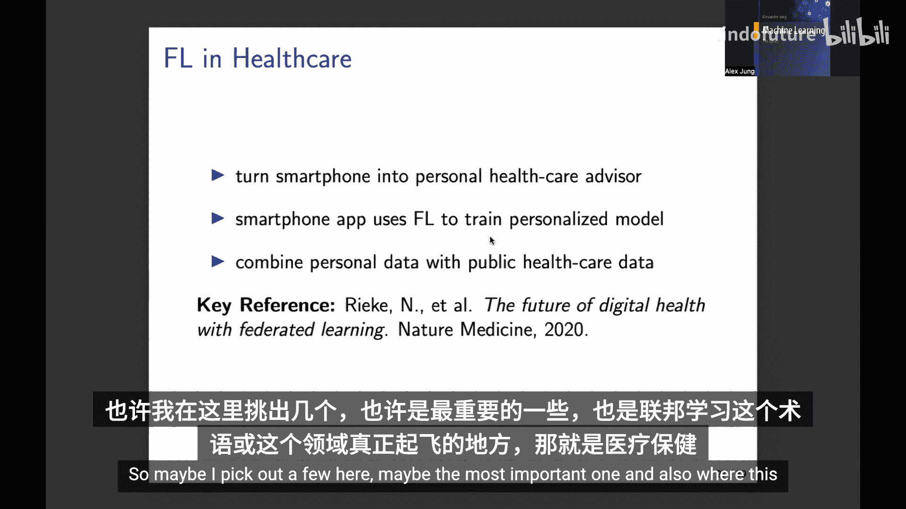

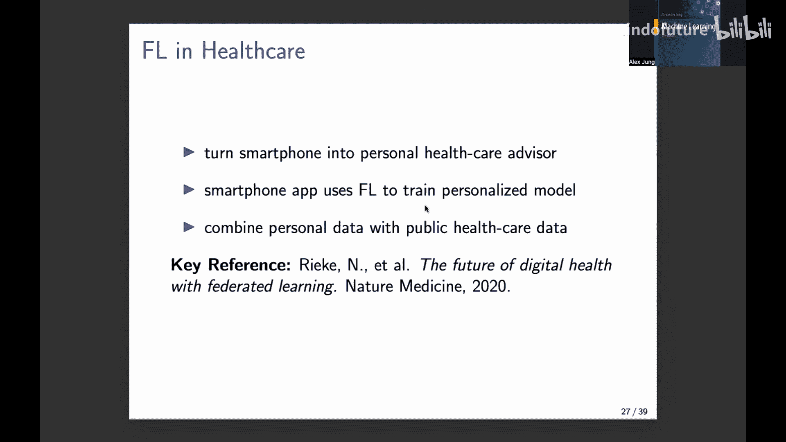

Each one physician has our own database of his patients， his or her patients。

 carries a lot of information that can be used for each one of us to get a better predictive model or better therapy predictions for each one of us。

So healthcare is maybe the most important application domaintill for federated learning。

 Theres also federated learning techniques coming up in finance to improve fraud detection or risk assessment。

 Ive found here some recent references that you can also find most likely in the paper list for candidate paper for doing a paper review。

 you can also choose these topics in your projects。

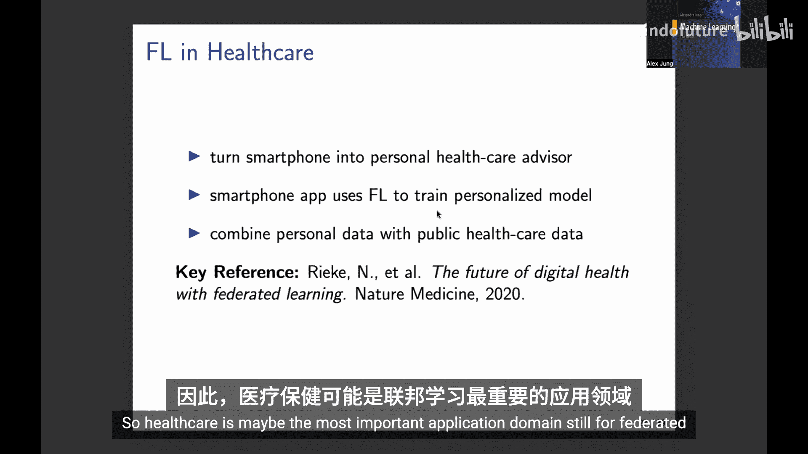

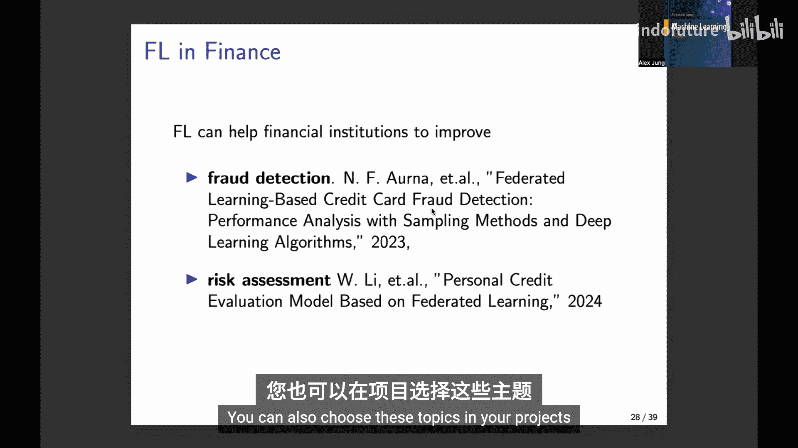

Another recent application domain that's maybe gaining more and more traction is in smart grids。

 So the power supply is more and more in the form of heaterch network。

 So you have renewable energy every some of us might have their own wind turbine or solar panel yet。

 So you want to know， for example， in in my case， we have a solar panel and it would be interesting to know when is the best time to start a washing machine because when I start the washing machine。

 I should be pretty sure that within the next one or two hours。

 there will still be sunshine because if there's all of a sudden clouds the solar panel doesn't deliver enough power anymore。

 And I have to take more costly or more expensive energy from the power grid from the conventional power grid to serve my washing machine。

 So for this， I would like to have a federated learning app that delivers for me。

 the perfect prediction。

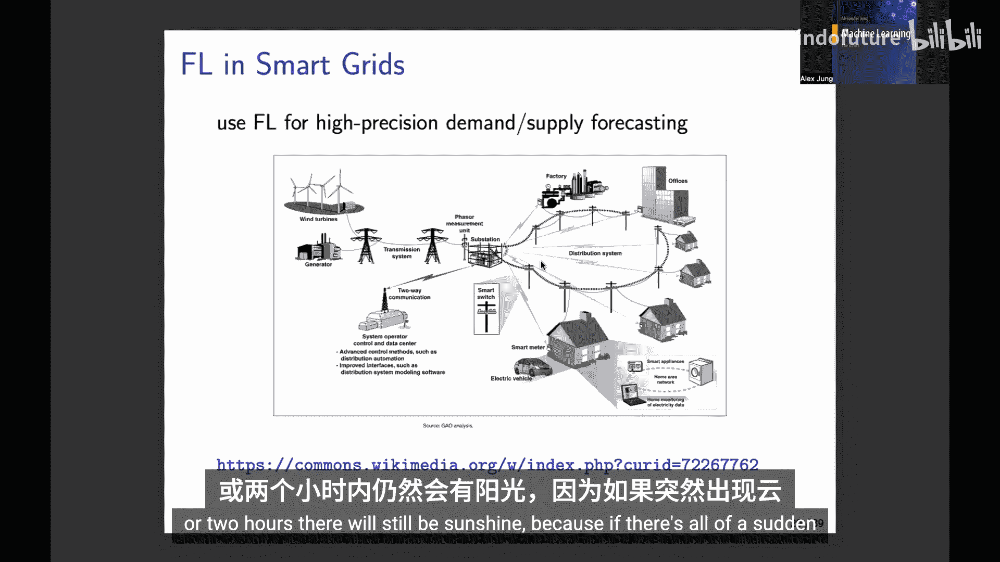

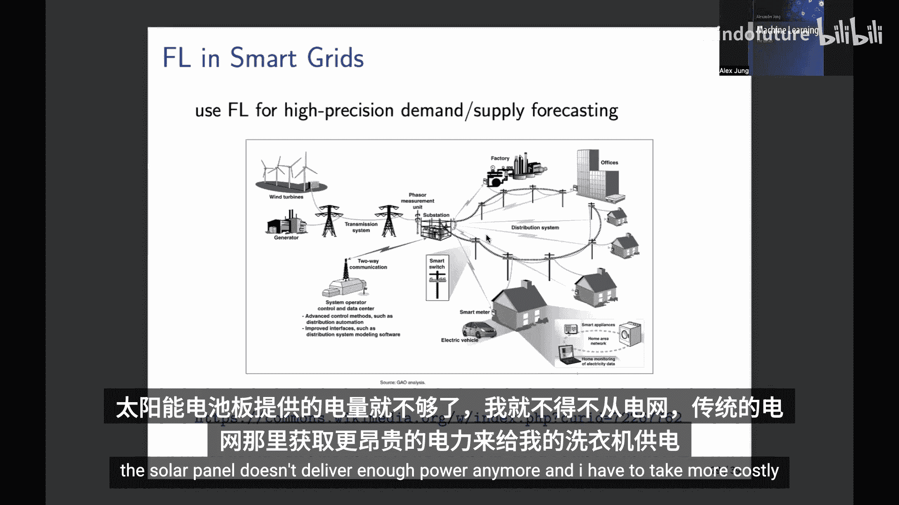

My area， for my house， how likely is there sunshine in the next two hours。

 So I really with high precision predictions。 and this is something that federated learning might be able to do。

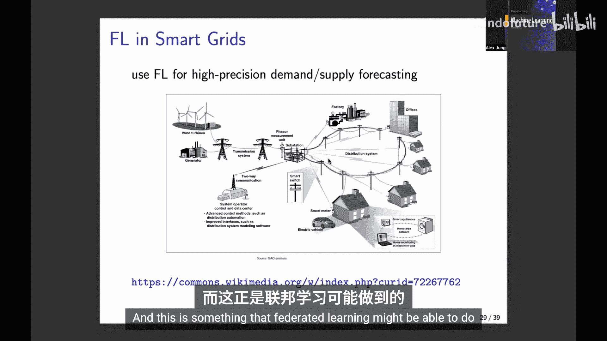