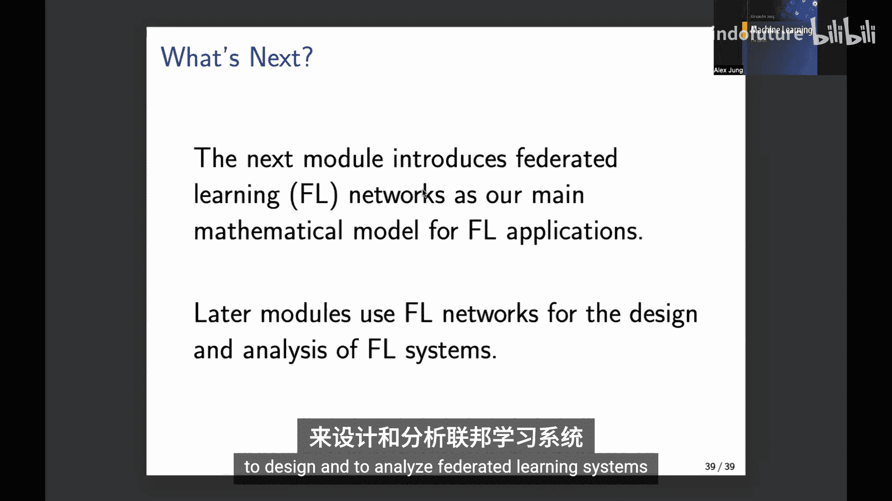
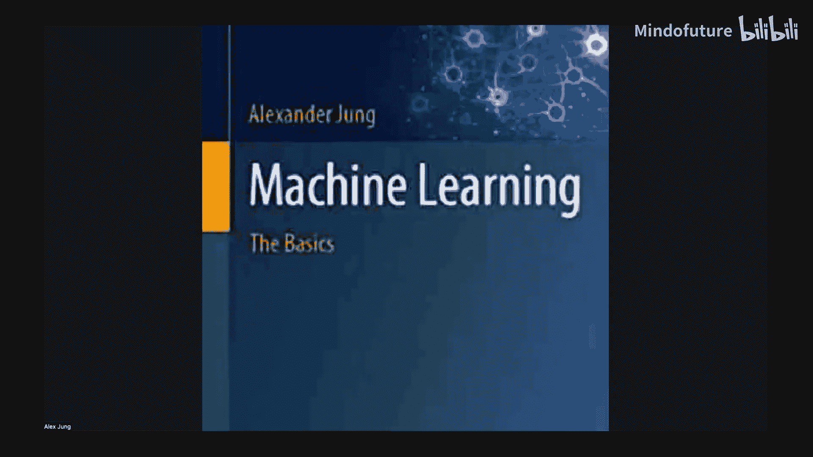

# 【阿尔托大学 - 中英】联邦学习 CS-E4740（Federated Learning，spring 2025） p07 P07 CS-E4740 Federated Learning - ML Basics -BV1cojRzDEfQ_p7-

For some of you， for most of you， maybe this will be redundant， but for some of you。

 it might be useful to have a quick recap of machine learning。

 So machine learning is all about learning a hypothesistheesis map this can be a very complex hypothesis map。

 for example， song recommendation and the goal of this recommendation is to find the best song to lift the mood up。

 So for example， and Finland in November it's very dark here。 and people are very tired。

 it's very tough， but sometimes a good song can really lift up the mood。

 And here iss a machine learning problem。 So you want to learn for a data point。

 which is a specific user like me in this case， and you have certain features。 So the mood tired。

 you have the datatime。 It's currently evening。 So what should you play。

To lift the mood of this user and the prediction is like the song Pohemian Rpsody and just to point out that there's a reasonable or serious work about this here。

 is a reference to some work on the effect of music therapy。

 so this could be actually quite useful application of ma learning。And how。

 how do we learn this hypothesis， Well， we learn a hypothesis by evaluating its usefulness and its usefulness is in machine in most machine learning methods evaluated by。

Measuring the prediction error。 So we have here here。 for example， we have a data point。

 a blue data point， and we want to， we measure the prediction error as the difference between the the true label of the data point and the predicted label。

 This is the the function value， H of x。So。We then average these losses。

 and we can use different types of loss functions。 This a design choice。 For example。

 we can use the squared error loss here。 Squared error loss is a popular choice for measuring predictions errors。

 And then what machine learning does。 what model training is is solving this optimization problems。

 So here you also see how machine learning is formulated as an optimization problem。

 and in this course， you will see how to formulate federated learning as an optimization problem。

 So we will extend this formulation， which is called empirical risk minim to cover or to introduce this coupling with other nodes。

 because if if we would not collaborate in a federated learning systems among the devices。

 then we could just look at each device independently and started using machine learning techniques。

 But what makes federated learning is the collaboration between different such learning problems。

 And the way we do it， we will see later is actually a form of。Regularization。

 but before I talk about regularization， I just want to complete the discussion of the basic machine learning workflow。

 So after we have solved this training problem， for example。

 using a dot fit function in Python we get a training error and one of the most important rules in applied machine learning is never ever stop after model training。

 you must always validate the trained model and we validate the trained model by computing the prediction errors or the average loss on a validation set that has not been used has not been used in this training problem。

 So this red red dots here， this red data points， they are not used in this training problem。

 But we use this red dots to compute the validation error。

 and then you can analyze to a large degree or quite a lot。

 you can diagnose machine learning methods just by comparing this training error with the validation error。

 you can then see if the model overfi。If you should use more training data。Or if it underfits。

 you should use more complicated models。And this is then the， I would say。

 the day to day loop of an applied machine learning scientist。 So you， you try out different models。

Or increase or you use different training data sets and see what what you get for the training error and validation error。

 And as soon as the training error and the validation error are on the same level as a benchmark or your target performance。

 then you are done。 So this is then an iterative loop to that each iteration includes a change of the model。

 hyperpar or change of the training data， gather more data or replace some data points because they might be poisoned。

And instead of of this， let's say trial discrete trial and error approach。

 you could use a more smooth approach， which is regularization。

 So applied machine learning is many applied machine learning techniques are based on the idea of artificially extending the training set by data augmentation So you say instead of observing a data point with feature value3。

 I could also have observed a data point with feature value 3。

2 because this feature values might come from a noisy sensor。

 which by itself has some only some some tolerance level up to 2% error tolerance or something So you could say naturally it would make sense to add to each original data point a slightly perturbed version and this is the idea of data augmentation So and data augmentation we augment each original data point by several perturbations and different data augmentation methods are obtained。

But different choices for this perturbation， so this perturbation could be just add some random noise or if a data point is an image。

 it could mean to rotate an image because often when you rotate an image， its label， for example。

 if it shows a cat doesn't change。Okay， so this was just a very quick overview of the machine learning basics and in the next model we will see how we can extend these basic machine learning setting to federated learning by using networks or in particular we will introduce the concept of a federated learning network。

 which will be our main mathematical model for federated learning applications and in the later models we will see how we can use these federated learning networks to design and to analyze federated learning systems。

Thanks for your attention。

