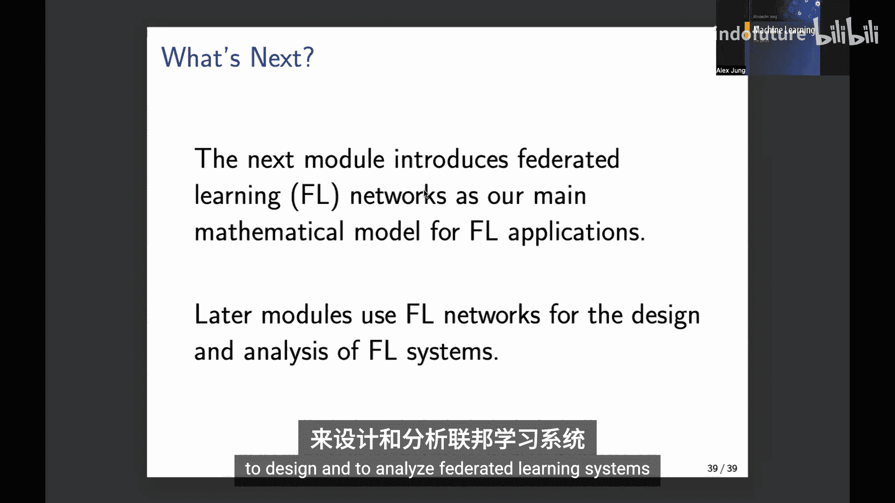
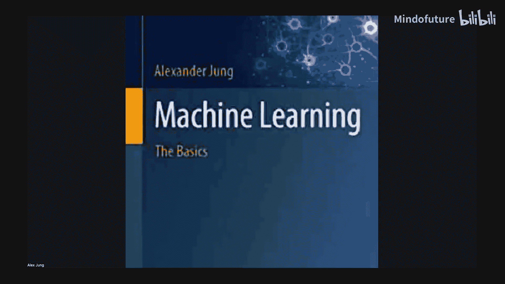

# 联邦学习 CS-E4740：P07：机器学习基础回顾 🧠

在本节课中，我们将快速回顾机器学习的基础概念。这些知识对于理解后续的联邦学习至关重要。我们将从机器学习的目标开始，逐步介绍其核心工作流程、评估方法以及一些关键思想。

## 机器学习的目标

机器学习旨在学习一个**假设映射**。这个映射可以非常复杂，例如一个歌曲推荐系统。其目标是为特定数据点（用户）找到最佳的歌曲以提升心情。

例如，在芬兰的十一月，天色很暗，人们很疲惫。此时，一首好歌或许能提振情绪。这就是一个机器学习问题：对于一个具有特定特征（如情绪、疲惫程度、当前是晚上）的数据点（用户），预测应该播放哪首歌（例如《Bohemian Rhapsody》）。需要指出的是，关于音乐疗法的研究是严肃且合理的，这展示了机器学习的实际应用潜力。

## 如何学习假设映射？

我们通过评估假设的**有用性**来学习它。在大多数机器学习方法中，有用性通过**衡量预测误差**来评估。

假设我们有一个数据点（例如图中的蓝点）。预测误差被定义为数据点的真实标签与预测标签（即假设函数值 **H(x)**）之间的差异。

我们随后会平均这些损失。损失函数的选择是一种设计决策，例如，可以使用**平方误差损失**，它是衡量预测误差的常用选择。

**平方误差损失公式：**
`L(y, ŷ) = (y - ŷ)²`
其中 `y` 是真实值，`ŷ` 是预测值。

那么，机器学习或模型训练，本质上就是解决以下优化问题：

**经验风险最小化公式：**
`min (1/n) * Σ L(y_i, H(x_i))`

在本课程中，你将看到如何将联邦学习也表述为一个优化问题。我们将扩展这个称为“经验风险最小化”的公式，以引入与其他节点的耦合。因为如果设备之间不协作，我们只能独立地在每个设备上使用机器学习技术。而联邦学习的关键在于不同学习问题之间的协作。我们后续会看到，实现这种协作的方式实际上是一种**正则化**形式。

在讨论正则化之前，我们先完成对基础机器学习工作流程的介绍。

## 模型训练与验证

在解决了上述训练问题（例如，在Python中使用 `.fit()` 函数）后，我们会得到一个**训练误差**。应用机器学习中最重要的原则之一是：**绝不要在模型训练后就直接停止**。

你必须始终**验证**训练好的模型。我们通过在一个**验证集**（图中红点所示）上计算预测误差或平均损失来验证模型。这个验证集在训练过程中未被使用。

通过比较**训练误差**和**验证误差**，你可以在很大程度上诊断机器学习模型：
*   如果验证误差远高于训练误差，模型可能**过拟合**。
*   如果训练误差和验证误差都很高，模型可能**欠拟合**。

这构成了应用机器学习科学家的日常循环：尝试不同的模型、调整超参数、使用不同的训练数据集，观察训练误差和验证误差的变化。当训练误差和验证误差达到你设定的基准或目标性能水平时，工作就完成了。这是一个迭代循环，每次迭代都可能涉及模型、超参数或训练数据的变更（例如收集更多数据或替换可能被“污染”的数据点）。

## 从试错到正则化

除了上述离散的试错方法，我们可以采用更平滑的方法：**正则化**。

许多应用机器学习技术基于**数据增强**的思想，即人为地扩展训练集。其理念是：与其只观察一个特征值为3的数据点，不如认为我们本可能观察到一个特征值为3.2的数据点，因为特征值可能来自有噪声的传感器（例如有2%的误差容限）。因此，为每个原始数据点添加轻微扰动的版本是合理的。

**数据增强公式化描述：**
对于原始数据集 `{(x_i, y_i)}`，我们通过应用扰动函数 `T(·)` 生成增强数据 `{(T(x_i), y_i)}`。

不同的数据增强方法源于对扰动的不同选择。扰动可以是添加随机噪声；如果数据点是图像，可以是旋转图像（因为旋转后，例如“猫”的标签通常不会改变）。

## 总结与展望

本节课我们一起快速回顾了机器学习的基础：其目标是学习假设映射，通过最小化经验风险（预测误差的平均）进行训练，并必须使用独立的验证集进行评估。我们还介绍了通过数据增强进行正则化的概念。

在下一个模块中，我们将看到如何通过引入网络的概念，将这些基础的机器学习设置扩展到联邦学习。具体来说，我们将介绍**联邦学习网络**的概念，这将成为我们为联邦学习应用建立的主要数学模型。在后续的模块中，我们将学习如何利用这些联邦学习网络来设计和分析联邦学习系统。