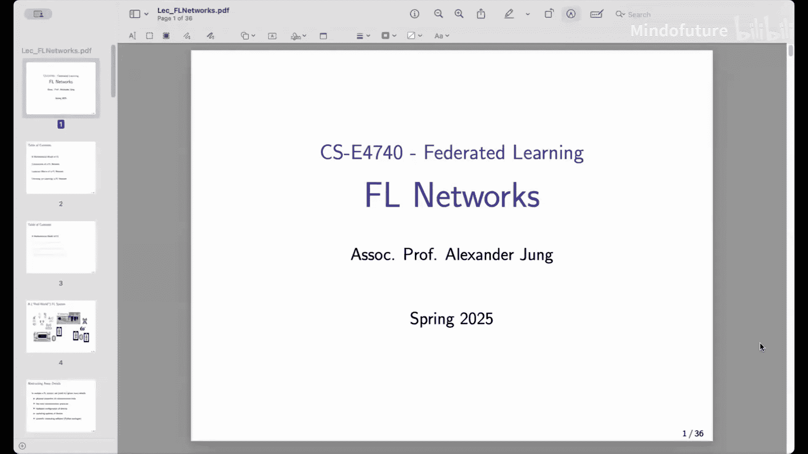
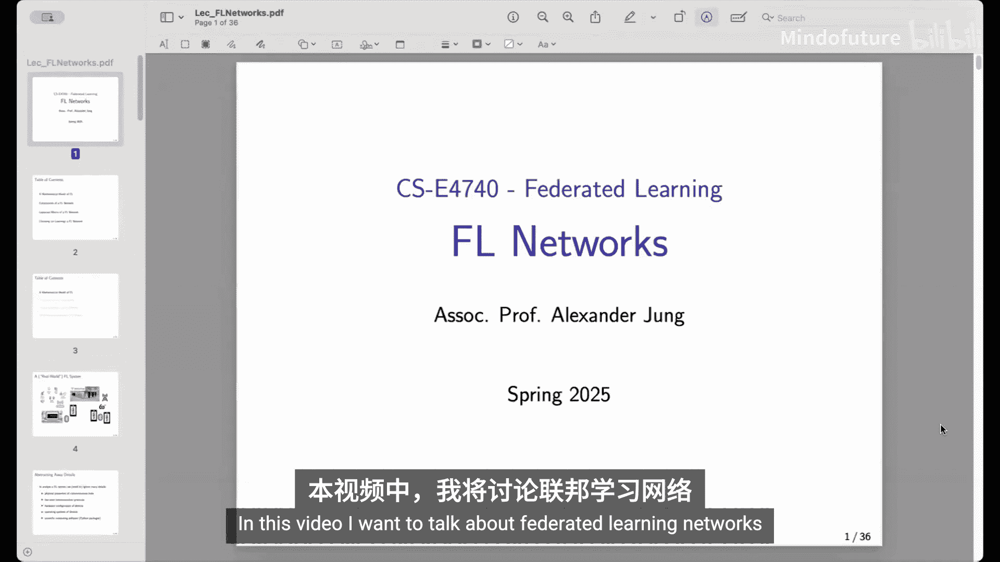
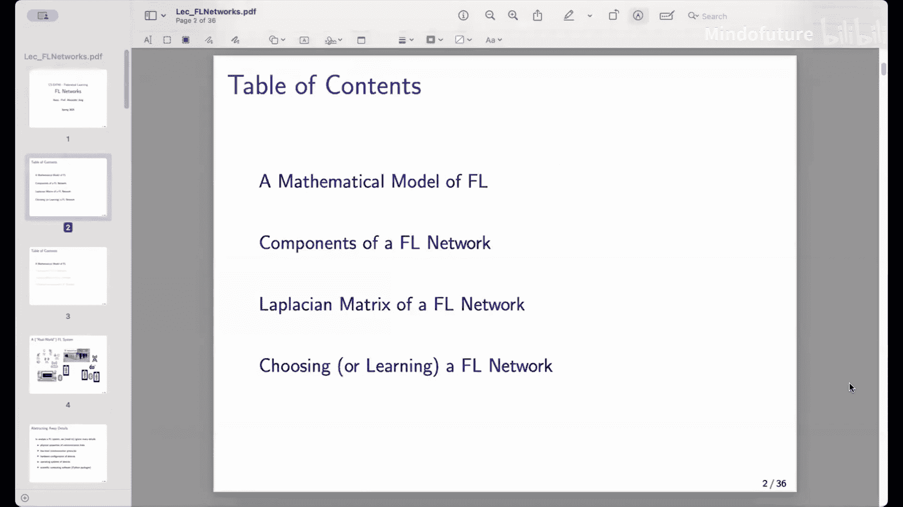
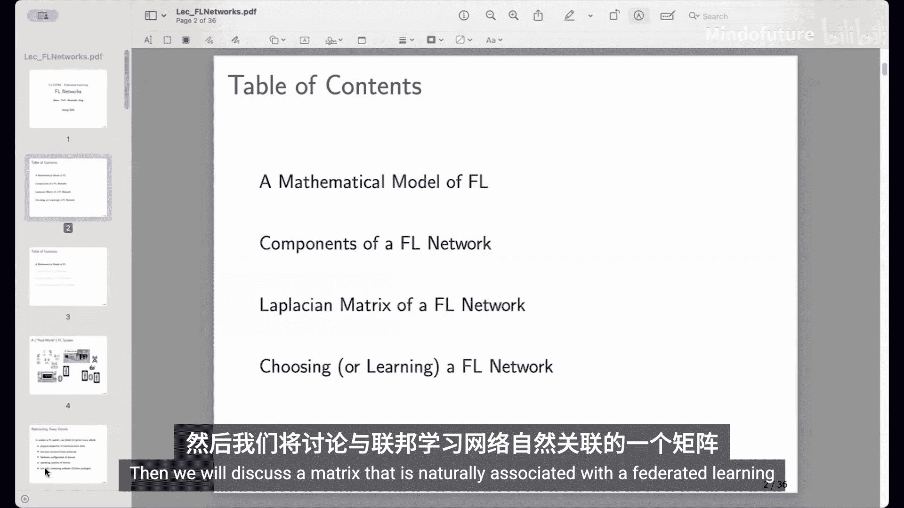
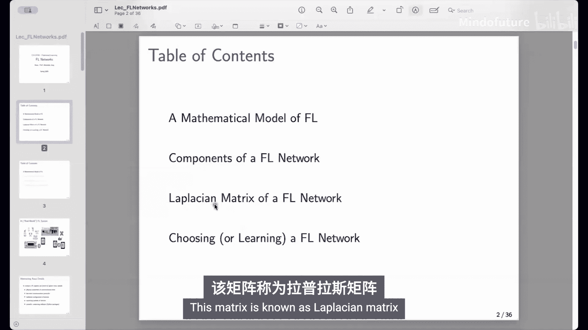
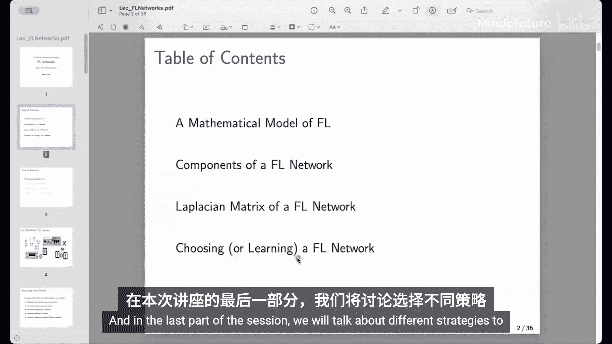
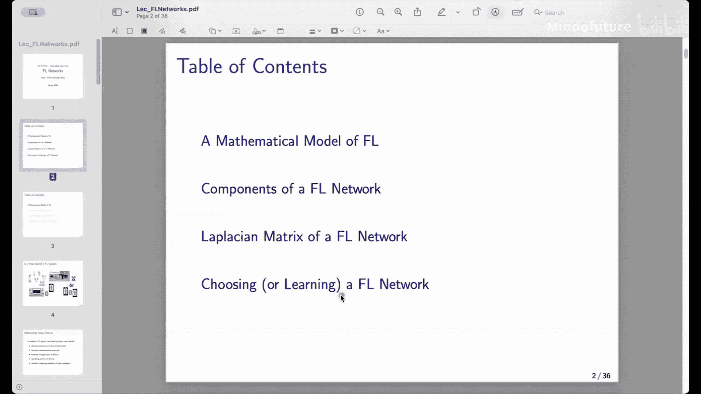

# 【阿尔托大学 - 中英】联邦学习 CS-E4740（Federated Learning，spring 2025） p09 P09 CS-E4740 FL Networks - Intro -BV1cojRzDEfQ_p9-

Welcome to this session within our course on Feerated learning in this video I want to talk about Feerated learning networks。

Federated learning networks will be our main mathematical model of federated learning applications and Feerated learning systems。

We will discuss the components of a federated learning network。

Then we will discuss a matrix that is naturally associated with a federated learning network。

 this matrix is known as Laplaceian matrix。

And in the last part of the session， we will talk about different strategies to choose or learn a federated learning network。

