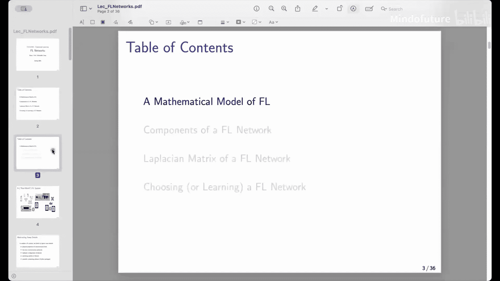
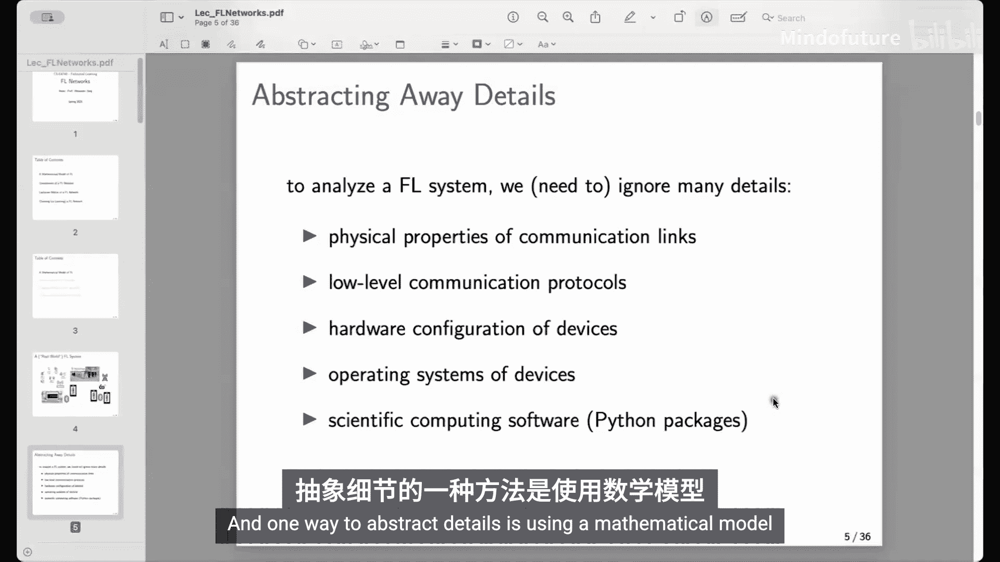
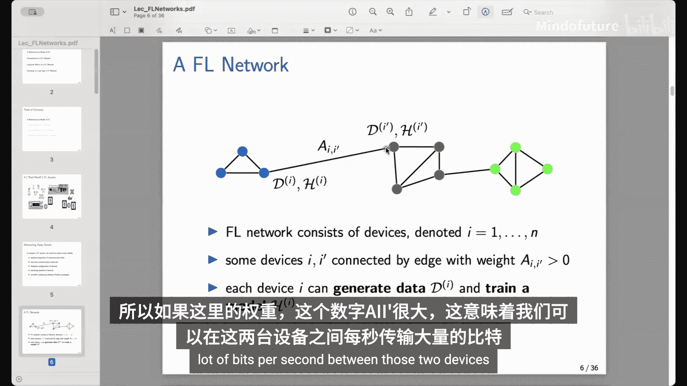
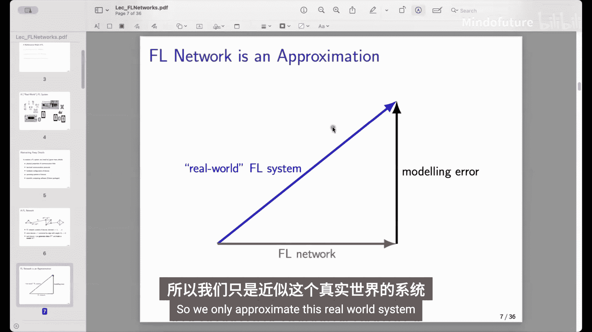
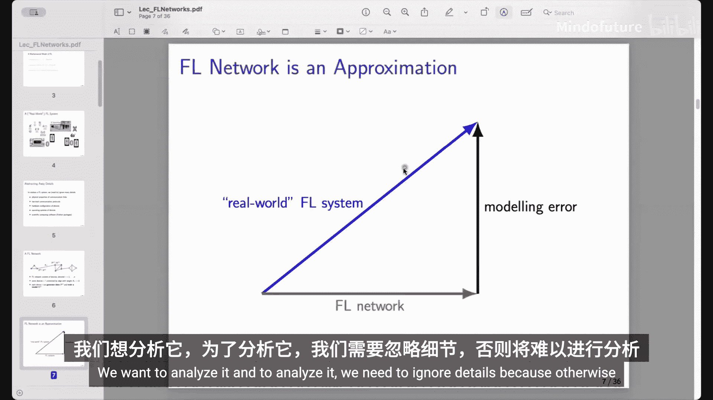
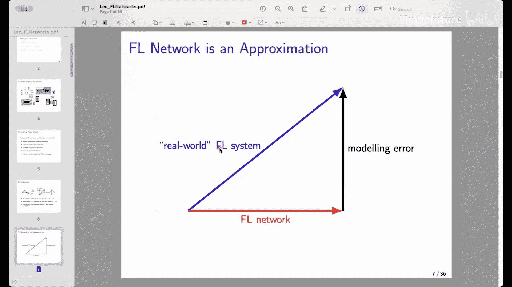
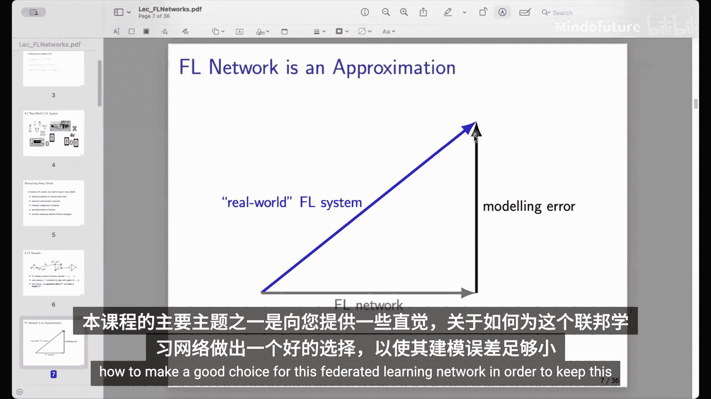

# 【阿尔托大学 - 中英】联邦学习 CS-E4740（Federated Learning，spring 2025） p10 P10 CS-E4740 A Mathematical Model for Federated Learning -BV1cojRzDEfQ_p10-

Okay， so why do we need a mathematical model of federated learning？ Well。

 a federated learning system， a real world federated learning system could be a highly complicated system。

 So federated learning system could involve supercomputers， training large language models。

 It could also include smartphones that run small or lightweight machine learning models。

 The smartphones might be connected by unreliable short range wireless links like Bluetooth。

Then we might also have laptops like the one I'm using now for recording this video。

 which runs some off the shelf Python package like Pythtorch for implementing machine learning models and a federate learning system might also include very small devices like and nowadays there are smart bulbs which have some computational power and which might also collect data like presence in rooms。

 so they know when to turn on。In advance， I went to light up a room。Yeah。

 so there's a lot of details involved here。 We， we have the the physical properties of all the communication links。

 There might be very different types of links like fiber communication links， fibers。

Providing high speed connections， there is wireless connections， wireless connectivity。

 via mobile networks or by a short range communication systems like Bluetooth。

 So there are many different。Types of communication links。

 all with their own communication protocols。 So we have different low level protocols。

And the devices are very different， can be very different。

 device can be a small embedded system in in a light bulb or could be a supercomputer。

All these devices typically use different operating systems。

 while some type of device like a smartphone， they might only use one out of a few different operating systems。

 but we should think bigger here in this course and consider really arbitrarily large and heterogeneous federrated learning networks and the devices in these networks also use typically use different computing software。

 for example， different Python packages。 So one of you might use a smartphone programming a smartphone using Pythtorch library。

 the other one uses prefer to use S kit learn Python package for machine learning。

 So there's a lot of versatility here and a lot of details and we will ignore many of those details or actually we need to ignore many of these details to make useful analysis and one way to abstract details is using a mathematical model and one such mathematical model or the main mathematical model in our。

Forse will be a federated learning network。So federated learning network consists of nodes that are represented here by these filled circles or field dots that represent devices。

 so each of these dots here might be either a smartphone。

 so this dot here might represent a smartphone and this dot here might represent the supercomputer somewhere in Finland。

And the network also includes links。 so some of these devices are connected。

 So there's some connectivity。 we model this connectivity。

 the ability for a smartphone to send some request to a server that is running on the supercomputer why an internet connection。

 this is condensed or or approximated by this link or edge here。

 and we also assign a weight to the edge。 this weight could be， for example。

 representing the capacity。 So if the weight here， this number A prime is large。

 This means we can transmit a lot of bits per second between those two devices。

Yeah the important point is that this federated learning network is a mathematical model and as any mathematical model it's an approximation。

 so we only approximate this realw world system so here is the rew worldor system and we want to study it。

 we want to analyze it and to analyze it we need to ignore details because otherwise it would be intractable to analysis to analyze it and this abstraction。

 this pruning away unnecessary or details that we deem irrelevant this is the federated learning network and this of course incurs a modeling error so depending on how we choose this federated learning network incuring many design choices。

 we get a larger smaller modeling error and one of the main theme of this course is to provide you with some intuition how to make a good choice for this federated learning network in order to keep this modeling error。

U smallmall enough。

