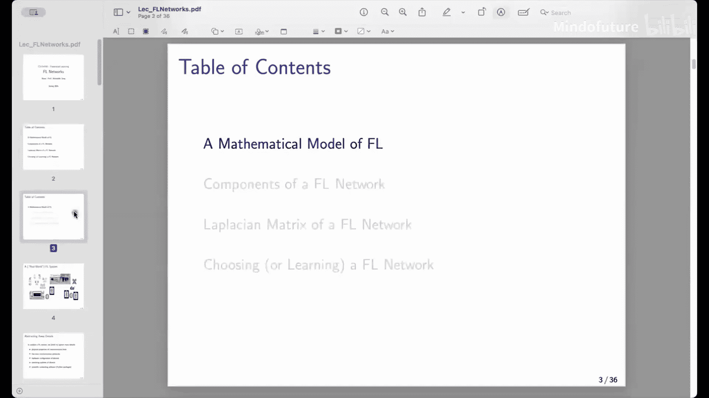
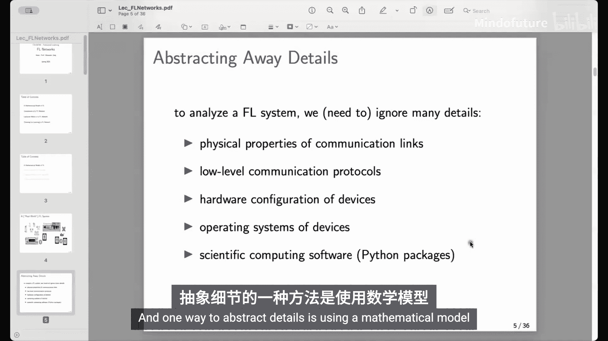
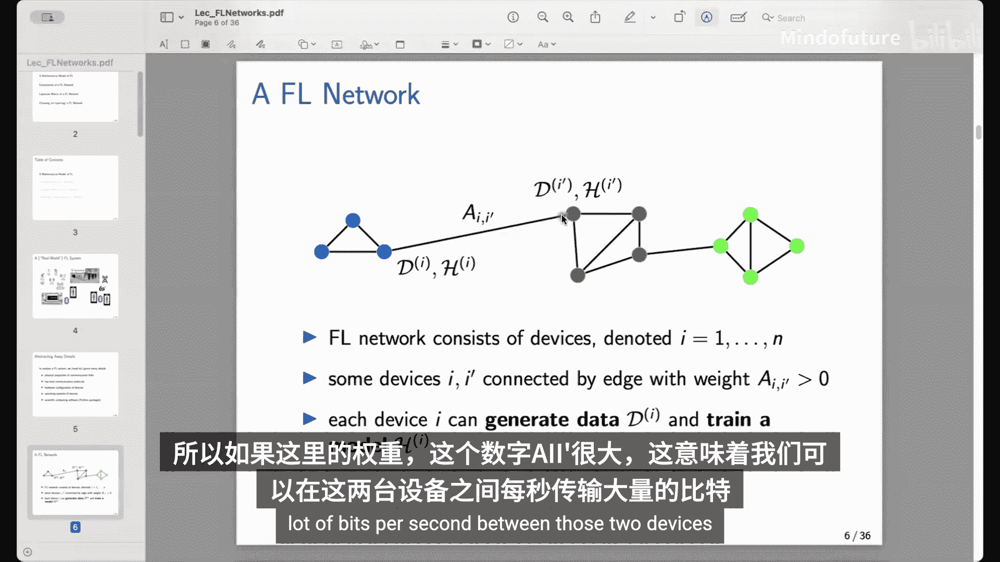
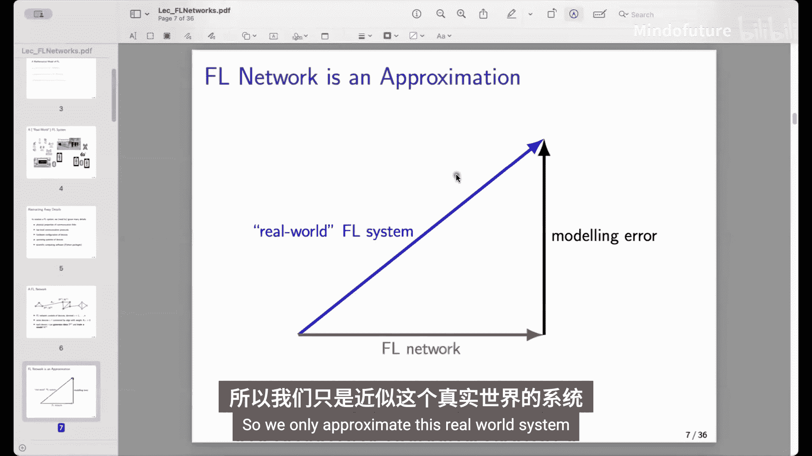
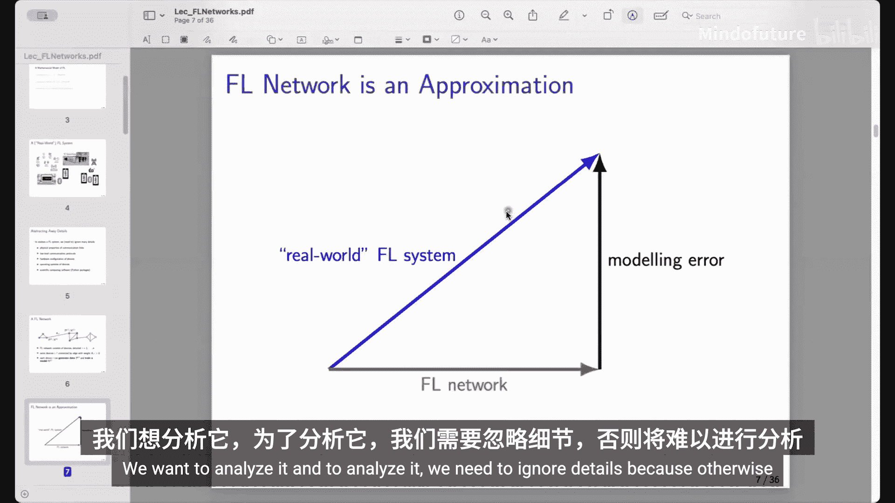
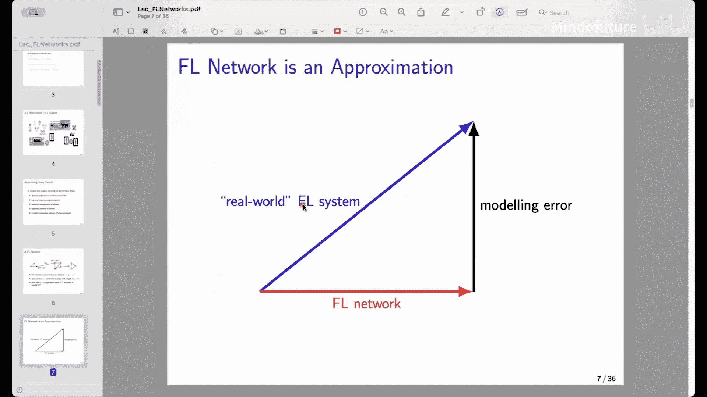
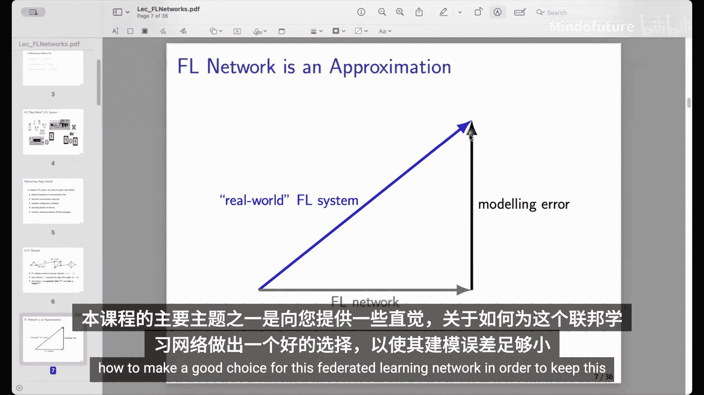
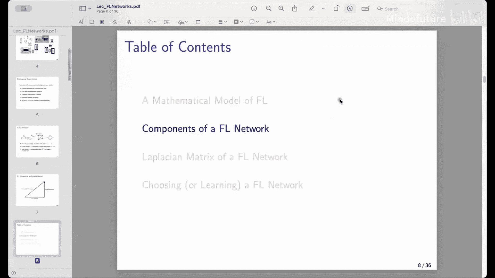

# 联邦学习 CS-E4740：P10：联邦学习的数学模型 📐

在本节课中，我们将学习为何需要以及如何构建联邦学习的数学模型。我们将从一个复杂的现实系统出发，逐步抽象出其核心要素，最终得到一个用于分析和设计的简化网络模型。

## 为什么需要数学模型？ 🤔

一个现实世界的联邦学习系统可能极其复杂。它可能涉及训练大语言模型的超级计算机，也可能包含运行轻量级机器学习模型的智能手机。这些智能手机可能通过蓝牙等不可靠的短距离无线链路连接。此外，系统还可能包括笔记本电脑（例如我现在录制视频使用的这台），它们运行着PyTorch等现成的Python包来实现机器学习模型。联邦学习系统甚至可能包含智能灯泡这样的小型设备，它们具备一定的计算能力并收集数据（例如房间内是否有人），以决定何时点亮。

这里涉及大量细节。所有通信链路都有其物理特性，可能存在光纤、移动网络或蓝牙等不同类型的连接，每种连接都有各自的通信协议。设备也千差万别，从智能灯泡中的嵌入式系统到超级计算机，它们通常使用不同的操作系统和计算软件（例如不同的Python包）。

面对如此多的细节和多样性，我们需要忽略其中许多细节才能进行有效的分析。而抽象细节的一种有效方法就是使用数学模型。

## 联邦学习网络模型 📡

本课程将使用的一个主要数学模型是**联邦学习网络**。

一个联邦学习网络由**节点**和**边**构成。
*   **节点**（图中用实心圆点表示）代表设备。例如，一个点可能代表一部智能手机，另一个点可能代表位于芬兰某处的超级计算机。
*   **边**代表设备之间的连接。这种连接能力（例如智能手机通过互联网连接向运行在超级计算机上的服务器发送请求）被建模为图中的边。
*   我们还可以为边赋予**权重**。例如，权重可以代表链路的容量。如果权重 `A` 很大，意味着这两个设备之间每秒可以传输大量比特。

## 模型是现实的近似 🔍

重要的是，联邦学习网络是一个数学模型，而任何数学模型都是一种近似。

我们有一个想要研究和分析的现实世界系统。为了分析它，我们必须忽略细节，否则分析将变得难以处理。这种抽象、剔除我们认为不必要或无关细节的过程，就得到了联邦学习网络模型。

当然，这会产生**建模误差**。我们如何选择构建这个联邦学习网络模型（涉及许多设计决策），将决定建模误差的大小。本课程的一个主要目标，就是提供一些直觉，帮助你如何做出好的选择，以保持这个建模误差足够小。

## 总结 📝

本节课我们一起学习了联邦学习的数学模型。我们了解到，由于现实联邦学习系统的高度复杂性和异构性，必须通过数学模型进行抽象简化才能进行分析。我们引入了**联邦学习网络**作为核心模型，它用**节点**表示设备，用**带权重的边**表示设备间的连接。最后我们认识到，数学模型是对现实的近似，设计模型时需要权衡细节的取舍以控制**建模误差**。