# 【阿尔托大学 - 中英】联邦学习 CS-E4740（Federated Learning，spring 2025） p11 P11 CS-E4740 Federated Learning Networks - Nodes -BV1cojRzDEfQ_p11-

Okay， so let's now have a closer look at this building blocks or components of a federated learning network。

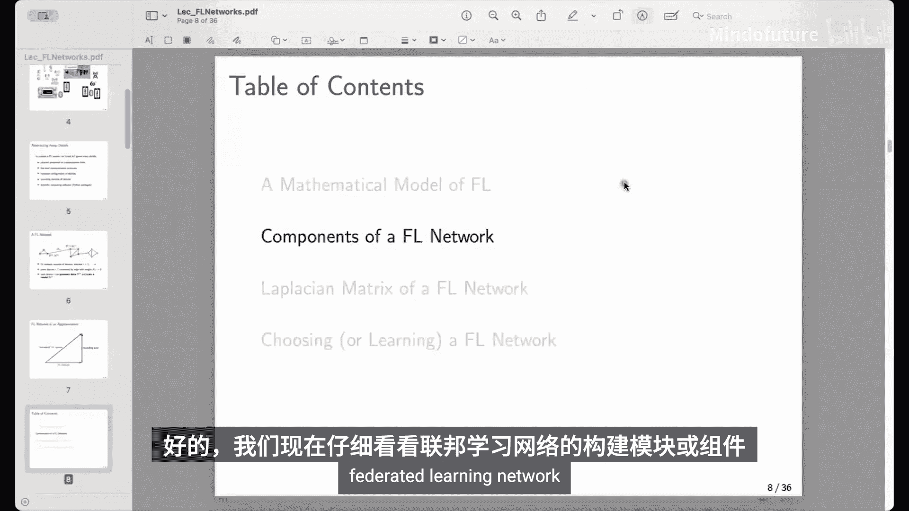

So as I have already pointed out in in this。Graph or in this picture of a federated learning network。

 it consists of nodes。 So we have a finite number of nodes that we， for convenience。

 identify with the first n natural numbers。 So within this course。

 when we talk about node of a federated learning network， we always mean the first n natural numbers。

This is not a severe restriction to use the first natural numbers。

 but what is a restriction is that we consider this end given。 So we assume a finite number of nodes。

 but this number can be arbitrarily large。So infinite there are also infinite graphs where the node set would be。

 for example the integer numbers， there are infinitely many integer numbers or all natural numbers this we do not cope cover in this course so within this course。

 we only consider federated learning networks that consists of arbitrarily but finite many nodes。

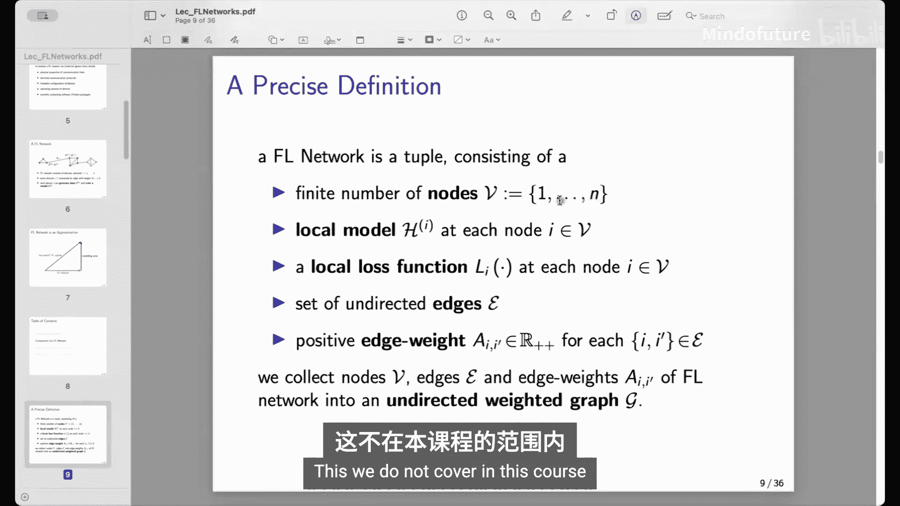

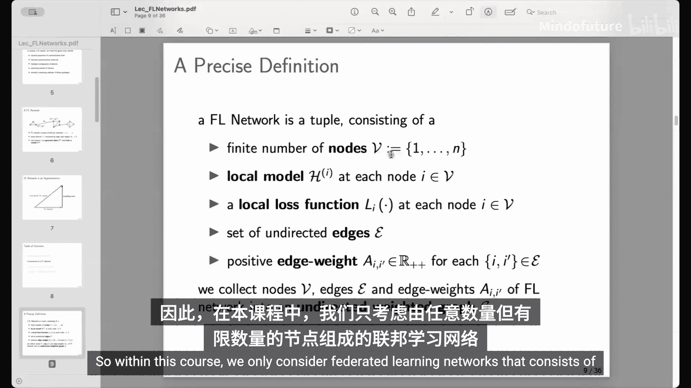

So each node represents a device and the device。In our federated learning perspective。

Can train a model or is able to train a local model。 So each device carries a local model。

 and this local model could be different at different node。 So one node might carry a。

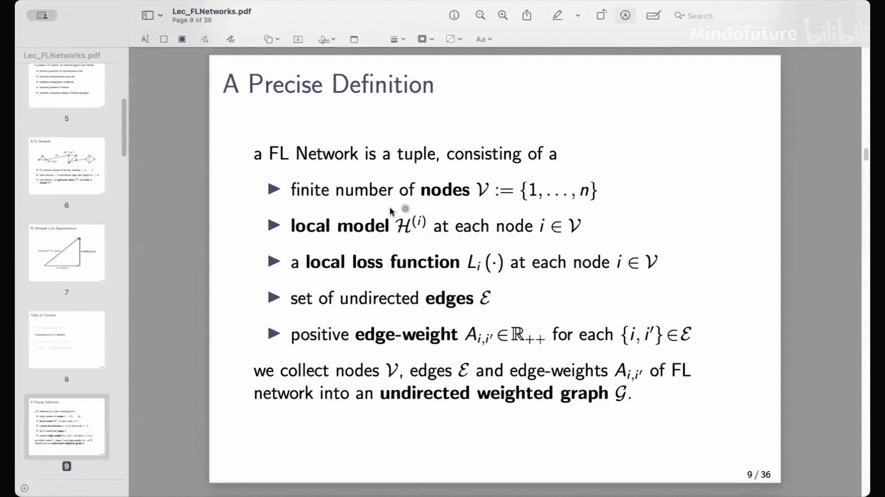

linearar model。 So the local model at node1， for example， might be a linear model。

 and local model at note 10 might be a decisionary。

 so we will see how we can develop federated learning algorithms that train arbitrary collections of local models。

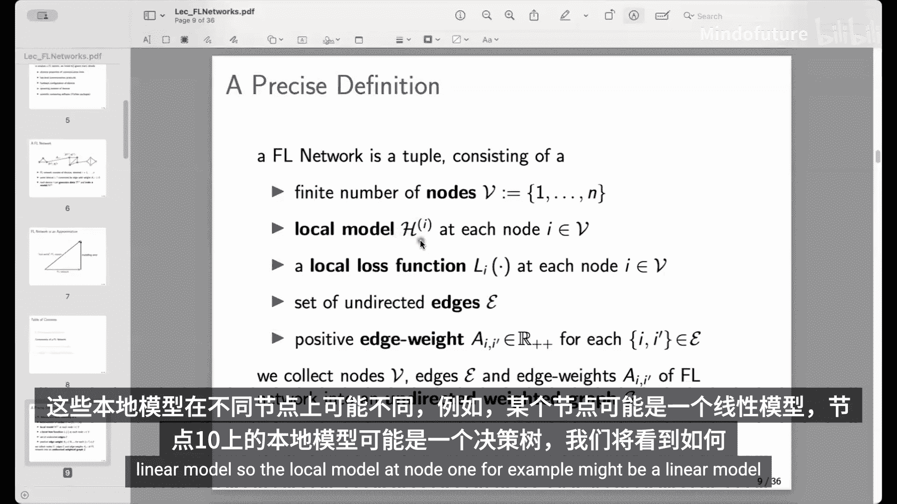

In order to train a model。Like in basic machine learning， we need some way to。

 to measure the usefulness of model parameters or of a hypothesis out of this model。 And for this。

 we need a local loss function。 So each node also carries a local loss function。

So beside this node attributes so we can think of this local model and the local loss function as node attributes。

 we have undirected edges， so a federated learning network consists also of an undirected graph so some of this node some of these devices are connected by an undirected edge and each edge is assigned a weight and edge weight that measures how strong the link is between these two devices and we will see different interpretations of this edge weights。

 but for now it's just a part of a mathematical model period。Yeah， and it's。

 it's convenient throughout the course to collect the nodes。

 this edges and the edge weights into an undirected weighted graph。 So this is basically a short。

Shorthand for the nodes， edges and edge weights。 We use the shorthand calligraphic J。

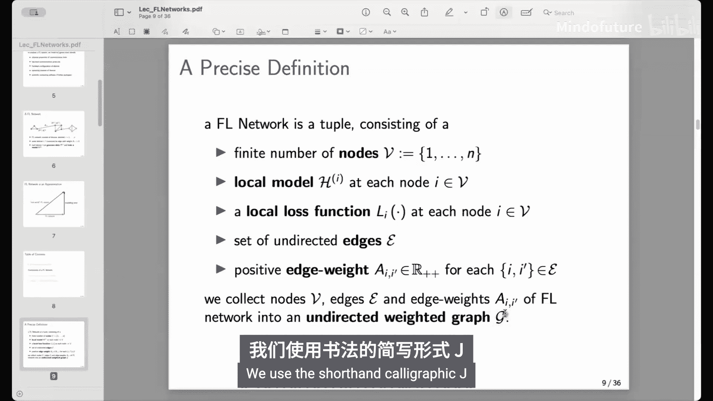

Okay， so now as I mentioned， the nodes of a federated learning network represent devices。

 So each node， let's say note1 represents or stands for or denotees a real worldor physical device。

 This could be a smartphone or could be a supercomputer or could be a smart light bulb。

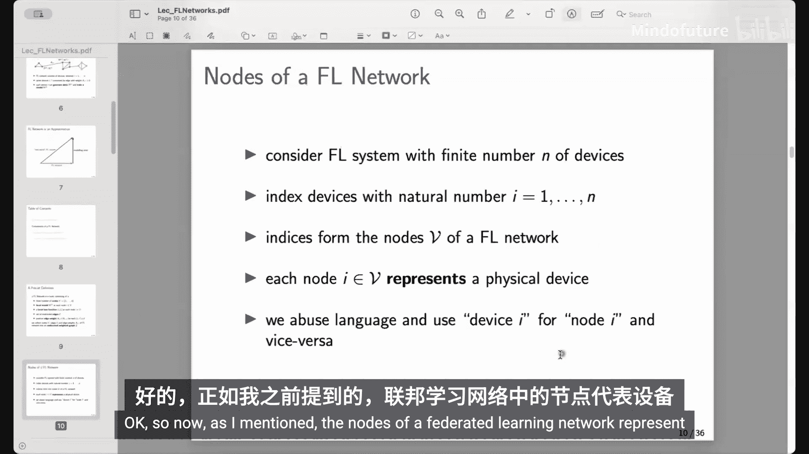

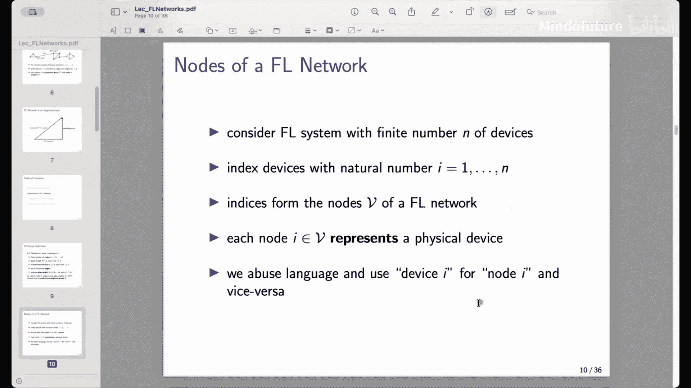

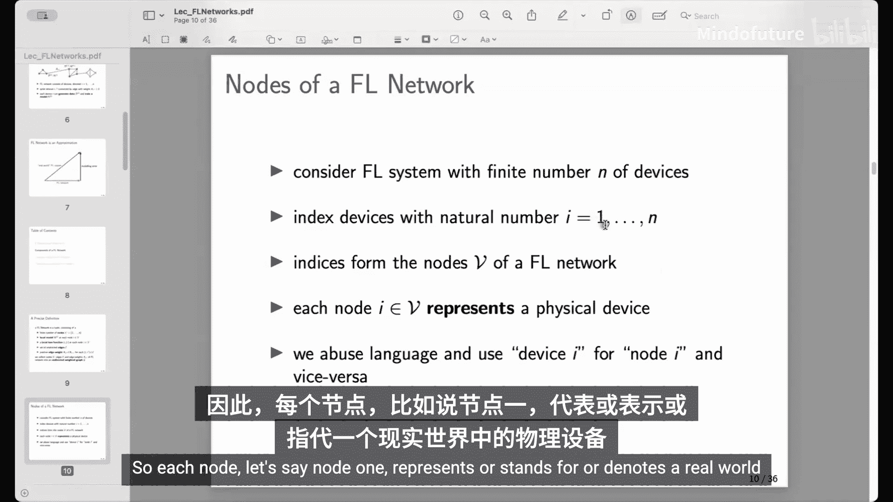

And we will be a bit sloppy with with language throughout this course and and interchangeably speak about a device I。

 when we mean the node I and we we use node I， when we actually mean the device that is represented by node I。

 But strictly speaking， there a different things。 So then a node within a federative learning network is a natural number between one and n。

But we use this number as a mathematical model for a physical device。

 so this is the device I that is represented by node I。

 so I hope you will be able to get their intended meaning depending on the context。

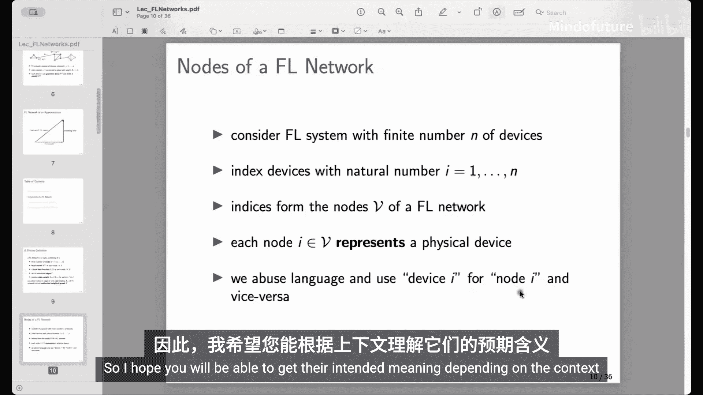

Okay， so now that each node represents a device。we are not really interested in technical detail about a device。

 We are not interested what operating system are they running。

 Which Android version or what what hardware configuration does a device have。

 how many megabytes Ram a working memory， main memory does a device have。

 So this is now where we abstract。 and the essence of a device is within this course that it can train a model。

 So each device is is assigned or carries a model， a machine learning model in the form of a hypothesistheesis space。

 So here11 device that is represented by node I carries a linear model。

 So this linear model is the set of all linear maps。 This is assigned to node I。

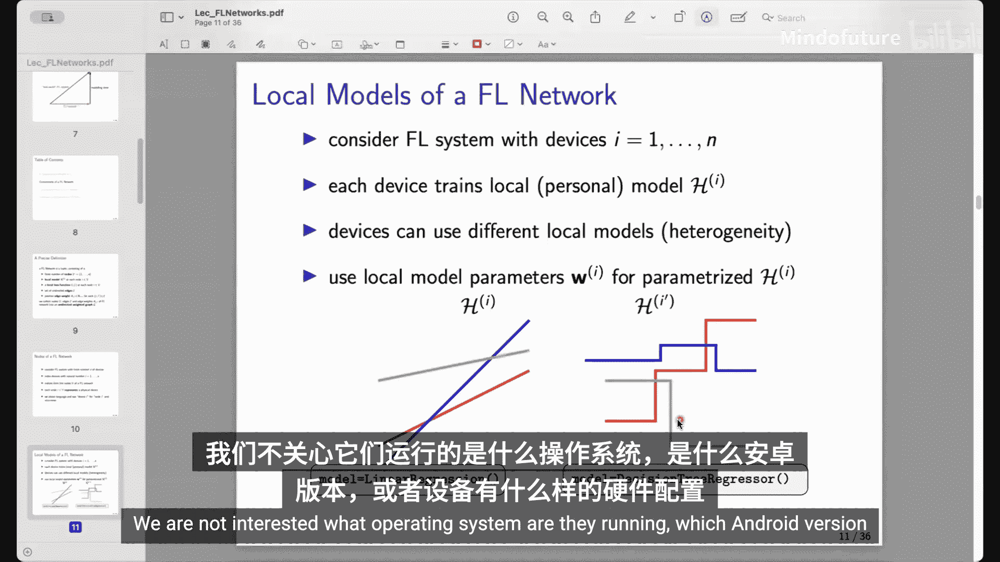

Another node I prime might carry a different model， like decision tree model。

 This is the set of piece by constant functions where these pieces are defined by the。

 by the decision notes in a decision tree。And you will also implement this， I mean。

 these are mathematical abstract concepts， but we will also see how to bring them to life。

 how to implement them， for example， in Python， you can implement this linear model or work with a linear model using this linear regression。

Class， and similar， you can use a decision tree class to。

 to represent and to work with a decision tree model。

And you will implement those different models in the assignments actually during the course。

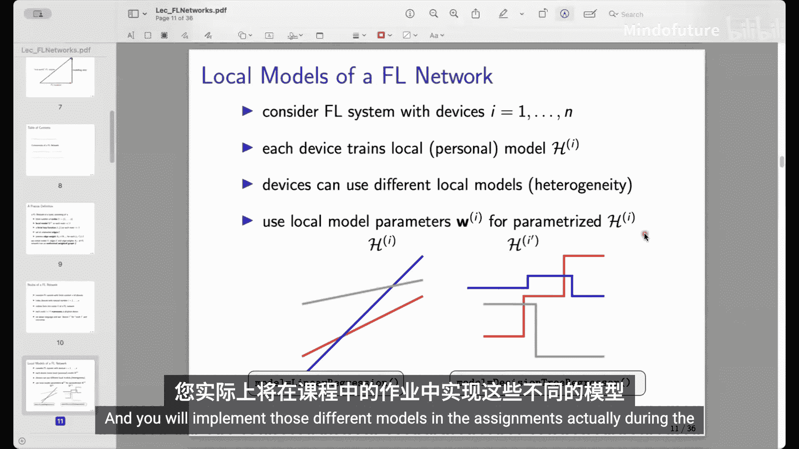

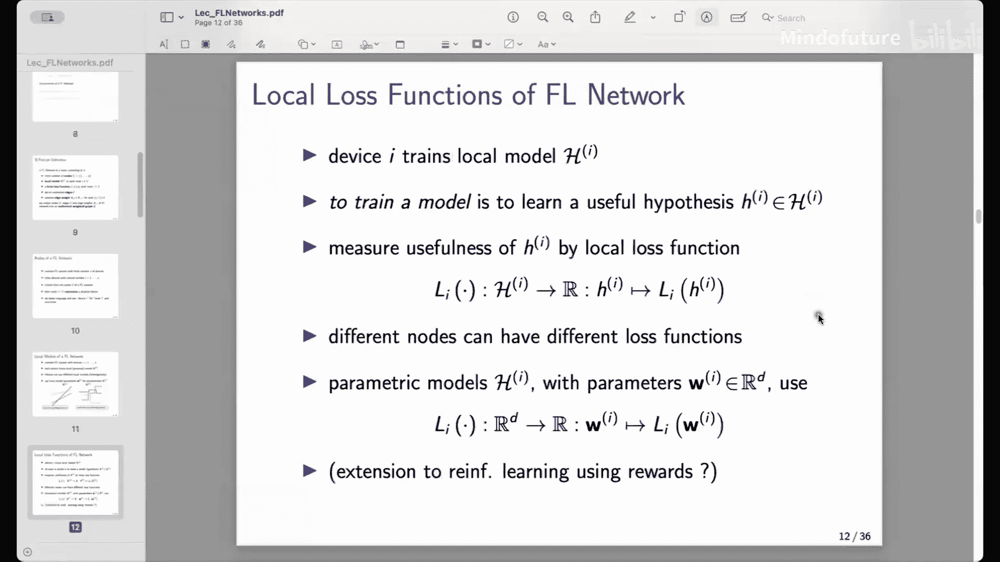

Okay， beside the local models， we also have a local loss function at each node。

 we need a local loss function to choose or to train a model training a model means to learn a useful hypothesis out of a model so for a linear model training a linear model means to find or to learn the most useful linear map。

 is it this green linear curve is it this blue linear curve or is it this red linear curve So this decision or this choosing process。

 this is what we mean by training a model。

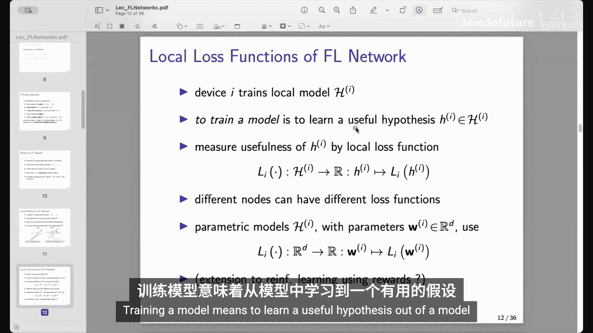

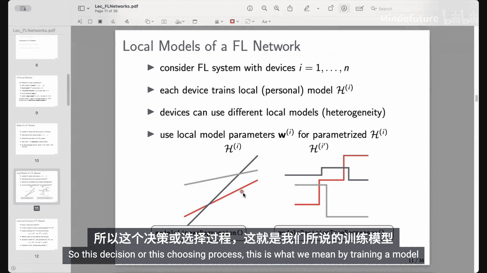

And it means that essentially it means to， to select a good hypothesis。

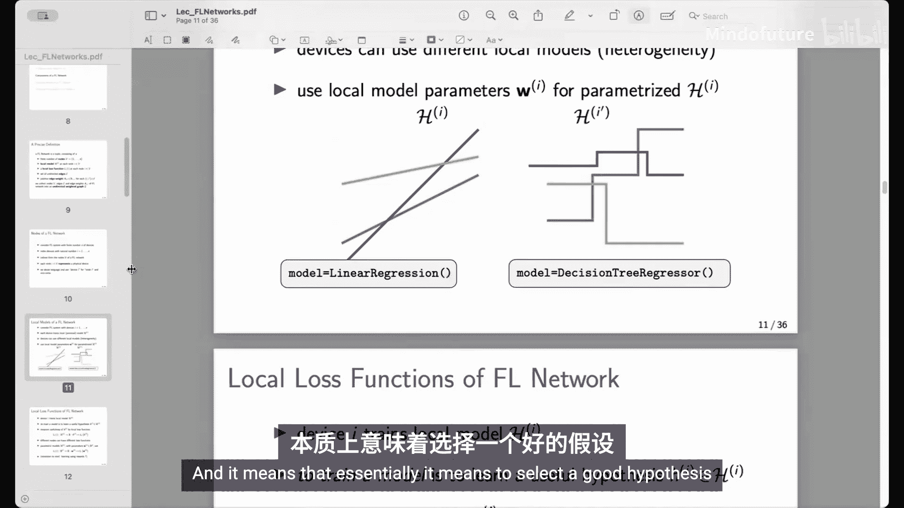