# 联邦学习 CS-E4740：1：联邦学习网络的构成要素 🔧

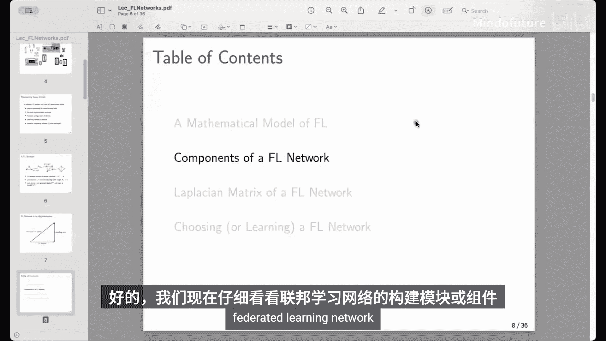

在本节课中，我们将深入探讨联邦学习网络的基本构成要素或组件。我们将了解网络由哪些部分组成，以及每个部分在联邦学习框架中扮演的角色。

---

## 节点集合

上一节我们介绍了联邦学习的基本概念，本节中我们来看看其网络的具体构成。首先，联邦学习网络由**节点**构成。


在联邦学习网络的图示中，它包含有限数量的节点。为了方便起见，我们使用前 `n` 个自然数来标识这些节点。在本课程中，当我们谈论联邦学习网络的节点时，总是指的是前 `n` 个自然数。

使用前 `n` 个自然数并非一个严格的限制，但一个重要的限制是我们认为这个 `n` 是给定的。我们假设节点的数量是有限的，但这个数量可以任意大。本课程不涉及节点集为无限（例如所有整数或所有自然数）的图。因此，在本课程中，我们只考虑由任意多但数量有限的节点组成的联邦学习网络。

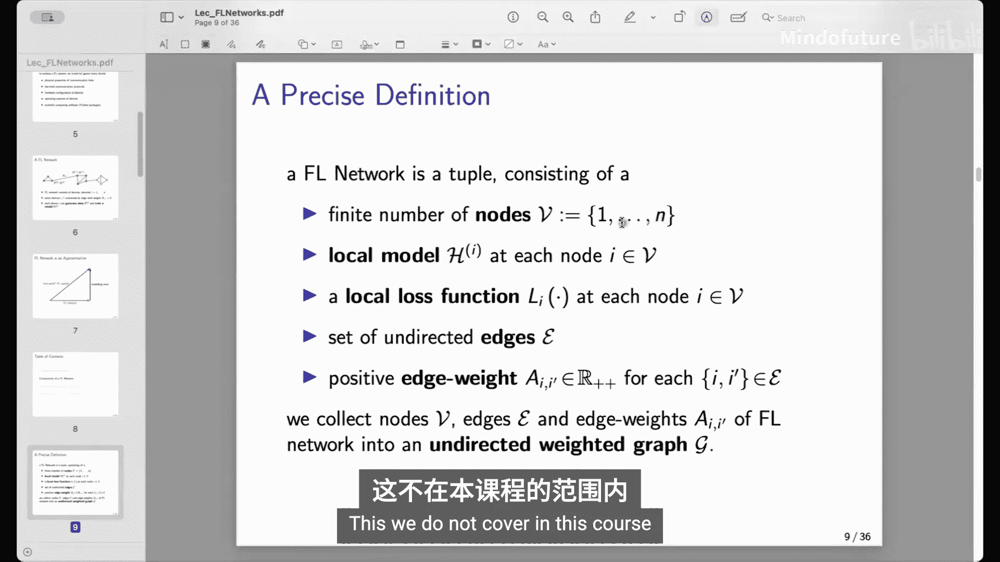

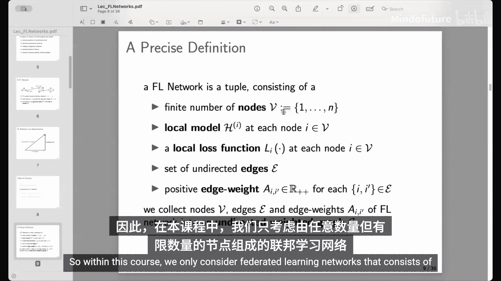

---

## 节点与设备

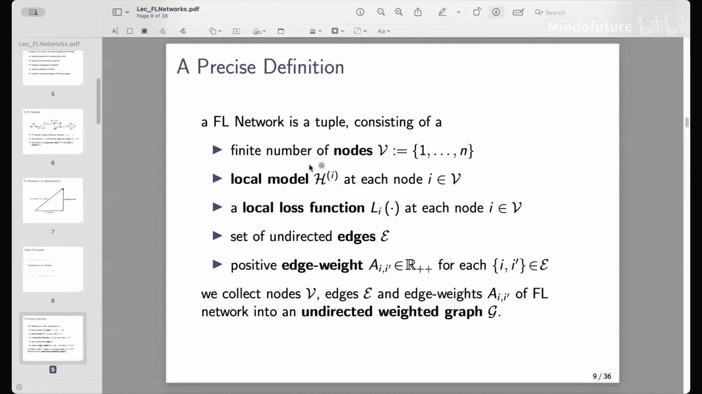

正如前面提到的，联邦学习网络中的节点代表**设备**。

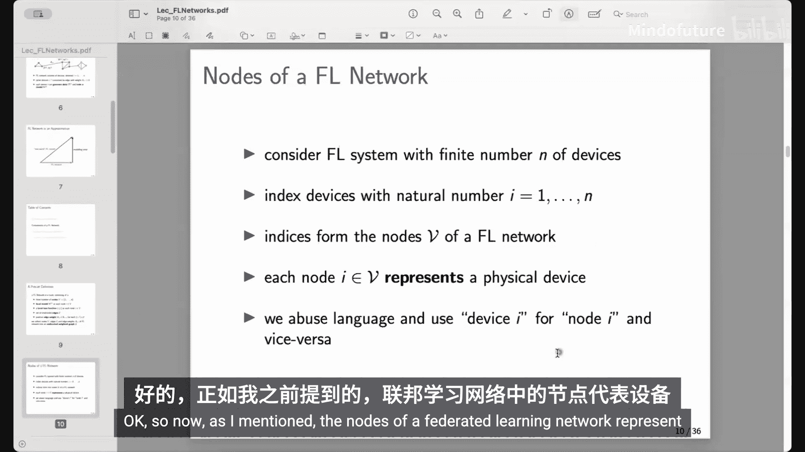
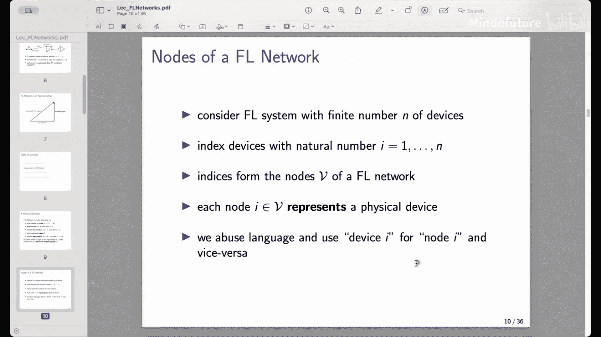
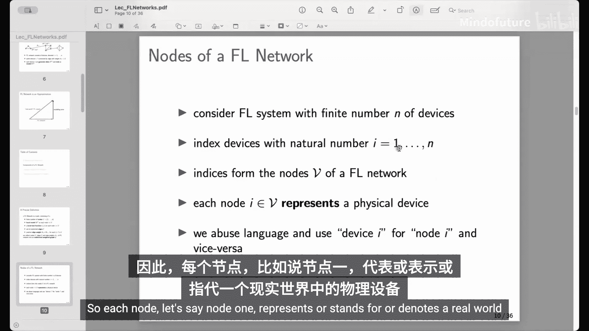

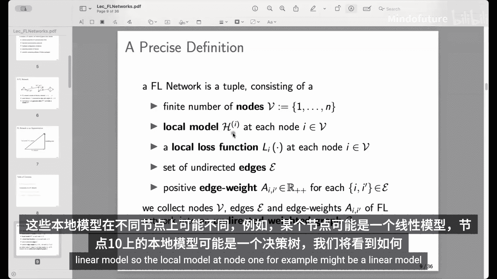

节点 `i` 代表或表示一个现实世界中的物理设备。这个设备可能是一部智能手机、一台超级计算机，或是一个智能灯泡。

在本课程中，我们可能会在语言上有些随意，交替使用“设备 `i`”和“节点 `i`”来指代同一个事物。严格来说，它们是不同的：联邦学习网络中的节点是一个介于 `1` 到 `n` 之间的自然数，但我们用这个数字作为物理设备的数学模型。因此，节点 `i` 代表了设备 `i`。希望你能根据上下文理解其含义。

---

## 本地模型

既然每个节点代表一个设备，我们并不真正关心设备的技术细节。


我们不关心设备运行什么操作系统、安卓版本或硬件配置，也不关心设备有多少兆字节的 RAM 或主内存。这是我们需要进行抽象的地方。在本课程中，设备的本质在于它能够**训练一个模型**。

每个设备被分配或承载一个机器学习模型，其形式是一个**假设空间**。

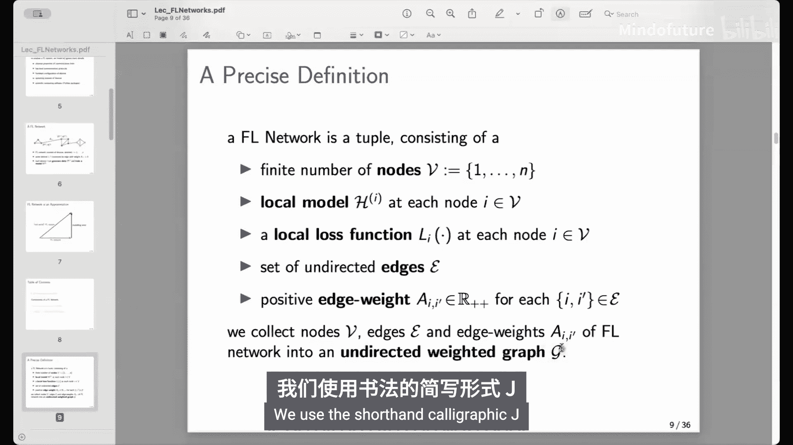


例如，由节点 `i` 代表的设备可能承载一个线性模型。节点 `i` 的本地模型可能是一个线性模型，而节点 `10` 的本地模型可能是一个决策树。我们将看到如何开发联邦学习算法来训练任意的本地模型集合。


以下是不同本地模型的例子：
*   **线性模型**：所有线性映射的集合。在 Python 中，可以使用线性回归类来实现。
    ```python
    # 示例：使用 scikit-learn 的线性模型
    from sklearn.linear_model import LinearRegression
    model = LinearRegression()
    ```
*   **决策树模型**：由决策树节点定义的分段常数函数集合。在 Python 中，可以使用决策树类。
    ```python
    # 示例：使用 scikit-learn 的决策树
    from sklearn.tree import DecisionTreeRegressor
    model = DecisionTreeRegressor()
    ```


这些是数学上的抽象概念，但我们也会学习如何实现它们。在本课程的作业中，你将实际用 Python 实现这些不同的模型。

---

## 本地损失函数

除了本地模型，每个节点还有一个**本地损失函数**。

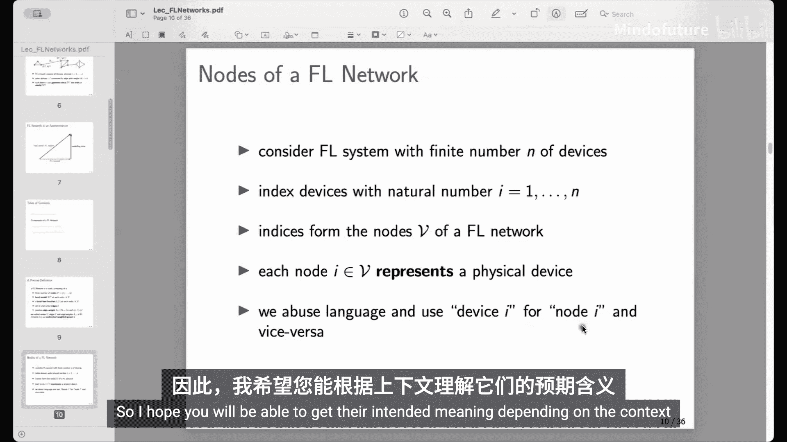


为了训练一个模型，就像在基础机器学习中一样，我们需要某种方法来衡量模型参数或假设的有用性。为此，我们需要一个损失函数。

训练一个模型意味着从模型中选择一个有用的假设。例如，对于一个线性模型，训练意味着找到最有用的线性映射——是绿色的线性曲线、蓝色的，还是红色的？这个选择过程就是我们所说的训练模型。

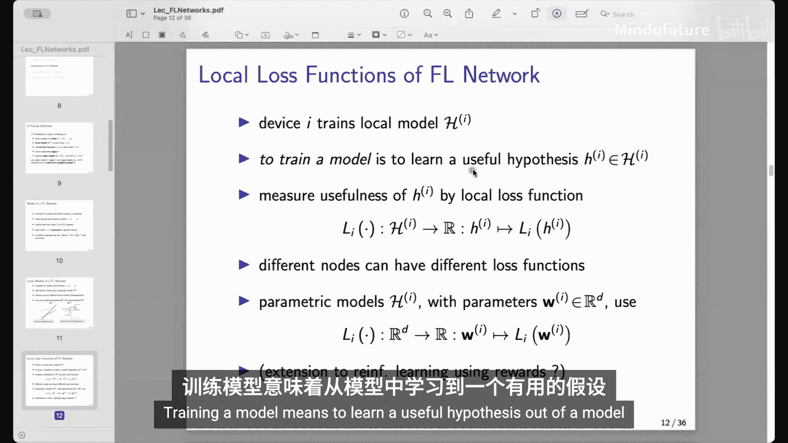
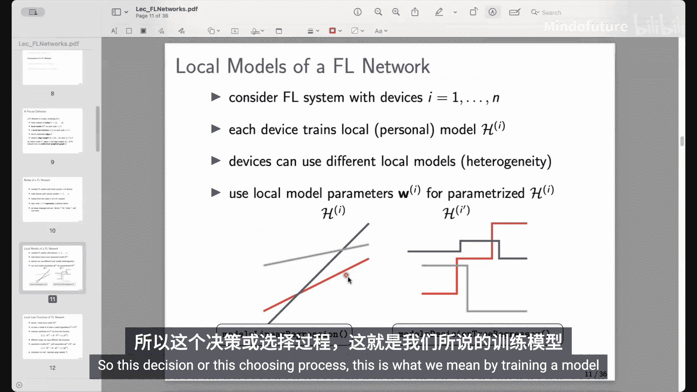
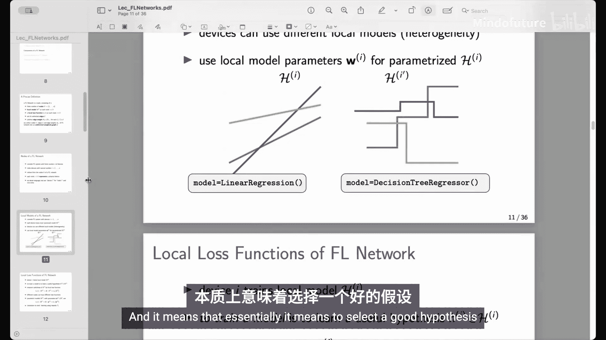

本地损失函数正是用来量化这个“有用性”或“好坏”的工具，它指导设备选择最佳的假设。

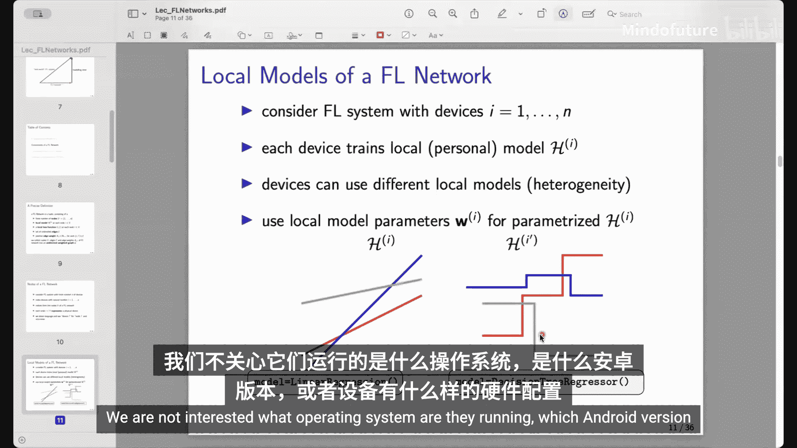

---

## 无向加权图

联邦学习网络不仅包含节点及其属性（本地模型和损失函数），还包含节点之间的连接。


网络还包含一个**无向图**。一些设备通过无向边连接起来，每条边都被赋予一个**边权重**，用于衡量两个设备之间连接的强度。我们将在后续课程中看到边权重的不同解释，但目前它只是数学模型的一部分。

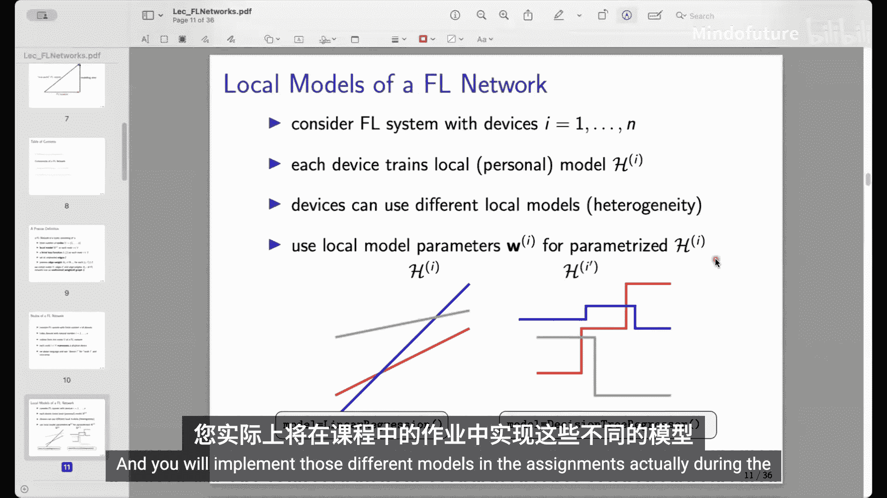

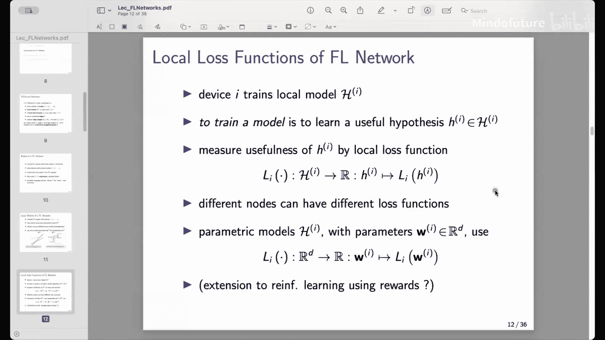

为了便于表示，在本课程中，我们通常将节点、边和边权重集合成一个**无向加权图**，并用花体字母 `𝒢` 作为简写。

---

## 总结

本节课中，我们一起学习了联邦学习网络的核心构成要素：


1.  **节点**：代表物理设备（如手机、电脑），用有限个自然数标识。
2.  **本地模型**：每个设备承载的机器学习模型（如线性模型、决策树），定义了可用的假设空间。
3.  **本地损失函数**：每个设备用于评估和选择最佳假设的函数。
4.  **无向加权图**：描述设备之间的连接关系及连接强度（边权重）。


这些组件共同构成了联邦学习算法的运行基础。在接下来的课程中，我们将看到这些部分如何协同工作，实现在不共享原始数据的情况下进行协作式模型训练。