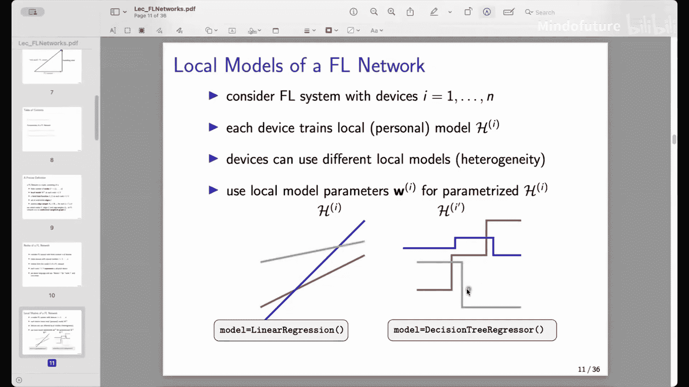
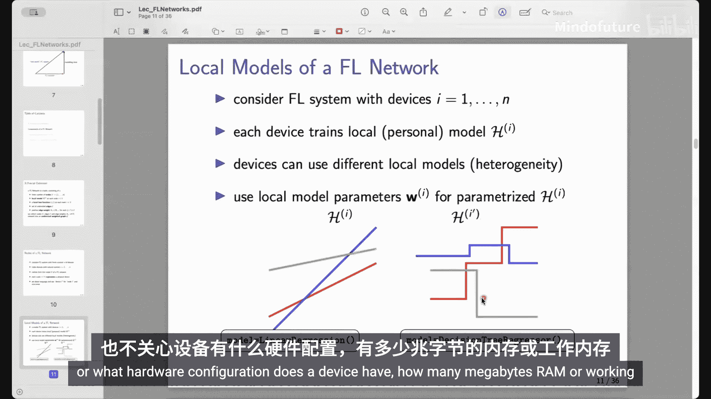
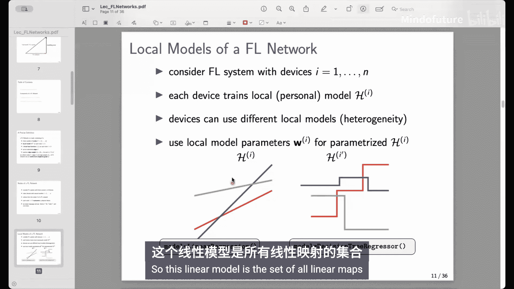
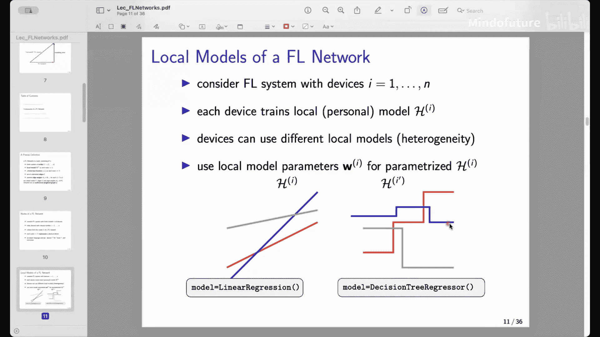
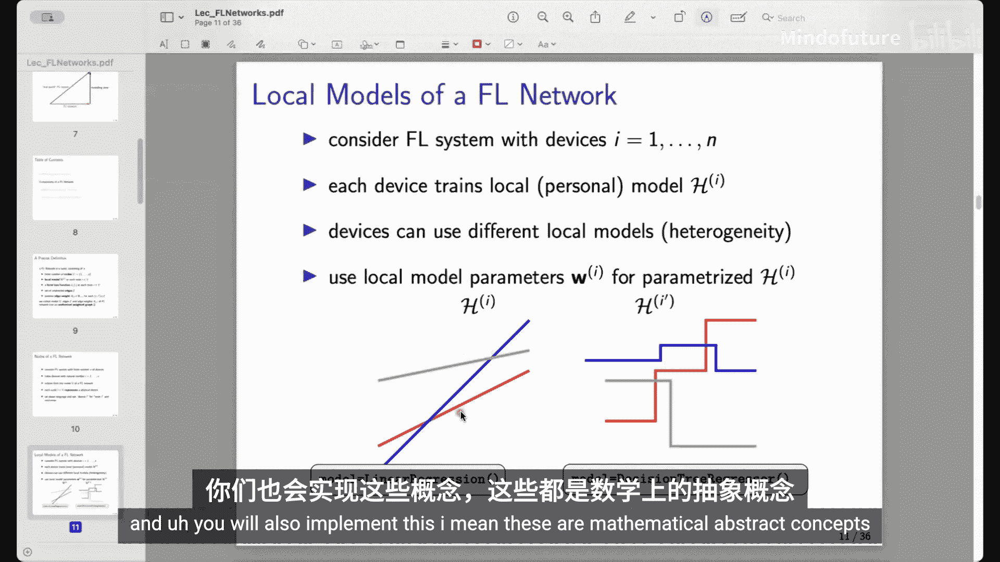
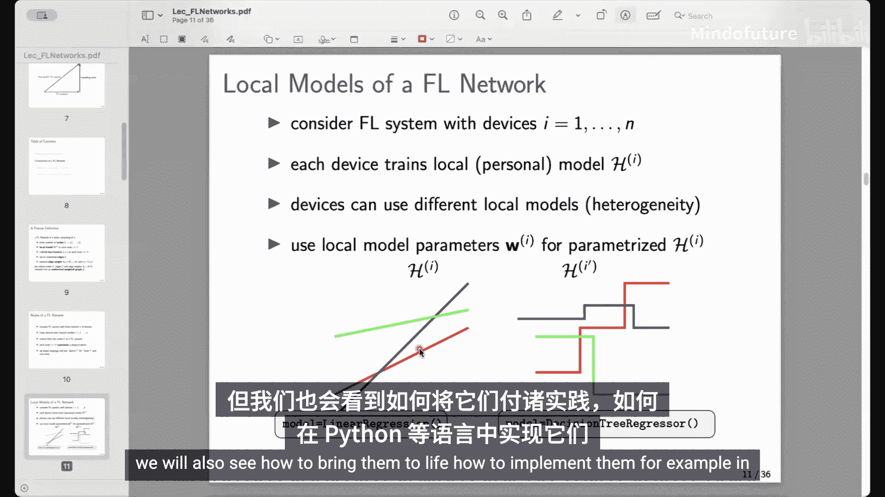
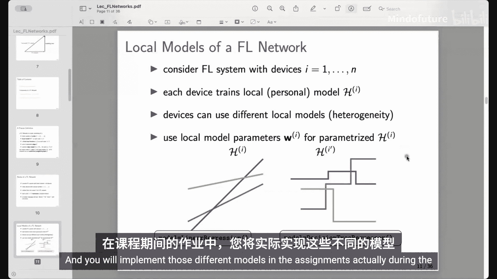
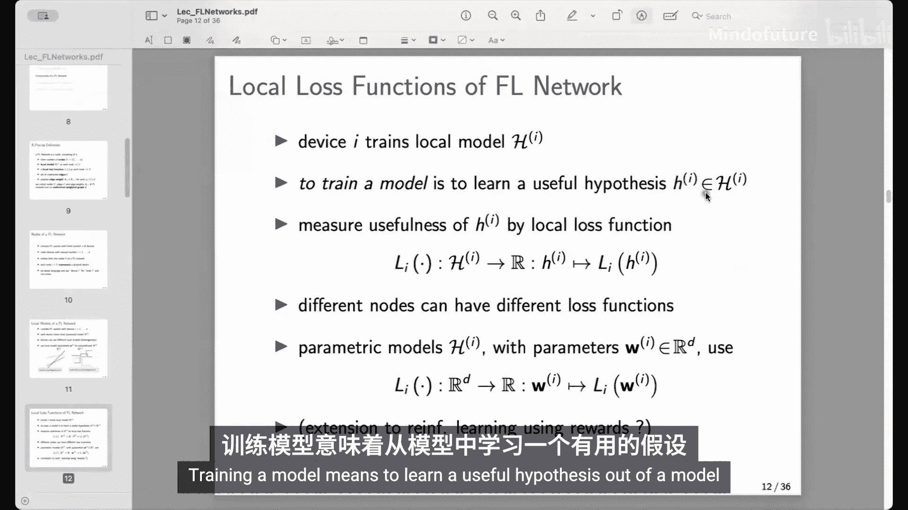
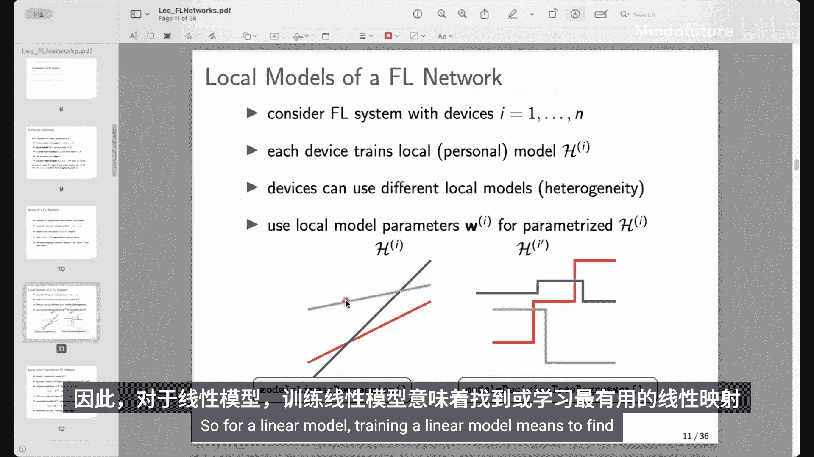
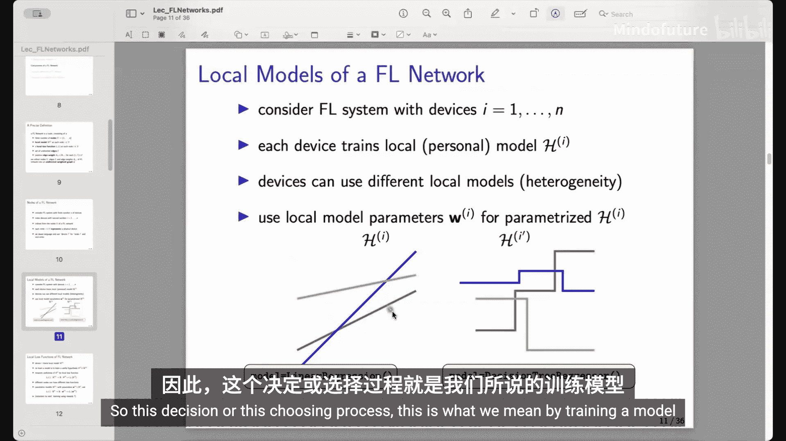

# 【阿尔托大学 - 中英】联邦学习 CS-E4740（Federated Learning，spring 2025） p12 P12 CS-E4740 Local Models in FL Networks -BV1cojRzDEfQ_p12-

Okay， so now that each node represents a device。

We we are not really interested in technical detail about a device。

 We are not interested what operating system are they running。

 Which Android version or what what hardware configuration does a device have。

 How many megabytes Ram a working memory， main memory does a device have。

 So this is now where we abstract。 and the essence of a device is within this course that it can train a model。

 So each device is is assigned or carries a model， a machine learning model in the form of a hypothesistheesis space。

 So here，1，1 device that is represented by node I carries a linear model。

 So this linear model is the set of all linear maps。 This is assigned to node I。

Another node I prime might carry a different model， like decisionary model。

 This is the set of piecewise constant functions where these pieces are defined by the by the decision notess in a decision tree。

And you will also implement this， I mean， these are mathematical abstract concepts。

 but we will also see how to bring them to life， how to implement them， for example， in Python。

 you can implement this linear model or work with a linear model using this linear regression。

Class， and similar， you can use a decision tree class to。

 to represent and to work with a decision tree model。

And you will implement those different models in the assignments actually， during the course。

Okay， beside the local models， we also have a local loss function at each node。

 We need a local loss function to choose or to train a model training a model means to learn a useful hypothesis out of a model。

 So for a linear model training a linear model means to find or to learn the most useful linear map。

 is it this green a linear curve， is it this blue linear curve or is it this red linear curve。

 So this decision or this choosing process。 This is what we mean by training a model。

