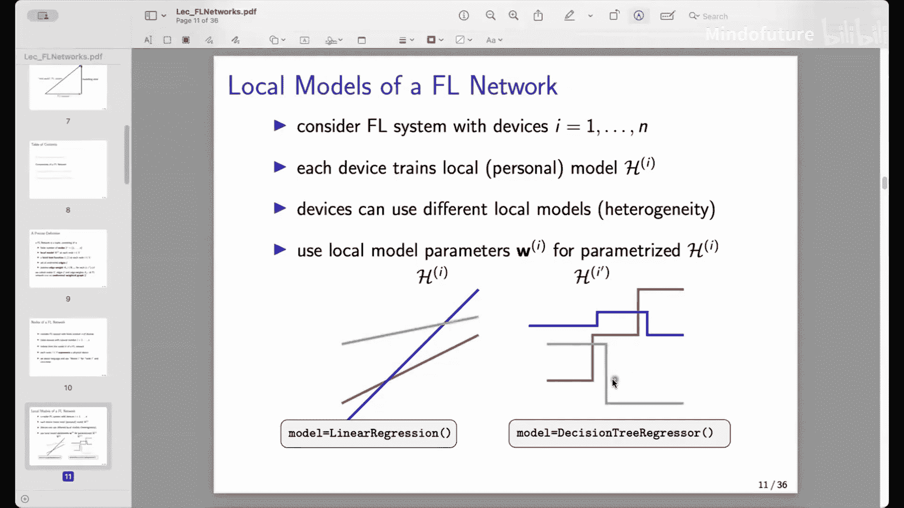
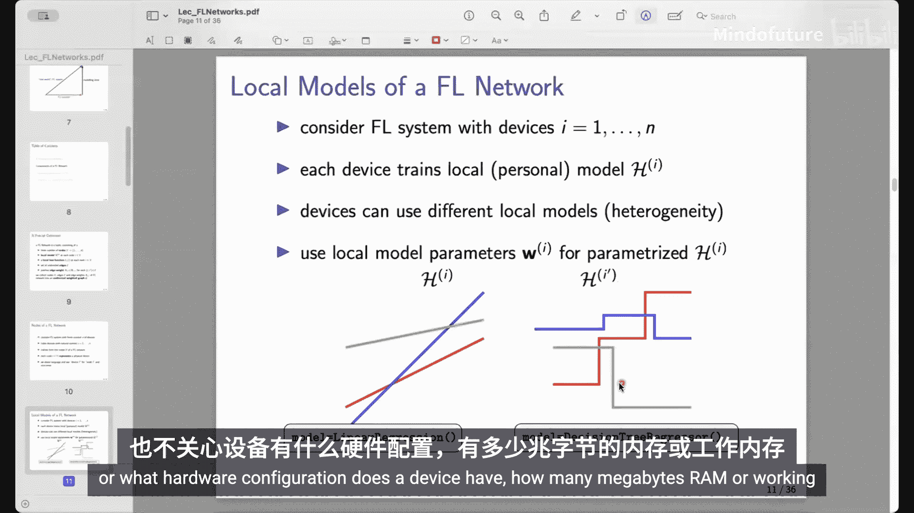
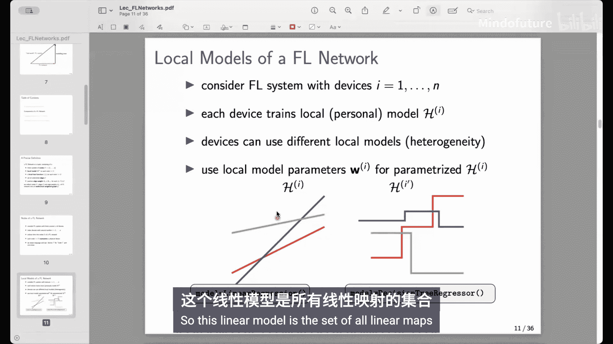
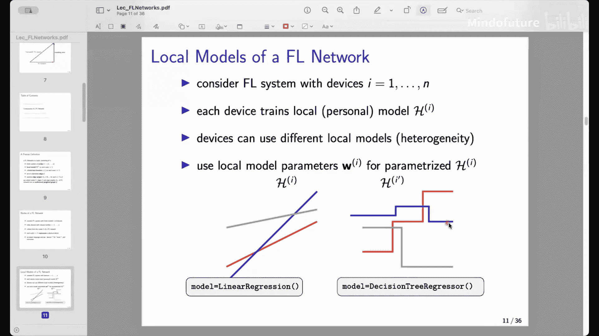
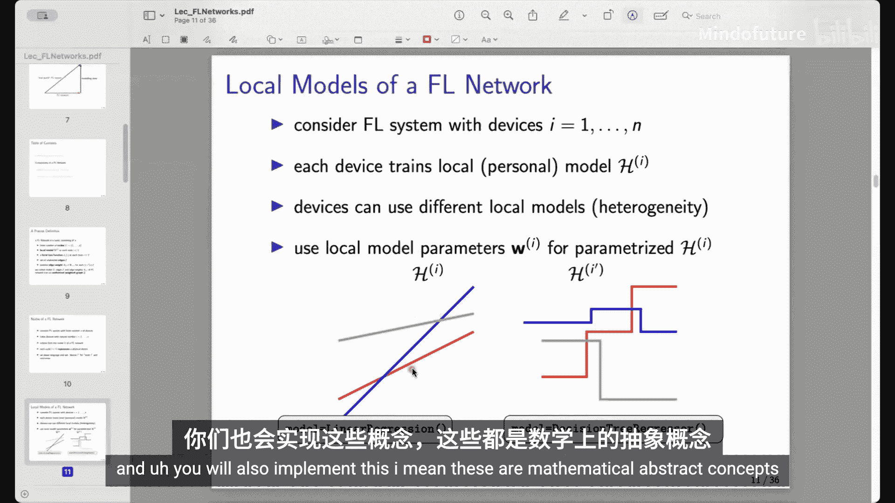
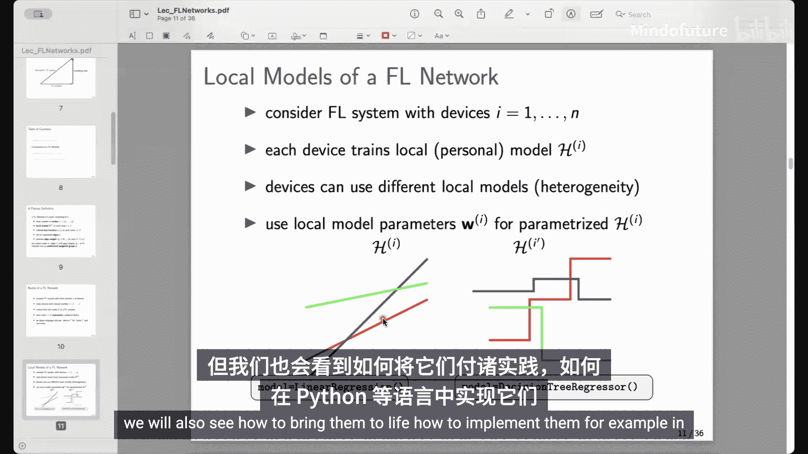
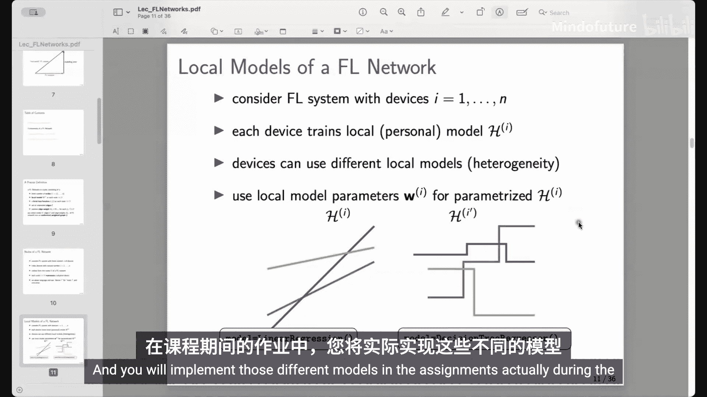
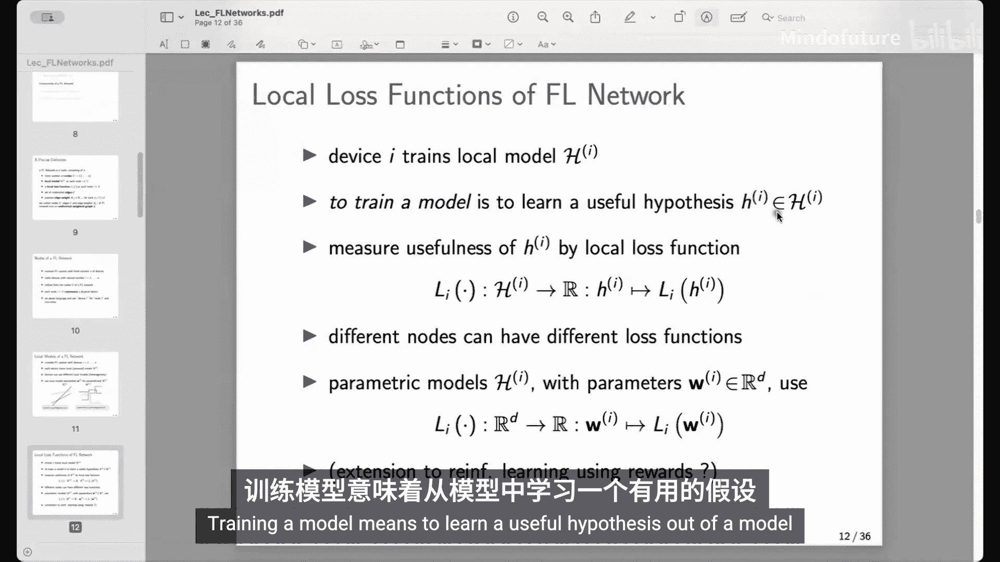
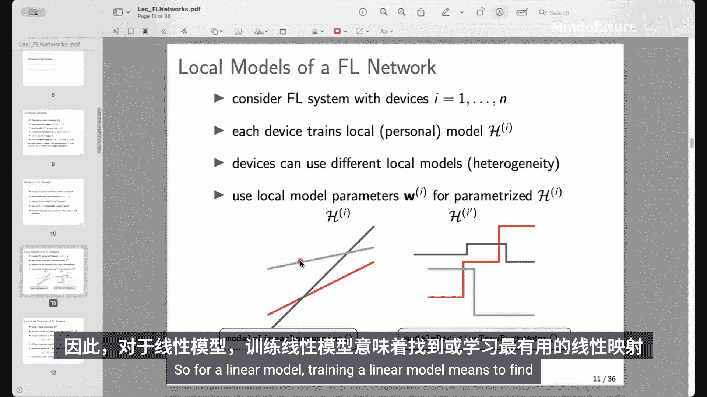
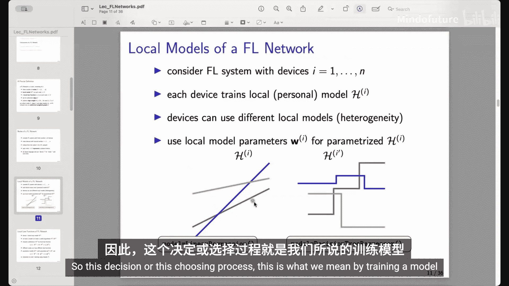

# 联邦学习 CS-E4740：P12：联邦网络中的本地模型 🧠

在本节课中，我们将学习联邦学习网络中每个设备（节点）的核心组成部分：本地模型和本地损失函数。我们将了解如何抽象化设备的技术细节，专注于其作为模型载体的本质，并探讨不同模型类型的数学表示及其在代码中的实现方式。

---

上一节我们讨论了联邦学习网络的节点结构。本节中，我们来看看每个节点所承载的具体内容。

每个节点代表一个设备。我们并不关心设备的具体技术细节，例如它运行什么操作系统、是哪个安卓版本、硬件配置如何，或者有多少兆字节的内存。

这里我们需要进行抽象。在本课程中，设备的本质在于它能够训练一个模型。因此，每个设备都被分配或承载着一个模型，这个模型以假设空间的形式存在，是一个机器学习模型。

例如，一个由节点 `i` 代表的设备可能承载一个线性模型。这个线性模型是所有线性映射的集合，它被分配给了节点 `i`。

另一个节点 `i'` 可能承载一个不同的模型，比如决策树模型。这是由决策树中的决策节点定义的分段常数函数的集合。

这些是数学上的抽象概念，但我们也会学习如何将它们具体实现。例如，在Python中，你可以使用线性回归来实现或操作线性模型。

类似地，你可以使用决策树类来表示和操作决策树模型。在本课程的作业中，你将实际实现这些不同的模型。

---

除了本地模型，每个节点还有一个本地损失函数。我们需要本地损失函数来选择或训练模型。训练模型意味着从模型中学习出一个有用的假设。

对于一个线性模型，训练它意味着找到或学习出最有用的线性映射。是这条绿色的线性曲线，这条蓝色的，还是这条红色的？这个选择或决策过程，就是我们所说的训练模型。

---

本节课中，我们一起学习了联邦学习网络中节点的核心抽象：本地模型和本地损失函数。我们了解到，设备被抽象为模型的载体，例如线性模型或决策树模型，并且这些模型可以通过代码（如Python类）来实现。本地损失函数则是用于训练模型、从假设空间中选择最优假设的关键工具。