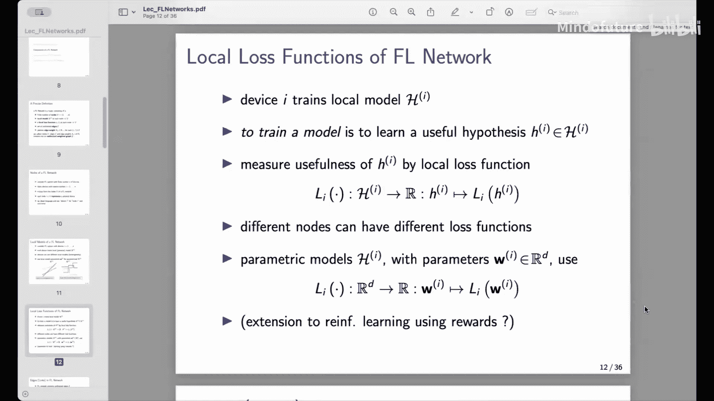
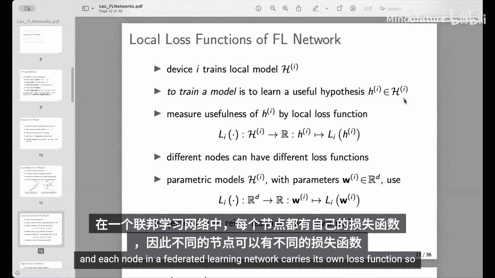
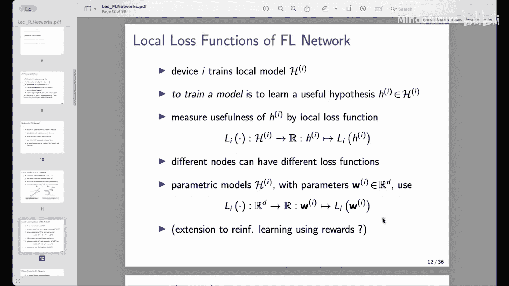
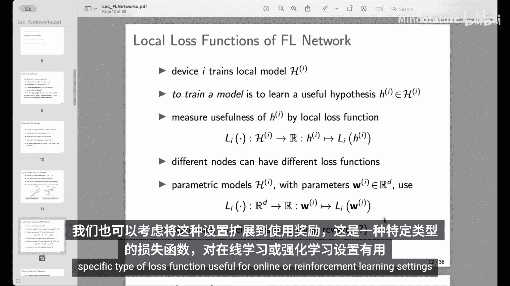
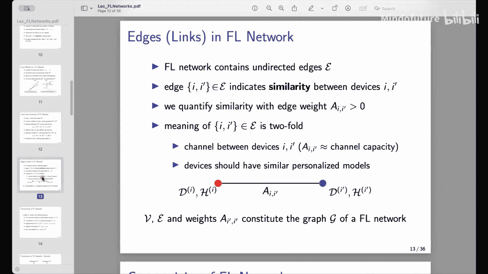

# 【阿尔托大学 - 中英】联邦学习 CS-E4740（Federated Learning，spring 2025） p13 P13 CS-E4740 Local Loss Functions in FL Networks -BV1cojRzDEfQ_p13-

In order to train a local model， we need some way。To evaluate the usefulness of a specific hypothesis。

 like a specific linear curve in a linear model。So we need a loss function。

 and each node in a federated learning network carries its own loss function。

 So in particular different nodes can have different loss functions。

We will introduce restrictions or assumptions on the loss functions as we use stulator on in the course。

 they can be very general， as I said， in particular。

 they can be different so we can use different types of loss functions at different nodes for parametric models。

We formulate the loss functions。Directly in terms of the model parameters。

We could also think about extending this setting to using rewards。

 which are a specific type of loss function useful for online or reinforcement learning settings。

 but this is beyond the scope of this course。

