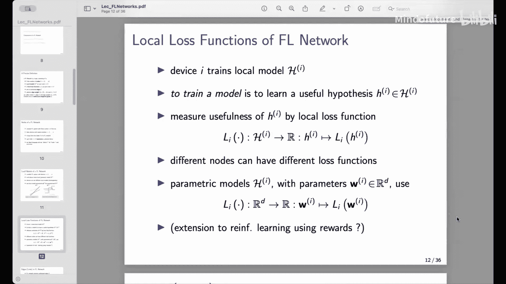
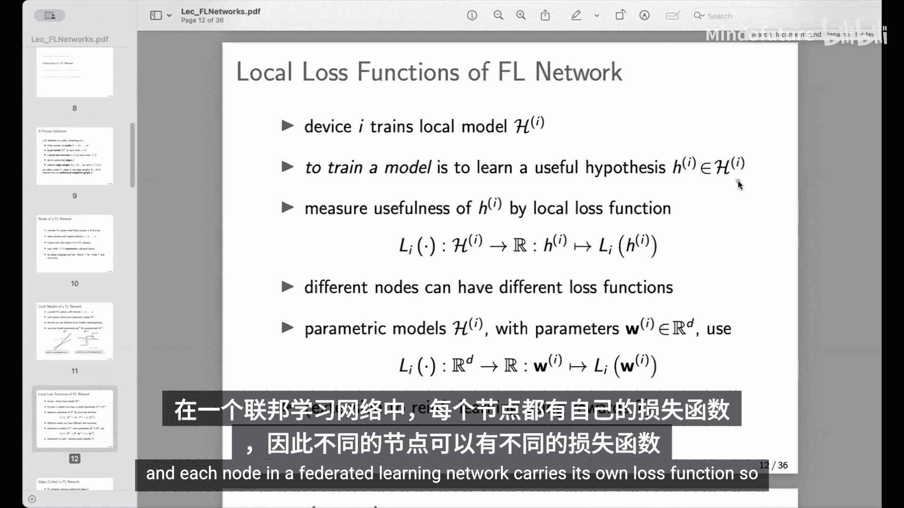
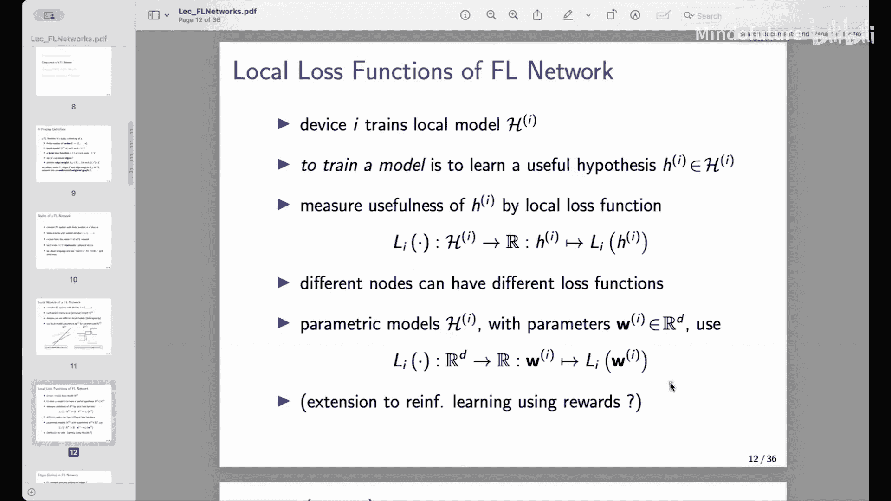
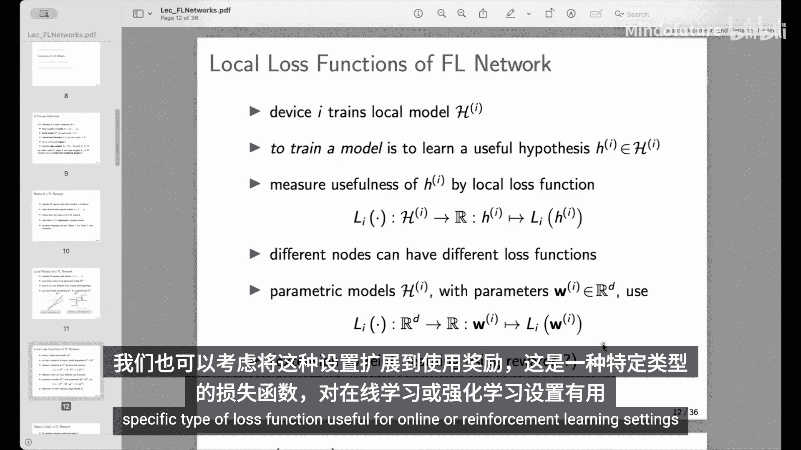
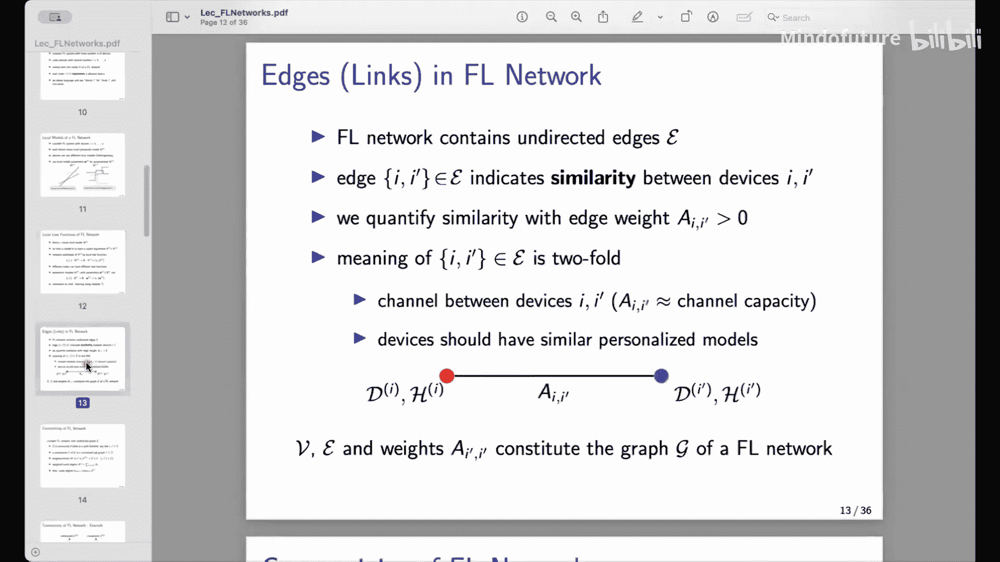

# 联邦学习 CS-E4740：P13：联邦学习网络中的本地损失函数 🧠

在本节课中，我们将要学习联邦学习网络中一个核心组成部分：本地损失函数。我们将了解为什么需要损失函数，它在联邦学习中的特殊性，以及它是如何被定义和使用的。

为了训练一个本地模型，我们需要一种方法来评估特定假设（例如线性模型中的一条特定直线）的有效性。因此，我们需要一个损失函数。

在联邦学习网络中，每个节点都承载着自己的损失函数。特别地，不同的节点可以拥有不同的损失函数。

---

## 损失函数的通用性与差异性

上一节我们介绍了损失函数的基本作用，本节中我们来看看联邦学习中对损失函数的具体设定。

在本课程中，随着学习的深入，我们将对损失函数引入一些限制或假设。但正如之前所说，它们可以非常通用。特别是，它们可以是不同的，这意味着我们可以在不同节点为参数化模型使用不同类型的损失函数。

我们将损失函数直接根据模型参数来表述。

---

## 损失函数的表述形式

以下是关于损失函数表述的核心要点：

损失函数 `L_i(θ)` 被定义为模型参数 `θ` 的函数，用于衡量节点 `i` 上模型预测的误差。其通用形式可以表示为：

`L_i(θ) = Σ loss(f(x; θ), y)`

其中，`f(x; θ)` 是参数为 `θ` 的模型对输入 `x` 的预测，`y` 是真实值，`loss` 是具体的损失计算方式（如均方误差、交叉熵等）。

---

## 向强化学习场景的延伸

我们也可以考虑将此设定扩展到使用“奖励”的场景。奖励是一种特定类型的损失函数，对于在线学习或强化学习设置非常有用。但这超出了本课程的范围。

---

## 总结

本节课中我们一起学习了联邦学习网络中本地损失函数的概念。我们了解到，损失函数是评估模型假设好坏的关键工具，并且在联邦学习的分布式环境中，每个节点可以拥有各自不同但针对模型参数定义的损失函数。这为在保护数据隐私的同时，协同训练一个全局模型奠定了基础。