# 【阿尔托大学 - 中英】联邦学习 CS-E4740（Federated Learning，spring 2025） p14 P14 CS-E4740 Design Choices in FL Networks -BV1cojRzDEfQ_p14-

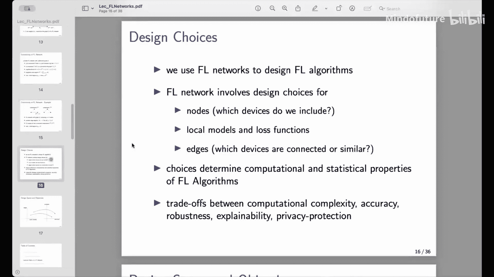

Okay， so I just want to， to reiterate that a federated learning network is a mathematical model。

 and it， it can be chosen。 So you， as the machine learning or federated learning scientist or engineer。

 you choose， for example， the edges。 often you can choose to some degree。Which nodes you connect byt。

 You can also often choose what model you use。 I mean。

 this is the model selection the show up of a machine learning engineer is often to select to choose the right type of model And this is only one design choice for a federated learning network。

 We have additional， we have the design choice。 Also， first of all。

 which which devices do we include in the network。 So we could use all all devices that can be reached from my current MacBook。

 via internet connections， is a very large network。

 or I could say all the devices within my my flat from the federated learning network。

 Also this is already a decided decision。 So which nodes to include which devices to include which are represented by nodes。

 Then the the local models for each of the of their nodes。

 and for this design choices we typically need to take into account。

The physical identity of the corresponding device， like if if a node represents a small embedded system。

 then we might not use a local model， a large language model that cannot be ever trained on that small device or even stored So we might only use then a decision tree。

 So the practice should guide the choice for the model in order to minimize the modeling error。

 as I mentioned before。

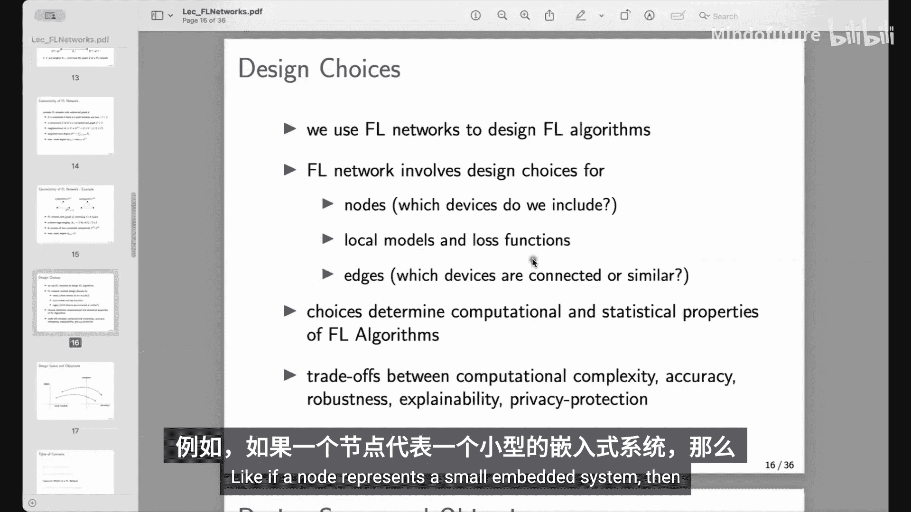

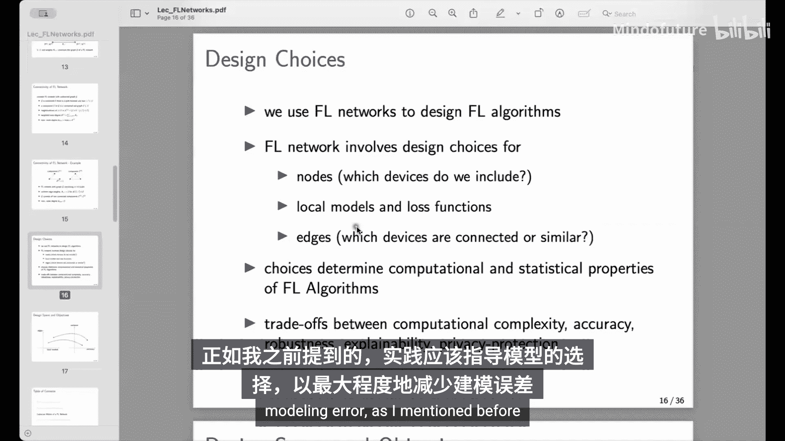

But within this course， the main design decision that we will be worried about is the edges。

 so I will then later in this session talk about ways to choose to make good choices for the edges so which devices should be connected within a federated learning network。

And all these design choices determine or influence the computational and statistical properties of federated learning algorithms。

 So this will be a main theme of the remaining lectures to study how does the computational complexity change if we use different choices for local models or ages and how does do the statistical properties change then。

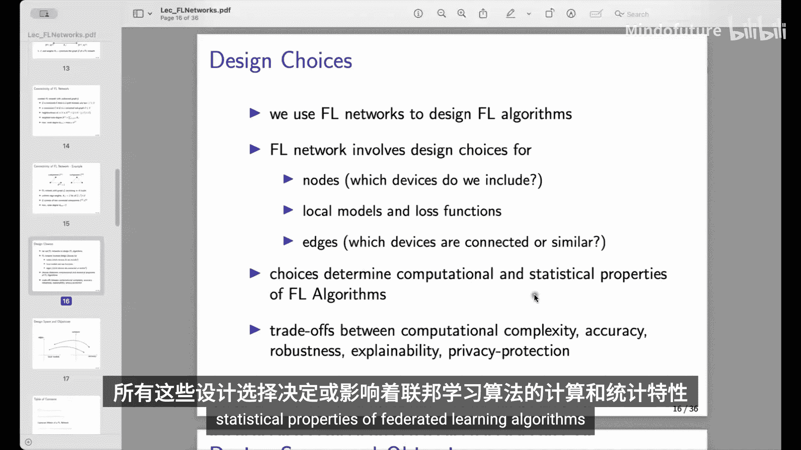

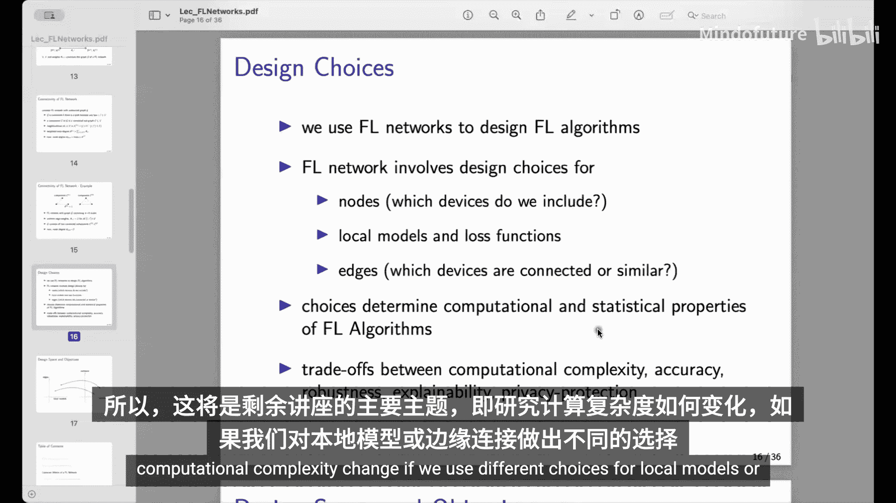

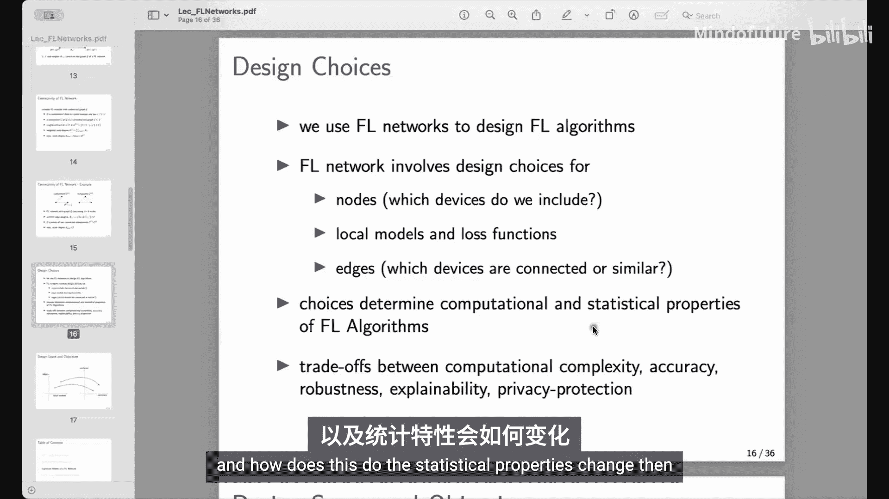

And typically， they are trade offs。 So when you when you want more accuracy， So you want to。

 to have a federated learning system that trains very accurate models。

 then you might typically need more computation or communication across the the links between the。

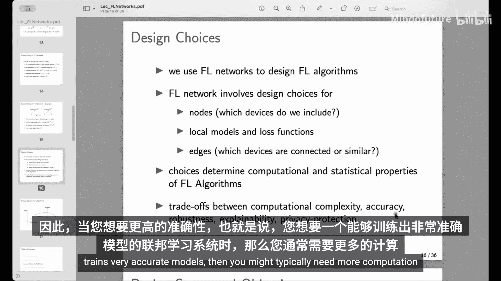

Between the notes。

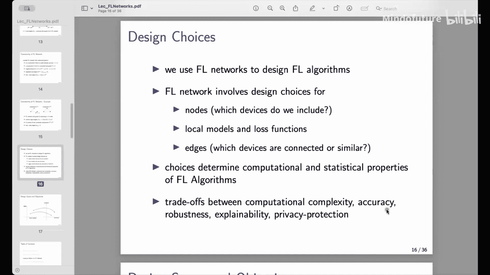

But there's also tradeoffs between other properties like the robustness。

 we want federated learning systems to be robust against different forms of perturbations。

 intentional or unintentional。We want them to be explainable and we want。

 of course a key characteristic of federated learning methods is that they allow for some level of privacy protection。

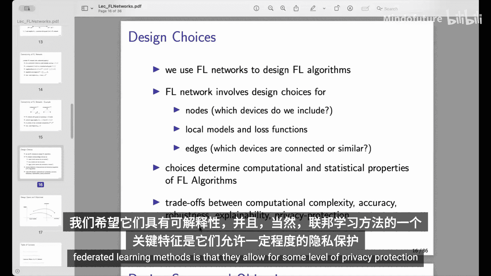

But typically we have to trade off privacy protection with computational complexity or accuracy。

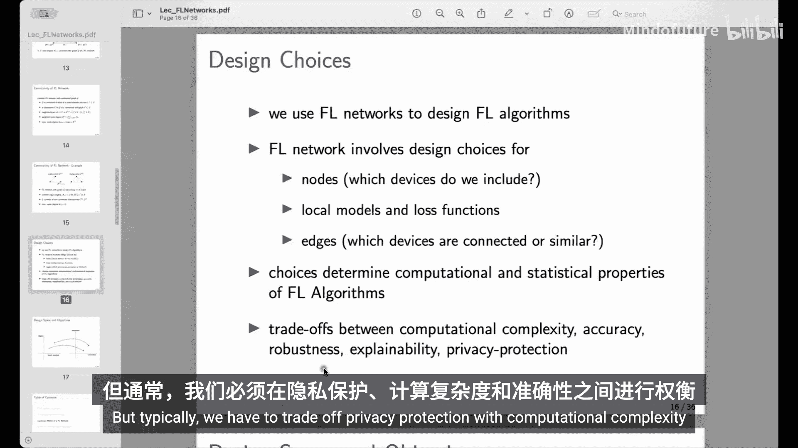

Yeah， I just want to。To visualize this design space and how they map to objective。

 So we have this design space as a federated learning design or federated learning engineer。

 you can choose the edges。 you can choose， to some degree， which， which devices you connect。

 which you devices you you want to communicate with each other and cooprate。

 collaborate on the model training。 you can also choose what type of models you want to train。

 So this is， of course， a key topic in machine learning research。

 how to find what are the the right type of models for a given application。

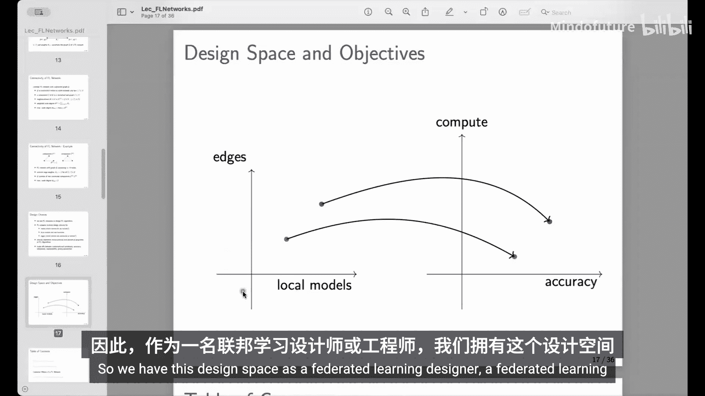

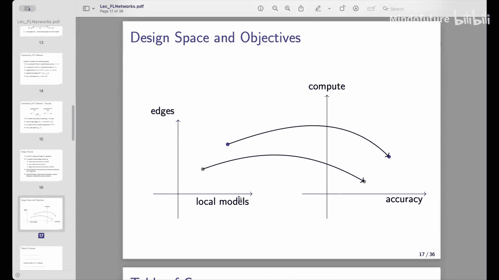

And these design choices then map to the objectives， performance objectives like the accuracy。

 We want， of course， to have trained models that are very accurate， have a very small tested error。

 for example， but they also should minimize the compute time。

 the more computation federerate learning algorithm needs， the more resources are needed。

 electricity。

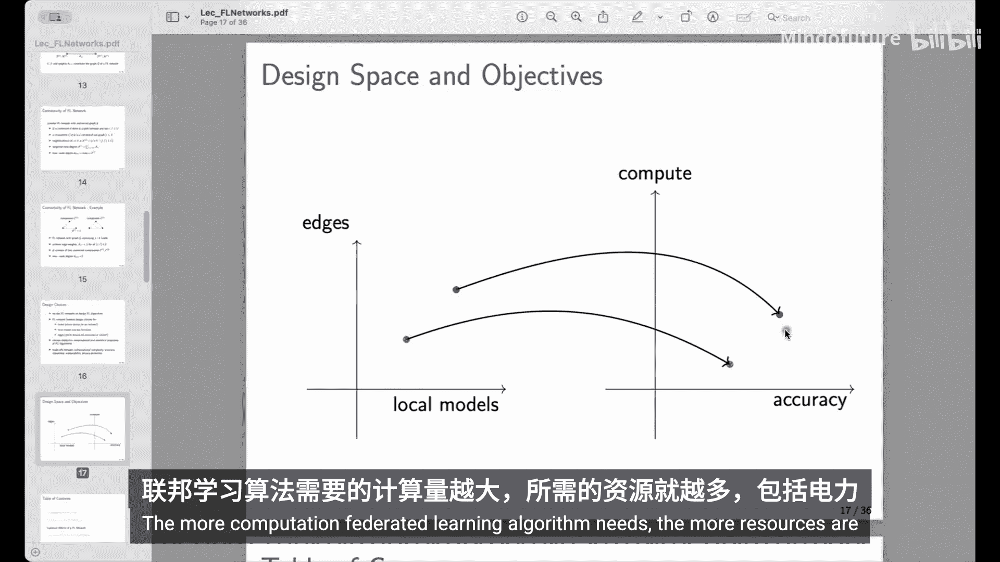

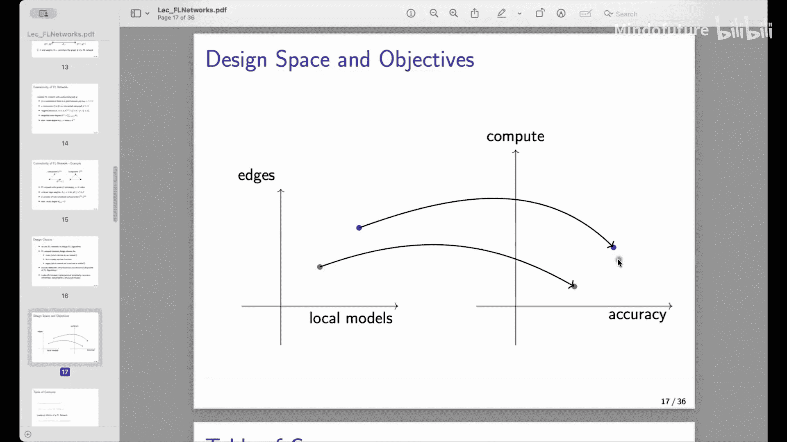

And also monetary costs， if cloud computing is involved in a federated learning system。

Okay。