# 联邦学习 CS-E4740：P14：联邦学习网络的设计选择

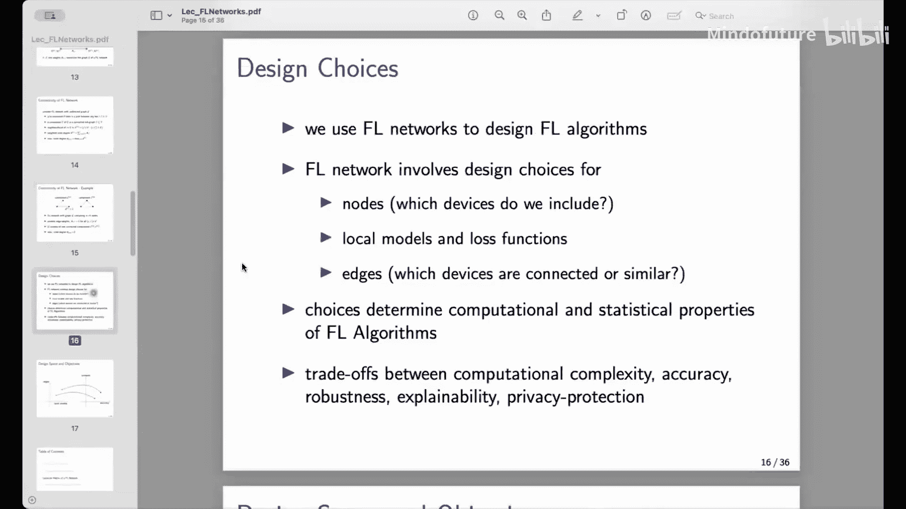

在本节课中，我们将学习联邦学习网络中的关键设计选择。我们将探讨如何通过选择网络中的节点、边以及本地模型，来影响联邦学习算法的计算、统计和性能特性。

---

上一节我们介绍了联邦学习网络的基本概念。本节中，我们来看看如何具体设计一个联邦学习网络。

联邦学习网络是一个数学模型，其结构是可以被选择和设计的。作为机器学习或联邦学习的科学家或工程师，你可以选择网络的构成要素，例如节点之间的连接（边）。通常，你可以在一定程度上选择将哪些设备（节点）连接起来。

你也可以选择在系统中使用何种模型。模型选择是机器学习工程师的核心工作之一，即为特定任务选择合适的模型类型。这只是联邦学习网络的一个设计选择。

以下是联邦学习网络的主要设计维度：

**1. 节点选择**
首先，我们需要决定将哪些设备纳入网络。例如，可以选择将所有能通过互联网从当前设备访问的设备都纳入，这将构成一个非常大的网络。也可以选择仅将特定物理空间（如一个公寓）内的设备纳入网络。这个决定定义了网络中节点的集合。

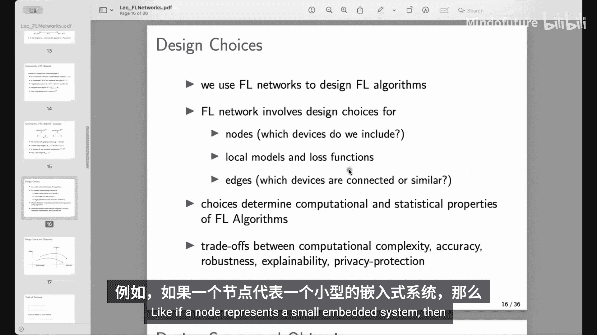

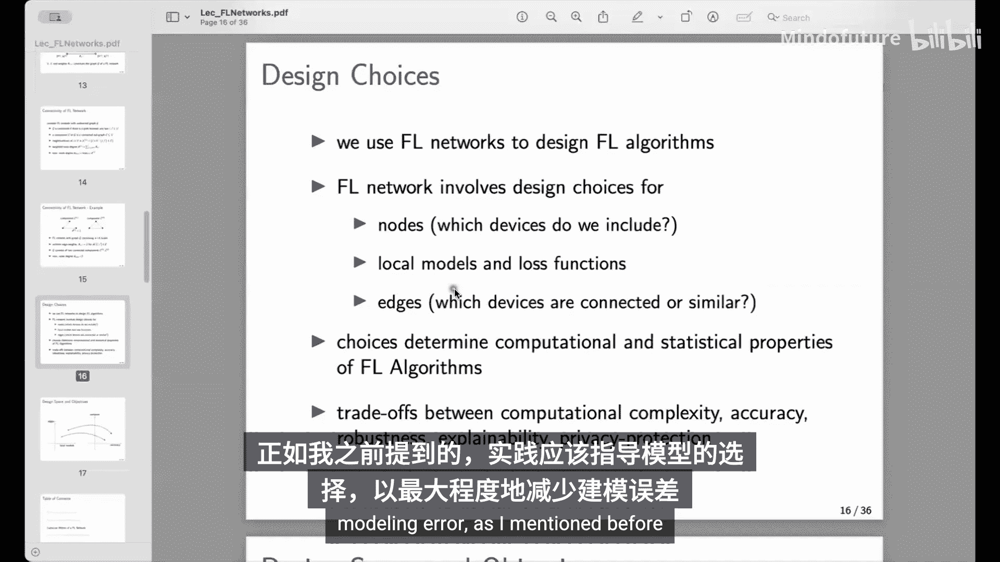

**2. 本地模型选择**
其次，我们需要为每个节点选择本地模型。在做这个选择时，通常需要考虑对应设备的物理特性。例如，如果一个节点代表一个嵌入式系统，那么可能无法在其上训练或存储一个大型语言模型。因此，我们可能只选择使用决策树等轻量级模型。实践需求应指导模型选择，以最小化建模误差。

**3. 边（连接）选择**
在本课程中，我们将重点关注的主要设计决策是边的选择。后续内容将讨论如何在联邦学习网络中为设备之间选择良好的连接方式。

所有这些设计选择共同决定或影响着联邦学习算法的计算和统计特性。这将是后续课程的一个主题：研究当我们为本地模型或边选择不同的方案时，计算复杂度和统计特性将如何变化。

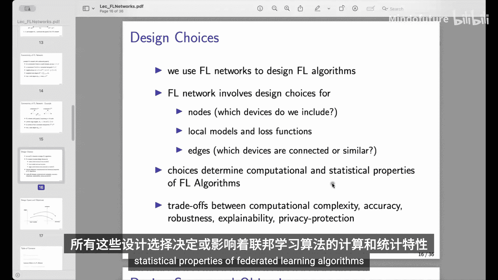

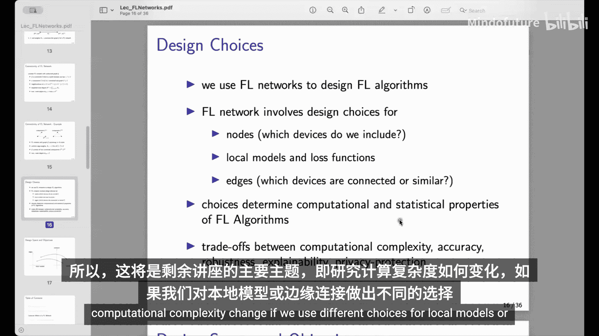

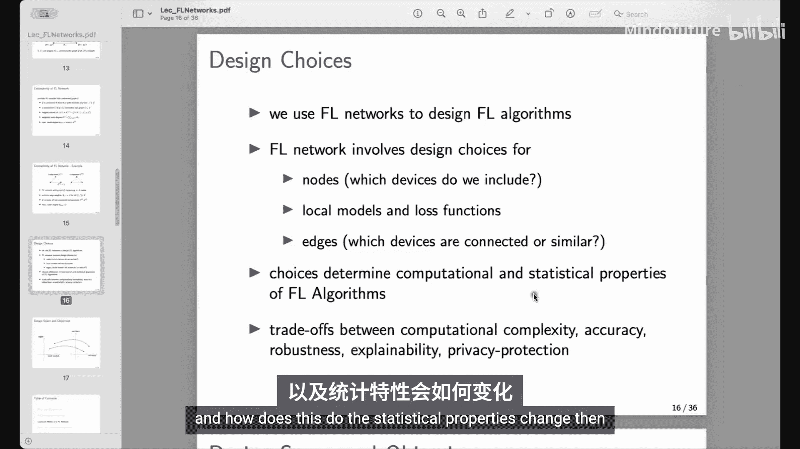

---

通常，这些设计选择之间存在着权衡关系。

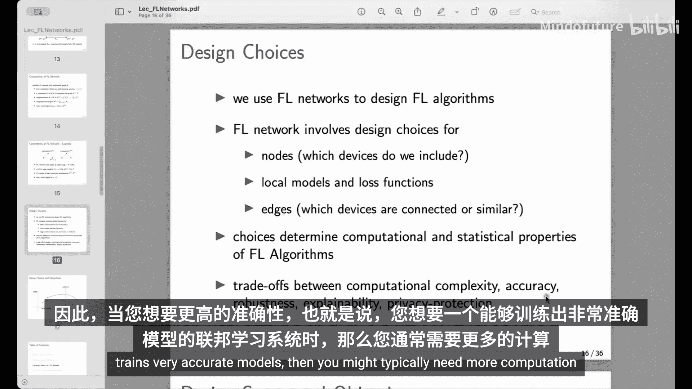

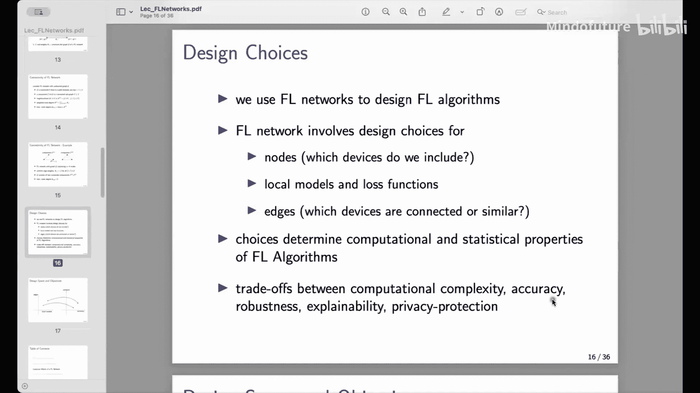

例如，当你希望联邦学习系统训练出更精确的模型时，通常需要在节点之间的链路上进行更多的计算或通信。

此外，在其他属性之间也存在权衡。我们希望联邦学习系统能够抵御各种形式的有意或无意的干扰，即具有鲁棒性。我们希望它们具有可解释性。当然，联邦学习方法的一个关键特性是它们能提供一定程度的隐私保护。

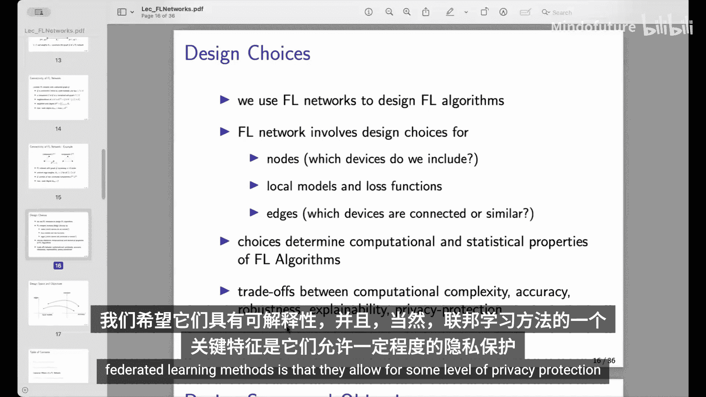

然而，我们通常需要在隐私保护与计算复杂度或模型准确性之间进行权衡。

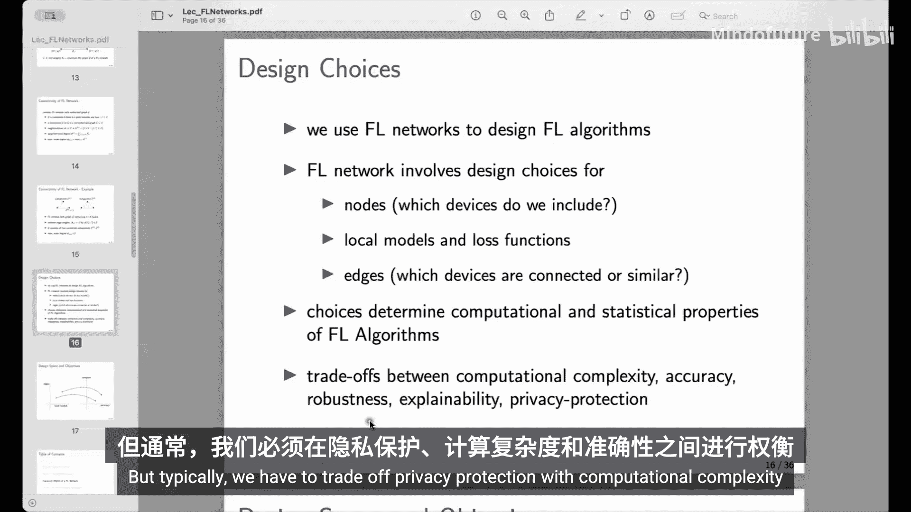

---

为了更直观地理解这个设计空间及其与目标的关系，我们可以进行如下总结：

作为联邦学习的设计者或工程师，你可以在一个设计空间内进行选择：
*   你可以选择边，即决定哪些设备之间相互连接、通信并协作进行模型训练。
*   你也可以选择要训练的模型类型。这当然是机器学习研究的一个关键课题：如何为特定应用找到正确的模型类型。

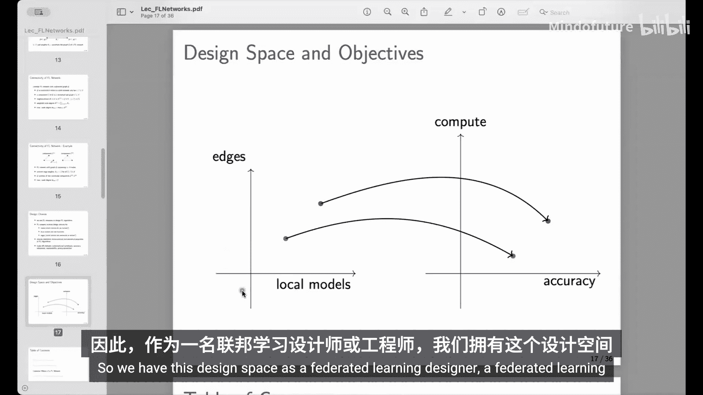

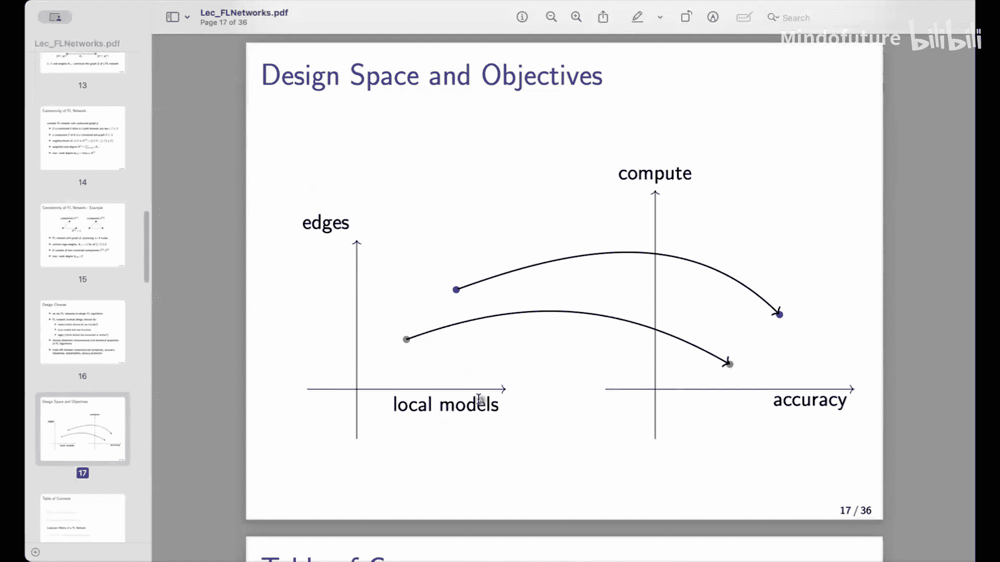

这些设计选择最终映射到我们的性能目标上：
*   **准确性**：我们希望训练出的模型非常精确，例如具有很小的测试误差。
*   **计算效率**：联邦学习算法需要的计算越多，消耗的资源（如电力）就越多，成本也越高。如果联邦学习系统中涉及云计算，还会产生货币成本。

因此，设计联邦学习网络是一个在多目标之间寻求平衡的过程。

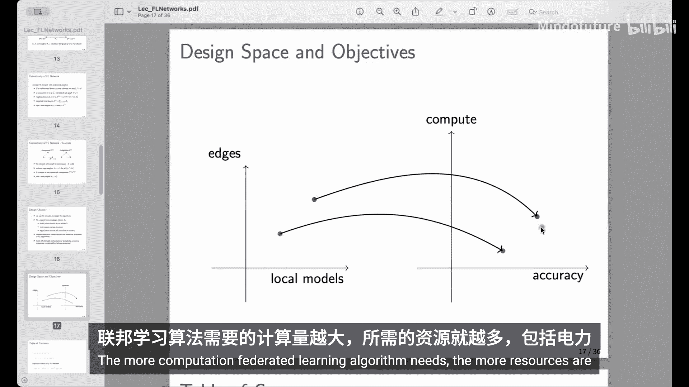

---

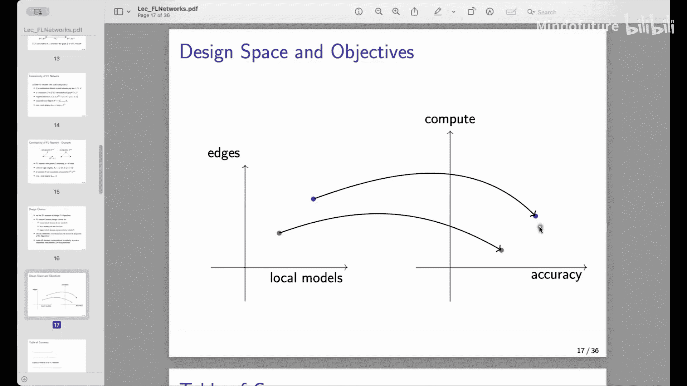

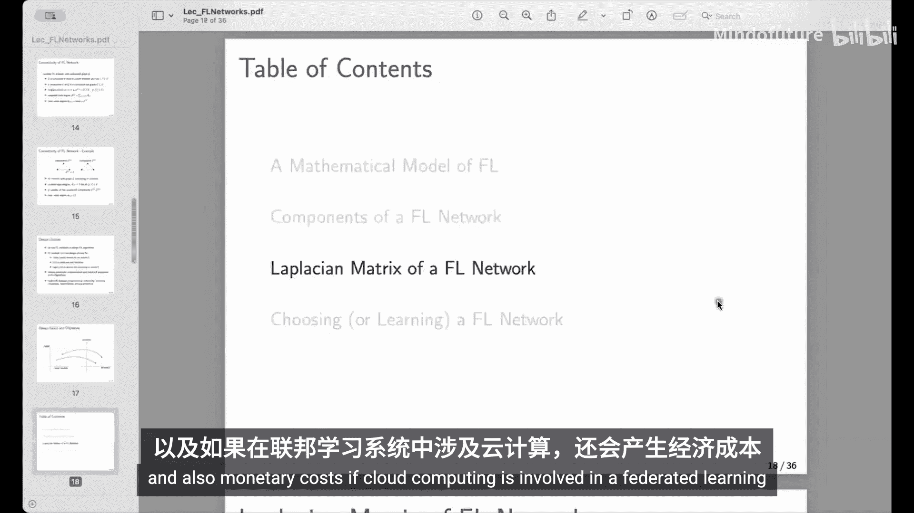

本节课中，我们一起学习了联邦学习网络的三个核心设计选择：节点选择、本地模型选择和边（连接）选择。我们了解到，这些选择并非孤立存在，它们共同决定了算法的计算复杂度、统计特性以及最终的模型性能（如准确性和效率）。更重要的是，这些目标之间往往存在权衡关系，例如在准确性、计算成本和隐私保护之间进行取舍。理解这个设计空间是构建高效、实用联邦学习系统的关键第一步。