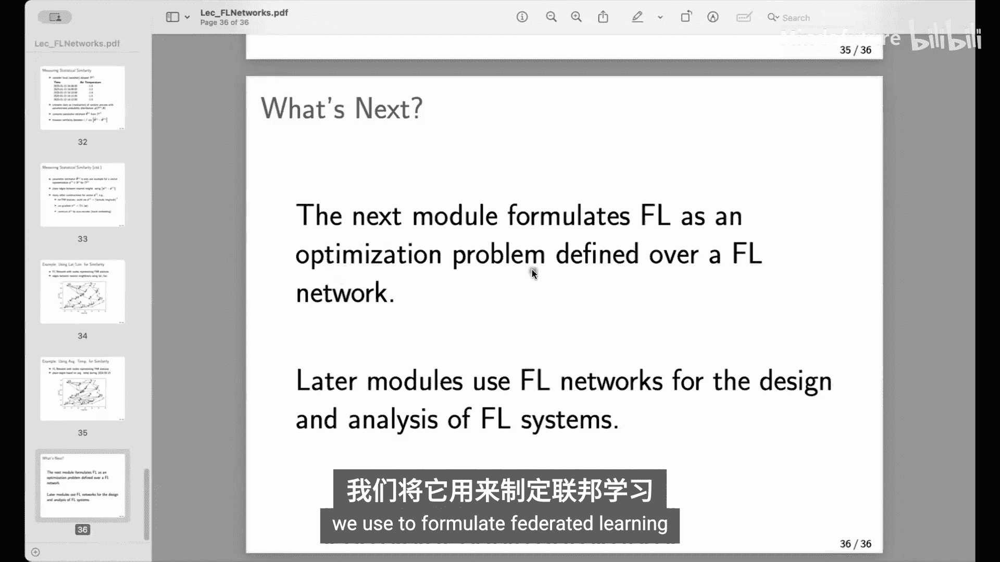

# 【阿尔托大学 - 中英】联邦学习 CS-E4740（Federated Learning，spring 2025） p17 P17 CS-E4740 Learning FL Networks -BV1cojRzDEfQ_p17-

So now that we have talked about the properties of a given federated learning network， in particular。

 the properties of the Laplacea matrix。Or its e values， more specifically it spectrum。

 the spectrum is the set of e values， hence the name spectral graph theory。嗯。

we need to think about how do we find a Feerated learning network To some degree it's a design choice。

 So how should we choose this federated learning network。

 and I want to discuss a few ideas for this using a specific example a specific Feerated learning example and this example uses weather stations So in Finland there's the Finnish Meteorological Institute。

 I've put here a link in the slides which I will share with you。To the data interface。

 So this is very convenient。 You can download freely weather observations for。

 I would say in total 200， more than 200 weather stations that are operated all over Finland。

And I have depicted here a few of those because 200 would be too many， would be too crowded。

 So my first design decision here my first design choice was to select a subset。

 to select a certain subset of we stations。And this I will use as the nodes of my federated learning network。

 So the next question is then of course， which nodes should I connect here？

So let's say I want to build a federated learning system that trains for at each FMI station。

 let's say each FMI station has a small laptop computer and could therefore train a model a without forecasting model。

So how should I connect those individual devices， where should I place the edges？And。

to find out the useful address， we also might use the data that each FMI station has so an FMMI station also generates a local data set。

For example， air temperature measurements， but there are many other physical parameters that are measured on minute。

 or I would say 10 minute or hourly intervals。 So how can we use this local data set or observation to find good choices for the edges。

Yeah， so lets let's think about the effect of adding an edge。

So one nice thing about networks is that you can start building intuition by looking at at small parts of the system。

 And the smallest part of the system is almost the smallest part is a pair of nodes。

 So we have two different weather stations。I and I prime。

And what would happen if we add a link or an edge in our federated learning network Well。

 we will see then later that federated learning algorithms they exchange messages or computational results of computations across these edges。

 So first of all， adding an edge means we need to communicate somehow computational results or model training updates via this edge。

 So we need some connectivity So we only want to connect FM stations where we can easily connect。

 for example， using IP sockets， some internet protocol type of communication。

Or some wireless low level communication。 if it's difficult to communicate data between two stations。

 we might not use an edge。 And yeah again， I want to highlight we are working very abstract。

 So exchanging messages between two FMI stations could also mean that you you store data。

 you store results。Of your model training in at this fmi station in the north。

 this is somewhere in Laplan， put the hard disks stored on hard disks。

 put them in a track and drive over the highways， the finished highways down to Helsinki。

 I guess this is somewhere in Helsinki， and then you can use this computational results here。

 So it doesn't need to be a wireless or communication of fiber cables。

 whatever you can use to exchange messages。 Maybe sometimes the best way is to use a track full of hard disks。

Maybe not always。Okay， so there's one one computational consequence of adding edges。

 which means we need more computation and communication。

 So adding an edge means we need to exchange model permit updates and also compute them。

 So whenever you exchange something， this typically means you have you have to compute something that you want to communicate。

 So adding an edge means more computation and more communication。But there's also the second aspect。

 like the statistical aspect， adding an edge we couple the model training， so it will to some extent。

 pull the model parameters at node I towards the model parameters at node I prime。

 and the question is do we want this。🤧So but let's first continue with the discussion of computational aspects。

So as I said， adding an edge increases the amount of communication and the amount of computation required by a federated learning algorithm。

But there's also another aspect， computational aspect， which is。How much。

 how long does the federated learning algorithm have to have to be run。

 We will discuss federated learning algorithms that are。Iterative algorithms。

 So they repeatedly implement local computations， exchange messages， and then repeat。

And often the number of required repetitions or number of iterations。Decreases with the connectivity。

 the more you connect the nodes in particular， you can show for many useful settings that this Lada tool that we already came across before。

 So the second smallest evalue of the graphler class matrix is a key driver for the the speed of an iterative federated learning algorithm。

 So loosely speaking， federated learning algorithms converge faster for larger Lada tool。

And Lambda 2 is， of course， smallest for a disconnected graph。 I mean， here。

 we will never converge because we cannot， we cannot exchange messages。 But so this looks trivial。

 but you can， you can make this more quantitative。 So you can also for very small Lambda 2。

 you can show that an iterative algorithm will take longer and longer。To。

 to converge or to deliver useful model parameters。

 When you increase Lada 2 and Lada 2 is maximum for a fully connected graph。

 So this is somewhat intuitive。 when you have a fully connected graph， you can in each iteration。

 you exchange all the information you have to all other nodes。

 So they can each node can maximally leverage the information from all other nodes and and the computation stands so far to speed up its own model training。

 So here's the other extreme。 So regarding the computational aspects， it's not so clear cut。

 because adding an edge means adding computation and communication， but on the other hand。

 adding an edge could increase Lada 2。 So could speed up the convergence。

 So you you need less iterations for your algorithm。

 and thereby decrease the overall number of computations。So it seems natural to choose or to try to。

 to put the edges such that for a given total number of edges。

 So you fix the total number of edges to some degree。

 you want to maximize this second smallest eigenvalue Lada 2。

 And there's a lot of research on on graph construction methods。

 So there there turns to there turns out to be a certain type or class of graphs that have very large Lada2 for a given number of edges。

Yeah。Okay， so just to sum up this computational aspect of adding edges。

 federated learning algorithms operate by passing messages across the edges。

 so naturally each additional edge adds computation and communication for each iteration of the algorithm。

 However， adding an edge can also decrease the number of iterations required to get an acceptable model parameters。

 so there's some sweet spot here in the middle where you fix the number of edges and you want to choose lambda2。

 you want to place the edges to maximize Lada 2 in order to minimize the number of iterations required。

Okay， that's about the computational side， the computational consequences of adding edges。

 What about the statistical aspects。😊，The federated learning algorithms that we will study in this course。

 they use this variation across edges as a regularizerizer。 So loosely speaking。

 an edge forces the the model parameters to be similar。

 So forces and edge between node I and node I prime forces similar trained models at those。 So。

 and this is not a good idea， for example， if the local data sets like this weather observations。

 they have very different distribution or statistical properties。

 then we should not maybe should not place an edge between those two But。

 but how can we make these more principles。 So how。

 how can we find out if two two nodes on this example， to FMI stations are statistically similar。

And of course， there are many different ways to do this。

Maybe the most established way is via probabilistic models。

 So if we look at a local weather data set， which consists of temperature measurements here。 So this。

 this is live data。 this data is really downloaded from FMI。But we in probabilistic modeling。

 we interpret these measurements as realizations of of a random process。

 So all this local data set is just a snapshot， one realization of a random variable or random process。

 and the distribution of this random process is parameterized by some model parameters Theta。

 And yeah， I want to highlight that this is not the same as as the model parameters of the machine learning model。

 So this is a bit difficult to keep to tell apart。 I'm not sure how to optimally do it in the course。

 I tried now to use a different symbol。 So we I use this theta for parameters of a probabilistic model。

 And this is different from the the model parameters。That we want to train at each model。 So this。

 this here at this W are parameters of a deep neural network， for example。

And these datata are parameters of a simple probabilistic model for the observed data。

 which we use to determine the edge set so we can estimate this parameters by established methods。

 so there are more than 100 years of literature and work on statistical inference， for example。

 we can use a maximum likelihood estimator。Estator to compute an estimation or approximation of these model parameters。

 And once we have this estimated model parameters， we just use their difference or their distance。

 some norm of their of their difference as a measure for similarity or dissimilarity in this case。

 strictly speaking And based on this， we connect10 weather stations。 So this can be generalized。

 of course， So this parameter estator that I've shown you， like for example。

 the maximum likelihoodest is just one example for a vector representation。

 So there's a lot of recent work on on learning a a single vector to represent very。

Hetergeneous data or data sets。 So depending on how we get this or no matter how we get this vector representation。

 the idea then to place edges between the nearest neighbors using this vector representations。

 for example， using these Euclidean distance between the vector representations and just to mention a few other constructions of this vector representations different from this probabilistic parameterid estimation approach for SMmiI stations we could use domain knowledge or let's say layman domain knowledge because my I'm a layman。

 I'm not a meteorologist would be， well， if a weather station is nearby geographically。

 then it should be I have data sets with similar statistical properties。Smile， amen， Intuition。

 which I found out is not very accurate in this case， but why not。

 So I use the latitude and longitude coordinate as the vector representation and then connect those nodes that represent FM stations that are closest regarding latitude and longitude。

Not example could be using a gradient。 So there is also recent work which uses gradients of the local loss function。

 So I can define some local loss function。 of course， when I train a model。

And evaluate the gradient at a certain parameter vector。

 So this current model parameters W might be obtained by some pretrained model or something。

 And then I use this gradient of the loss function to compute the vector representation。

 So I find this quite elegant to use the gradient as a way to come up with a vector representation for a data。

 So the dataset comes in here in the loss function。

 The loss function encapsulates the local data and the gradient then results in a single vector。

 a vector with a given dimension， which is the same， of course， as the model parameters here。

 that depends somehow on the local data。 and sometimes it's a useful dependency。And finally。

 a more generic approach， you can use any type of embedding learning embeddings。

 like there's recent work on learning embeddings for data sets like data being this weather data set of an FMI station。

 so you can also use the auto encoders。Okay we will not discuss in any depth these statistical properties within this course so without the scope of the course。

 I just wanted to mention to you that there are different ways to measure similarities between FM stations and yeah for the rest of the course。

 we mainly assume that the FmiI network is given so somebody did already this job of choosing a good federated learning network for us。

 I want to show here two examples for this Fmi stations。

 how the federated learning network looks like when we use different ways to measure the similarity between Fmi stations。

 so here I show the network that results from using the latitude and longitude。

 this layman domain expertise that are referred to earlier。

 so we connect FM stations which are closest in terms of latitude and longitude so geographical coordinates。

And we get this network and then I want to contrast this when using another notion of statistical similarity。

 which is。We use the average temperature during a 10 hour time period in May， mid of May in 2024。

 so we compute for each weather station an average of such air temperatures during some period of time。

And then connect those weather stations which have the closest average temperature and you see the network looks fundamentally different。

 for example here I want to point out we have some connections between FMI stations 13 and 14 and 7 and 11。

 which are not really near geographically， but it turns out I mean that's my guess。

 as I said I'm not a meteorologist but they have similar statistical properties because they are all located along the coast。

So since they all along the coast， they might have similar climate and temperature profiles。

 so to say， and therefore they are more similar in terms of this average temperature。

 so and you see here how this design choice， how we measure similarity between nodes and use it to define the edges。

 how this affects the properties of the whole mathematical model and the resulting federated learning algorithms。

Okay， so where do we go from here in the next model。

 we will use this federated learning network as the domain for an optimization problem。

 so we will define optimization problem using a federated learning network。🤧。

And this optimization problem will be our main model or principle for designing federated learning algorithms because these federated learning algorithms are then just results of applying optimization methods。

 existing well started optimization methods， distributed optimization methods to this optimization problem that we use to formulate federated learning。

Okay， thanks a lot for your attention。

