# 【阿尔托大学 - 中英】联邦学习 CS-E4740（Federated Learning，spring 2025） p19 P19 CS-E4740 Exercise 26-Feb-2025 -BV1cojRzDEfQ_p19-

Nice， so at first like you have to go any of the browser you use and then you have Alta students。

 you guys have to go to the Jupiter hub like Jupiter。cs。alta dot fee。And after that。

 like just a moment， you have to go to the control hub。 It's just normal。

 I'm just starting my server again too late， you guys。So from the beginning。Yeah。😊，So just okay。

 so you guys will see our federated learning course here like here， the federated learning D 2025。

And then you have， you guys have to start the server。While the server is being starting。

 I will just let you guys know like the students from outside Al。

 you guys already have got the exercise file through the email。

 so you have to complete the task and send it through the email to Professor Alex， I guess。

So there you guys can like see the exercise。 And now after like going to the federated learning server。

 you guys have to go to N big greaterr。 and after that like there is the assignment list here so you guys have to like select it and then。

啊。Go to fetch the first assignment。And then here you guys will see a new folder， This one is。

This is ML basic6 auto created and this one is the new folder like F 2025。

 it will take some moment to come here and then you will see the whole assignment like here everything is given like the learning goals in your background material like what you have to study before doing this exercise and after that like the data and or otherwise like if you guys go to the assignment folder。

 you will see the data like we are using to do this assignment。And after that。

 you guys will see that the libraries and the data set， like if I run this file。Then。You can say。

 you can see the data has been like importing and。Here is the like data and the first data point and then everything about the assignment is discussed here。

 like how to see the data and what is here in the data and also what does the data points means suppose like a data points here is corresponding to our new measure of temperature in our FMI station and then how we are how we are declaring the features and the levels。

 the training set and the validation set。So you guys have to do these tasks and run these command like this。

 And if everything is okay so you will pass the sanity checks like here like the sanitity checks has been passed and there are several tasks here for you like the first task is displayed split the data set in the training and validation set where our 80% is where some data for is training and some are for validations and then there is the task like you have to split it in X train and X So after that like if you guys passed all these sanity checks。

 you guys can understand that like okay the work is almost done and after that like completing this。

Assignment， like if you guys don't complete it， it will like give you some error like here is the implementation error。

 or if I just comment it here。But run this， it will show you some errors about that it has not been completed and after completing the assignments。

 you guys have to go to the assignments and then click on the validate to check like the validation has been completed there might be a warning or error message about the tensorflow optimization but ignore that one and after that you have to submit this So if you guys submit it here we will get your assignments。

So， and here are the tasks like for first task。You have to split the data set in a training and validation site。

For the second task， you have to do a simple baseline linear regression and you have to like validate。

 you have to calculate the training error and validation error and after that there is a CNN。

And you hear the hints and a description like how many layers have to be there and how you have to use those layers so and how do you like flatten the data and everything。

And after that， you have to implement another algorithm。

 which is decisionary reggressor and there has been given the instruction on how much depth it has to be。

And after that， we will use some regularization and data augmentation on those data sets。

 like our scale dataset sets， we we will augmented the data and after that we use our main data like we will train our data set with augmented data。

 but we will measure the MSC error with our main data like X scaled and X value scaled。

And and that's all like after there is no task scan every task and you will see some graphs and plots like how the data model is working on these data sets and。

There are some points over this every task like this task is for 1。

5 points so I guess there are seven points for each assignments。

 so if you completed it correctly you will get seven points for each task like each assignments。

So here is the all overview of the data set。 So like do you guys have any kind of。

Querries or questions or anything about it you guys just can ask and I'm here to answer all this like it has been already shared to repeat hub some of you guys have already see that and like have some queries。

 So like do you guys have any queries for now。Okay， so I' will。

Take it as no one has any kind of questions or anything。Soak。This is the thing I should hit。

 So I'm here for next one hour。 So if you guys have， okay， so there is a question just a moment。Okay。

 so how many Ipoch in general deep learning models need to be run？OK所呃。I don't think you were。

 I think you were talking about like CNN model。 So I guess there are。Not really epochs。

 like can you like elaborate your question a bit more， please。Can you hear me？

Yes I can hear you Okay great Mike is working so in when you train or run a fifth method inside the tensor cloud it asks you the amount of epochs so that's why I was asking what is kind of like the。

The default value， what we are going to use like I can put 100，000， but I'm pretty sure thats。

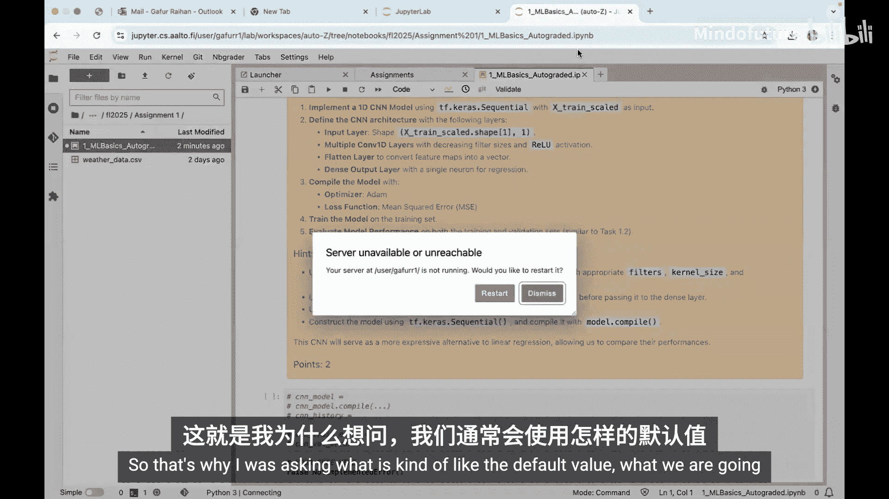

Whats something what you want to have？😊，Yeah， you can use like 20 epochs， I guess。

 like 20pos are enough to do this。Okay， thank you。Yeah， no worries。And any other one like having。

 Yeah， I have another question when I was doing the assignment。

 Does having the sanity check past mean that doesn't mean that it is the correct solution。No。

 not really like it's not the 100% correct solution like there are two layers like one sanity checks is for like you guys and there are another final sanity checks for us like to check like if you guys have done the correct answer so if you guys pass this sanity checks。

 then you guys can like say that you are going on the right path but the result is not exactly correct。

So， but I cannot share you the final s checks with you guys。

 but if you guys share like if you guys pass the s check。

 you can like believe that like you are on the correct part， okay？嗯。Okay， thank you all。Okay。

 so any other question， anyone。Hello， excuse me。 Can we just do the。

Exercise in other platforms like Google Collab or we just have to do it Jupyter notebook so sorry for asking like are you from Alto or like no I'm not from Alto I'm out of Alto Okay so for an outside Alto students I think there are has been like you guys have received one email regarding this assignments and you guys have seen the details like how to do that and also here sorry for sliding into for tackling into the discussion will I will try to avoid this but in this case just to clarify we have here two different groups of participants So there are this students who registered via Alto So you have formal study rights at Alto and you have to submit via。

By the Jupiter H and maybe this this Rahan， you could then quickly show or or tell in more detail how to submit on Jupiter H when when when the students are ready with their solutions and then we have students from outside Alto basically from all over the world who I offered to to register for the course and you have to you can use whatever you want to work on the notebooks and you just have to send it to me by email。

And whenever I have promised those external students to provide a confirmation letter informal。

 But for this， of course， I need them to have let's say an online meeting or kind of online oral exam where we where we walked together through your solutions。

 So I had the plan to make this fully automated also for external students。

 via something called Github classroom， but I didn't have the the time for it。

 So if you're a non autoto student， you can work on the notebooks with whenever framework or or software you want。

 for example， Google callop。 and you just send it to me by email。

 So we will then release after the deadline for this assignment the deadline is the 17th of March。

 we will release the reference solutions。 So everybody at least sees what the correct what one possible correct solutions was。

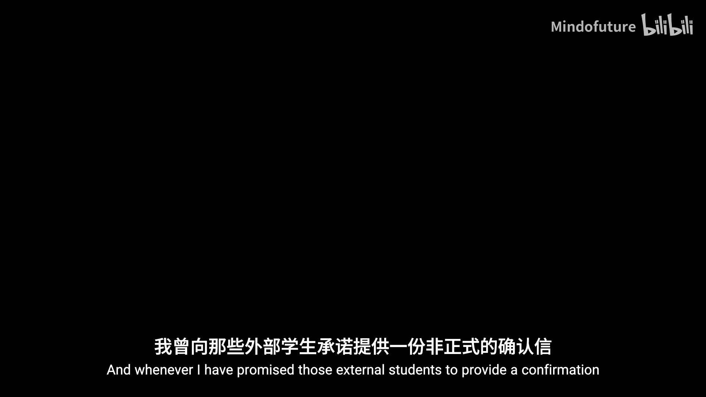

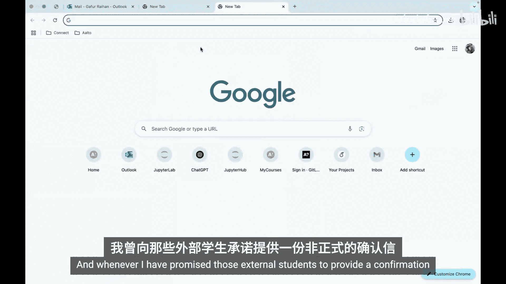

Okay， thanks for the explanation。Yeah， thank you。 Thank you， Alex for the clarification。

 So I guess it I guess it answers your question， Neda。 So okay， there is a question in the masses。

 like when do you recommend to start the project So you can start the project anytime you want like from next week。

 I guess。So like as soon as you get the details， you can start the project， I guess。Okay。

 so any other question， anyone。Or like you guys can do the assignments right now here in your computer and if you guys face any kinds of problem。

 you can ask me。Or do you guys want to see the like the al students。

 Do you guys want to see that how to fetch the assignment and how to submit it again。

 because like I have new ones Yes please Yeah okay。So let me share my screen again just a moment。

去。Okay， I guess my screen has been shared here， so sorry。是。Okay， so。Let me show you from the start。

So when you go to the Uter hubub like Upiter。cs。 fee。

 I can share the link after the class at the slack at slack so in this link when you are login with your al email then you will see our fated learning course here like the ferated learning 2025 so you have to click it you will not see the instruction versions for me but like you will see this is student version for you guys and then you have to。

Just a moment you have to like click on this start。And then the server will start。

In case if you are selecting something else， so how do we fix that one when I'm signing on automatically open that one。

Okay， so if you like mistakely select something else， then we will see this。Face， if you see this。

 see this is screen， then you have to go to the file like thepper left。 There is a file option。

 You have to click the file。 Then there is hub control panel。

 You have to click on the hub control panel。 Then you have to click。 yeah， Stop my server。 Okay。

 I'm doing it again。 No worries。 So stop my server， and then it will stop your server。

 and then you have to click start my server。Then if you click this start my server。

 then you will see this option like which server you want to use because like there are many courses in Alto and different courses have different servers for this so here you have to choose this pre learning D2025 server option。

And then you have to go start。Okay， is it working for you now？嗯。Yesス， I thinkオッケーナイ。

And then the cyber will take one or two minutes to starting it up。🤧Sorry。Okay。

 so after starting the server， you guys will as you guys can see this Nb grader on the upper option。

 so here on the NB grader， you have to select this assignment list。

So you have to click on it and there you guys will see this assignment one option since I have already fetch this one so but I can show you guys again like if you mistakenly like fetch this option and like edited the file but you don't like it then you guys have to go to the folder like F 2025 it will be created when you like fetch the first assignment so you have to go here。

 then assignment file because like you Peterterhub does not delete the full folder like if you click on delete like here delete it will show you like it cannot be delete because like the assignment one is not empty So if you have to go to the folder。

 then separately delete all the files here。Like here delete， and the data set is。Deelete。

Then you have to go to assignment one， this one you have to delete。And then FL notebooks， F 2025。

 you have to delete it。So if you'll delete this thing， then it will not。I guess it will not yeah。

 it has now it's showing me that like there is assignment one and I have not done anything with this assignment one。

 okay？So after doing this， like after seeing this screen， then you have to click on the fetch button。

 and then it will fetch the assignment one and create a new folder like this F 2025。And after that。

 like you can go from here， like if you click on the assignment one。

 it will show you one ML basic6 autograded or here is the folder like F 2025 and assignment1 so。

Sorry， here， so here both are same。 So you can just click on it and you will see the details about the assignment like the learning goals。

 the background material， the data set and the tasks and the details about the data sets and the points and the tasks and the like details about the points。

 So for those guys like who have come here lately in their， I want to repeat the things again。

 that like you have to run。All the files like suppose if I like click on this to import the data set and。

To see the data。Just giving me here is the data like data set data type and the first data point of ours so by this you can just run the files and if everything is everything goes well。

 you guys will see that sity check has passed for all these cells。So after doing all the tasks。

 you have to go to assignments and click on the validate button。

 so it will show you guys like the assignments have been validated。And。

It will might be like for some people， it's showing some error for this tensor flow optimization error。

 but ignore this one， it is not any problem。But after that， you have to submit it via click here。

 So if you submit it， it will go to the submitted assignments option and we will get your assignments。

 So I hope it's clear from start to end how to get the。Assignments on how to submit it。Right。😊，Okay。

 so。There were some questions。Let me check it。Yes， someone。

Okay so the question is I guess this is some sort of exerciseation yeah right。

 this is some sort of exerciseation， not any kind of lecture or details about the theory。

 so like our theory class or lecture is on Monday and the exercise is on today like Wednesday there so。

So anyone have any questions？She。Okay， I'm just going to turn off my screen share and， but I'm here。

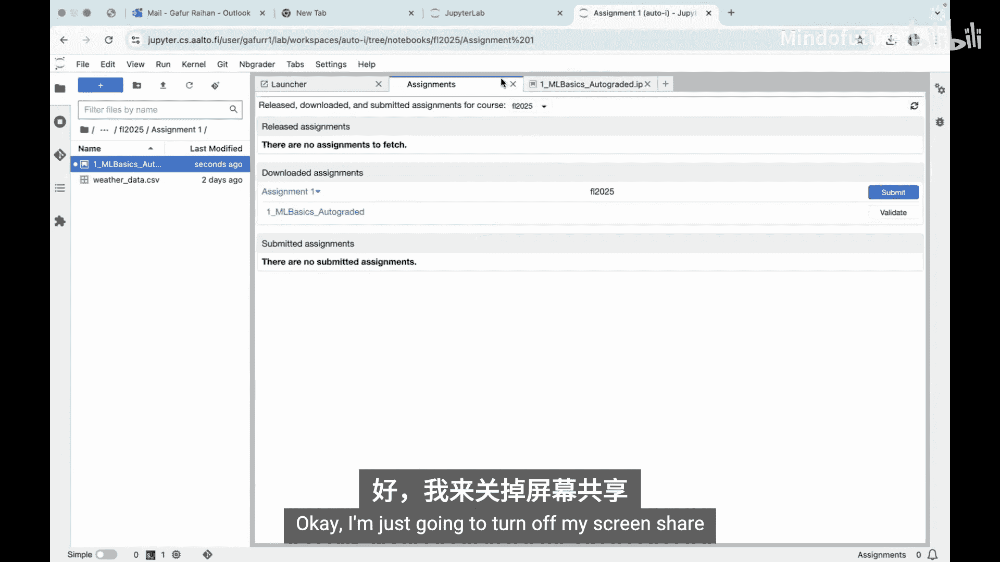

Yeah， hello， I got one question。 So it's me again。 I'm sorry。 It avoid to， to intercept。

 but I got the direct message， a question as a direct message。 And this is for the project。

 I do not really understand the main FL concept。Of the project yet。

 so when the concepts will be introduced during the lecture to start the project。Yeah。

 so the idea is that now we have in in March the boot camp with in total six lectures。

 first one we had last Monday and six exercises， the first one is discussed today。

 and then in April you should start working on the project but of course you can already now start working on a project based on the information that you have but I still need some time to polish the templates for the project so you will be provided a template。

 the LA file similar to a template for a conference paper like IEE ICP just as a hint where there's a deadline upcoming I think in September so you might use this project as a pilot to pilot ideas or get feedback for IA submission if you want。

But this template is still under work and I hope to release next week， but in general。

 I would advise you not to start too early working on the project because we will only build the mathematical tools and instruments。

During the next few weeks， so during March， I suggest you focus on the lectures and the exercises。

And then in April， you work mostly on the project。😡，Yeah。

 please don't hesitate to post any other questions on the chat。Yeah， thank you， thank you。

 Alex for helping me out。But yeah， if anyone has any kind of question， just ask。😊，Okay。

 someone has asked one question directly to me that one is。嚟。When specifying the con only the layers。

 there are filters and kernel sizes， I it correct that we select also， for example，64，5，32，3，62。

Or each layer sensible。 Yeah， you can use it because like we have not like decide like we have not restricted any kind of layer points like you can use any kind of layers for the1 D layer so you can use。

Any kind of the kernel size and activation and everything， I hope it answers your question。Yeah。

 I would like to to maybe add to there was previously a question about the number of airportpochs that students should use。

😡，For training the deep neural network。 And so is it really so that the students can choose freely or should we。

 should we tell them the number of epochs that that we are sure that our tests work。

They autograde tests。Yeah， I guess 20pos will be good。 Yeah， yeah。

 I will maybe then send an announcement to make this clear。

 because I'm not sure if we stated clearly in the in the notebook that iterations should or 20 epos should be used。

 yeah。Okay， so we will make one announcement。Yeah， there was another question or comment regarding the project as long as I will have enough time to start the project after the exam week。

 Yeah， so we we are aware of these constraints that you have from the academic calendar at Alto I'm aware of this exam weeks and we will make sure that you have enough time beside this exam week to work on the project。

 So don't worry about this。And yeah as a general note。

 which I will also repeat again in the next lecture and also in an announcement。

 you will have the possibility to meet with me in the end of the course and review and discuss all your graded activities so if for example。

 there was a minor problem or you had a misunderstanding in the task descriptions for the notebooks and you lost points due to this and you unhappy them with the grade with the resulting grade。

 you will have the opportunity in the end of the course to meet with me and review all your graded activities and we can then rectify any any problems or errors that arose through due to misunderstandings or unclear formulations in the task descriptions。

Thank you， Alex I have another question， but I guess you can like answer it better than me Like someone has asked me like how can I get more than five credits through the project like maybe he's talking about 10 credits so I guess yeah so we had last year we had the project as optional for extending the course for five credits to 10 credits。

 but we have significantly reorganize the course So now the basic variant includes also the project as mandatory activity and as I as I announced already in the previous election Monday。

 I will decide on this case by case， so typically I will only offer this possibility for extending to 10 credits only to students who did well in the basic variant having a top grade5。

And if you are then interested， you can reach out to me towards the end of the course and we discuss about the extension。

 for example， extending your project or doing another paper review。Yes thank you， thank you Alex。

 so anyone other have any kind of question。Yeah， someone asked like the next lecture is on Monday 1615。

 according to the C。 do you have next Monday。 Yeah， so yes， the next lecture。

 like the lecture is on next Monday， and Professor Alex will take that。 So Alex。

 if you want to add something you can add。 Yes， that's correct。 next lecture will be next Monday。

 at quarter past4 in this zoom hall again， and I will try also to be available physically in our lecture hall。

Yeah， the letter hall is in the a grid， so in the eighth Yet room so you can come here physically or like join the class through the zoom。

Yeah thank you， so like anyone has any other questions。Yeah， okay。

 just just to encourage everybody of you， please don't hesitate to reach out to to us via discussion forum or via email if you get stuck or have any questions regarding course organization or the content of the current assignment。

Yeah， you can ask to us email or via Slack like we are we try to be active on slacklack。

And we try to reply as soon as possible of any of your questions。 So， okay， someone has message like。

 please repeat the lecture hall number。 It's in the a grid。 the room number。

 I don't remember the exact room number， but the room name is yeti。 Like， I can write it here。

In the masses， just a moment。s yetty at Edgrid or you can see it in the my course or like we can post it in the slide Yeah I will announce it again in in my courses by my courses message and in Sl yeah。

That will be better Yeah， so I I cannot promise now that I will be there physically I will be be try to be there physically in my lectures。

 but for sure I'm in the zoom zoom hall， but we have reserved this this lecture hall anyway。

 so feel free to use it and meet just meet and sit there together and follow me on zoom。Okay。

 so Alex， there is another question。 So I guess you can answer it better。

 Like the question is when will it be decided whether the student is eligible for the additional project。

 like depends on the previous assignments or any other things。 Yeah。

 so at least this this will be decided only after the the last assignment。

 So we will see how well did the student do in the assignments and in the first at least I want to see the first project submission So this this decision about extending to 10 credits will only be in May or beginning of May possible。

Thank you and just to be added， I guess it will be depends on your all every six assignments and also the projects。

 the base variant project you are doing so I guess all of will be count to are you eligible to do the extended portion not。

Thank you， so any other questions like do you guys have？Yeah， we will be here for like。

For more time so you guys can ask any things about the assignments or any other things about the course。

 So we are here I'm just muting my mic， but I'm here。hello。嗯。Hey hello， yeah， ask Yeah。

 so I'm looking at the assignment actually and for the first for the first task。I read。

I didn't quite understand the feature the feature set do you is it just the lag feature columns that we need so anything with lag in it or or do we also need the the default feature Okay so let me just discuss it with you so the training like you have to split the site into training and validation set so there are some basic columns like the name I understood that yeah。

But you have to just take the la columns like there are the features like if you see the data set like in the preprocessing section we have like lagged some columns which have lagged maybe in the name or maybe in somewhere else so this is the h already has been given in the task so you have to take only the la feature columns and if you take yeah only the lab columns so if you do those correctly it will not create any problem I guess。

Yeah I'， I just， I just needed a sanity check。 Yeah， you'll have just to do the sanity checks， yeah。

Okay， there is another question， like just a moment。Okay。

 so there are another question like do we have a tip for constructing the CNN model。

 such as how many layers should I include Okay， so there has been given hints。

 like how many layers you have to you have to do but for con1D you can use three to four layers I guess。

 but I'm not giving you the correct answer， but I'm just helping you with the hints so but other than that like the flatter and the dense layers like is already given in the hints so you can like take for three to four layers for con 1D layers。

Okay， thank you。

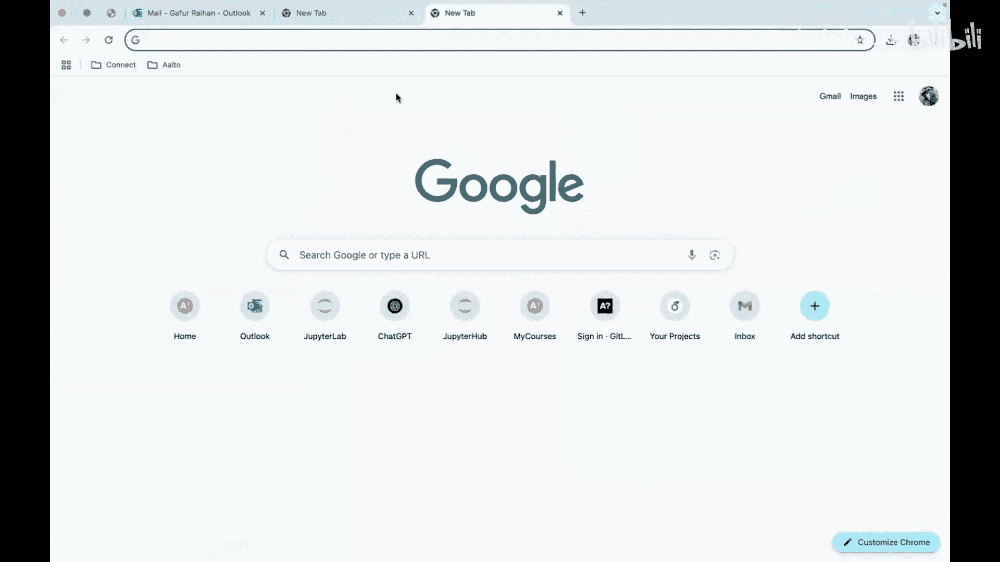

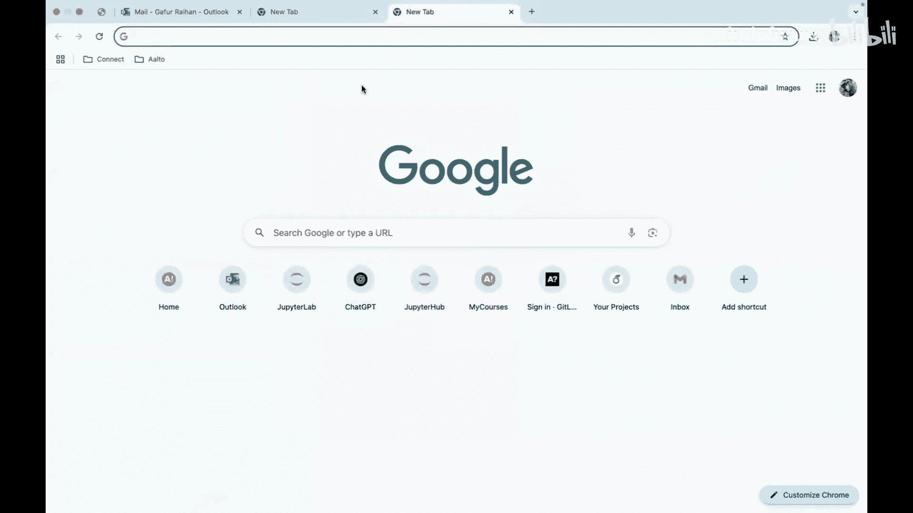

Does anyone have any question you guys can ask freely？

Hey， I know like someone has asked like。I'm not audible actually I'm mute because like I have answered the required questions and I have say like I have showed the assignments how to do it like。

But do you need to go through the assignments on how to get those again？Like， if yes。

 I can show you again。But， I was just muted。Okay， so for all the students。

 like you guys will get the assignments from UPterhub， let me share my screen again。

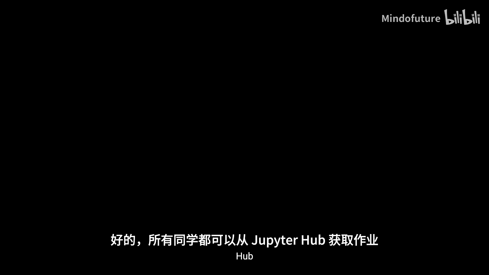

，Okay， so。Here is the。Okay， just a moment。 Let me just cut all of this。

Theyate all of these again just to start fresh。Have。That's the moment。Okay， just。

Stking with too much time， I guess， about my survey is closed already。Yeah， there is a question like。

Okay， there are two questions let me just answer the first question like for the CNN part train the model on the trainings that can I use CNN model do。

Fith， which contains apo20 instead of a training loop。

It's your choice like you can use CNN dot feed or like CNN dot。Compile， because。

There are more options and there is a commented code in the task like CNN model that combine so compile so you can use that also。

 but your fit is good you can use that also and another thing another question is like why do we only use two of 20 days。

From data for training。Okay， so呃。It's kind of， like， the。Requirements for our assignments。

 like how the data works on a small data set， rather than the large data set and how it works on the like when the training set is smaller and the validation set is large。

 how it works。 So that's why。 actually， So the every the details have been discussed in the data points。

 like you can check on that。But this is the like more or less reason， actually。Okay。

 so I was showing the how to like run this server， so you guys have to launch the server。

And then like if you are an Alta student， then if and you log in through your Alto email。

 you will see this in the UPer。cs。alta。v website， so we' on UPter hub and there you have to choose this credited learning course D。

And after that， like you have to start the server。 So if I just click on this server。

It will start and it will take one to two minutes。To start the server。Okay， so it just started。

 and after that， like you have to go to N big grader and after the N big grader。

 you have to click on the assignment list。 Then here you will see the assignment one since I have。

Al fetch the assignment， so it's not showing me here， but if I delete the assignments from my folder。

 it will show me again like it's for like if accidentally do some mistakes with your assignment and you want to start fresh for that。

Like， you have to delete all the files from here。And then。You have to delete the folders。

It the moment。And then the main F 2025 folder row。And then you will see if you go to and be greater an assignment list is to show you the assignments here。

 so you just have to fetch it。And then go to the assignment or it will create a new folder F 225 here in your notebooks。

 and then you have to go to the folder and assignments and click on the assignments and here are all the details you will get to do the assignments。

And after doing the assignments。You can just validate here。 So while you will validate。

 you might get an error of tensorflow。Which one is here from for the Tensorflow optimization。

 this warning error， but it's not any error， so don't worry about it。And after that。

 like you have to just submit the assignment and we will get it。So that's the process。

 but the students were from outside Al， so you already have got the email about the assignments and where you will get it and how to do it and as Alex already discussed in this exercise like you can do it on like Upiter or Google Collab or any other platform you want to do so after doing the assignment you have to email him the assignments I guess so yeah that's the thing you have to do for outside Al for Alto you must and must have to submit it through Upiter Hub。

Yeah， any more questions？Hey， I tried to。 I'm from outside of auto。 I am trying to edit the code to。

I to do my own version Google Cor， but it says this set is a redly format and it doesn't let me。

To edit the cells。 I tried to save a multiple copies and save it to my own Google drive and then edit it。

 But it's still， I get the same error。 That's the Okay。 Okay， okay， so yeah， okay， so like。

Your question is done。 but can I answer。It's a read only format I can't edit the first cells to get to the sanity check to load the data from the。

From def， my drive。Okay， so sorry for hearing about that。 But we have done it for Upiter。

 like not for Google Collab。 So I'm a bit confused。 Like。

 does it work on Google collab as same as Upiter， because we have to check that。

 But one thing you can do is like for your like personal development， You can just copy the code。

 suppose like。You can just go here and。Okay， you can just Yeah。

 copy this code and like paste it on your own Google collab file。

 Then it will work because like there is nothing about the server here。

 like you can just copy paste everything。 So it will work Very good。

 But if you want to want a separate file to run like a template file like this。

 So we have to like check that like how to fix that for in Google collab actually。

 but sorry for that。 Sorry for the。 Yeah， no problem。

 So I will just copy because I just wanted to keep the format to deliver it with the same format。

 But if it's not possible， I will just copy the codes and then do it method。 Yeah， Thank you。

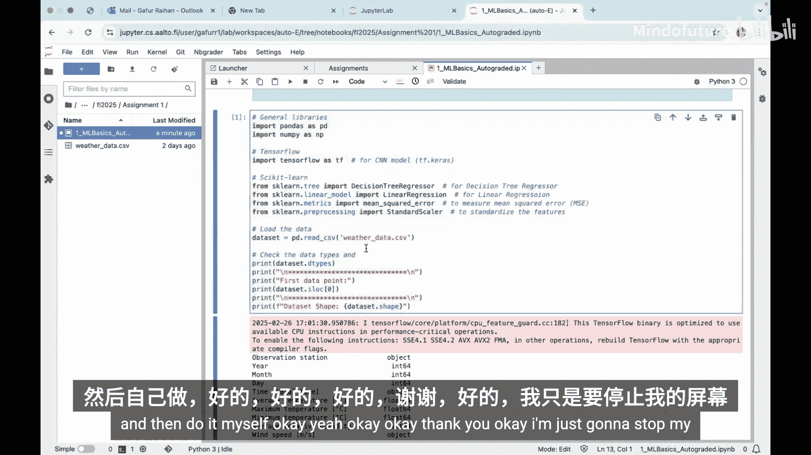

I'm just going to stop my screen。And any other questions， anyone。

Does anyone have any question until now， like while you guys are doing your exercises if anything happens like any kind of confusion or any。

Instruction default like we can just ask。Yeah。Does anyone have any questions？

I might ask about feature selection， I'm just thinking how I formalized the question。

 so it's a little bit cryptic。Okay。Okay， so you were asking about the future selection Okay。

 so as you can see yeah， yes， I I first yesterday I construct。A training set with three dimensions。

 let's say that way， but when I。Apparently when I give it to standard Scalar。

 it wants to have two dimensions。So therefore， I concluded that there has to be。One picture。

 or like two。诶。Like I don't know if you get what I mean。Yeah I can understand like okay， but okay。

 so let me tell you like while you have to select the features like you have to select select some selected features or like selected columns like you can see in the hints of the task 1。

1 like there has been written that like use lag feature columns which columns containing lags to create feature sets so like in the preprocess you can see that we have already preprocess our raw data set into some lag columns and we have excluded some columns from our main raw data so you have to only select the laggged columns lag column is some the columns which have laggged。

I'm not answering this， but I'm giving a hint like which have lag workyword in their names or maybe in other values or like in units so you can choose only those columns so if you'll just only do those columns to create the feature set so then it will not give you any problem。

Do。Yes， I kind of did that， but I was wondering you have this one list called numeric columns。

So should one include some of the like of course， one needs to include some of the information from there。

Like， for instance。At least。Like wind speed or ettera。

 I included one of those memory columns and it lags。

And I don't know if it's a correct way to approach this situation or should I include all the numeric columns for this prediction。

 but I got it to work with the sanity scalealar， the scalar one when I only include one of those numeric columns and it slacks。

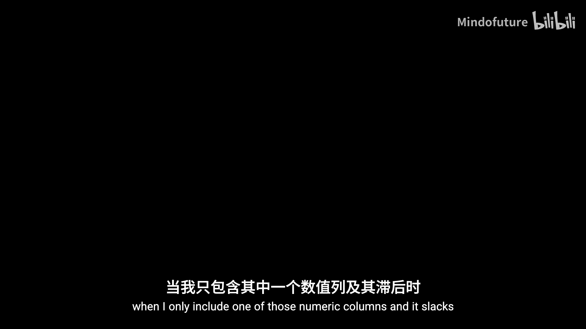

Okay， so yeah， but you can try out without selecting those numeric columns like just in case like to get a other perspective。

 like you can remove those numeric columns or like only select those columns who have lacked。

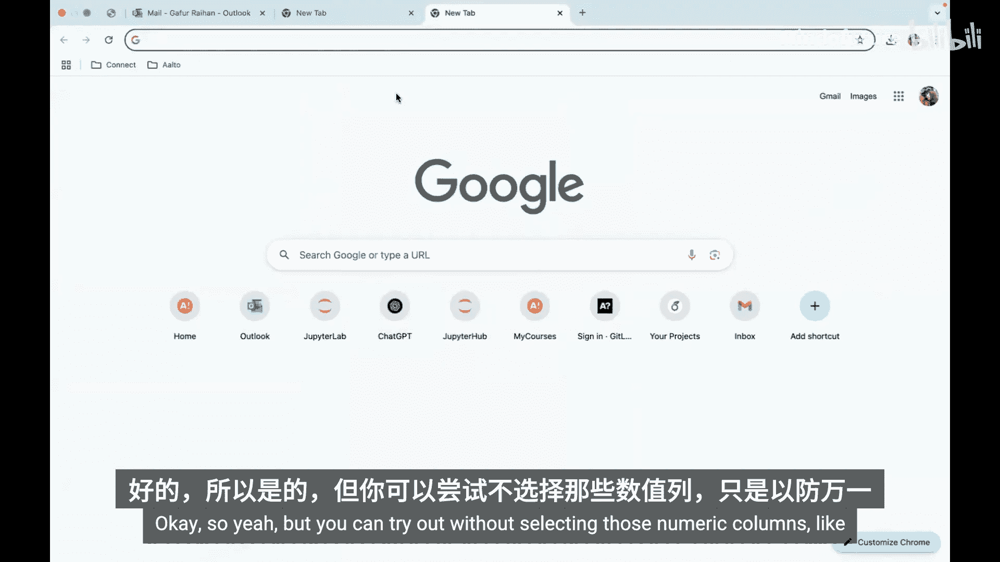

I hope you understood my point。I think I can forward with this thing based on your tips。

 thank you for those。Or otherwise， like if youre still stuck on it like。For more time。

 like for more than one day or anything or like a couple of hours。

 then you can also ask in our slack like。You are stuck with it and like we can help you out like how to do that thing。

Of course， of course， I have already implemented。Like the task。

 but I'm now trying to figure out have I included all the data points which I should。Okay。Okay。

 great。Does anyone have any other question？Sorry to interrupt。 Neda。

 is it working like while doing the copy past for the。 Well， I actually， yeah， I used it。

 The problem was with the cells for this sanity check。 So those cells are not editable。

 but other cells are editable。 So it's working right now。 Okay， great。

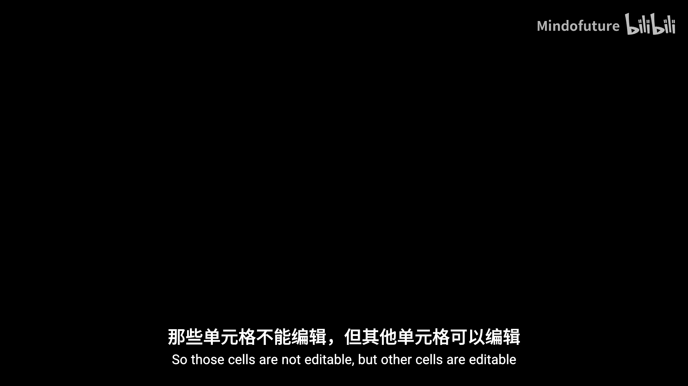

Thank you。No worries。Hey， someone'm on Ma， like is this session is over。 no， it's not over yet。

 Like I was like showing them how to do the assignments and。

How to get it from Lipi hub and how to submit it and show the details about the assignments。

 So like if you have any kind of questions or if you like do you want to see that how to fetch the assignment and submit it or like any other questions to how to do the models or how to like split the data into training and validations that you can ask anything。

 the session is going， but like since I have showed them so I have just muted and just share off my screen。

But we can ask any questions。

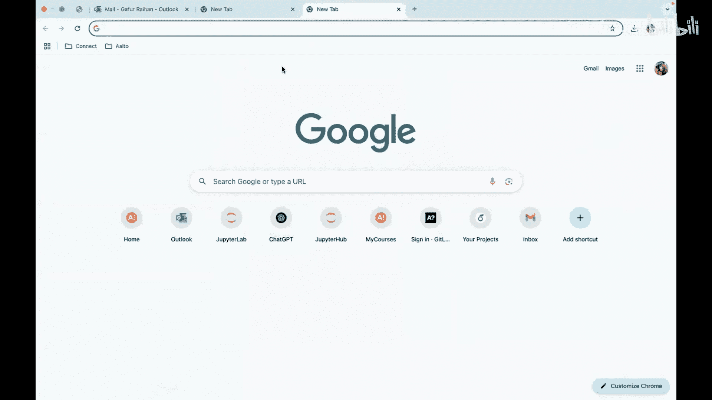

May does anyone have any question？We can ask anything。あ系。

I like to know what do you mean exactly by like the feature comments。Okay。

 so if you see the pre processing cell， like they are in the pre processing task。

 we have like some we have created some lack columns， so you have to。

Take those lack columns into your training or validalating data sets。

So if you see that preprocessing cell carefully， so you will see that。

Like we have already preprocesed the data and created some new columns。That's what is。Oh sorry。

 my microphone was muted。 So you mean the pre processingces that shows after running the first ride。

Yes， the pre processingcess data is the after running the first。Sell。

 you will see that there is a preprocessed data like copy the main data set then convert it into some numerical values。

 then feel some missing values and also lagging those values So there are some custom column which name contains some keyword like lag or lag or something like that Do you have to use those to make your feature set。

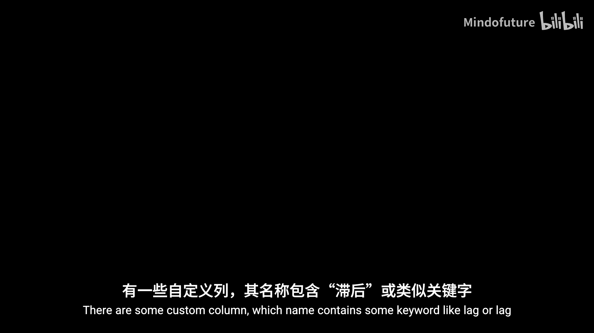

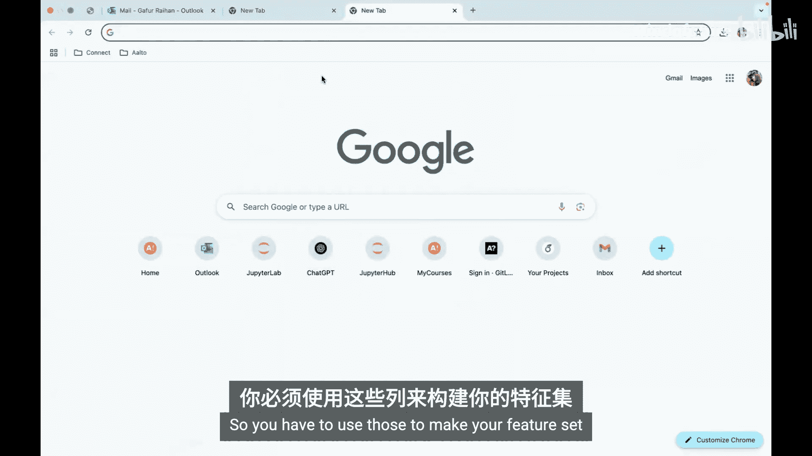

I hope it helps you。 Okay， thank you。 Yeah， no is。Yes someone asks sanity check if fall okay yes。

 if you do all things good， it will pass your sanitity checks。

 but that does not mean that let me clear you guys this sanity checks is the first layer of your solution。

 like if you pass the sanity checks it will it means that you are on the right path。

 but it does not mean that it is the correct answer like the solution will be or the correct answer will be discussed after the deadline of these assignments。

But yes， if the sanity check passes this， so you can say like you are on the correct path and continue your work for the next task。

Okay。Sorry。😔，No worries。Should the Re and improve the model in general， are you allowed to say that？

Sorry， can you repeat the question again？The final phase where I have implemented that Re and versus knownre。

Should the regular model be formed by the versus the original model， are you allowed to tell that？

It depends like it depends on the implementation and also on the like it does not always like the regularized model will be better than the nonreized model。

 but it might be worse than that original model so but no words like it's not strictly rules that the regular model will better will be better than the nonregized or baseline models。

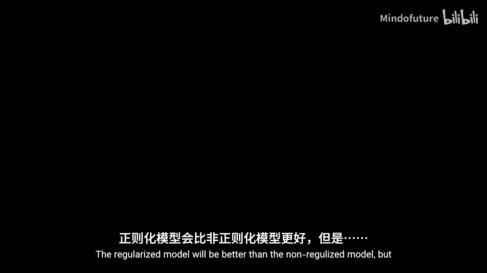

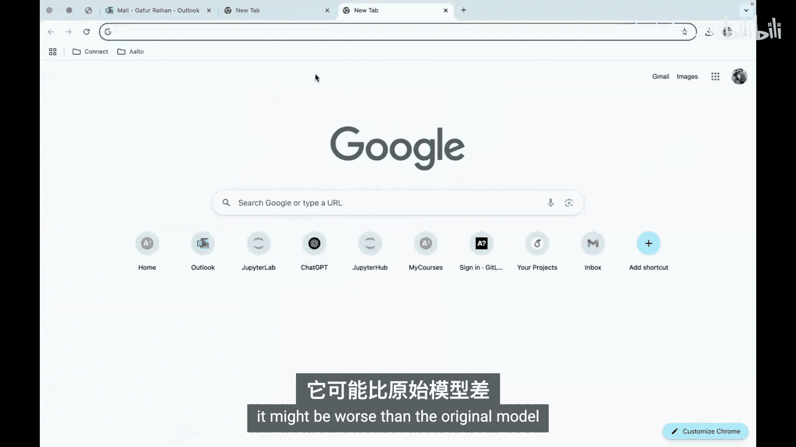

Okay， that's great， thanks okay， no。Okay， so someone has asked like。

 how can I confirm the result is okay or not So if you， if you pass all these sanity checks。

 then you can like assume that your answer is correct， no worries。

Because like these architects are almost like。你明。Correction or mean sanity checks。

 so we have to not worry about that。Okay， thank you。Yeah， you can email the。

You can email your answers。Not answer like the updated notebook to Alex。

Does anyone have any other question？Hello I have a question so do you have any video or audio recording of the tutorial session you had I'm sorry I joined a little late。

😊，No worries like we are recording this station， so you will get it on the YouTube as soon as like the class ends and also similar as the theory class。

 so you will get it on YouTube。 okay， okay， thank you。 Okay， thank you。 always。

And also someone has asked like I wanted to know which F framework will be discussed during the implementation module of the course。

 Okay， so a model。A model called like this that's not a model actually it's a library like network X to constructing empirical graphs for F network so we will use that tool to build the F framework actually so there's the thing and many details will be discussed later on the upcoming exercises。

Thank you。Does anyone have？Any questions？Does anyone have any question？Like you can ask freely。Hey。

 thank you for your time。 I will solve the assignment and then come back with my questions on the next week。

 Yeah， sure， no worries。 And if you， meanwhile， if you face any kind of problem。

 you can ask it in this slide。 So Okay， sure， thank you so much。 Have a nice day。 Yeah， thank you。

Thanks。😊，I think if none of you guys have any more questions so we can close this。Blass。

 like not glass like the exerciseation。Do you guys have any more questions？I think not okay。

 so see you next week on the exercise and before that on Monday on the theory class， okay。So see you。

 Bye bye， everyone。Thank you thank you thank you so much。

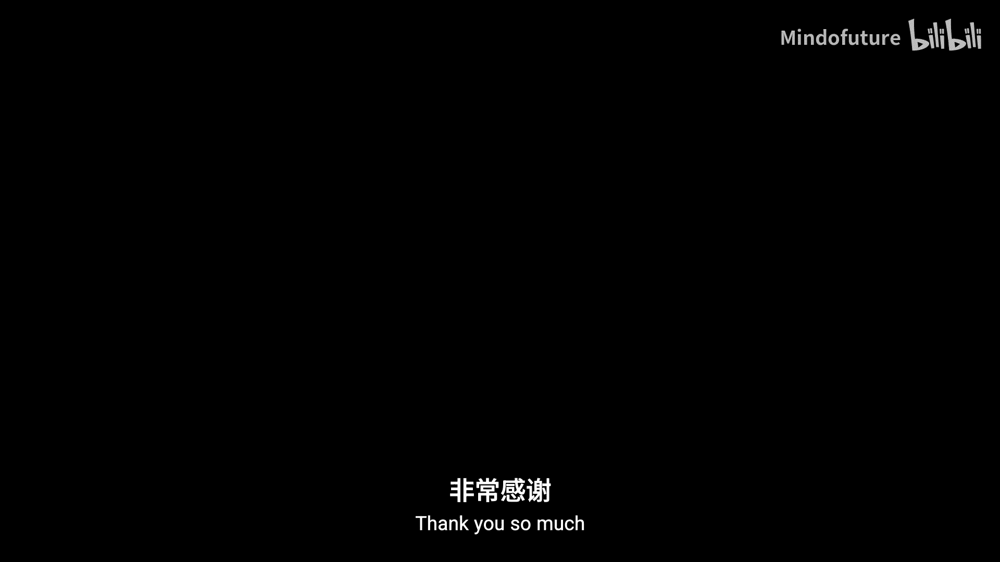