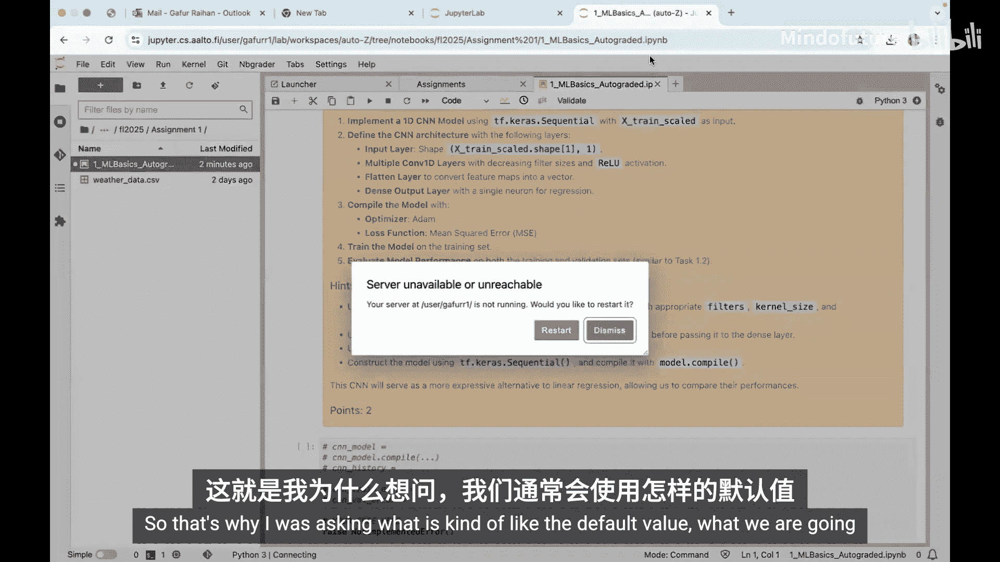
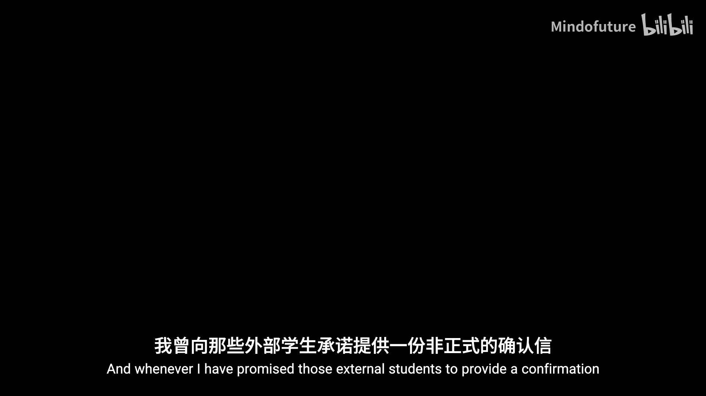
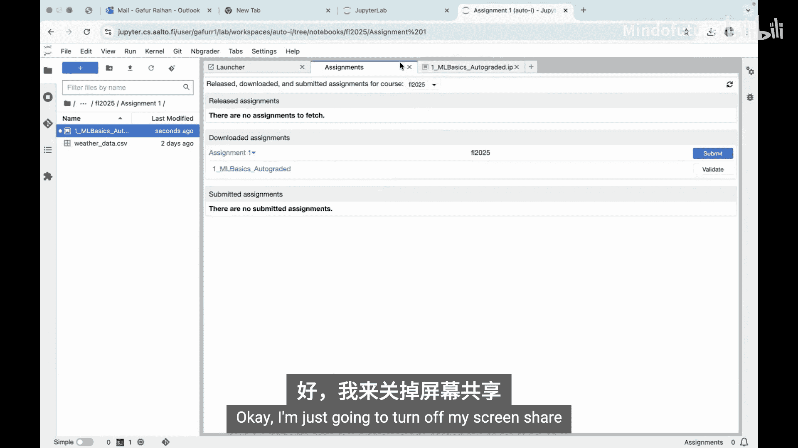
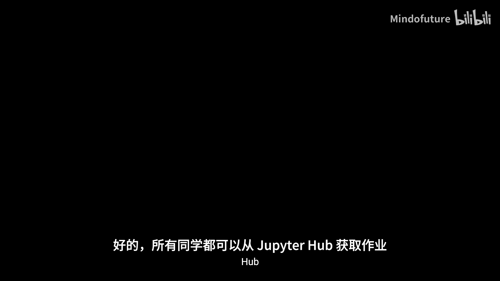
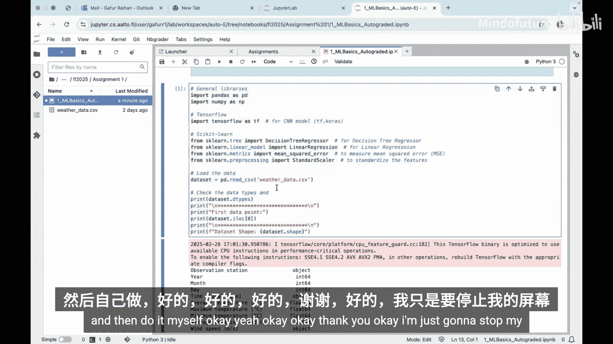
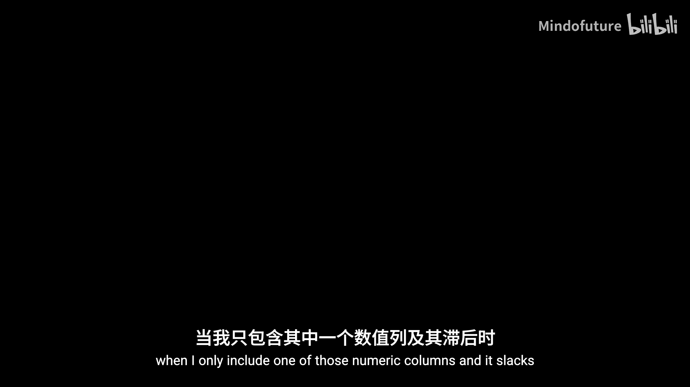
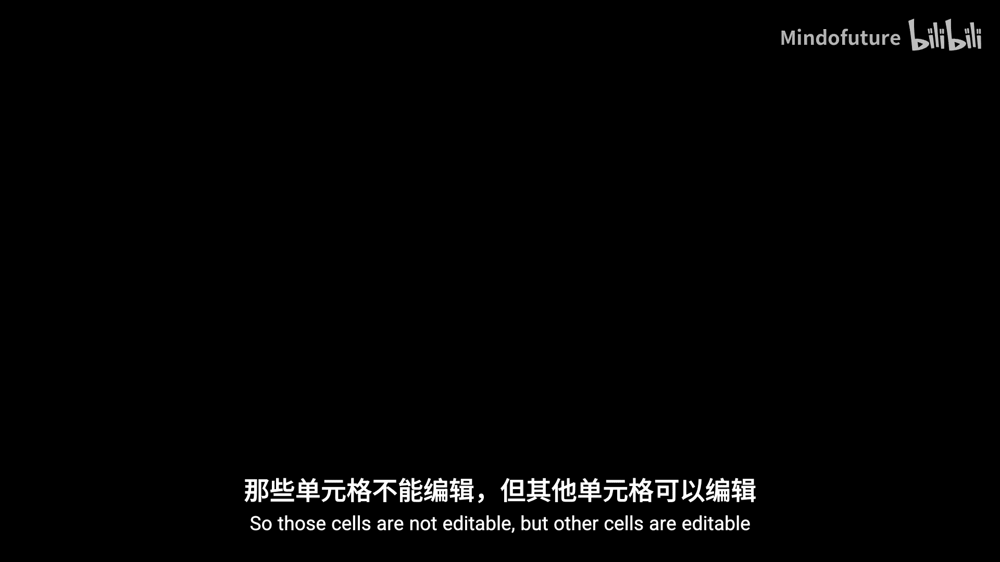
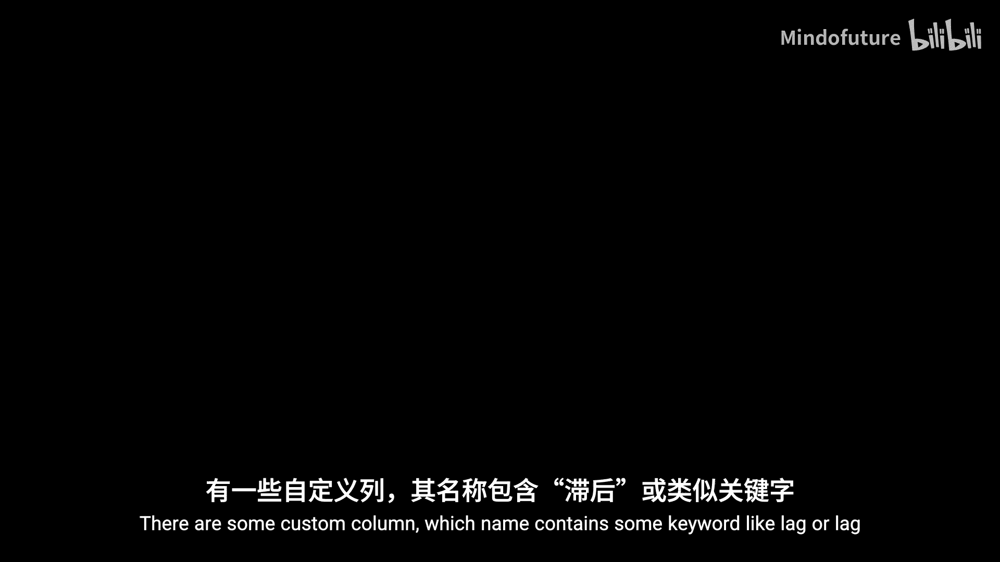
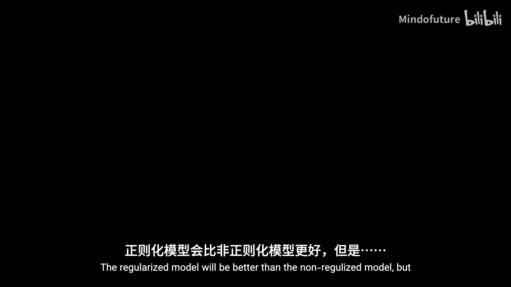
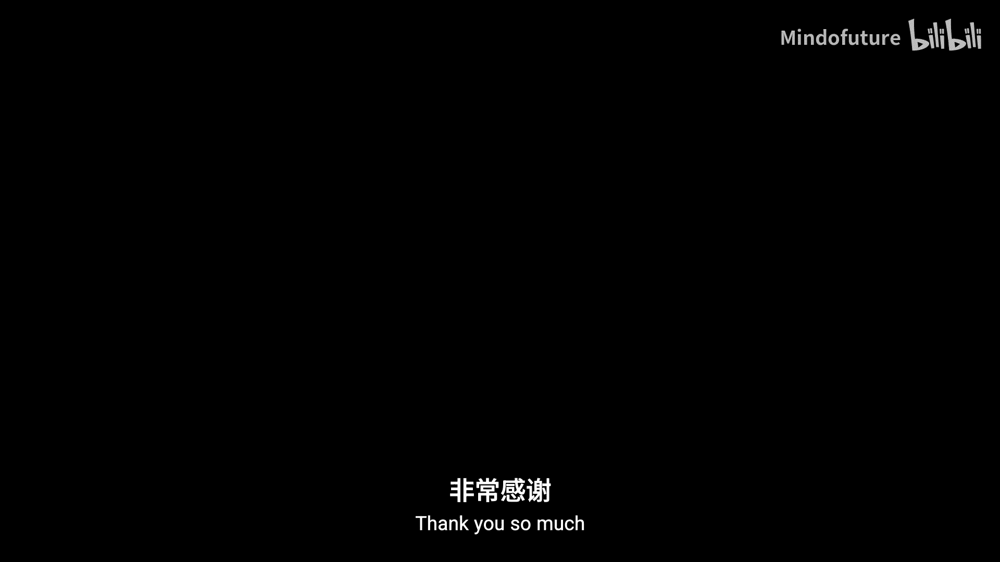

# 联邦学习 CS-E4740：练习1：首次作业环境配置与任务概览 🚀

在本节课中，我们将学习如何访问阿尔托大学的联邦学习课程作业平台，获取并完成第一项编程练习。我们将详细介绍从登录到提交作业的完整流程，并概述作业中的核心任务。

## 概述

本次练习旨在帮助大家熟悉课程作业环境。阿尔托大学的学生将通过JupyterHub平台获取和提交作业，而校外学生将通过电子邮件接收作业文件。作业内容涉及数据预处理、模型构建与评估。



## 作业平台访问与提交流程

上一节我们介绍了课程背景，本节中我们来看看如何具体访问作业平台。




### 阿尔托大学学生访问流程


以下是阿尔托大学学生获取和提交作业的步骤：

1.  **登录平台**：使用阿尔托大学邮箱登录JupyterHub平台：`jupyter.cs.aalto.fi`。
2.  **启动服务器**：在课程列表中选择“Federated Learning D 2025”并启动服务器。
3.  **进入作业列表**：服务器启动后，点击顶部的“Nbgrader”选项，然后选择“Assignment List”。
4.  **获取作业**：在作业列表中，找到“Assignment 1”并点击“Fetch”按钮。系统将自动创建名为“F_2025”的文件夹。
5.  **完成作业**：在“F_2025/assignment1”目录下打开名为“ML_basics_autograded.ipynb”的笔记本文件，按照其中的说明逐步完成编程任务。
6.  **验证与提交**：完成所有任务后，返回“Nbgrader”的“Assignment List”，点击“Validate”进行验证（可忽略TensorFlow优化警告），验证通过后点击“Submit”提交作业。

### 校外学生注意事项

校外学生已通过电子邮件收到作业文件。可以使用任何喜欢的平台（如Google Colab或本地Jupyter Notebook）完成作业。完成后，需将作业笔记本文件通过电子邮件发送给Alex教授。课程团队将在作业截止日期（3月17日）后发布参考答案。



## 作业任务核心内容概览

成功获取作业文件后，我们来看看本次练习需要完成哪些核心任务。

### 数据预处理与划分

首先，你需要加载并理解数据集。数据点对应芬兰气象研究所（FMI）站点的温度测量值。

**核心任务**：将数据集按80%的比例划分为训练集和验证集。具体操作是选取包含“lag”关键词的特征列来构建特征集。

```python
# 示例：选取包含‘lag’的特征列
lag_columns = [col for col in data.columns if ‘lag’ in col]
X = data[lag_columns]
```


### 模型构建与训练




作业要求实现并比较三种不同的模型。

1.  **线性回归基线模型**：实现一个简单的线性回归模型作为基线，并计算其在训练集和验证集上的误差。
2.  **一维卷积神经网络**：构建一个CNN模型。提示中给出了网络结构指南，例如可以使用3到4个`Conv1D`层。训练时建议使用**20个epoch**。
    ```python
    model.fit(X_train, y_train, epochs=20, validation_data=(X_val, y_val))
    ```
3.  **决策树回归器**：按照指示的树深度实现一个决策树模型。

### 正则化与数据增强

在基础模型上，需要进一步应用正则化技术和数据增强方法，以观察其对模型性能的影响。请注意，虽然我们使用增强后的数据训练模型，但最终评估（如MSE误差）仍需在原始缩放数据（`X_scaled`, `X_val_scaled`）上进行。



### 评分与验证

作业共包含多个任务，总计7分。每个任务都配有“健全性检查”代码单元。通过这些检查表明你的实现方向基本正确，但并非最终答案的绝对保证。最终评分将由课程团队的自动评分系统完成。







## 常见问题解答


在完成作业的过程中，你可能会遇到以下问题。




*   **关于训练轮数**：在训练CNN等深度学习模型时，建议使用**20个epoch**。
*   **关于健全性检查**：通过“健全性检查”仅意味着你的代码在格式和基本逻辑上没有错误，处于正确的轨道上，但不保证与最终答案完全一致。
*   **关于项目**：课程项目将于4月正式启动。3月份的建议是专注于听课和完成每周练习，为项目积累必要的数学和工具基础。关于将课程从5学分扩展到10学分的可能性，将在5月根据学生在前6次作业和基础项目中的表现个案决定。




## 总结



本节课我们一起学习了联邦学习第一次练习的完整流程。我们明确了阿尔托大学学生与校外学生不同的作业提交方式，详细介绍了从平台登录、作业获取到最终提交的每一步。我们还概述了作业的核心任务：数据划分、实现线性回归、CNN、决策树三种模型，以及应用正则化和数据增强技术。请记住，在遇到问题时，可以通过课程Slack频道或电子邮件及时联系助教或教授。