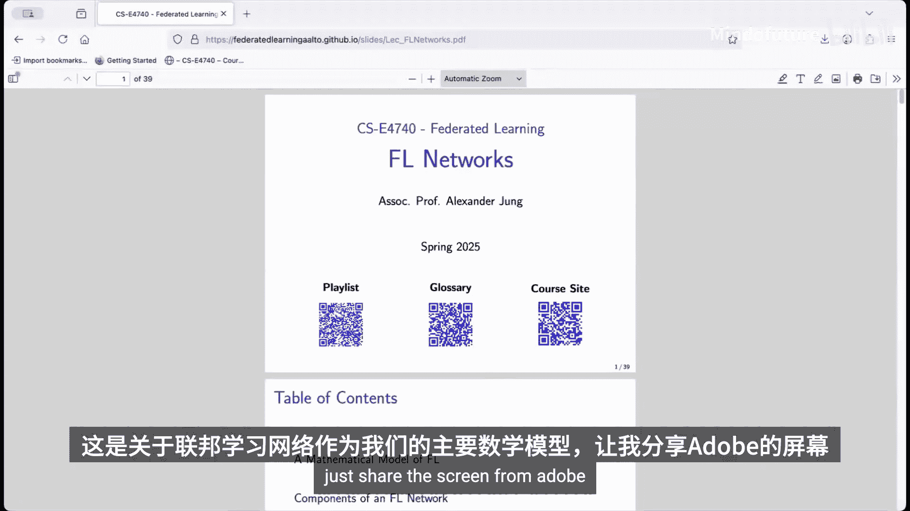
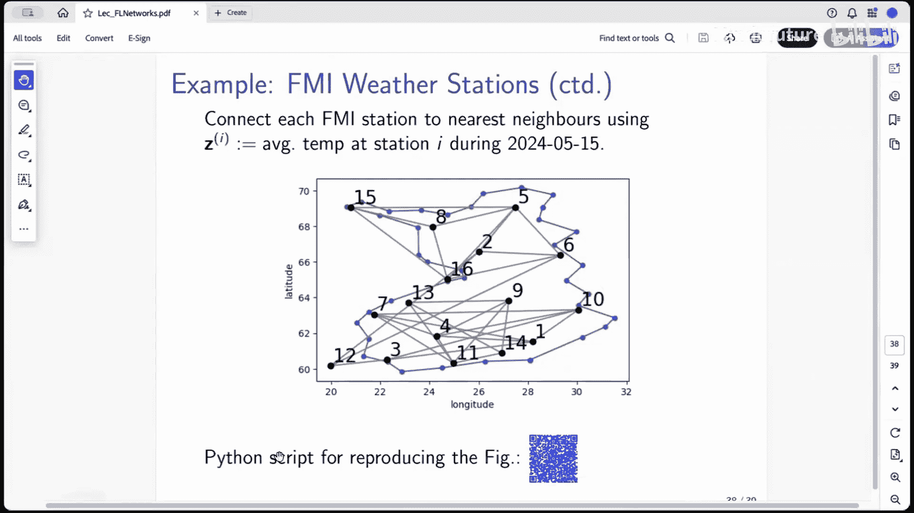

# 【阿尔托大学 - 中英】联邦学习 CS-E4740（Federated Learning，spring 2025） p20 P20 CS-E4740 Lecture 03-Mar-2025 -BV1cojRzDEfQ_p20-

Okay， welcome everybody。To our second lecture within our course on Feerated learning。

We are here today in the module and lecture for federated learn Feerated learning networks。

 So we will start to， to build a mathematical model。This model is called Federated Learning Network。

Which will then use as a。Its the building ground for Feerated learning algorithms。

 So in the next two two lectures， you will learn some principled ways to build federated learning algorithms and to analyze them。

Okay， some generic information or general information about the course in the beginning。

 I have now provided a template for the， the project report。

 You can find it on this course side on the project。 So here we have the。Mnu project。

 And then you have here， the， the P D F。V of project report template。

 and this template also includes instructions that give a pretty precise a pretty good idea of what to what I expect in the reports。

 So it might be a good idea if you， if you have a look at this template。

 and I'm happy to hear your feedback during this week so we can find tune or slightly modify this this template and instructions。

Together with the instructions we also have provided here a draft for the review sheet。

 so remember in the student projects you have to review or grade three to five reports of your colleagues。

 so we have here the draft for the review questions。

They are pretty specific precise fine grained review questions。

 and also here we we are happy to take your feedback into account if you receive it during this week。

Overall， there's still some time for working on the project。 Remember。

 I remind you about the the schedule。 We have the first project report submission by end of April。

Then you have around two weeks for the peer grading， so the peer grading deadline is 15th of May。

And the final project submission， which consists of a revised project report and a response letter where you explain how you took the the peer reviews into account。

 this has to be submitted by end of May。So now in， in March。And beginning of April。

 we still have a focus on the boot camps so learning in concepts in the lectures and implementing them in the exercises。

Yeah， are there any questions at this point regarding projects？Please post your questions in the。

 in the text， in the chat， in the Zoom chat or here。

 ask them here in the lecture hall if you are here。Okay， if not， then yeah。

 let's continue with the content of the day， which is about federated learning networks so our main mathematical model。

Let me just share the screen from Adobe。

嗯。Remote。嗯。I see one question here。 When is the deadline to define our project topic， There is no。

 there is no deadline for defining your project topic。 You just choose the topic that you wish。

 you are free to choose an application and you work on the report and submit it。 So you。

 you don't have to tell me at some point what the topic is。

Theres no need for that。Okay。Yes， can you see my， my slides in Adobe。

Please give me a brief feedback in the Zoom chat。Before I start talking for half an hour and nobody sees what I see。

Very good。Yes， yeah， so today we talk about a mathematical model。of or for federated learning。

 which is what I call a federated learning network， which consists of a few important components。

 which we will go over in the lecture。Then I will briefly discuss the concept of La laplaian matrix and how you can use a laplaian matrix to understand or to analyze the。

 the connectivity structure of a federated learning network。

These federated learning networks can be very large， can be very complicated or complex。

 but it turns out using a few properties of of the eyeingvalue or the eyeiging values of a matrix。

 you can tell pretty much about the general structure or global connectivity structure of federated learning networks。

 Yeah， and then we will discuss a bit how to choose a federated learning network within this course。

 we have a lot of design choices to make and one of these design choices is， for example。

Which hs or links should we include in a federated learning network。Okay， so let's start。

 first of all， what do we want to model。 This course will talk a lot about mathematicalal models。

 Mathematical models are nice。 We can， we can reason about them with pen and paper all all nice。

 But in the end， what the mathematical model is is an approximation of something in the real world。

 I'm very hesitant to use the notion， real world， because it's not really a useful world。

 but let's say a physical system。 So we have real devices like smartphones。

 we have real supercomputers like this loommi in Finland。 I think it's located we have laptops。

 physical physical objects in our real life。 and also more and more of these smaller devices like even light bulbs。

 light bulbs， smart carries is some computational power that can be used to train a model。

Believe it or not， or smart plugques， I have myself used smart plugs to analyze the energy consumption and how how it could match with solar energy availability or supply of solar energy。

So there are large systems that consist of devices and device is something that can train a model。

 train a machine learning model and has access to some data So that leads us to modeling perspective and in this model we want to abstract the way or it to abstract the way is the nice word for ignoring we want to ignore many details because it becomes too cumbersome for include for the analysis of federated learning systems to include all discrete details like physical properties of communication links。

 do we really need to know the frequency band or frequency range that is used in a Bluetooth connection or is it just enough to know that over a Bluetooth connection can communicate a parameter vector of dimension 16 with some accuracy。

Or incururing some quantization noise。We in this course。

 we also don't take too much into account the the low level communication protocols。

 Is it important that， you know， if we use Aloa or slotted Aloa for those who have learned about the。

 the Internet communication layers or stack， Internet stack。We abstract away many of those details。

 Also， the hardware configuration of devices。 We don't really care if it's a small raspberry pie or a laptop。

 a desktop computer， the operating system， we don't take into account much and the。

 the type of software that you use。 So we ignore many details just as a disclaim in the beginning。

Which， of course， is nice because what what we then develop the mathematical models and analysis is flexible。

 but it might be too， it might be not fitting for your particular application or task。 So in the end。

 when you work as a federated learning engineer， when you have to implement this federated learning systems。

 you have to worry about all those details， possibly。

But here we take more of bird's eye perspective in this course。 So we， we abstract away many details。

 and we say a federated learning network is， as the name suggests， a network。

So how many of you have heard about networks or took a course on complex networks。So quite some。

 So this is basically one possible application domain of all these cool tricks that you learned in this networks course is federated learning。

 So we can， we can interpret a federated learning system as a network。

 a network which consists of devices that we denote here by dots， these other nodes and we。

 we for simplicity， we， we limit ourselves to finite many devices， but we don't set the bound。

 So N could be 10。😊，Or in this case here you see four seven nodes。

 but n could also be 10 billion like all the IoT devices on the planet。But it has to be finite。

So for pure mathematicians， this is a limitation， but for practical applications。

 I think large enough n is is good enough。Okay， and some of these devices are connected by an edge or link with with a weight。

 and we will see different usage， or we will， we will you have a very specific。

 We will put a very specific meaning or interpretation on these weights。 They have two， two roles。

 So to say。 So one role is。They tell us， or they reflect the， the communication rate between nodes。

 So if I have a link between two nodes， then they should be communicating somehow。 For example。

 via a Bluetooth connection。 And the way it also tells us how much data per second。 So it。

 it reflects the bit rate， in some sense。But it also has a meaning regarding the statistical properties of this federated learning system。

 So we， we will interpret a link with a large weight as an indicator of a statistical similarity。

And we will see different notions or measures for statistical similarity。 But roughly speaking。

 if there is a link between two nodes， then they generate similar types of similar data or similar distributions。

Okay， what else So these nodes， which represent devices， they generate data。

 So each one of us has one one such device， a smartphone， which generates data。

 collects data all the time。And each device potentially trains a model。 So we， we。

 we leave it open if， to what degree this device is trained model。

 So it might be the trivial case where we have no computational power at the node。

 which trains a model by not doing anything。But in principle， each device。

 each node in a federated learning network generates data。And wants to train a model。

So you could think of one way to， to think of this federated learning network is smartphones。

 So each dot represents a user with a smartphone。 what you， what you do with the smartphone。

 you collect data。For example， through through some fitness app。

 when you go for for a run or bicycling。 So you， you collect data。

 how fast did you move and what's the trajectory and you want to train a model。

 So you want to train for， for you， the person the optimal training program。

 the optimal training schedule， Should you go running tomorrow。

 should you do cycling tomorrow or swimming and how much should you do tomorrow to optimize your training effect。

Okay， but typically these models they are very complex nowadays we use deep neural networks with billions of parameters。

 so this this local data， these data sets， DI will be too small So what do we do then infeerated learning we collaboratively trained this local models so we exploit this similarity structure loosely speaking we pool the local data sets of nodes that are well connected or clustered。

But we do this pooling not by shipping raw data。 I don't want to ship my fitness GPS coordinates or routes to some random other person。

 which also uses this fitness tracker， but we rather do with indirectly by exchanging model parameters or parameter updates。

That's what federated learning， what sets federated learning apart， maybe from distributed learning。

 where we don't take into account this privacy protection that much。Yeahて。

Any comments or questions at this point？Okay， yeah， this will be our main tool。

 our main mathematical concept or object in this course， a federated learning network。

 We will the the main goal or task。In， in the Feerated learning project。

 or one of the main tasks will be to translate your application。

 your federated learning application into a federated learning network。

 So you have to specify what are the node， What do the notess represent， Are the notes， smartphones。

 are they weather stations， are they。A sensors installed along the road network in Finland。 This is。

 this is that actually the， I would say the hardest part of you of applying federated learning。

 the modeling， how you model the application as a federated learning network。

 And there's a lot of design freedom here。You， you can choose。 What do you consider as nodes。

 What do you consider as Hs and what do you use as loss functions。

 which we're gonna talk about in a second more about。But it's important to remember。

 it's only an approximation。 It's as any mathematical model。 It's only an approximation。

 And you will make a modeling error。 And depending on how much modeling error you're willing to take。

 you use a simpler Feerated learning network with fewer nodes。

 Or if you want to make less modeling error， you you do use a larger network。Okay， and then yeah。

 pretty much covered already most of the components。 So as a precise definition。

 you could think of a federated learning network as as a list or a tuple coupleple of objects。

 The first object is a node set set of node， calligraphic V。

 which in our lecture will always be the first n natural numbers。 So we start with one。

 We don't start with0。 for those who like programming in C。 we start with one。

 First node is one up to node n。So theres a question yeah。

 please ask your questions in the chat in Zoom。I' not see it yet。嗯。Yeah， the question is。

 can you please explain the graph in the earlier in the previous slide。So。😔。

I guess you mean this here。 Yeah， So this is like a cartoon。

 you could think of of the real federated learning system as some some point in in a very abstract space and a federated learning network is a point in a subspace。

 So we， we kind of summarize a lot of real worlds Feerated learning systems that have the same。

 same network representation。 So the point here is。

 even if you use the same Feerated learning network。

 the real world system could can look very different。

 So you can use the same federated learning network to model very different physical systems。

And you will incur， of course， a modeling error。 And this is what I want to highlight before we start playing with this federated learning network。

 As soon as you， as you have the federated learning network， everything is， is easy pe。

 You can do all your， you can pull all your tricks that you learned in linear algebra in。

 in analysis using gradient methods and so on and so forth。

 This will be your main program in in this course。 I just want to make this this game in the beginning。

 This is， this is just were working with mathematical models。

 So be sure that you use a useful mathematical model。 You will make a modeling error。😊，嗯。Yes。

 so we have a finite set of nodes and nodes and each node carries a local model。

 So think of a local model or decision tree or like in Set learning。

 Set learning decision tree object or a deep neural network in your favorite deep learning library。

 a Kas object and what sets now federated learning apart from basic machine learning is that we have one such model for each node。

 And that's why I call this a local model。😊，Because it's local。 It's only used for this one node。

 I could also use personalized model， which might be a more catchy term from a marketing perspective。

 But somehow， I like local model more。So each node has its own local model。 And in this course。

 like in my machine learning courses， a model means a hypothesis space， a set of possible functions。

 Each function being a predictor or a hypothesisthesis map that reads in features of a data point and outputs a prediction for a label。

Okay， so then how， how do we find a good predictor map out of a hypothesistheesis space。

 or in other words， how do we train a local model。 Well， for this， we need a loss function。

 And again， in contrast to basic machine learning， we have a separate loss function for each node and the node could use different loss function。

 So one node， one device could use what's your favorite loss function。

 Do you remember any loss functions。What are there。What's your favorite loss function。

 The most beautiful， elegant loss function。Let's in the chat。 we have some comments。Cross entropy。

Crossenttropy。 Yeah， there's one comment。 Adam Adam is not really a loss function。

 It more refers to an optimization algorithm。 ME， Yeah MSE， which is based on the square error loss。

 square error loss or crossent pillows。 For example， yeah。

 and you could we will study methods that can handle some node one one and the same federated learning network。

 but one node uses crossent pillows， which is used for classification problems。

 So where you have discrete labels like cat or Nocat， cat or doc。

 and another node uses MSE or square error loss， which is useful for predicting numeric quantities。

 So you will learn federated learning algorithms in discourse that can handle such very hiter or channels learning networks。

 So one model wants to train a classifier using crosscentrop pillows and another model。

 another device trains linear regression model。And you can couple them together。

 as we will see in the later lectures。Okay， so the loss function can be varying different nodes of different loss functions。

That's about the node， the node properties。 And you will then learn in the。

 in the exercises how to attach these node properties to to nodes in Python。 So this is a very nice。

 elegant way using network X code or the network X Python package。

 where you can say one node attribute is skiet learn machine learning model。

 So you can really attach to nodes。 entire machine learning models。

 And it can be very different at different nodes。 I find this amazing。😊，Okay。

 then another main component of， of a network， of course， we not only have nodes。

 but they must somehow interact。 If there would be no interaction between nodes， then it would split。

 would break down into individual machine learning problems。

 And there's no point in offering you a federerate learning course。

Because you are covered by machine learning courses。 What makes federated learning。

 Feerated learning is the， the presence of the presence of edges or links， links。Between nodes。

And in this course， we use undirected edges。 So we could。

 we could also use another mathematical model with directed edges。 But so far。

 I didn't come across really an application where would be that useful to to use directed edges。

 So we will focus on undirected edges。 But I leave it up to you to extend my model framework to。

 to directed edges。And so， an edge。In a relation between two nodes。 In particular， it， it。

 it signals that the， the learning problem at two nodes is somewhat similar。 We could， for example。

 pool the， the data of these two nodes。And we also represent the amount of similarity by an edge weight。

 So each edge carries an edge weight AI I prime， which is positive。So the larger the edge weight。

 the larger， the similar， the more similar are the， the learning tasks at no， node I and I prime。

 Yes， there's one question。 Please ask on the chat。嗯。Are there any questions here in the audience？

Yeah， we'll then collect the questions also later at a later point。

Just ask drop your questions for those who are following this lecture in Zoom。

 please drop your questions in the chat。Of soon。Okay， yeah， so as I mentioned， the nodes。

 the nodes of the network represent devices， and I will be a bit sloppy in this course and sometimes talk about device I。

 which is the physical object。 a device is this this here that I can really grasp this physical object。

 node I or now this the device and I represent it by a node node I。

But I trust that you can tell the meaning apart。 So when I talk about a device I。

And I actually mean the node in the mathematical object。Okay。

 and then just to illustrate a bit this local models， as I said， a model。As I understand it。

 in my machine learning courses or in my machine learning notation。Is a set of of functions。

 a function space or hypothesistheesis space。 For example， we have here a model， a linear model。

 This linear model consists of linear maps。And this model is， for example。

 represented by the Python ski could learn class linear regression。 So when you in create an object。

 linear regression， then this holds of this stores the whole function space of linear of linear this linear function space。

Another model are decision trees。 So decision trees are piecewise constant。Functions。

 and they are characterized by a flow chart called。Guess decision tree。

 So a decision tree is a flow chart representation of a piece by constant function。

 And so strictly speaking， a decision tree represents a whole。

 a whole family of such piece by or space of piece by constant functions。 And yeah。

 I want to really highlight here that in a federated learning network。

 you can have one node carrying a linear regression model and another node carrying a decision tree。

😊，And still， you can couple them。 You will learn methods to couple those two models。嗯。Okay， yeah。

 so we， we need， of course， a means to， to choose between these different functions。 So why。

 how do I know if this green linear curve is better than the blue， Well。

 that's what we have lost functions for in machine learning and other infeerated learning。

 in particular， in federated learning， we have a separate loss function for each device or node。

And as already mentioned， for example， we could use here one， one loss function for a linear model。

Which loss functions could you use with a linear model。

Does the choice of model restrict yourself or restrict significantly the the possible choices for the loss function or other independent components。

Do you do you need to use a squared error loss when you want to use a linear model。

Or are there many different methods that all use a linear model， but very different loss functions。

So this is a largely independent design choice。 But for example。

 when you look up Python or skiet learn documentation。

 you will find maybe a chapter or a section called linear methods。

And these methods are all machine learning methods that share the same model， linear model。

 but have very different loss functions。 So one loss function is squaredarrow loss。

 Another loss function could be logistic loss。 Then you have something called logistic regression。

Yet another loss function could be。Hinchlo。Then you get something called support vector machine。

 So they all use linear models， but different loss functions。And what was my point。

The the heres a question。 What's the difference。Okay， this， this refers to before。

 What's the difference between。Directed and undirected edges。 a very good question。

 So in our federated learning network。We we connect some of these some of these nodes by an undirected edge and。

Because we use undirected edges means that whatever we want to represent those。

 So whatever the meaning is of those edges， we have no notion of， of orientation。 So if we say。

 or if I tell you that this edge represents a similarity between node I and node I prime。

This immediately means there's also similarity between node I prime and node I。But some。

 sometimes relations between two nodes are are not， are not symmetric。 So， for example。

A friend friendship relation。 So note I can be friendly to note I prime， but note I prime。

 maybe not friendly to note I。So this is an example of， of， of directed relation on yeah， directed。

Itches。So within this course， we only look at， look at applications where theres a symmetric notion of similarities。

 So if task I is similar or useful for node I prime， then so is node I prime for node I。

And there might be some applications where this is not the case where you have not asymmetric regulation between two nodes。

 but this is beyond the scope of this course。Very good question。😊，呃。Next question。

 is there a central model that feeds the network for improved states of the model or each node of the network develops and evolves its own model also does the network。

The network work towards a common goal， common model。Very good question。

 So this is related to one of the following lectures on Feerated learning flavors。

 So we will see how different choices for the network structure result in different federated learning flavors。

 So there one question was， is there， could there be a global model that that supports all other models。

 And yes， you could， and you could model this by this edges。

 So you could say theres one node which is connected by an edge to all other nodes and this edges have high weight。

 That's how you can make， for example， this node here influence or drive or guide the training of all other local models。

😊，But it's not necessary。 So you could also have fully decentralized systems or federated learning systems。

 where there's no central authority。This could be beneficial， for example， for robustness purposes。

 When you have no single authority or no server node。

 let's call it server node that drives or helps all each other。

Then you have a single point of failure。 So if some Austrian cyber criminal wants to attack the system。

 he tries or she tries to attack this one server。On the other hand。

 it could be useful if you have a powerful server which kind of drives or supports the training of models at low complexity devices like a small embedded system or a cheap smartphone。

 then you you can benefit from the computational power of this loommi supercomputer， for example。

AVery good question。嗯。Yeah， then please elaborate。 what do you mean by undirected edges。

 I already covered that to some degree。 Then the next question。

 what is the significance of directions， Yeah， so I also covered this。Yes。

Then one comment or question。 How does the note coupling happen for two nodes with different models。

 Very good question。 And this we will answer in one of the following lectures。

 So I want to keep a bit the， the suspense or we will not spoil it yet。Just one to highlight。

 you will learn in this course methods to couple to handle federated learning systems where one node trains a linear model。

 another node trains a decisionary and yet the third node trains a large language model or a few layers of a deep neural network。

Very heterogeneous networks。 And you will learn methods to couple those wild mix of models。Okay。

 let me move on。 So we have a loss function at each node。Yeah， for example。

 mean squared error we for for most of the lecture and in the assignments。

 we will work with parametric models。 So a parametric model is a model where you can find a useful map from from a subset of a Euclidean space。

Containing what is called pagameter vector to the， the function， the predictor function。

And one such model for which this is possible is a linear model。

Where you have the weights or the the the factors that you use for each feature of a data point and these factors or or weights or scaling coefficients you can use as parameters。

 Another model where you find where there's a useful or yeah。

 useful choice of parameterization is deep neural networks where you have this weights and bias terms in the network。

But there are also examples where it's not so obvious。 What is a useful parameterization。

 And I call them non parametric， One of them being a decision tree。可以。不是。Yes， yeah。 then the edges。

 as I said， we have an undirected edges。 So there's no sense of direction。

Between the nodes that are connected by an edge and just for the time being I tell you that these edges reflect similarities。

 but mostly in this course an edge is a design choice。

 So you as the federated learning engineer have some freedom in choosing which nodes you connect by an edge。

 So this is a design or engineering problem。And this choice is guided by by two effects。

 So first of all， when you place an edge between two nodes。

 you need to communicate between those two nodes。So if you want to have an edge between two nodes and your federated learning network in this model。

 then in practice， when you then develop a federated learning algorithm based on this network。

 you need to you will have to communicate between these two nodes。

And sometimes this might not be easy。 So you want to avoid this。

 Think of this smartphone somewhere in the middle of nowhere in Finland with no， no cell tower。

 So it's hard to communicate them with another node。 or you have a satellite link。

And then you might have a small edge weight。 So you can。

 you can think of this edge weight also as a capacity。

 So if you have an edge with a large edge weight， you shouldn then have a means to implement a high bit rate communication between this two node。

Okay， and beside these communication requirements， you also will will shape the statistical properties of the learning method in particular。

 when you place an edge between two nodes， you will force the learning。

 theerate learning algorithm to couple these two nodes in the sense of training similar models。

So the trained models will have1 similar model parameters at these two nodes。

 or equivalently you effectively pull the training data at these two nodes。

 So putting an edge with a large edge weight between two nodes is is essentially the same as exchanging the raw local data sets at these two nodes。

Okay， any questions at this point？see there's nothing under the checked。Okay。

 so to study and to design federated learning systems。

 we should have some tools or instruments for characterizing and studying the connectivity of a Feerated learning network。

And by connectivity， I mean， for example。How can we find out or how can we ensure connectedness of a federated learning network。

 So a federated learning network with graph calligraphic G is connected。

 if there is a path between any two nodes。So， let's look an example。

Is this federated learning network connected。Yes。How do you know how to remove one edge to make it not connected anymore？

Do you think yeah。Yeah， between this and this。 So if we kick out this one edge。

 it's not connected anymore。So do you like this behavior？Well it depends。 It depends if。

 if these nodes actually have a very different statistical property than the blue nodes。

 then it's actually good because you don't want these blue node to。

 to disguise or to distract the learning of the red node， because they。

 they have some completely different learning tasks， On the other hand。

 if they have somewhat similar task， then the information in this blue node could help the training at this red node。

 So then you don't want it。 So it depends on the statistical properties of the。

 of the local data sets and the learning tasks。And this is the difference to。

 to using networks for or using network models for communication in communication networks。

 you would not like to have a disconnected network。 You won't have connectivity。

But in federated learning， you want to have connectivity between the right。Partners。

 communication partners。 So that's a bit the difference between basic between other applications of complex networks。

 which only look at at the connectivity patterns。 So in complex networks per se。

 you have nodes and links。 And then you study the connectivity properties。

 So how many edges do you or how many links do you need to remove to make it disconnected。 But in in。

 in our case， we have a bit more。 So a federated learning network is more than just the network。

 It also has statistical models at each node。 And this。

 this is kind of the upgrade compared to the techniques and models that you learned in complex networks courses。

 So we not only look at the structure at the topology。

 but we also look at the learning processes that sit on top of the nodes in the network。

See any comments， no comments so far。Okay， then yeah， just a termiminology。

 which might be a a refresher for most of you who already took a course in complex networks or network theory。

 So a graph is connected if there's a path between any two nodes。

A component is a connected subgraph with no edges leaving the。At the sub graph。

The neighborhood of a node is the set of all one hop neighbors。

 so each node that is connected by one edge is can be reached by following one edge from node I is part of the neighborhood。

Pretty clear， I would say then we have the weighted node degree is the sum of all weights of the weights of all edges that are incident to this node。

And the maximum node dec is the maximum weighted node degree over all notess。

So let's look at an example here。 This federated learning network consists of two components。

 so it has two component component 1， comprising node I equal 1，2，3， and the second component is 4，5。

6。For simplicity， I have I have used uniform edge weights。

 so this has edge weight 1 if there is an edge on zero otherwise。So the the node degree of node 1。

 for example， is one because it has one neighbor， but and the neighborhood， for example。

 of node 2 is3 and1。These are the3 and one are the neighbors of node 2。

 and the maximum no degree is 2。So far so good。 Any questions at this point。

 This is really basic terminology that we will then use throughout the course。Okay。

 so just to remind ourselves about the design choices。 So a federated learning network is。

 is a model that we create that we choose。 We built a model to approximate to approximate a real world Feerated learning system like the I O T network。

Of the entire world。And one question design question is already the nodes。

 So what how many nodes do you use， What do you represent。

 which physical objects do you represent by the nodes in your network。

 And this is something I want to see in the project reports that you write down at least one line or one sentence。

 The nodes in this federate learning network represent smartphones or the nodes represent spatial。

 temporal areas， regions， This can be abstract objects also。

Then I want you to clearly tell about the local models and loss functions you have used in your Feerated learning network。

And last but not least， the edges。 So which devices do you connect by an edge and how do you measure the similarities。

 So how do you choose the edge weights。And yeah， you will then learn in in this in the following lectures how these choices determine the computational and statistical properties of the resulting federated learning algorithms。

 And there are， of course， trade offs。 So if you， for example， use many edges。

Have a densely connected network。 Then each edge corresponds to message passing。 You exchange some。

 some computational， intermediate results of computations。 So the。

 the number of edges is somewhat proportional to the amount of computation during each iteration。

 the per iteration complexity。 The more edges you have。

 the more you need to compute in each iteration。On the other hand。

 putting many edges between similar nodes might help to couple this training。

 So it might help to to train more accurate models。

 So more computation buys you more accurate models。

But there's also other design dimensions like the explainability of the privacy protection。

 which we will touch in the last lecture on trustworth E federated learning。

And this is something I would like you also to explore in the project by numerical experiments。

 for example。 So try out two different choices for the network。

Dense network and the sparse network with few edges and then report the computational complexity or the accuracy of the trained models。

Okay， skip this this point。 Yeah， so we are progressing nicely。

 Are there any questions at this point。Yes。😊，So the question is， can we use a multigraph？Yes。

 so I mean， you you， you could build a multi layer graph by having。

Let's say kind of copying or cloning the node set over different time steps and then having connections between the time steps so you can。

 you can build multi layer graphs as a special case of of of a federated learning network。Yeah。

 but we will not exploit the specific structure of multi layer networks。

 That's beyond the scope of scope of dis course。 But you。

 you could view a multi layer network as a specific choice for the edges in a network。

And the specific choice of nodes in particular， you you have kind of a time series of nodes that represent actually the same device。

 but at different time points。Okay， there are some questions。

You mentioned about federated learning with decision trees and later mentioned that we would work with parametric algorithms。

 Sorry， it is not clear to me。 Could you please clarify， Yeah。

 so we will mainly study algorithms for parametric models。

 but we will also present federated learning algorithms that don't need any parametricization anymore。

 They can handle any mixes of parametric and nonparmetric models。

 but the the focus also in election notess regarding the analysis will be on parametric models because there we can do more。

 So to say we can tell more because we have more structure。嗯。Another question in the network。

 Do we assume node communicate with each other or do we have a central server through which the communication is done。

 Very good question。 So the， the， the standard mode for the federated learning algorithms。

 in this course is fully decentralized。 So we will study federated learning algorithms that communicate with each other via message passing。

 So this device 3 communicates with device2 over message passing over this edge。

 So only communication over the edges。 we do not assume that there's a central server。In general。

 but， of course， you could say。You choose one node that is has strong communication links to each other node。

 And then effectively， you have a server。 So a server。

 this server based federated learning is a special case of this federated learning network。

 where you have a star network。 So to say you have one center node。

 which is connected to all other clients by H。 how do you call it。A stumps or like each。

 each client is connected by an edge to the to the central server。

 So server based federated learning is included in this setting as a special case。Okay。

Let me now move forward to the。The idea of using matrices to characterize。Networks。

 so how many of you have heard about Laplaceian matrix or the general idea to use matrices to characterize networks。

 quite a few。 Very good。 Yeah， this， this is the， this is the main approach in something called spectral graph theory。

 So that did any of you have a course on spectral graph theory。Specifically。

So what you do in spectraltrograph theory， you build a matrix based on a network and look at the spectrum。

 hence the name spectraltrograph theory because it uses the spectrum of matrices or operators more general terms that are naturally associated with a network and maybe the most widely used in my case my favorite my favorite matrix there are different definitions of these matrices of Lalastia matrix is this here So you have a matrix of size n by n。

 n is the number of nodes in the network。 So it's a square matrix which with each row representing a node and each column representing a node。

 and then you build it up entry wise by putting the negative of an edge weight at row I and column I prime if there is an edge between node I and I prime and they are different So this is this here of diagonal entries and on the main diagonal in the I main。

Egonal，W whichch corresponds to the I node， you put the weighted node degree。And otherwise。

 you put only zeros。Pretty straightforward。 So let's let's also look at it for a simple example。

 So here's a graph with uniform edge weights and three nodes。 And on the right。

 we have the Lalastia matrix。 So for example， between node 1 and node 3， we have an edge。

 So if we look into row 1 column 3， we have a non0， and this non0ro entry is the edge weight，-1。

If we look at row 1 and column 2， which is this pair。

 we also have a non zero entry because there's this edge。And-1 negative edge weight。

 If we look between node 2 and node 3。 So second row， third column。

 there's a0 because theres no edge weight。 there's no edge， sorry。Okay， so far so good。

Does any of you have an idea why this is a useful matrix representation of a network？Yes， yeah。

 just from the way we constructed it， it's， it's a non zero pattern reflects the， the edge set。

 And we can also read off the edge weights。 I mean， yeah， it's a very pragmatic explanation。 It just。

 it's just a different way， different symbolic way to represent the left symbol。

The the graphical way， yes， very good。But it has some nice properties from a linear algebra perspective。

 First of all， it's a metric。Since the edges are undirected。So node I has an edge with node I prime。

 If and only if node I prime has an edge with no connected by edge with node I。 So it'ssymmetric。

 and it's positive symmetry in it。And this， you can verify just by writing out this quadratic form。

 So if you take any vector W whose entries， you can think of node wise attributes。 So this w has one。

1 number for node 1，1 number for node 2 and one number at node 3。

And if you look at this quadratic form， what you get is the total variation。

 So you sum the hwise differences of these node nodewise values W the value at node I， W。

 I and then value at node I prime， W I prime take the difference and the square。

 So this is the variation。 How much do this node values vary across H I， I prime。

And you multiply those。 You weight those with the edge weight。 So the larger the edge weight。

 the more influence has this variation on the total variation。That's very cool。

 And we will exploit this relation a lot。Okay， so I think there was。Was there something on the jet。

🤧嗯。Theres what is the meaning of negative values in the matrix， Good question。

 Why do they have to be negative。Why don't we use the， the edge weight itself here， plus  one， but-1。

 yes。Actually， the row sum up to zero。0， yeah。 Yeah， I mean， in principle， we could do it if。

 if our intention was just to， to， to， to represent a network structure as a matrix as a two dimensional array of numbers。

 we could just use here plus  one。Yeah， why not。 However， if we use-1， we have this identity here。

 So I would say there should be minus the edge weight that we get this identity correct or that this identity is in force。

There was other comment。Why the element located at row 1 and column 1 is 2。Yes， because here row1。

 column 1 means the the total the the edge the node weight of node 1。 And since node 1 is connected。

To two neighbors with the unit unit weight edges， the weight the note degree is 2。

So here in the main diagonal， we see the weighted no degree。

The sum of edge weights that are incident to this node。 So node 2， for example。

 has one edge attached to it。 So the， the node degree is one。 So we see in row 2， column 2。

 the entry is one。Another question。We will learnma semi decentralized Feerated learning or fully decentralized learning。

 You will learn fully decentralized learning。 and one special case of fully decentralized learning is Serba client based Feerated learning。

You can think of， for example， here， note 1。Just define the吧。

You can pick one node one as a server because it's connected by a link to all other the nodes。

 but it doesn't need to be the server。Okay， so now that we found out or that I told you。

 you're very welcome to prove me wrong。 Laplace matrix is positive semi defite。

And since it's positive semi defite， we can use something called spectral decomposition。 So who。

 how many of you have heard about spectral decomposition of positive semi definite matrices。Yes。

 very good。So it turns out if you manage to show that a matrix is positive semi in it。

Many nice things are possible or can happen。 First of all。

 or one of those is you can write it as a linear combination of so-called rank1 matrixrices。

 So each rank one matrix here is defined by a vector。 And these vectors are actually orthonormal。

 eigenvectors of the lalastia matrix。 Very nice， very nice property a very nice structure and the the coefficients in this linear combination。

 this La that J eigenvalue of the lalastia matrix。 So what you see here is nothing but an eigenvalue the composition。

 and it's a very special very nice structure， eigenvalue the composition。

 because the eigenvectors are orthonormal。😊，And this will be useful in in many in many ways when we analyze federated learning systems in the following。

Okay， so as orthonormal eigenvectors， their inner product is zero and their norm squared Euclidear norm is1。

This is just what this equation here means。And we have a list。

 an ordered list of non negative itemigenvalue。 And I want to highlight that this。

 this list is unique。So once you fix a lalasta matrix。This list of ion values is fixed。 It's unique。

In contrast， these eigenves are not always unique。 So there are different choices of an orthonal eigenves for La plastic matrix。

 Does anyone have an idea when this is the case。For which Laplaceian matrices。

 is it possible to find two sets of orthonomalizing vectors。Well， you can show if some of this list。

 this increase in the list are identical。 So you have repeated ion values。

Then the orthonormal eigenvectors are not unique anymore。

 As long as this eigen these list elements are distinct， pair distinct。

 So you have a unique first entry， another second entry a different third entry and so on and so forth。

 these are essentially unique， these autonormal aigenvectors。

 But as soon as you have repeated eigenvalues。They are not unique anymore。Okay， and yeah。

 when can this happen， When can you have repeated e values。 Yeah。

 one case is you have a network that consists of several connected components。

So the overall network is not connected， but it splits。 It breaks into K。

 small K connected components。Like。This example here。 So this network。

 this federated learning network， consists of two connected components。 So here K would be2。

And the number of connected components is reflected by the number of zero eigenvalues。

 So if your network has k connected components， the first k eigenvalues。

 the first k entries in this list in this list， which is unique， by the way， is0。And that's。

 that's also the idea behind spectral graph clustering。 So you。

 you look into the eigenvectors that correspond to the zero eigenvalues。

 And it turns out you can find one possible choice for these eigenvectors。

indicator functions for these clusters。These are not unique。

 So there might be other eigenvectors that correspond to the zero eenvalues。

 but there is one choice for these eigenvectors that are exactly showing you what the。

 what the clusters are， what the components are。And this is there here behind spectralgraph clustering。

So did any one of you use already spectral craft clustering。It's ready。's， it's available also。

 I think， in skiet learn implementation。And the， the idea behind spectral graph clustering is to use the spectrum of a lalastia matrix in particular。

 the fact that when you have K components。Which are not connected among each other。

 Then you will have K0 eigenvalues of this of the graphlplium。

 and you will find corresponding eigenvectors that are exactly indicators that tell you precisely where what nodes belong to which cluster or which nodes belong to the same cluster。

In particular， the network is connected， so we have only one connected component。

 which is the entire network if and only if the second entry in this list of ionvalues this ominos Lambda 2 is larger than0。

嗯。😊，Okay， so here' is a to example。 again from before here， we have two ionenvalue equal to 0。

 The first two ionvalue are equal to 0。 So it's not connected。 There are two connected components。

And you can find， you can construct one eigenvector whose entries。

 the entries of an eigenvector are node attributes， so to say， and you can find one eigenvector U1。

 which node attributes1 equal to1 for all nodes in component 1 and equal to0 for all nodes in component2 and vice versa you can find another eigenvector which has entries equal to1 at all nodes in component 2 and equal to0 for all nodes in component 1。

And inspect spectral graph clustering， we， we avoid this。This ambiguity。

In the choice of aigenvectors， as I said， the avectors are not unique。 You just。

 there's one choice of aenvectors that has this nice property of， of being an indicator。

But any rotation of these eigenvectors is also a potential choice of eigenvectors。

 So you just use a method that doesn't care about rotations。 And one such method is K means。

So spectral graft clustering uses first the eigenvectors of the smallest eigenvalues。

 and since they are not unique or in the ideal case， they are not unique。

 but you could have a rotation of these nice eigenvectors that you would like to have you use k means because k means is how do you call it immune to any doesn't deliver the same results when you rotate all your data points in the Euclidean space。

Okay， any questions at this point？Yes。第二。Yeah， then you use weights here。 Then you use， for example。

 if， let's say between node 1 and 3， you have weight 2 or3。 Let's say weight 3。

 then you would have here minus-3。And here， the entry would be four。But this。

 this always sums up to 0 by definition。Yes， it's symmetric。 So if the rows sum up to 0。

 also the columns sum up to 0。Yeah， by the way， just from the fact that the rows sum up to 0。

 can you tell immediately one possible eigen vector for eigenvalue 0？

Summing up a row is the same as multiplying this row with a vector consisting only of once。

So if you multiply this matrix with a vector that only consists of once。Let's see if。

 let's see if this works。 So everything breaks down immediately。

So if you multiply this with a vector of ones。What you get is in each row， the sum。

Of the entries and since by construction， this is zero。What you will get is。0，0 vector。

So the all entries is equal to one or equal to the same value。

Results in an eigenve or is an eigenvector for eigenvalue 0 over a lapplacey matrix。ok。Let's move on。

Towards the last part of this lecture， which is about how do we choose or learn a federated learning network。

 In the end， it's a design choice。But there are， of course。

 good design choices and bad design choices。 So how do we find a good design choice。

And I'd like to explain this or illustrate this with an example， which is We stations。

 So let's look at the Feerated learning network where each node represents a We station run by the Finnish Meteorological Institute or FMI for short。

And I have here provided a Python script， which you find with this QR code。Let's see if it works。Yes。

 so if you click it， you get the source code。I guess you cannot see anything in the sharing。But yeah。

Not strong world。If you follow this core code， you will find the nice little。

Python script that reads in data sets for each of these FMI station。

 So these data sets look like this。 So you have a time stampamp and you have a temperature recording。

So we have a local data set。 So we have the nodes。 We have specified the nodes。

 a set of FMI weather stations， and we have local data sets。Another question is。

Which node should we connect by an edge。So placing an edge has two effects。 First of all。

 you need to be able to communicate some intermediate results in the course of running federative learning algorithms。

 But let's say they are all having Sim cards so you can all reach them。

 So let's say the connectivity is not an issue。 So the second role of an edge is you couple the models。

 So you train similar models or you effectively pool the weather data at connected stations。

 So which weather stations should you couple for which weather stations is it useful to to pull together the training data or pull together the data to have a training set for a weather forecasting app。

 And for which stations it would not be good because they have very different weather dynamics。Yeah。

 you。Yes， so you could use the Euclidean distance of latitude and longitude， for example。And this。

 this have done。Here， so I connect。I connect the nearest。Neighbors。

 so I use the latitude and longitude。To connect each weather station with its nearest neighbors。

 I would say The 5， no，3 nearest neighbors。And I get this network。Sother comment。Yeah。

 so you can use all kinds of of distance measures based on on latitude and longitude。

And do you like this network？This is just one way。 I mean， that the general pattern here is。

The general pattern is that you construct， you construct a vector。

 somehow a representative vector for for a node。 And this representative vector could also be some parametermeter estimate of the local data set。

 for example， the average temperature。And you could also learn this vector instead of latitude and longitude。

 You could try to。To train an auto encoder， to find a good embedding for a weather data set。

 But let's say an another choice for this vector could be。The average temperature。So。You would。

 you would say I I or you would interpret these local data sets as realizations of a random a random draw from a probability distribution。

 distribution over temperature values and this distribution has a mean value。

And then you could estimate this mean value or the average using the empirical average of this local data set。

And then you say， you connect or you say。You want to train similar models for FMI stations whose recordings have a similar average temperature。

It's a lot of design choice。 And here's the network you get。It looks very different。So for example。

 you have here this。Let's pick a nice example。Note 13， node 13 here， for example。

 when you use their latitude and longitude， node 13 is not connected directly to node 11。

But when you use the average temperatures， it seems。

 I guess so note 13 is connected directly to node 11。And also。Or else do you see。

 Note 7 is directly connected to node 11。You also don't have this direct connection here when you use latitude and longitude。

So it seems that when you use the average temperature。

 you get more links between these FMI stations that are along the coast。

Does this make sense in your opinion？Yes， yeah， first the connection between develop analytics mistakes。

 which obviously does not really make any sense。12 and 6。Yeah，12 and 6。

Is here when you use the average temperature。Why does it not make sense？😡。

one is in the environment mean and the other one is in the middle of the body see and the other one is the in the far from the ocean as can get the so you would say。

Doesn't really reflect the the real weather dynamics or what。Plus， yes。Yeah， yeah。Out last。

 and I have computed this average。 I don't know for 5 or 6 temperature recordings。

 very short time intervals。 So what you could do is you could use averages over long time intervals。

For this。 And this is what I want to hear。 I want to see that you explain in your project reports。

 How did you construct the network， Did you construct it by using average temperatures over which time period did you use the average。

 Did you compute the average and so on and so forth。Yeah， I have also put here a link to the。

 to the Python script that uses this average temperature for drawing this nice network。Okay。

 that brings me already to the end of today where I。

Tryed to motivate our Feerated learning network framework。

As a useful mathematical model for federated learning systems， just to remind you， it's just a model。

 just a mathematical model， which means you will make modeling errors。

 And it standard the hard work is to find out， are they modeling errors reasonable or are they too large。

 So is the Feerated learning network completely useless in practice。

 Is it just a nice theoretical exercise for a course project。呃。

But once you have formulated your application as a federated learning network。

 we will see in the next lecture next week， how to。

Then represent or how to formulate federated learning as just a natural。

 very natural optimization problem over a federated learning network。 I mean。

 the idea is almost already。Obviously， in the definition。

 I said we will use Hs to couple the training of models。

And we can do this by just penalizing the difference between model parameters across an edge。

 So we can do this by penalizing by having a penalty term。 That is the total variation。

And this design principle that I will introduce next week is called generalized total variation minimization。

 Generalized， because we will not， we will look at the larger class of， of variation measures。

 which is more flexible than this。 and in particular。

 also allows to measure the variation of nonpometric models。

And the idea is not to compare model parameters across an edge。

 but to compare predictions of two models on the same test set。

 That is that is how we how we will make how we will generalize this total variation。

 minimization approach to arbitrary collections or very general collections of different models。

 so you can have a linear models at one node or linear model at one node。

 a deep neural network at another node， a decisionaryclassifier at a third node。

 and we will couple all of those together。Okay， thanks a lot for your attention。And yeah。

 I'm happy to take any questions。See if there's something on the chat， not。Not then。 yeah。

 thanks again。 And just heads up on Wednesday at same time， same location in this Zoom meeting。

 we will have the exercise discussion。Yes， there's one question。

 Please post your question on the chat。Okay， theres several question。

 When we use the average temperature， I think our model will be biased。 Is it correct。呃。

Depends on the， on the probabilistic model that we use。 if we， if we use the average temperature。

And we assume that the， the distribution of temperatures constant do not change。 So it's II D data。

Then we will have an ambiedestimator。But， of course， this depends on， on。

 on how complex of a probabilistic model we want to use for the， for the weather data。

Then another question。 can you please explain the differences in the two network graphs。

 So I think we covered this， the differences due to the using the。

 the data itself instead of just the latitude and longitude to connect the FMI stations。

 So we let the data speak in， in， in some sense， when we use the the average temperature to connect FMI stations。

Another question， if two devices are connected by an undirected edge。

 that means they can share data between them。 So if a cyber attack happens in one device。

 how the otherwise is protected。 Yeah， I just want to make clear an edge means that we communicate。

 but we don't communicate raw data。 We never communicate raw data。

 We only communicate model parameter updates or predictions on a test set。

 So our methods will always be privacy friendly， but not 1 hundred percent。

 Some information will leak， but hopefully not sensitive information。

Another question does sharing the data between connected nodes have an advantage over sharing only the local model parameters。

 which may be computationally more efficient。Yes， so as I just said。

 the main advantage will be the privacy protection。 if you can share raw data。

 then theres no need for federated learning for all this focuscus focus that I teach you here。

 You just store all the local data on hard drives and send a truck to one central location and collect all the data。

 But here we only share model parameter updates or as I already indicated， predictions on a test set。

 We only share indirect information about the the local data sets。 We never share raw data。

Then another comment， please explain total variation Again。 Yeah， in the sake of time。

 I will refer to the the next lecture。 Next Monday will be devoted completely to total variation minimization。

Yeah， there was one question。 Why do we want to apply clustering， So we don't。

 we don't class that directly。 So what， one simple approach could be to to。

 So once we have federated learning network。 we feed it into a spectral graph clustering algorithm。

 and then we have the clusters of nodes。 But instead。

 our federated learning algorithms will do the clustering。Implicitly， they will do it。By the way。

 they do it on the fly。 while we train the local models。

 they will couple those local models more that belong to the same cluster。 So we， we do the。

 we do the clustering as we train the local models。 We do not do an explicit clustering step。

 And this might be difficult also for privacy protection reasons。Okay。

 I think I've covered most of the questions。 Please don't hesitate to send more questions and comments on the select discussion forum or directly by email to me。

 Otherwise， thanks a lot。 and have a nice evening。

