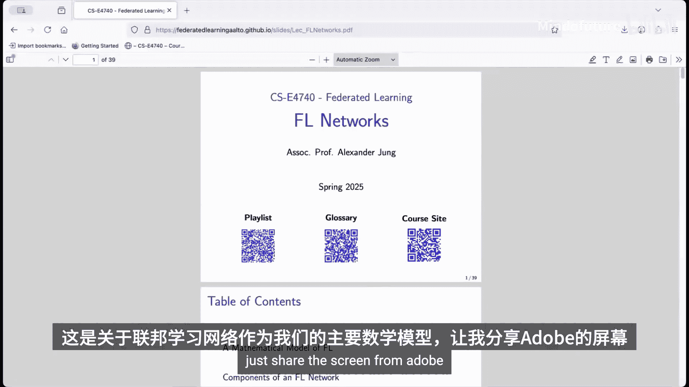
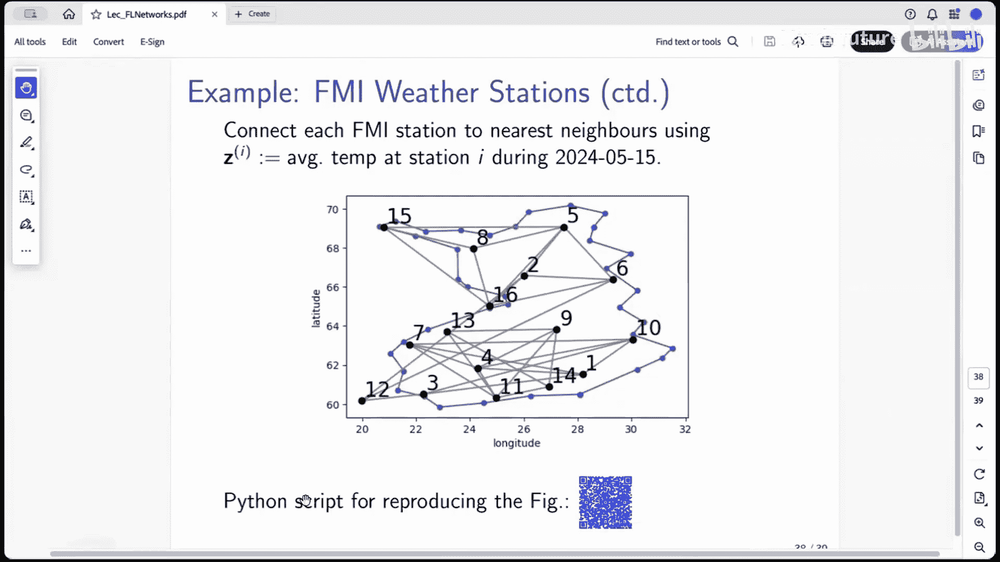

# 联邦学习：第2讲：联邦学习网络 🕸️

在本节课中，我们将学习联邦学习的核心数学模型——联邦学习网络。我们将了解其基本构成、如何用矩阵（特别是拉普拉斯矩阵）来分析网络结构，并探讨如何为一个实际应用选择合适的网络模型。

## 概述

联邦学习网络是一个数学模型，用于抽象和表示一个由多个设备（节点）组成的联邦学习系统。每个设备拥有自己的本地数据和机器学习模型，设备之间通过边（链接）进行连接和通信。这个模型忽略了硬件、通信协议等底层细节，使我们能够专注于算法层面的设计和分析。

## 联邦学习网络的构成

联邦学习网络可以定义为一个元组，包含以下几个核心组件：

### 1. 节点集合

节点集合 `𝒱` 代表系统中的设备，例如智能手机、传感器或服务器。我们通常用数字 `{1, 2, ..., n}` 来标识这些节点，其中 `n` 是设备的数量。

### 2. 本地模型

每个节点 `i ∈ 𝒱` 都关联一个**本地模型**。这个模型代表一个假设空间，即一组可能的预测函数。例如，一个节点可能使用线性回归模型，而另一个节点可能使用决策树模型。在联邦学习中，每个设备训练的是为其自身数据定制的个性化模型。

### 3. 损失函数

每个节点 `i` 还拥有自己的**损失函数** `L_i`，用于评估其本地模型的性能。不同节点可以使用不同的损失函数，例如，一个节点使用用于分类的交叉熵损失，而另一个节点使用用于回归的均方误差损失。

### 4. 边与权重

节点之间通过**无向边**连接。边 `(i, i')` 的存在及其权重 `a_{i,i'}` 具有双重含义：
*   **通信能力**：权重反映了两个节点之间通信链路的容量或比特率。
*   **统计相似性**：权重越大，表示两个节点所处理的学习任务或数据分布越相似。在训练过程中，算法会促使连接紧密的节点学习相似的模型。

## 网络的连通性与拉普拉斯矩阵

为了分析和设计联邦学习系统，我们需要工具来刻画网络的连通性。拉普拉斯矩阵是描述图结构的一个强大数学工具。

### 拉普拉斯矩阵的定义

对于一个具有 `n` 个节点和边权重 `a_{i,i'}` 的图，其拉普拉斯矩阵 `L` 是一个 `n × n` 的矩阵，定义如下：

*   非对角线元素 `(i, i')`：如果节点 `i` 和 `i'` 之间有边，则 `L_{i,i'} = -a_{i,i'}`，否则为 `0`。
*   对角线元素 `(i, i)`：`L_{i,i} = Σ_{i'≠i} a_{i,i'}`，即节点 `i` 的加权度（所有关联边权重之和）。

用公式表示为：
`L = D - A`
其中 `D` 是对角度矩阵，`A` 是邻接矩阵。

### 拉普拉斯矩阵的性质

拉普拉斯矩阵是对称且半正定的。它具有以下重要性质：
*   **二次型**：对于任意向量 `w ∈ R^n`，有 `w^T L w = (1/2) Σ_{i,i'} a_{i,i'} (w_i - w_{i'})^2`。这衡量了节点属性 `w` 沿着图中边的总变差。
*   **特征值**：拉普拉斯矩阵的特征值都是非负实数。特别地，**零特征值的数量等于图中连通分量的数量**。
*   **连通性**：当且仅当拉普拉斯矩阵的**第二小特征值（代数连通度）大于零**时，图是连通的。

这些性质在谱图理论和后续的联邦学习算法分析中至关重要。

## 如何构建联邦学习网络

构建联邦学习网络是一个设计过程，需要将实际应用映射到数学模型。这通常是最具挑战性的部分。以下是关键的设计选择：

### 1. 定义节点
确定网络中的每个节点代表什么物理或逻辑实体（例如，每部手机、每个气象站、每个地理区域）。

### 2. 选择本地模型和损失函数
根据每个节点的任务，为其分配合适的机器学习模型和损失函数。

### 3. 确定边连接
决定哪些节点之间应该存在边，以及如何设置边的权重。这需要权衡：
*   **通信成本**：更多的边意味着更多的消息传递和更高的计算开销。
*   **统计效益**：连接统计相似的节点可以汇集信息，可能训练出更准确的模型，但连接不相似的节点则可能干扰训练。

### 实例：气象站网络

假设我们要为芬兰气象局（FMI）的多个气象站构建一个联邦学习网络，以协作进行天气预报。

*   **节点**：每个气象站是一个节点。
*   **本地数据**：每个站点的历史温度、湿度等时间序列数据。
*   **连接策略**（两种可能）：
    1.  **基于地理距离**：连接每个站点与其地理位置最近的 `k` 个邻居。这假设地理位置相近的站点天气模式相似。
    2.  **基于数据相似性**：计算每个站点数据的平均温度，然后连接平均温度最接近的站点。这直接让数据本身决定连接关系。

这两种策略会产生结构迥异的网络，进而影响后续联邦学习算法的性能和效率。在你的项目报告中，需要清晰阐述你做出这些选择的理由。

## 总结

本节课我们一起学习了联邦学习网络这一核心数学模型。我们了解了它的四个基本构成部分：节点、本地模型、损失函数以及带权重的边。我们介绍了如何使用拉普拉斯矩阵来分析网络的连通性，并探讨了如何为一个实际应用（如气象站网络）设计和构建合适的联邦学习网络。记住，联邦学习网络是对现实世界的抽象，建模时的选择至关重要，它直接影响到算法的性能和实用性。

在下一讲中，我们将以此网络模型为基础，探讨如何将联邦学习问题形式化为一个基于广义总变差最小化的优化问题。