# 【阿尔托大学 - 中英】联邦学习 CS-E4740（Federated Learning，spring 2025） p22 P22 Federated Learning as an Electric Circuit -BV1cojRzDEfQ_p22-

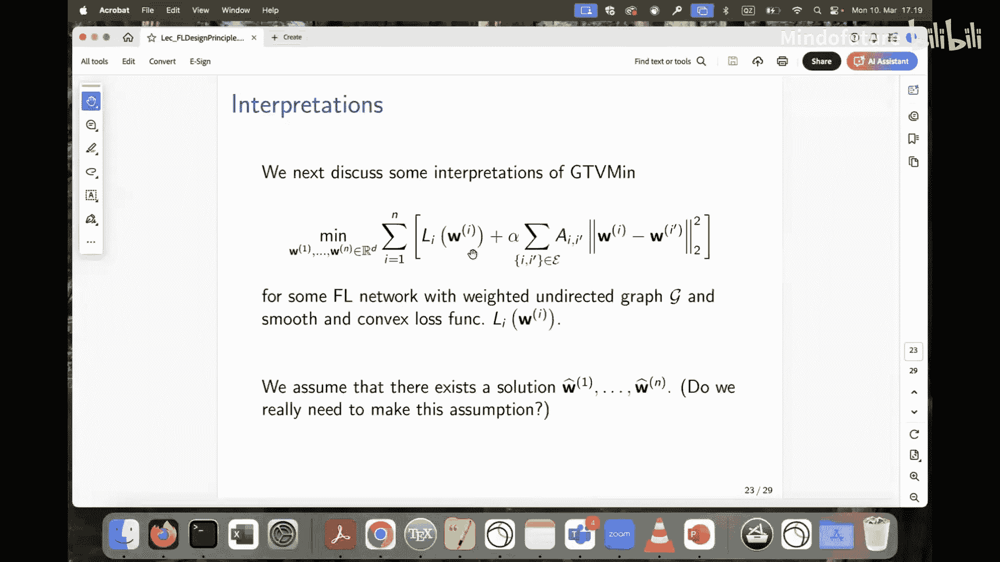

Okay， and for the under this assumption， we have， first of all a nice interpretation as electronic circuits so we can think of each edge in the federated learning network as a resistor。

 a resistor that is connected to to junctions that are under a certain potential。

 So the the local model parameters are like electronic potentials。

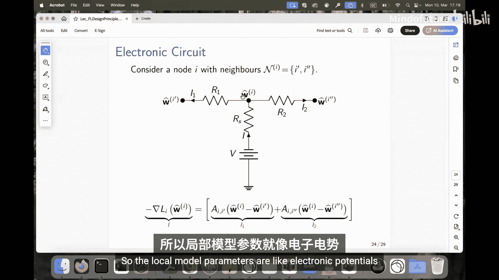

That drive a current， drive a current through the resistors。 And this current， the。

 the value of this current is given by the product of。

 of the edge weight and the difference between the local model parameters。

 So this difference between local model parameters is like a potential difference or voltage that drives a current an abstract current through a resistor。

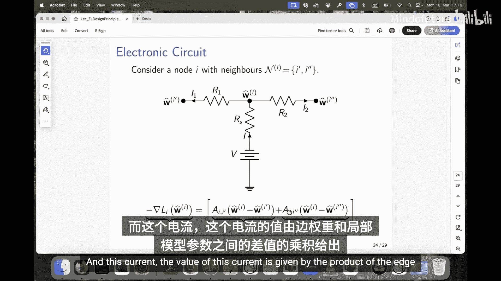

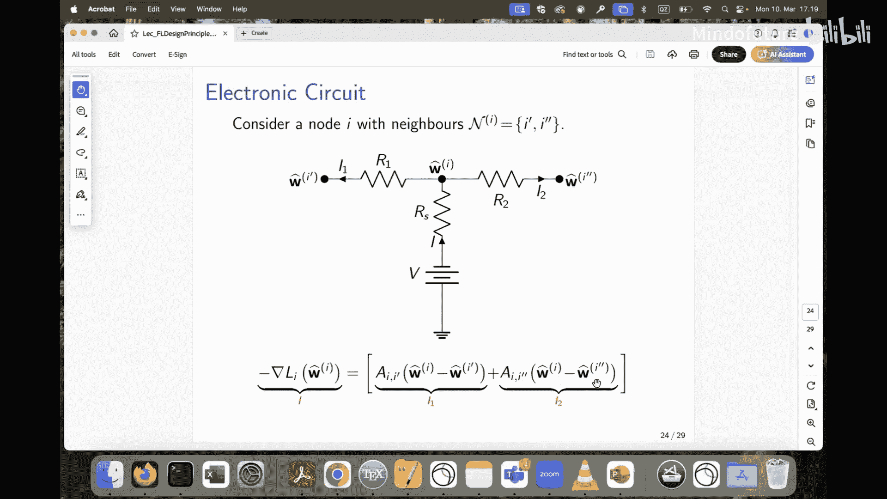

And then those of you who also had the privilege like me to learn about circuit theory a long time ago。

 in electrical engineering program， there is something called Kihovs laws。

 So there is something called the the conservation of current。

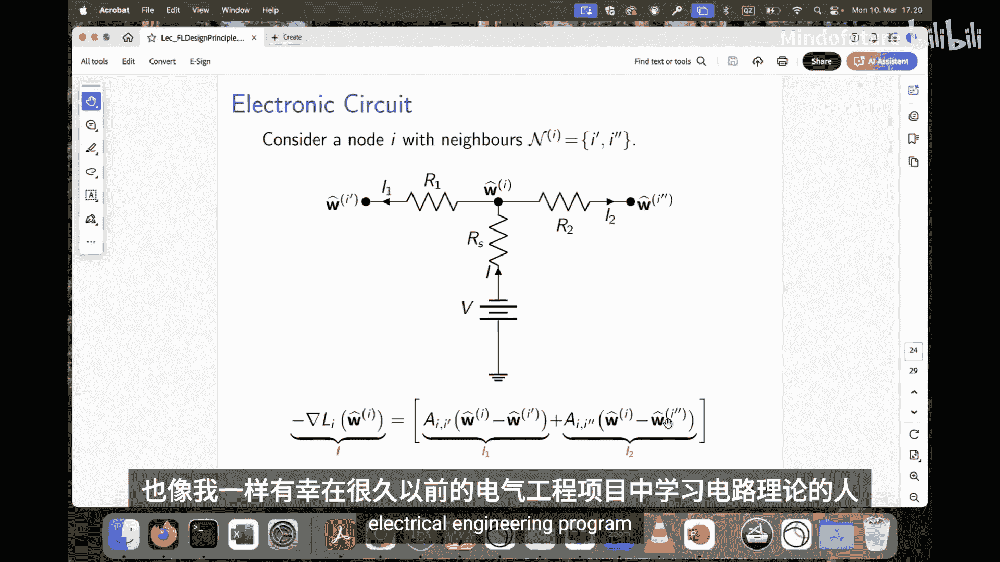

So whatever current that flows into a node here。Must be compensated。By a current， that is generated。

By a loss function。 So these loss functions or the gradients of the loss function， they。

 in some sense， generators that push currents， that drive currents into the circuit。

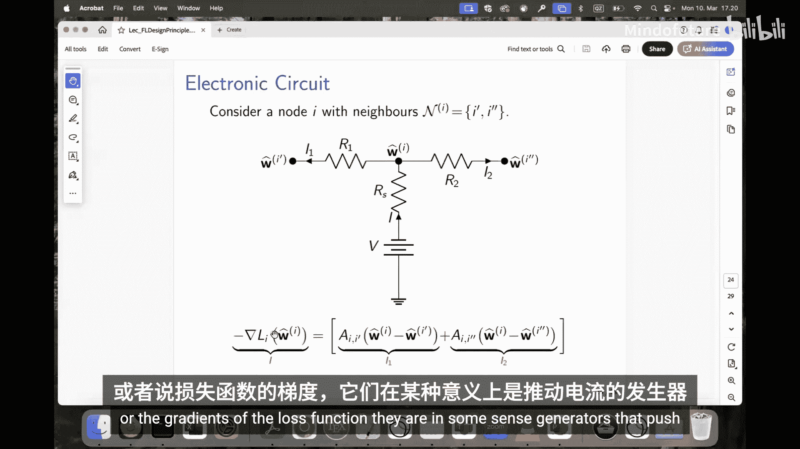

🤧嗯。Yeah， I find this a very nice， a very nice interpretation because of my background of electrical engineering。

😊。

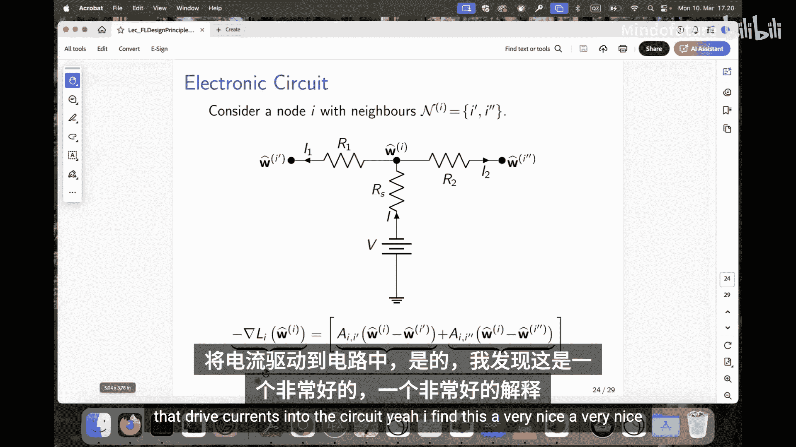

Before I rebranded myself as a machine learning expert。So why is this cool？ Does anyone have an idea。

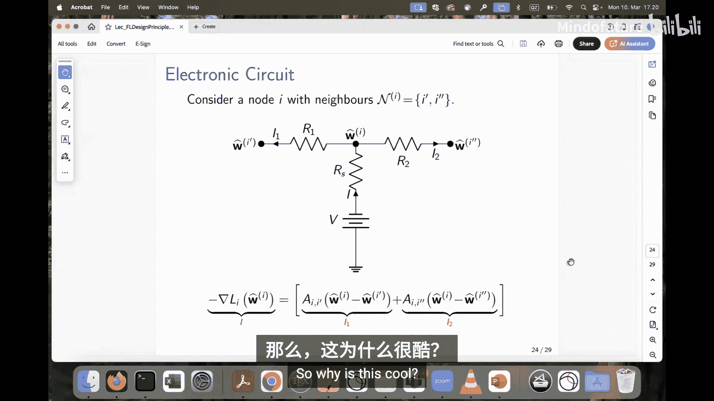

I mean， you could。 You could。

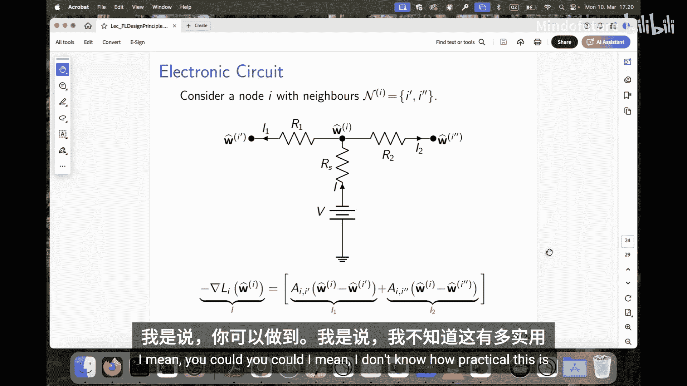

I mean， I don't know how practical this is， but you could solve GTV minimization by building an electric circuit with real resistors and voltage sources and then measure the potentials at each of these junctions and these potentials are the solutions of GTV minimization。

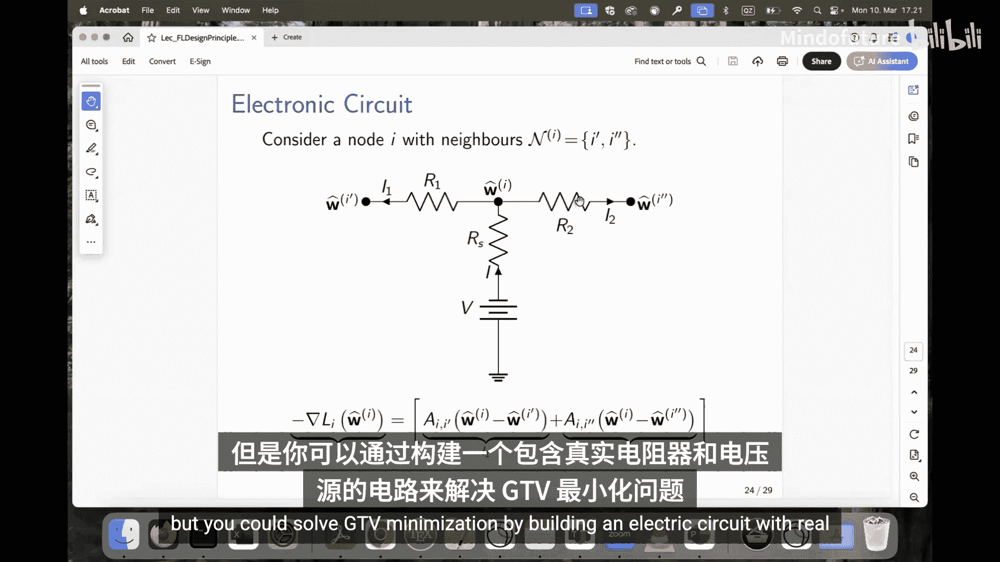

There， of course， some， some obstacles here， like， how do you implement vector valued potentials。

 but。

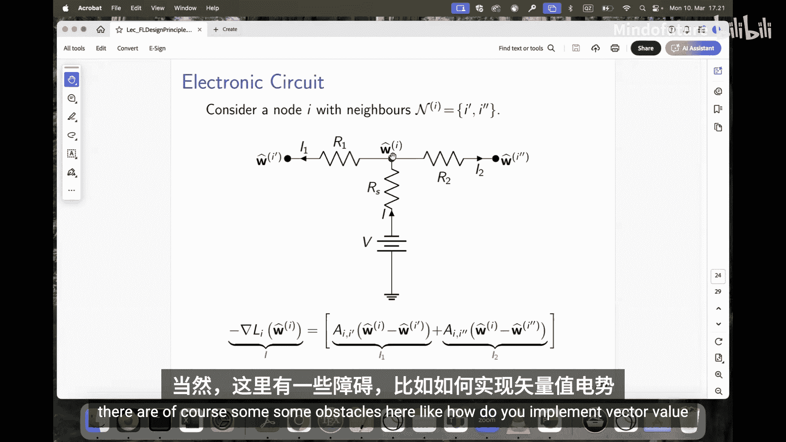

Maybe we can get around this。 So one way to solve optimization problems is to embody the problem as a physical system like a resistor network with voltages and then let the magic happen。

 So to say let the physical process swing in when you when you attach the when you attach the voltage source and at some point you will have here a steady。

 current and steady potentials。

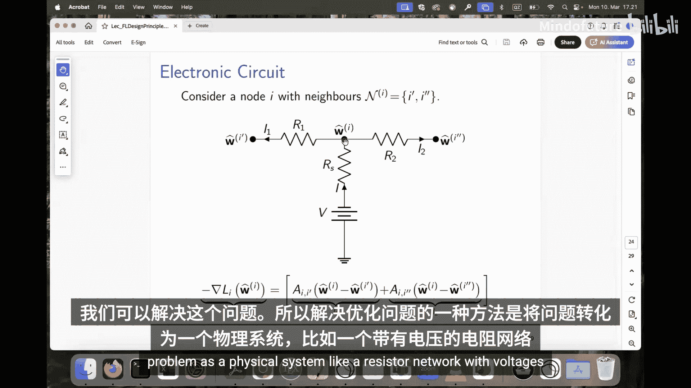

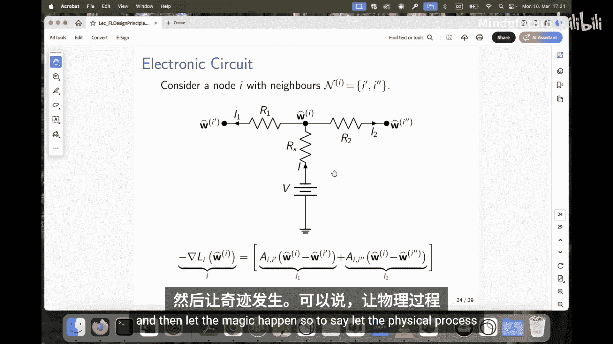

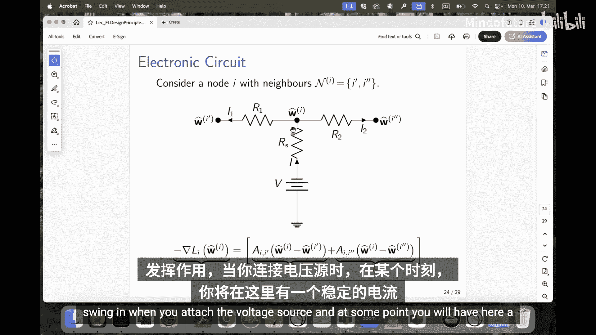

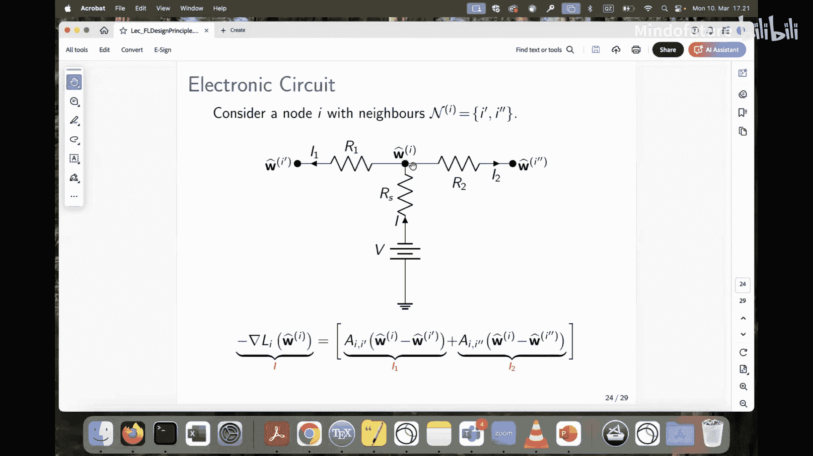

And these are the solutions of GTV minimizing。