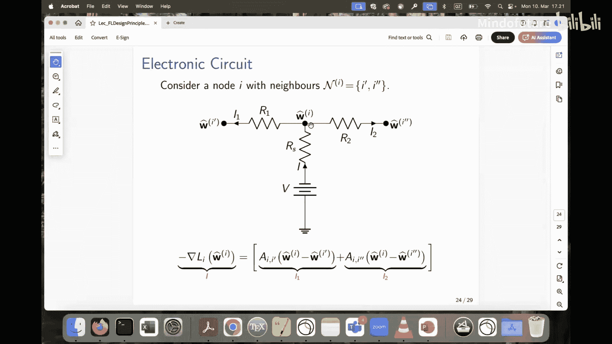
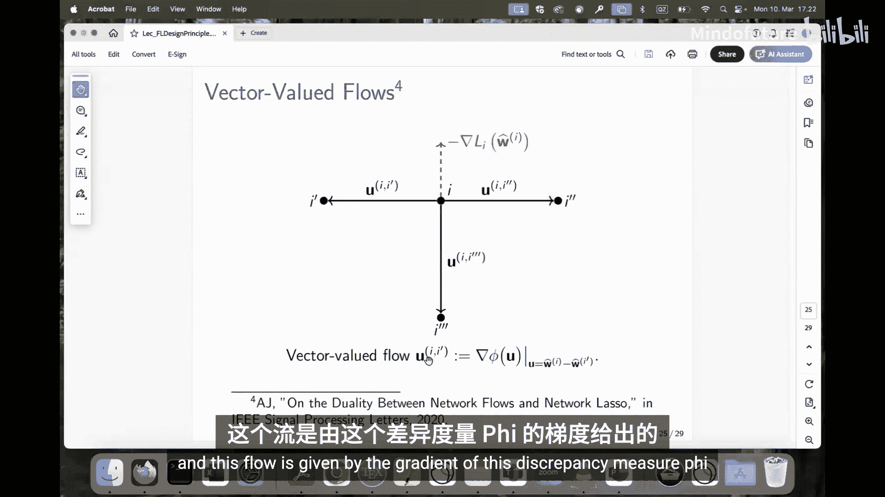
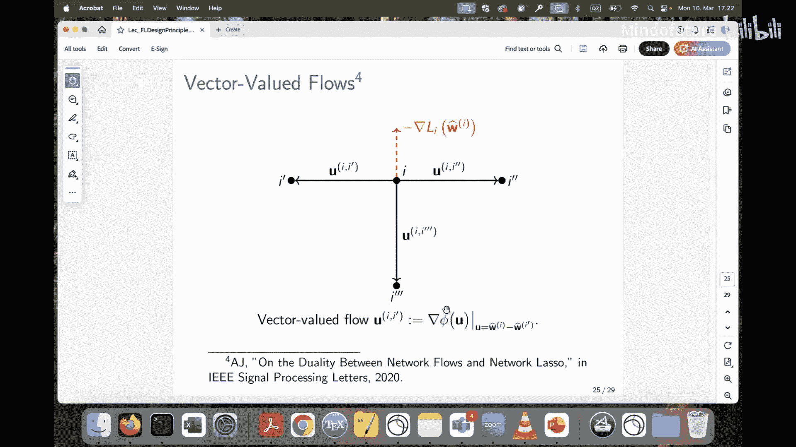
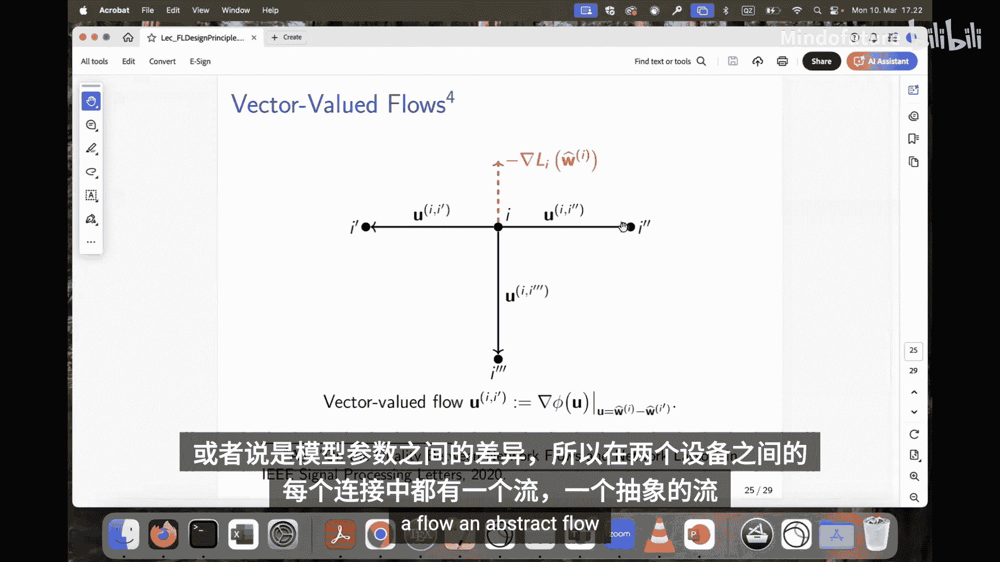
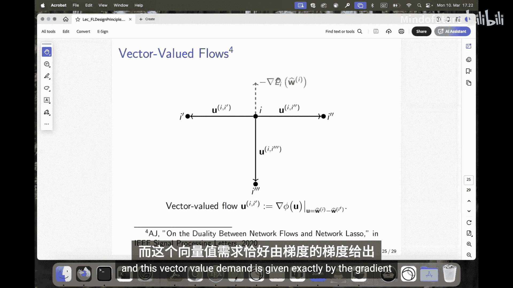
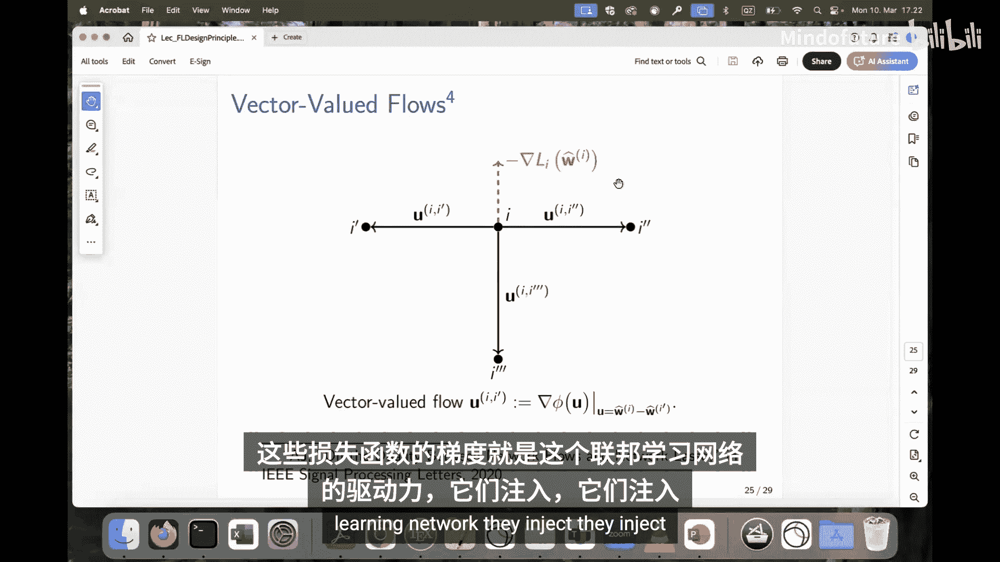
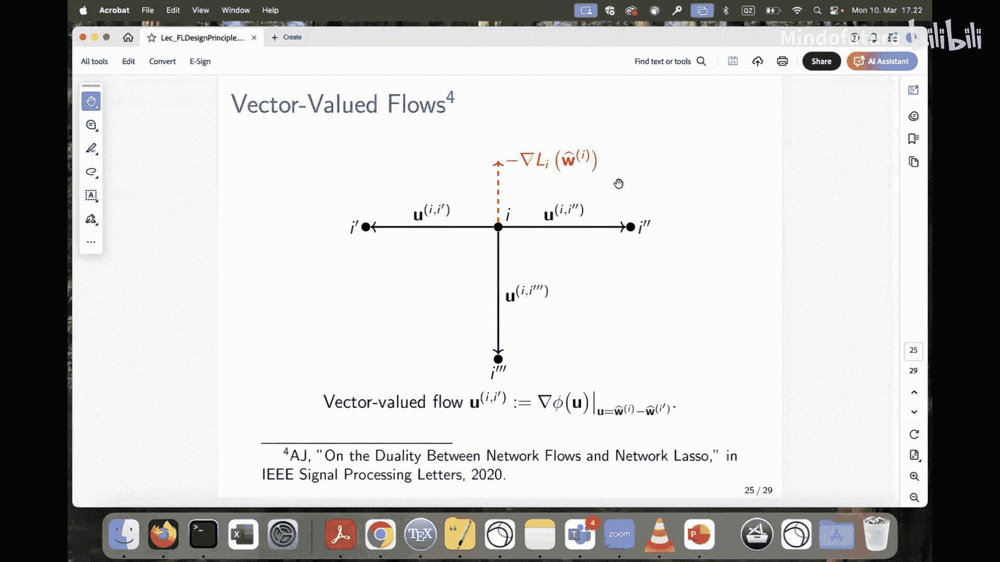

# 【阿尔托大学 - 中英】联邦学习 CS-E4740（Federated Learning，spring 2025） p23 P23 Federated Learning = A Flow of Vector Values! 🔁 -BV1cojRzDEfQ_p23-

ですに。

Okay， that was the first interpretation， another interpretation which is very much related is vectorvalued flows。

 so we can think of a federated learning network as a flow network and in each edge of this federated learning network there's a flow flowing and this flow is given by the gradient of this discrepancy measure 5。

Evaluated at the current potential difference or difference between model parameters。

 So in each link between two devices， there is a flow。

 an abstract flow and this flow this net flow going out of an node to the neighbors must be exactly covered by a source current or how do you call it a demand a demand。

 vector value demand and this vector value demand is given exactly by the gradient of the loss functions。

 and again， that this gradients of loss functions they are the drivers of this federated learning network。

 They in checked they in checked and absorb this flow or this current or abstract current that flows through the links of the federated learning network。

