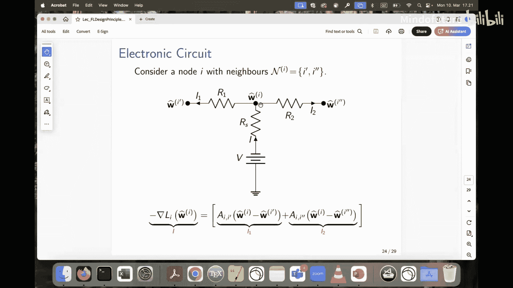
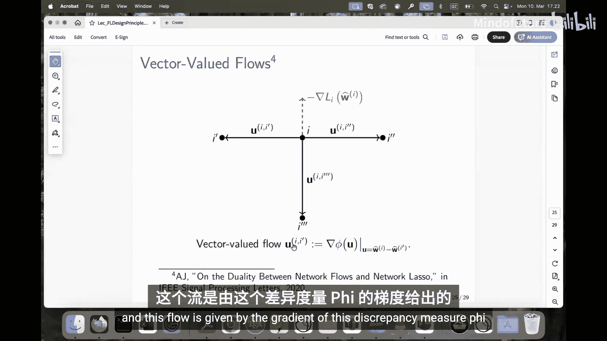
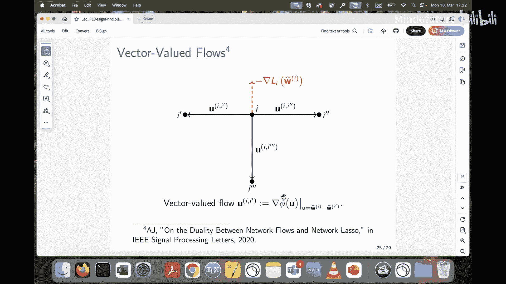
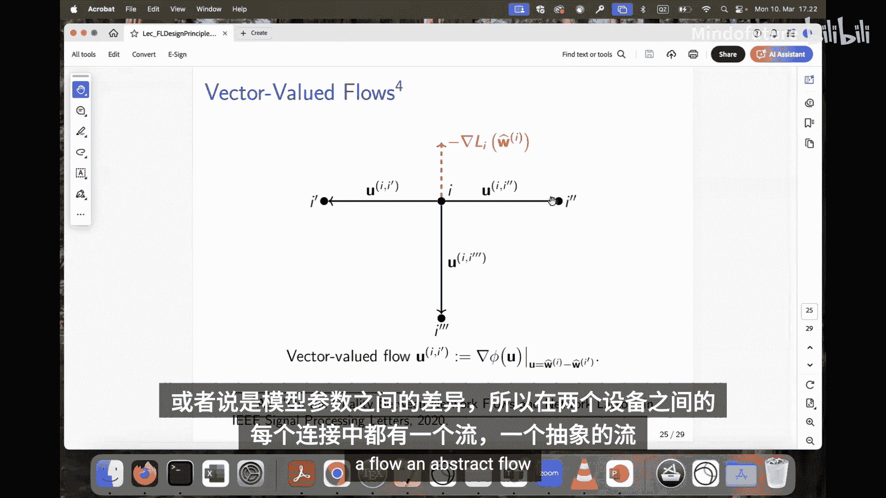
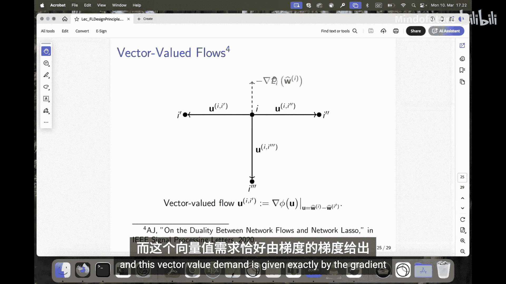
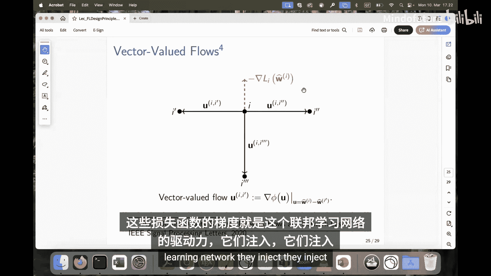
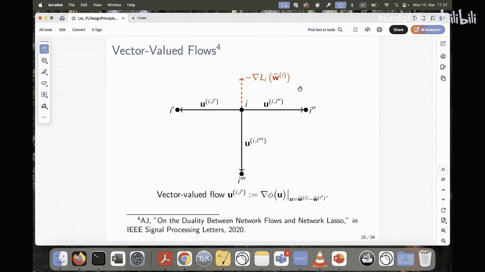

# 联邦学习 CS-E4740：P23：联邦学习 = 向量值流！🔁

在本节课中，我们将学习联邦学习的第二种重要解读视角：**向量值流网络**。我们将看到，联邦学习网络可以被建模为一个流网络，其中流动的不是物质或能量，而是**梯度向量**。

上一节我们介绍了联邦学习作为势能网络的解读。本节中，我们来看看一个与之紧密相关的视角：**向量值流**。

我们可以将联邦学习网络视为一个**流网络**。在这个网络的每一条边（即设备之间的连接）上，都有一个“流”在流动。这个流的具体数值，由**差异度量函数**在当前模型参数差值处的梯度给出。

用公式表示，设备 *i* 与设备 *j* 之间链路上的流为：
`F_ij = ∇Φ(θ_i - θ_j)`
其中，`Φ` 是差异度量函数，`θ_i` 和 `θ_j` 分别是设备 *i* 和 *j* 的模型参数。

在每个节点（设备）处，流向其所有邻居的**净流出量**，必须恰好由一个“源电流”或“需求”来平衡。这个需求是一个**向量值**的需求，它恰好由该设备上**损失函数的梯度**给出。

以下是关键点的总结：
*   网络中的流由模型参数差异的梯度驱动。
*   每个节点的净流出由该节点的本地损失函数梯度平衡。

也就是说，各个设备上损失函数的梯度，是整个联邦学习网络的**驱动力**。它们注入并吸收着流经联邦学习网络链路的抽象“电流”或“流”。

本节课中我们一起学习了联邦学习的“向量值流网络”模型。我们了解到，联邦学习过程可以形象地看作梯度向量在网络链路中流动，并由每个设备本地的损失梯度作为源或汇来驱动和平衡。这一视角将优化问题与网络流理论联系起来，为理解和分析联邦学习算法提供了有力的工具。