# 【阿尔托大学 - 中英】联邦学习 CS-E4740（Federated Learning，spring 2025） p26 P26 Measuring Discrepancy Between Personalized Models - A Simple Approach -BV1cojRzDEfQ_p26-

Okay， so how do we do it， how do we build a penalty and the ideas as follows？

So let's consider we have two nodes which represent two devices。

 So we have a node I and a node I prime。 These are two devices。

 let's say my smartphone and my friends， smartphone or my neighbors smartphone and the neighbor and me we collect our own data like activity logs from our exercises。

 So we each of us collect data。 And then each of us wants to train a model， a fitness advisor app。

 let's say， but we somehow want to agree on on a few certain things。 So I know， for example。

 that my neighbor is similar to me and that we don't like to do running when it rains。

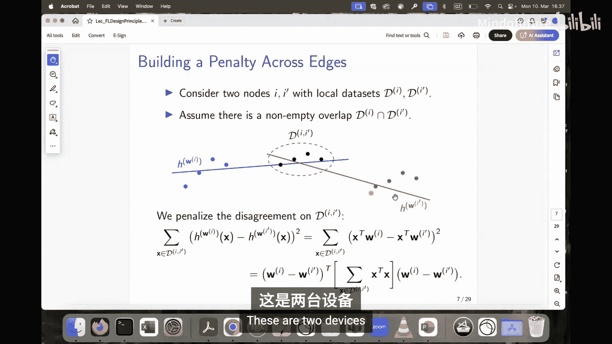

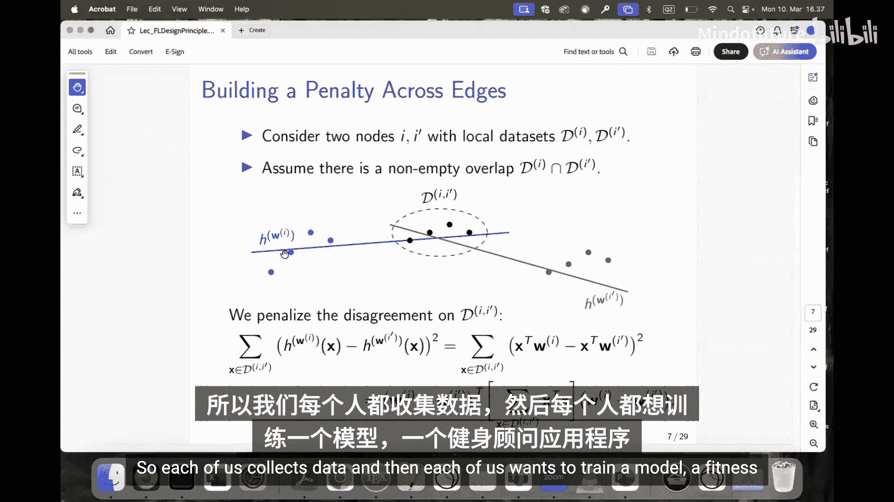

And this kind of agreement we can implement by forcing the trained models。

 So I have a trained model here for me for I and node I and the trained model。

 this red curve for node I prime to agree on a test set。

And this test set could be carefully selected reference days。 So like specific days in the past。

 where there were specific weather conditions and where we， we both agree what to do。

 Let's say there was one day where it was 35 degrees。 So we both decided to go swimming。And this。

 we can enforce by making this discrepancy of these two hypotheses on the test set small。

That's the main idea behind all the methods that we will learn in this course。

And but we can use different ways to measure the discrepancy like like the loss function for machine learning methods。

 also the measure， the discrepancy measure here， how you measure this discrepancy in detail is a design choice and one of these design choices is the squared error loss so we can compare the predictions of these two models on the test set。

 this gives us predicted values or let's call them pseudo labels and we compute the squared error loss。

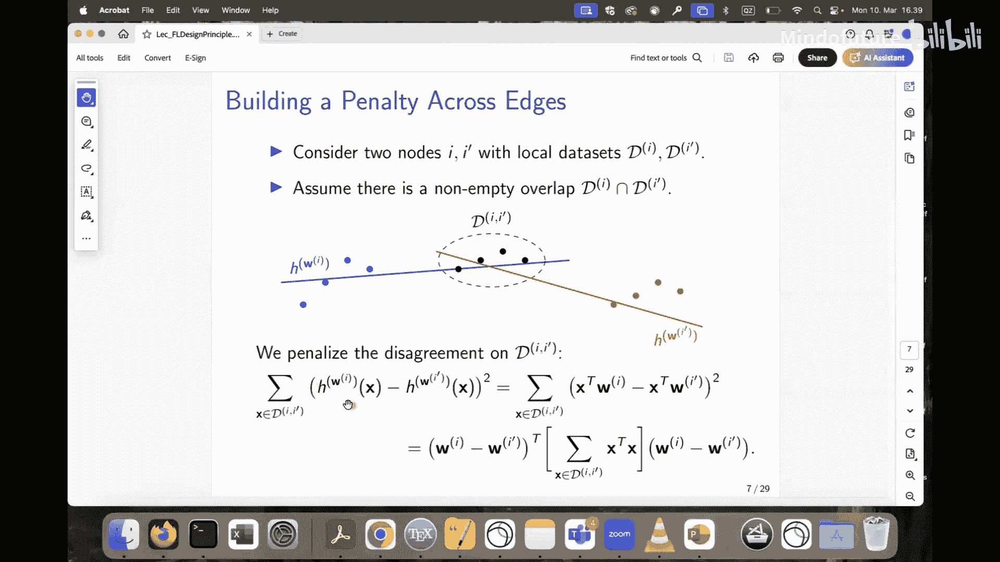

Between those two。 And this gives us a measure for the disagreement of the trained model at nodede I and node I prime。

What else could we use to measure the discrepancy， Well， if this。

 if these models are not regression models so they don't deliver numeric quantities。

 but they deliver labels or categories， then we， then there's square error loss is typically not good choice。

 And we could use something like the cross entropy。So whatever you。

 you know from basic machine learning methods as possible loss function。

 you could also use for this discrepancy measure。

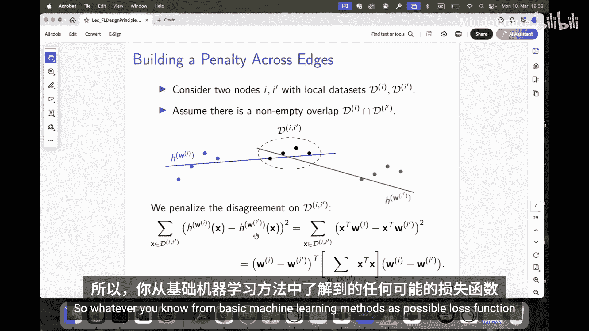

Yeah， I would like to point out that this test set。

 this test set on which we compare those two models， this can be different for， for different edges。

 So this test set。Is tailored to a pair of nodes。 So this test set is only used for node I and I prime and for another pair of nodes for another edge in our federated learning graph。

 federated learning network。 we might use another test set。

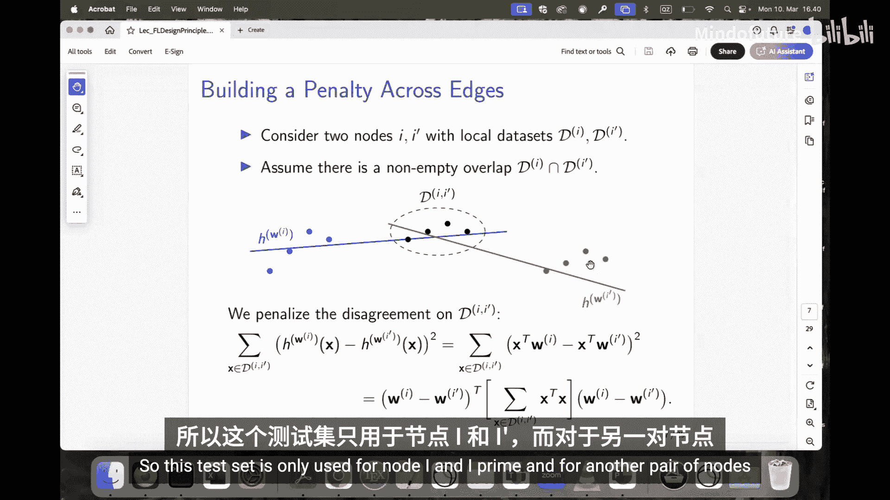

So we can tailor this test set to the edges in the network。And also this tested， in some sense。

 or is a design choice。That， for example， you can try out in your federated learning project。

 You can try out different constructions of these test sets。

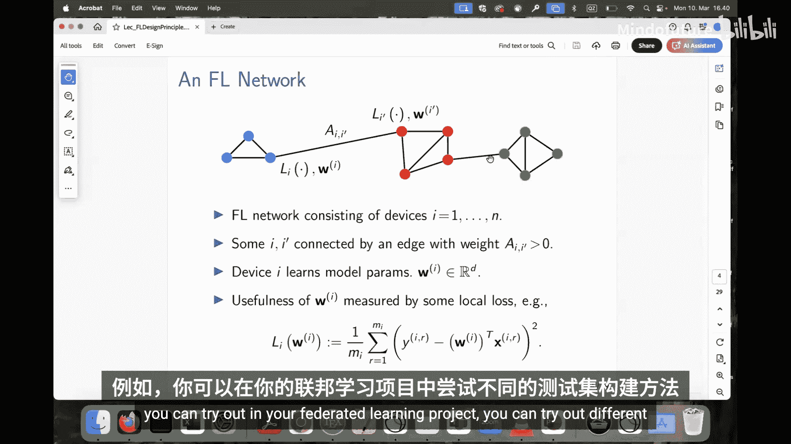

Does any of you have have some intuition or some idea how to build such a test set between two nodes in a federated learning network。

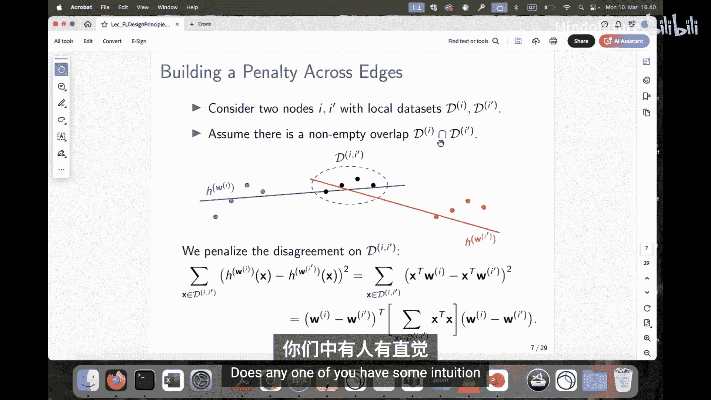

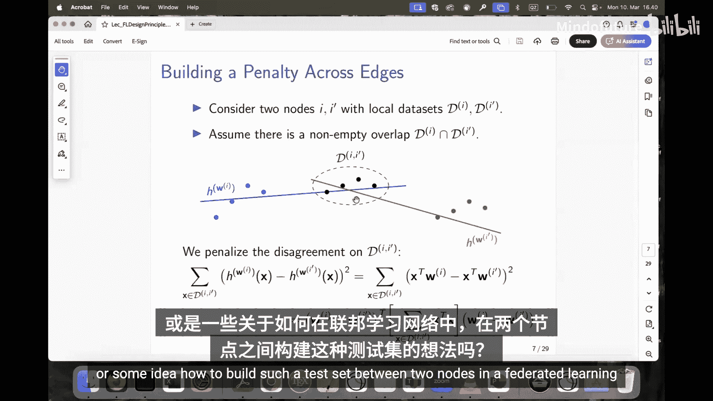

So let's say you have two nodes。 Let's say this is one node and this one node carries a local data set。

 And then this， this other node carries another local data set like this red dots here。 So how。

 how could you build a test set that somehow compares those two nodes。

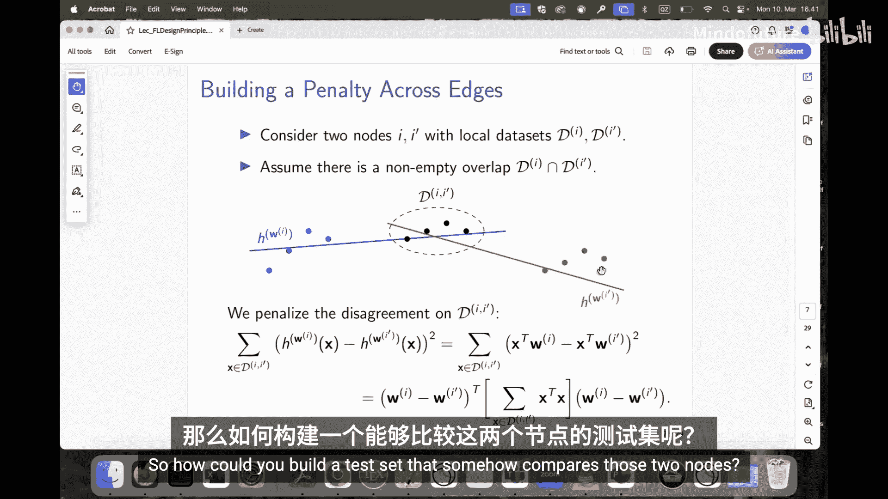

What would be a natural choice or what would be your intuition？Yeah。

 let's assume they can communicate so they can arrange whatever they want。

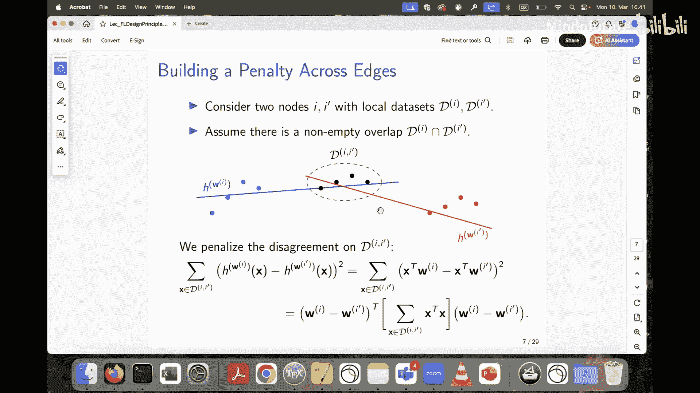

they overlap。 So yeah， so this test set could be built from from subsets of these local data sets。

 So for example， you could say I built this test set by randomly selecting 10% of this data and randomly selecting 10% of that data and put them together into a test set or you could say you pick those data points from this data that have very close neighbors in that data。

 So in some sense， they overlap。

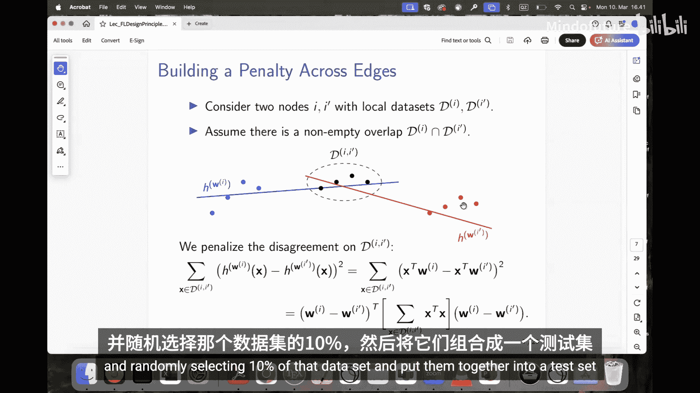

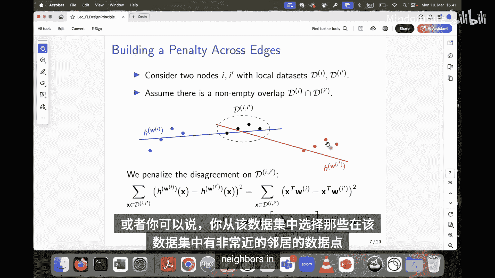

Another， another option could be， let's say these local data sets are for a classification problem where you want to classify each data point here。

 Each dot is an image， and you want to classify it into cat and dog。And similar here。

 So here you also have a cat dog classification data set。 And then you could say you。

 you construct this。This tested by randomly generating cat images and dog images。

 So this is something that can be very specific for your application。How， how you construct this。

 this test dataset set。Okay， any questions at this point。

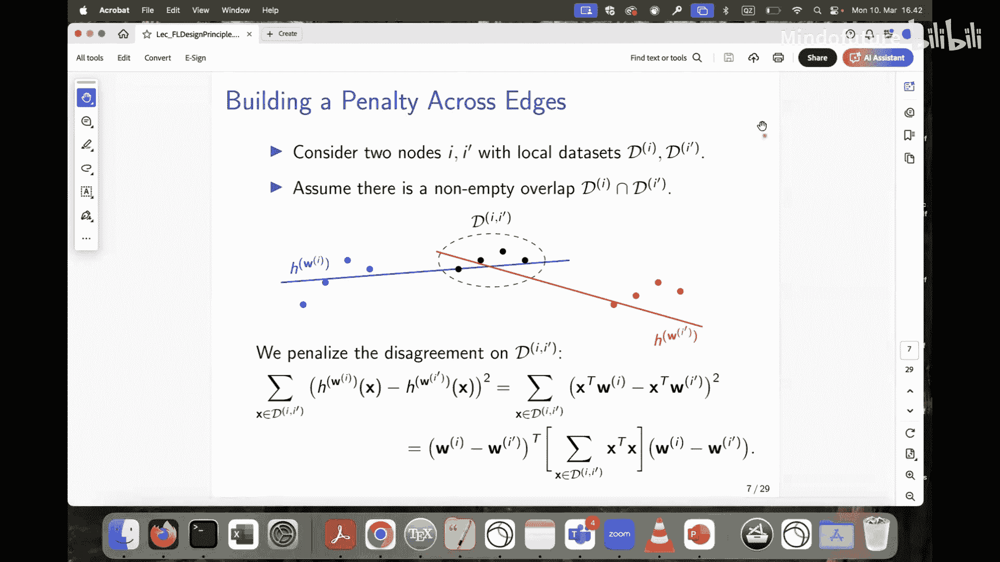

There was a good question why， why is the third way to focus the focus of this course。

 so why do I focus on this penalty term perspective。

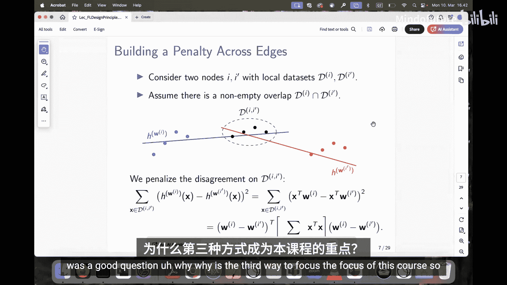

And that's a very good question。 I mean， the first answer is because it's close to my current research。

 So I know the most about this， about this approach。

 but I don't dare to say that this is the best way to do it。And， I welcome you to， to， for example。

 in the paper review， pick a paper that uses a different approach。

Let's say using somehow data augmentation in a privacy friendly way。

 and you are very welcome in your paper review to then contrast this approach with this penalty term approach in in the course and tell what is better。

 what is worse。

嗯。O。Yes。Yeah。

The a good question so the question is how do you how can we build a test set or how can we construct this test set without leaking private information from the local test set one naive way is that you somehow randomly generate one test set and every pair of nodes uses it so you completely randomly generate this test another option could be you estimate somehow the distribution of the local data sets and then from this estimate of the distribution you draw random samples。

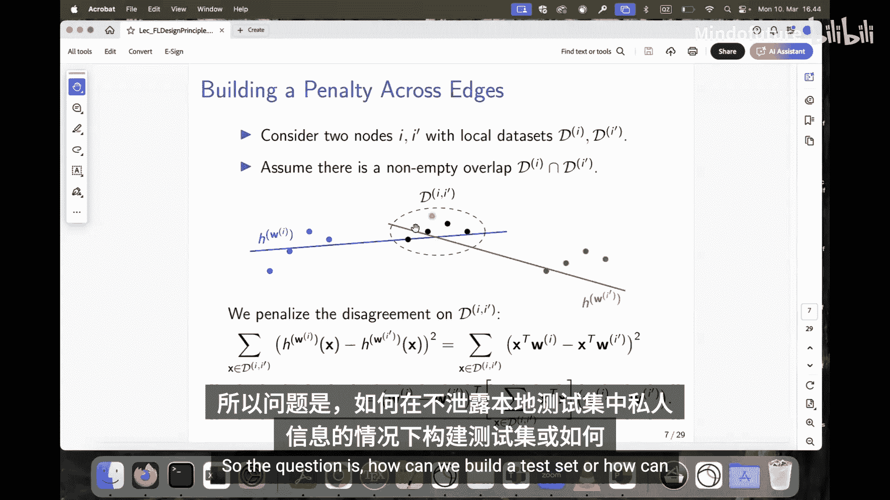

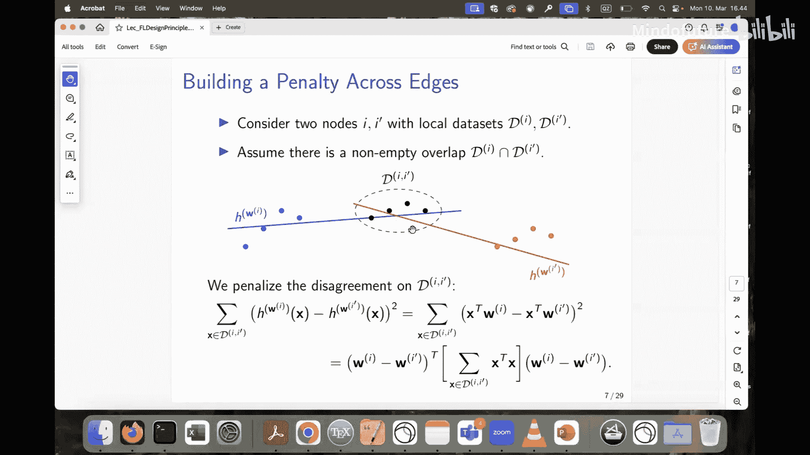

This could be a way to， to generate this tested in a， in a privacy friendly way。 Yeah。

 so sharing chunks or sharing 10% of the raw data points here might be not privacy friendly。

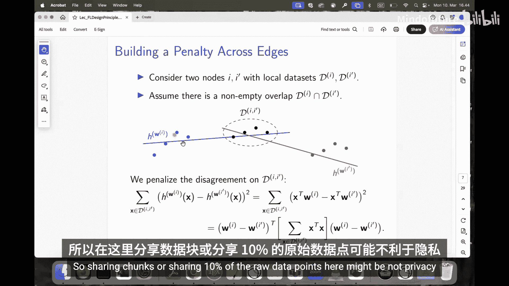

Very good point。Yeah， this was now also asked in the。In the。Chat， yeah， so this。

 what I first mentioned， this simple idea of， of taking 10% of this data points。

 this data set and 10% of this data set and then combining it to make to produce a test set might be not privacy friendly。

 So instead， you could estimate the distribution of this data set and estimate the distribution of this dataset set and then randomly sample。

Realizations from these distributions， so this would be a more privacy， friendly way。Okay。

As one comment， each node can send the final local weights to the other node and the target node can calculate the loss of those weights over its subset of data and send it back。

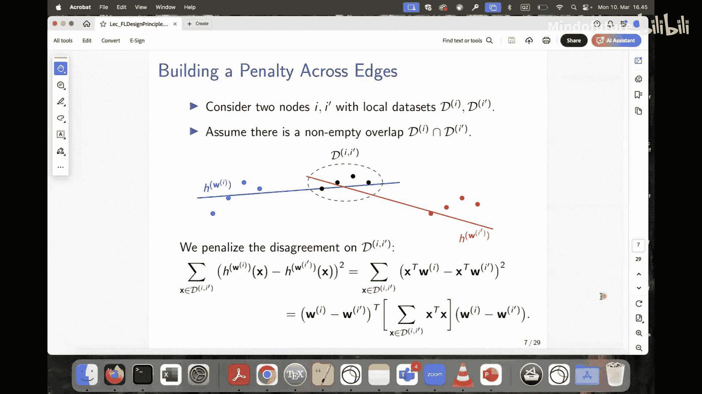

Yes， so you， you don't need to。 Yeah， so。This is just a visualization of this。

 of this construction process。 I mean， you don't need to really share raw data。 You。

 You only need to share predictions。Of， of this model， for example。

 of the red model on the test set and sharing these predictions。

 only sharing these predictions might not be a privacy， too much privacy unfriendly。Okay。

 but this is an already in very detailed discussion。 So let me now move on and yeah。

 just point out that when you work out this， for this simple case， this disagreement measure。

And let's say we， we use linear models。 So we use linear models at each of these two devices of these nodes。

When we insert the， the formula law for the linear model。

 we get the following expression for the disagreement。

And this is quite nice because this expression is a generalized norm。So this is or a squared norm。

 If this in the middle， this matrix would be identity， Then we would have here。 we would have。

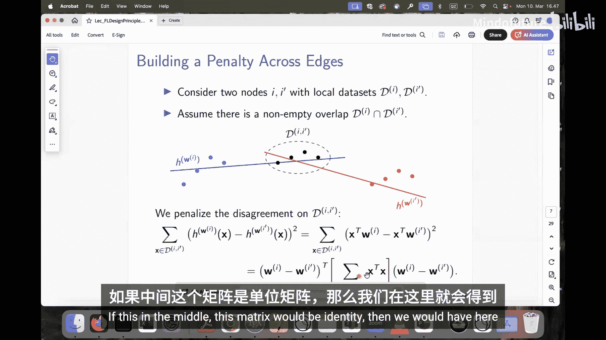

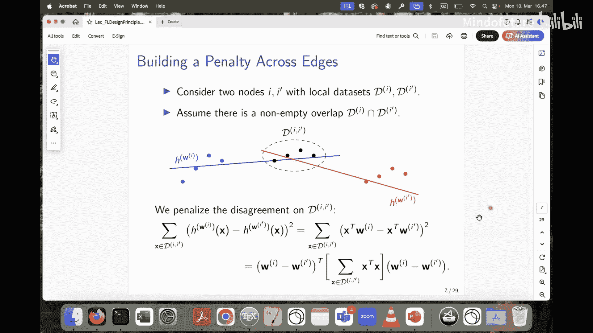

Oh。We would if this would be identified， then what we see here would be exactly the squared Euclidean norm。

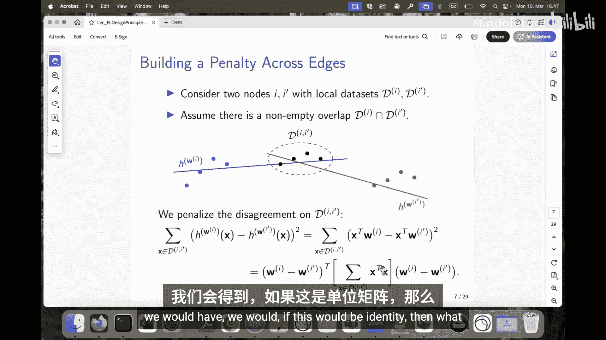

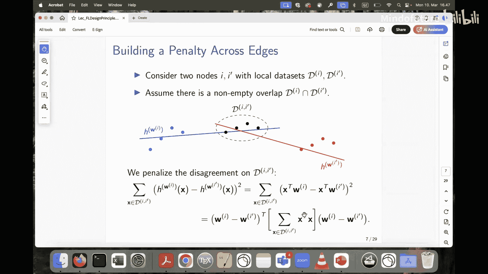

But instead of of the square Euclidean norm， we have there here this matrix， which is some。

Positive semi defite matrix that defines the。The a generalized squared norm。

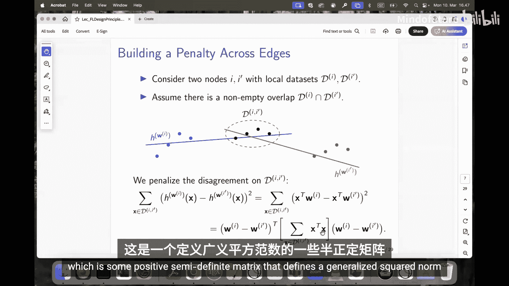