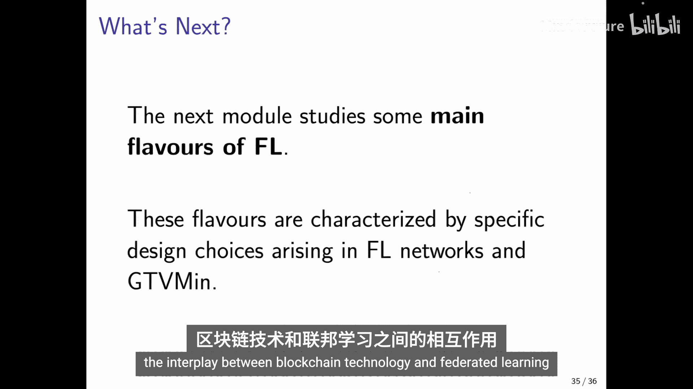
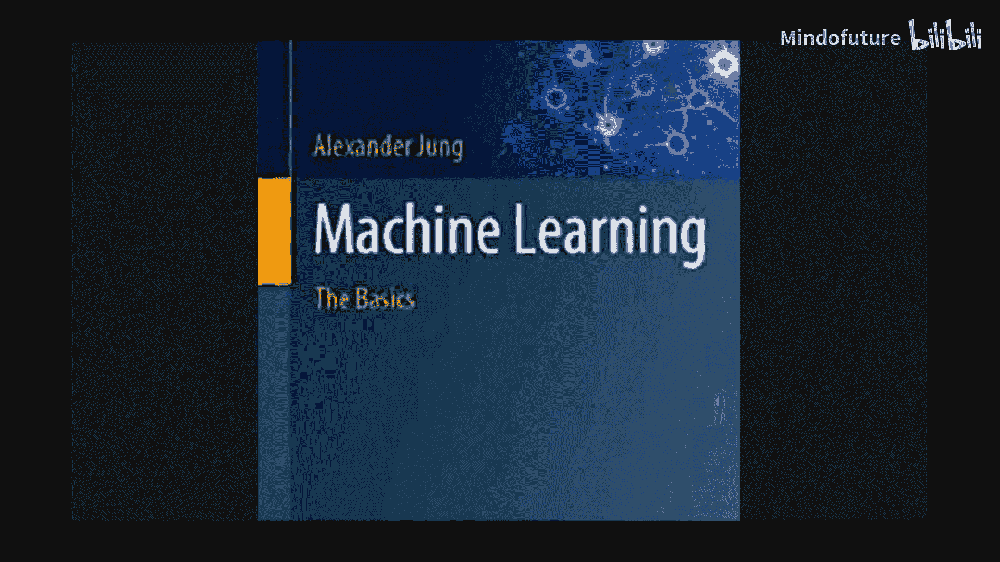

# 【阿尔托大学 - 中英】联邦学习 CS-E4740（Federated Learning，spring 2025） p30 P30 CS-E4740 Lecture FL Algorithms -BV1cojRzDEfQ_p30-

Just to recap， we， we use networks， federated learning networks in particular。

 to model federated learning applications。 So a federated learning network consists of nodes。

 Here have three blue nodes and three four red nodes that represent devices。

 So each of these nodes could be a smartphone could be a laptop could be a supercomputer。

We don't really restrict the， the， the actual physical device or the type of physical device。

 We just represented by a node in a network。 And some of these nodes are connected by an。

Ege or a link that also has an edge weight。 And this edge weights has serves two purposes。

 First of all， we use it to communicate intermediate results within these federated learning algorithms between those nodes。

 So there should be some form of there should be some means of communication between two nodes。

 If they are connected by an edge。And we use the edges to couple the models or the model training at the connected nodes so that the the nodes that are connected by an edge have somewhat similar models。

 So this is two， the two sides of an edge， the computational side， which is we。

 we share intermediate results over that edge。 So we need to communicate somehow。

 We need some means to communicate。 And theres the statistical side of an edge。

 It couples the model training at the nodes that are connected by this edge。Okay。

 and based on this federative learning network， we set up a learning problem in the in the form of an optimization problem。

 So this is the the ominous design principle that I am talking about the whole time。

 The design principle is this optimization problem。

 So this is one one special case of this optimization problem。

 which are called a generalized total variation minim。

 And this instance is formulated for parametermetric models。

 So here we have a model parameters at each node。 So we have a separate set of of parameters for each node I node I equal1 has another set of parameters than node I equal2 and so on and so forth。

So this means we train， we train separate models or personalized models for each node。

But this model training is coupled。 And how do we couple it， Well we require。These model parameters。

To to have a small variation and the variation， there are different ways to measure variation。

 So this is， in a sense， a design choice。 And one way to measure this variation is to use the squared Euclidean norm between the model parameter differences all across an edge。

 So we have one such term for every edge in the。In the federated learning network。

 So if we have more edges， we have more of these terms。 This sum here consists of more components。

 which somehow means more computation。 So more edges means more computation。Yeah。

 it's a special case。 When we choose alpha here is regularization parameter equal to 0。

 that the coupling， the coupling disappears。And we have。

 we minimize essentially each local loss function separately。

 So we individually train personalized models only on the individual local data sets。

Is this all is this always a bad idea or is it could it be sometimes that is actually a good choice to use alpha equals 0。

 So to completely get skip this coupling over the edges。

 Could you think of an of a scenario or a setting where the best way to train these models is just independently or separately train the local models。

Any comments of the chat， please use the chat。If you have a comment。What a suggestion。

Or put another way， why do we mess around with having this coupling term here。

 Why do we want to couple the model training。嗯。Why do we want the the nodes or some of the nodes to have similar trained models。

我没。Yes， there's some question。What， what is the difference between alpha。

 What is the difference between alpha and。The edge weights， Very good question。 So the question was。

 what is the difference between this alpha here and the edge weights， this a subscript I， I prime。

 this alpha， you can think of this alpha as a global scaling factor。So by alpha。

 we can make all edge weights larger in the same manner。But， of course。

 you could also always define alpha equal to1， fix it。

 and then use different choices for the edge weights。So it's just of。

 a bit of a notational convenience。Okay， there were some comments on the chat。 Yeah。

 we want to learn from neighbors。 We want to couple。 We want to pull information from the neighbors。

 That's why we we want to couple the training of the local models。

Another comment when the edge devices have large sample size and when they are very heterogeneous。

 Yeah， when， when the， the edge devices。 So each device I here has a large local data set such that this loss function is a good。

 a good learning objective。 So we will not run into overfitting。

 then it might be the best to train separately each model on its own local dataset and don't worry at all about this coupling。

Okay， but this might be too good to be true。 So often we we we or in many applications。

 we do not have sufficiently large local data sets。 So we we need to pool it somehow。

 Think of of this toy example that I mentioned already where you want to train a very non nonlinear high dimensionional neural network to tell you what is the best activity tomorrow。

 So for this， you would need to collect a lot of a lot of training data。

 which you typically do not generate yourself。 But when you collect or pool the data of 10000 other athletes or hobby athletes。

 you might have enough training data。Yes。😊，Yes。Yes， exactly。 So this alpha。

 this studio parameter alpha determines how much we allow the models to。

 to be independent to personalize the or to have personalized models。

 When alpha is very large or sufficiently large。 and it you can show that the solutions of this optimization problem。

 they are model parameters that are approximately identical at。

 at the nodes of all connected components of the network。 So if the network is connected。Then。

 and you choose alpha very large。Then the solutions of this G TVV minimization is actually approximately constant model parameters for each node。

 And this， for example， could be useful because in some applications， you want to train。

 you want to have the same model for all notes。 This is one of the federated learning flavors。

 I will talk about next week。 You want to have one global model。

 but you want to train it in a distributed fashion。Using local data sets。

 And one way to do it without any server client architecture is to use G TD minimization with a sufficiently large alpha by choosing alpha very large。

 The solutions of this optimization problem that you can solve using distributed optimization methods。

Is approximately constant for all nodes。Yeah， there's a comment on the chat。 Alpha is or a question。

 Alpha is a learning parameter。 you can think of alpha as a hyperparameter of this GTV minimization。

 yes。So you might， you might choose it via cross validation techniques。Yeah。

 somebody raised their hand。 please ask questions on the chat。There's another question。

 Why should w be similar to W prime So yeah， because when you choose alpha very large in order to minimize this objective function。

 you must use local model parameters that do not change too much across edges and if you have an edge between any any possible pair or if you have let's say if each two nodes are connected by a path of edges。

You can show iterativeively or inductively that they must be close to each other because there cannot be a large variation across any of the edges within the path that connects two nodes。

Okay， so I'll let you now post more questions in the meanwhile。 Let me continue。

 So the goals for today or the learning goals as follows。 So after completing this module。

 which also includes the assignment。You should be able or you should know how federated learning algorithms are obtained as from gradient descent。

 So one principled approach to design federated learning algorithms is just to apply gradient descent to GTV minimization。

Then you should know how to implement these gradient decent steps using message passing。

You will also know how to generalize gradient descent。

 which by definition only applies to parametric models because you need to be able to compute the gradient。

 But how what do you do if you don't have a parametric models。 So when you have nonparmetric models。

 there arepars anymore and you cannot compute the gradient anymore any longer。

 So we will see how we can generalize the gradient step to something similar for non-parmetric models。

And finally， we will discuss the important notion of asynchronous algorithms。

 So we will see algorithms that， that can run。By message passing。

 using nodes that work in a different speed。 So there are some nodes that update a lot。

 Other nodes update very little or almost never。 But still， overall。

 this algorithm is able to converge at some point。 So this is then called an asynchronous algorithm。

 And we will see a little a simple model of mathematical model for this asynchronous algorithms。Okay。

 so to start just here show the the gradient step this is just plain gradient descent for GTV minimization。

 So you you， you， you look at this optimization problem as a smooth。 So you。

 we assume that this loss function is smooth， differentiable loss function。

So we can compute gradients。 And as soon as you can compute the gradient of these loss functions。

 you can compute the gradient of the whole objective function because the second term here is by construction。

 always smooth。And， and when you work out the gradient， you obtain an expression like this。

 So using basics calculus。And yeah， once you have the gradient， you can do a gradient step。 So we。

 we use the gradient。Using the current， the current choice of model parameters of local model parameters to update the current model parameter at at some node I。

 So this is one， one part of this gradient step。 The the whole gradient step consists of parallel updates like this for all node。

 So this update step here is applied synchronously or simultaneously to all nodes in the network。

And when you work out the gradient step like this， you， you get a nice interpretation here。

Which is based on two terms。 So we have this term here， the gradient of the local loss function。

 which means you want to， you want to push the， the current choice。

 or you want to change the current choice for this local model parameter more towards the minimum of this local loss function。

 So this is natural。 So this term drives or tries to push the local model parameter at node I towards the minimum local minimum of the loss function at node I。

 So this is， this is very much the， the basic idea of any machine learning。

Choose a model parameter to make the loss minimum， to minimize the loss。So so far so good。

 why could this be not enough。This principle， well。

 this loss function might not carry sufficient information， Sta information。

 because it might be computed from a too， too small sample size。

 So just minimizing this loss function is not sufficient or is not doesn't provide sufficient information。

To avoid overfitting。 So here， then when the second term kicks in， this helps us to。

 or this provides more information。 In particular， this provides information from the neighbors。

 So the second term ensures that you learn model parameters that are not too much too different from the neighbors model parameters。

 So this second term here drives the agreement of， of local model parameters over well connected nodes in the network。

 And in some sense， here， this term。Is equivalent to， to pooling local data sets from the neighbors。

But in a privacy friendly way。 So instead of of having node I asking all its neighbors。

 So the set of neighbors is this calligraphic n superscript I。

 this is the set of neighbors of node I， instead of pooling all the local data sets at these neighbors to help node I to get a better gradient step。

 we use this term here， we use this coupling term which involves only the local model parameters。

 So the only thing we share between neighbors are the model the current model parameters。And。

 of course， these typically carry information about the local data。 So you will have in inevitably。

 you inevitably， you will have a leakage of information。 But often you can。

 you can choose this model parameters or this model parameters don't leak too much information about specific。

 very specific properties of the local data。 for example。

 a local data containing healthcare information， my healthcare information and my latest blood pressure values。

 So this is one very small aspect of a local data。That is。has a tiny little bit of influence。

 or might have have a a tiny little bit of influence on these model parameters， but not too much。

So here， here， this second term is that， the privacy friendly way to share information among neighbors in this federated learning network。

Okay， and yeah this， this term here is alpha。This alpha times the edge weight。

 This steers the balance or provides the trade off between these two effects。

 So if alpha times the edge weight is very small。 So here is actually a typo。 This should be。A。

 I prime。If this product here is very small， then there is little coordination or cooperation between neighbors and it's mainly this federated learning algorithm mainly does independent model training for each node。

And the larger you make this alpha， the larger you choose the alpha。

 the more you couple the training on on over neighbors or at neighboring nodes。 And at some point。

 when you choose alpha very， very large， the second term here dominates and ensures that you end up with the same model parameters at or almost or nearly the same model parameters at all nodes。

Okay， any questions at this point？😡，There's one question。

 Can you please explain the steering effects and how they are balanced once more So this gradient step here consists of or the gradient update consists of two components the first component is the gradient of the local loss function So this tells you how well is your current local model doing for your own private local data set and of course you want to make us you want to incur a small loss and this is ensured by taking a gradient or taking a step into the opposite of this gradient so this steers the local model parameters to the minimum of the local loss function and this is counteracted in some sense by the second term here。

 this second term doesn't care about the local model performance but cares only about the agreement or cooperation over neighbors So this second term steers the training or steers the update of the local model parameters。

Ws agreement among neighbors。 So when we， we， if， if we would not have this second term， we。

 we wouldn't care how much neighboring model parameters differ。 But since we have this term here， we。

 we do not tolerate that model parameters that neighboring nodes are very different。Y。Okay， yeah。

 I just want to point out that this， it's very easy to write down the gradient step。

 It's very easy to write down the gradient and just use the gradient to update the local model parameters and you do this in a nodewise fashion。

 So very easy to write down on pen and paper or on a latex slide like here。

 but I just want to point out you need to do this in a synchronous fashion。

 you need to make sure that all nodes in your network and there might be millions or billions of nodes in your network when you work on an Io internet of things network。

 there might be millions and billion of devices that are poorly connected over low quality。

 lower reliability links and it might be simply impossible to ensure that this gradient step is executed synchronously in parallel。

 So all nodes have to complete this update step before you continue。

With the next gradient step at any node。Yeah， I have illustrated here also this message passing implementation because this gradient step。

 this gradient step at node I needs also information from its neighbors。

 So you cannot compute the gradient step at one node without exchanging information with your neighbors because you need those for this second term。

 So you need to always before you do the gradient step。

 you need to exchange the current model parameters at each node with or among its neighbors。

 So each node has to send its current has to broadcast its current local model parameters to all its neighbors。

 So in this simple case， there's only one neighbor of node I， which is node I prime。

And on the other hand， node I prime needs to submit its local model parameters to its neighbor。

 which is node I。And after these nodes have exchanged their model parameters。

 every node does this update step。 can do this update step simultaneously。

And then you the next detereration begins。 So you share the。

 the new model parameters with your neighbors and do the gradient step again， and so on and so forth。

Yeah， good question。 So the question was now that we have these two steering effects。

 what is the overall effect， What is the overall effect， and this is a very good question。

 this depends a lot on the overall network structure， although these updates here。

 they only involve the local structure of the network that is the neighborhood of node I。

 what this resulting or what this gradient descent will deliver on each node depends also on the overall structure of the network in particular on the cluster structure of the network and we discussed this in the last lecture this cluster structure of the solutions depends on the connectivity between the nodes So for example。

 here， this gradient steps might then converge for this approximately same model parameters for these nodes and the identical approximately identical model parameters for these nodes because they are very tightly connected by many edges。

Which have a large weight。 And there's only one，1 single edge between these two clusters。

 So what the overall effect is depends heavily on， on the actual network structure。And this。

 this cannot be， yeah， for this， you need to know something about the network structure。

 You cannot tell in general what their overall effect will be。Okay。

So now that we have discussed this gradient step。嗯。

Let us look at now at a few well known examples of。

 of federated learning algorithms that are based on this gradient step that use variation or extensions of this gradient step。

 The first one is， is federated gradient descent， which is just essentially。

Flelash out a full algorithm using this synchronous gradient steps。

 So an an algorithm typically consists of a precise ex description of the initialization。

 So how do you start the algorithm。 For example， we could initialize using zero vectors for all model parameters。

 But this might not might not be the best choice。 You might also initialize the model parameters by some random choice randomly。

Or another choice could be you train the your own model locally on your own data set without any any coupling with neighbors and use this trained model as the initial choice。

 but this might be。Might not be optimal because you might overfit。

I just want to point out that there's no mathematically reason here or justification for using the zero initialization。

 It is just one， one in one possible initialization。Yeah。

 and then you start repeating this gradient steps。Yeah。

 but this is a bit sloppy formulation for an algorithm， or it's， it's a bit useless algorithm。

 or not practical algorithm because I didn't state as stopping criterion。

 So this is an algorithm that you only start once， but never stops。Which is， of course， not。

 not very practical。 So and this is something people like to， to avoid or not talk about。

 And including me now， about the stopping criterion。 So， but do you have some， some intuition。

 How could we know when to stop this iterations。 So how could we develop this。

 this algorithm or this sketch of an algorithm to a more practical algorithm that includes a stopping criterion。

H。What are possible stopping criteria for gradient methods or gradient decent methods。Yeah， you can。

 you can。 you can track the progress。 so you can look after each gradient step。

 You see how much did it reduce， how much did it reduce the local loss function。

 You can monitor the local loss function。 Yes， so this would be one way to to come up with a stopping criterion。

 Or if you have a sufficiently large local data， you could use part of the local data set as a validation set that you don't use for constructing the local loss function。

 and you stop when this validation error validation loss doesn't decrease anymore。

 And I would say it's actually the most widely used practical approach to stopping criteria。

 What other options would there be。For stopping criteria。Yes。Yeah， so if。

 if the weights themselves don't change much anymore， then， of course。

 there seems to be no point in in continuing iterating because theres not much effect of of more iterations。

Yes， that's also a possible stopping criterion。 Any else。

 Does anybody else know another stopping criterion。Well。

 you could come up with a mathematical analysis that bound the。

 the subopality of of a specific iteration number of iterations。 And then you choose the。

 the minimum number of iterations such that you are within a certain range of the。

 of the actual optimal value of the G TV minimization objective function。 But for this。

 you would need your mathematical analysis。 and you need to make assumptions。

 So you need to assume that your local loss functions have certain convexity properties， for example。

Okay， but I just， I just want again highlight this difficulty in implementing this step synchronously。

 So when I write here， do a gradient step， then this is very simplifying， very simplifying。

 It's almost almost disguising the complexity that you have to do this gradient step simultaneously at all notes。

So， I have。Prepaed a little demo。 so you can， you can find this demo。 when you click on this link。

 you find the demo on my Github repository。 There' is also a small markdown。

 which explains the overall setting。 So here these demos。

 They consist of several Python scripts and launch a script。

 which then calls or starts executes a server script， one server and one on work， several workers。

 So each worker corresponds to a node here。 And why， why all of a sudden， we need a server。

 I was talking about distributed optimization algorithms。 Why do you need a server。 Well， one。

 one reason why we wouldn' need a server is to provide a clock。

In order to synchronize this gradient steps， we would need we， we could use a clock。

 and this clock consists of sending a sync signal to all nodes。And each node only starts。

 only starts a gradient step after it has received the sync signal。

It does the gradient step and sends back the， the new updated local model parameters。

 And only after the server has received this updated local model parameters from all nodes。

It makes a clock tick and sends out a new sink。And yeah。

 I have demonstrated this here in this Python demo for the simple setting with two node， two nodes。

And if you implement this for， let's say， a million notess， you run already into many， many problems。

 First of all。To， to define this algorithm or this algorithm uses as a rule for the new sync that you must have received all updated model parameters。

 So this means you must know which how many clients do you have or how many nodes do you have in your federated learning network。

 So you must do some bookkeeping some some administration。

 each node needs to register at the server and say， hello， I'm here。

 I want to also contribute or yeah， contribute to this federated learning algorithm。

 And this might be very unpractical。 So sometimes you might you might enjoy way more casual systems where theres no central server that that has a user database or a list of all node that that are part of the Feerated learning network。

There's a question on the question on the chat。 What happens if the sun signal does not reach the clients in general。

 What happens if any signal does not reach its destination， Very good point。 So in my simple demo。

 as as soon as one of these sun signals or as if any of these update update of the monoparmeters fails。

 the whole algorithm breaks down。So this is not something we can put into production soon or sell on an app store。

And should also illustrate you how， how， how challenging this is to turn this innocent looking update rule here。

 this gradient step， which looks very simple mathematically。Into a practical algorithm。

 you need to think of all these nitycrty details。 For example， what happens if this sync signal。

 for some reason， this sync signal fails to be delivered。 So for some reason。

 this sync signal is sent out by the server， but never reaches this node。

This means that this node i 1 will never continue with another gradient step。

 and in turn will never send back another update， which in turn means that the server will wait indefinitely for the clock tick because it doesn't get this update from node 1 anymore。

So this， this， we should avoid。 But this is， of course。

 this in how to implement this algorithm in real hardware and software is way beyond the scope of this course。

 So I guess at least here Al we have courses like mobile computing or or Eon where you。

 I guess where you will learn this。But yeah， just to point out the。

 the nity gritty details of putting this mathematical model into a real federated learning system。

Okay， yeah， I strongly encourage you to， to play around with this demo。 So download， copy this。

 this folder ideally and try to run this launcher Python script。And you then see this。

 these status messages， Basically， these sun signals and these updates of the。

 of the local model parameters are， are printed out in the。In the Python console。O。Yeah， just。

 I want to point out here， this， this variant federated stochastic gradient descent。

 which is just a little variation of， of federated gradient descent in the sense that instead of。

 of gradients， instead， instead of this gradient， we。😊。

We use estimations for the gradient because computing the gradient might require， for example， in。

 in a linear regression setting to compute sums like this here。

 And this sum might involve a lot of data points。And even if there are not so many data points。

 but the computation itself might be costly because the device might be a small raspberry pi computer and this feature vectors might be vectors of an image。

 including millions of of entries。 So actually computing this sum for a small number of data points might be challenging。

 and also the access accessing these data points might be challenging because this would require this raspberry pi to read in weather measurements from a weather sensor it is attached to。

 And for this and other reasons， it might be useful to to use approximations of the gradient。

 So instead of of the gradient that we use here in this gradient step， we use an approximation。

 And one way to compute an approximation is if you use a randomly chosen subset of data points in the training set or a batch。

 So we call this a batch in stochastic gradient descent。 And yeah， you just replace this sum。

In the gradient computation by a sum over this random subset or batch。Andvoa。

 you get federated stochastic， gradient descent。So not much of additional challenge here。Okay。

 any question at this point？After our first two algorithms。If not。

 then I continue to maybe the the most widely known algorithm。In federated learning。

 which is federated averaging。 So how many of you have heard the term federated averaging before。

Let's look on the chat。So， at least one。Now， ugly 3。f。Yeah。

 we are reaching already a good percentage of all participants。Yes， so I would say。If。

 if you have to name one federated learning algorithm。

 the dominant answer will be federated averaging。And I will now show you how federated averaging is actually a variant variation of federated gradient Tscent。

And it goes as follows。 So in infeerated averaging， we。

 we say we want to learn the same model parameter at each node period。

 We want to learn one model that can be used for all nodes。

 But we want to learn this model by using the information in in distributed local data sets。

 And we don't want to collect all the local data sets together to train this one single model。

 So one way to do it is。To， to use G TVV mean G TVV mini minimization， using hard constraints。

 So in G TVV mini minimization， we， we only penalize differences between。

 between two nodes or connected nodes， But instead， we， we are very strict node。

 So we require that the local model parameters at any two nodes are exactly the same。

So you can show that training。A single model on all local data sets together is the same as minimizing this sum of local loss functions under these constraints。

 So for each possible choice of two nodes， we require that the local model parameters are identical。

 So this， this means all local model parameters must be the same。And there。

 there is a nice variant of gradient descent for such constrained optimization problems。

 which is called projected gradient descent。 So what it does。

 it basically computes a gradient step for this optimization problem。

And then projects into the set of allowed local model parameters。

 And the set of allowed local model parameters is those who are identical at all nodes。 So this。

 these constraints define a subset of all possible collections of local model parameters in particular。

 these constraints define a subset of constant local model parameters。

And we come can easily project on this subset by computing the average。 So this。

 this is the projection step in projected gradient descent， which I explain a bit in the。

 in the election notess， I think in， in chapterpter 4。嗯。Consists of。

 of minimizing or doing a gradient step for these local loss functions independently。

 But then projecting the resulting updated local model parameters on this， this constrain set。Yeah。

 and then we just write down the algorithm， we flesh out the algorithm。

 which first starts with a server。 so again， we need a server that coordinates the whole training algorithm or learning algorithm which which also maintains the global model parameters。

 So we have one set of global model parameters that we initialize with0。And with this。

 this is broadcasted to all clients or all nodes。 And each node node then does an independently does a gradient step。

 So this is the same as if each node would just train its model on its own local data locally。

But we couple those by having the server collecting all these updated model parameters and computing the average。

 And this average， hence the name averaging。This average is nothing but a projection step within projected gradient descent。

 So federated averaging is an instance of projected gradient descent。So， there's a question。Several。

 actually。So， but so we we are constraining the model， not the weight， right， in this case， by W。

 we refer to the local model， not the weight。 good point。 So this。

 these ws are the local model parameters。 So these are the model parameters at node I。

Which could be some， some vector， some vector in， in our 10， if we have 10 model parameters。

And as a question， how can we handle strraagglers in this case？ So good question by， by strala。

 we mean。Clients or nodes that fail to stick to this to to， to this rhythm。

 So let's say at some iteration， a node stops to do the update。 For example， it runs out of battery。

 It's a raspberry pie， little mobile computer without any battery anymore。

 so it cannot do this gradient step， and it cannot send the the。The model。

 the updated model parameters back to the server。 So what happens？ Well， if the server is strict。

 so it requires all nodes to return the local model parameters， then the whole system breaks down。

So what， what we could do then is just to require that at least 10% of nodes return the local model parameters。

 and as soon as they have returned it。We do the update。But this might then， of course。

 break destroy convergence properties。 So these strglers might not， might not crash the， the the。

 the system completely。 So you might still have a running algorithm that at some nodes updates model parameters。

 but the， the sequence of this local model parameters might not converge to the， the minimum of the。

 of the optimization problem anymore。Okay， you can find again here this demo on my Gi repository。

 which includes a little readme markdown， explaining the individual parts， a launcher， Python script。

 a server and this worker。 several instances of the worker script will then be executed to illustrate federated averaging。

 And yeah， I strongly encourage you to play around with this。With this。Scrip0。I need to fix。

 I guess I need to fix here some of the。Some of the links， but you can find。

 you can find the the scripts in this Giub folder anyway。Okay， now federated averaging。😡。

Bottom line is it is a form of projected gradient descent。

 and in the in the actual formulation or in this publication that coined the term federated averaging。

 they authors used some variations like they used stochastic approximations of the gradients。

 So instead of the exact gradient here， they computed stochastic approximations of the gradient。

And instead of， of running one single single gradient step here， they。

 they use several gradient steps because you might be able to， to get more progress for。

 for nodes that have more computational power than others。😊，Okay。

 and then the next algorithm I want to talk about is called F prox。

Which replaces the gradient step by another update。

 So instead of do I have this here instead of doing a gradient step。

 this update uses the current choice of global model parameters to formulate or to construct a regularization term and it then solves a regularized empirical risk minimization problem。

 So this second term here ensures that the solution of this update step is close to to to the current global model parameters。

 So this second term here pulls the update or ensures that the update doesn't dev too much from this current global model parameters。

On the other hand， the update should try to make this local loss a bit smaller。

 And this is ex actually the same idea as ingredient decent。 You want to， to make the loss function。

 You want to find a new choice for motor parameters that make the loss function a bit smaller。

But you， you do not allow the update to be too excessive。 So you only make a small update。

And instead of， of， of using a gradient and the local approximation， we here use a proximal step。

 So we use this penalized local loss function。This is kind of this。

 you can interpret this proximal step here as an generalization of gradient descent or a generalization of a gradient step。

 You can reob great at the gradient step by using a linear。

 local linear approximation of this loss function。 So if you use the， the local。

 linear approximation of the loss function。Insert it here， you， you will obtain the gradient step。

And what is nice， what is what is nice about this gradient step。

 about this proximal step is it gives us some idea how to generalize gradient methods for nonpometric models。

Because you could try to， to implement this regularization for a non parametermetric model。

So do you know a way have you。Did you hear in this course a technique to。

 to do to implement this rich regression term or rich regression penalty term for nonpometric models。

So in the first assignment， some of you submitted the first assignment today。

 If I remember correctly， you had to implement a regularization term for a decision tree。

And exactly there， you used a penalty term that uses the predictions on a test set to construct a pen this penalty term。

 So you have an in assignment1， you have you came already across a technique to implement or to generalize this penalty term for nonpogmetric models。

 like for decision trees。And this gives you a way to。

 to implement this proximal operator for decision trees。And in turn。

 you can then use these proximal steps in this F prox algorithm。 So we， we use them。嗯。Yeah。

 I didn't formulate it here completely， I I should add one slide to flesh out the complete F pro algorithm。

 but the idea is to， to use federated averaging and replace the gradient step by this proximal step or proximal operator。

And when， once you have formulated using proximal operators。

 it's not too much of a challenge to formulate this whole algorithm for nonparmetric models。

 like decision trees， because you can， like minimizing the loss function for a decision tree is implemented in Python。

Using some top fit function。So if you would not have this penalty term here。

 you could minimize the loss function or the training error for decision tree using a dot fit function。

And this penalty term here， you could implement by augmenting the training set for this loss function by using some extra data points with with specific labels or pseudo labels。

 like you did in assignment 1。Okay， I just want to point out here that these F blocks seems。

 or there there have been papers that reported that it can be。

 it's easier to use in the sense of requires less tuning tuning of hyperparameter compared to this federated averaging It seems to be easier to。

 to handle or to tune in practice。 But I didn't find really a convincing argument。

 a theoreticaloretic argument that shows this F box converges faster in a broad range of of settings compared to federated averaging。

O。Any questions at this point， yes。嗯哼。😊，嗯哼。😊，So this state augmentation， you use state augmentation。

To implement this penalty term here。😡，And this penalty term involves the current global model。

So one way to， to generalize this penalty term for。

 for decision trees would be that the server maintains the current global decision tree。

And it shares which， with each client that predictions of this global decisionry on a test。

And you then build this， this， this augmented data set or this augmentation then uses this test set along with the predictions from the current global model。

So you would have， instead of， of these smaller parameters。

 when you have a decision tree in federated averaging， you would have a global。

 the current global decision tree。Which is maintained or stored at the server。

 So how how does the server now share or broadcast the current decision tree to all the nodes。

 This would be a bit difficult。 I mean， you could somehow represent a decision tree by defining the tree structure。

 but actually what the only thing you need the at the clients is the output or the predictions of this current global model on a test set。

 And this you compare So instead of optimizing a parameter vector， you know。

 optimize over a decision tree。So you optimize here over a current decision a hypothesis that is in this decisionary space。

 And here， this term would be the predictions on a test set。

And you compare those by the squared difference， for example。So， and here you sum over。

 over this test。I have， I have formulated this out in in notess。 So you find these in notess。

 I hope if not， then I will add it after this discussion， so。And this， this， I mean， by augmentation。

 this here， what you see here is actually the same as the training error， the loss function。Of the。

 of the hypothesis of this decision tree on a new data。 and this new data is obtained。 So for。

 for this local loss， we use the dataset D I。And this new loss function is obtained for an augmented dataset set。

 which consists of D I， the original local data set。Augmented by the test， by the。

 the features in the test。X D， let's call this X test。

And the labels that you obtain on the test set from the current global decisionary model。

So you use the， the predictions of the current global decisionary model as labels for this data augmentation on the client。

And then you use this augmented data set。As input to whatever training algorithm you use for your decision tree。

 Like in， in Python， you will have something like decision tree。Decision tree dot fit， I guess。

Decision tree dot fit and in this dot fit function。You have to pass on the， the training set。

 And here you pass on this augmented training set， features and labels。

And then what you obtain is there is the effect of this dot fit function is exactly to solve this update here。

 this update problem， so you can then use this dot fit function in this update step of fit pros。

I see we， we， we require you this to implement in， in one of the assignments。

 if I'm not wrong or partially you will， you will have to implement this。

 what I just explained to you by yourself in， in one of the coding assignments。

 if remember correctly。Ws。So there have been some questions accumulated， which I will now take。

Please explain multiserv federated learning。 Also。 yes， I， yeah， I would like to， but I cannot。

 sorry， I don't cover multiserv federated learning。I cannot。Help you here。

 Then do we another question or comment。 Do we need to assume that declined updates form a convexhull to say that projected gradient descent is the same as averaging。

 If we don't assume the form a convexhull， what could be the interpretation。Noow， you。

 I I'm not sure if you need to assume that the updates。Updates here。 Where are they。

 These updates form a。For a former convict seller actually don't know what is meant here。

By forming a convexile。 So what， what you need to typically need to assume for this projected gradient descent that these local loss functions are convex and differentiable。

 And as soon as they are convex and differentiable or smooth。

 then you can prove all kinds of convergence guarantees for， for projected gradient descent。

 And it turns out that actually， this convergence rates。

 So the convergence speed is pretty much the same as without the projection。

 So the projection doesn't hurt the convergt speed the only thing。

 the only difficulty that is brought in by this projected gradient by this projection step is the additional computation you need to compute the average。

 So computing the projection means to compute the average。 And this requires computation。

Then another question。 Can you please explain the notion of proximity in fit prox once more？ Yeah。

 so this， this prox proximal operator or proximal mapping is is a generalization of gradient of the gradient step。

 So the， the idea of the gradient step was you have some loss function that and you have a current choice for model parameters。

So the question is， where to go from here， How do you update them， Well。

 you say you approximate your loss function locally by a linear function。

 and this linear function is determined by the gradient of the of the loss function。

 and then it seems natural， well， you go down in the opposite direction of the gradient。

 That's why you have the minus gradient。 But then you should not go too far because this local approximation is only local。

 it will it will incur an approximation error that is larger and larger if you go farther and farther away from the point where you approximate。

 That's why you have a step size。 So the step size ensures that you you don't go too far。

 you don't do a too far update because then your approximation becomes useless。

 the approximation is not good anymore。 The gradient is only a good approximation locally by its very definition。

That's why you want to， to stay close to the first to the given data point。

 And this staying close to the given a choice of model parameters。

 This is the role of of this or this is taken care of by this second term， but this penalty term。

 this penalty term for bits the solution to be too far away from the given global model parameter。

 On the other hand， it allows to change a bit to go a bit away from the current global model parameter。

 And in which way do you want to go away。 Well， you want to go in such a way to make this local loss function smaller。

 That's why you add the local loss function here and in the in the objective function。给那么 questions。

😔，There's a question in all these approaches。 Do we assume that all devices run the same models， no。

No， so in this， for example， in when we， when we use these nonparmetric methods。

 you are completely free。 You can choose different models at different nodes。

 The only thing where they need to agree is in the in the output space or prediction space。So if。

 if you want to compare。Models across。And so， for example， in this case， for these fed pros。

 you need to compare model parameters or you you， you need to use local models that are parameterized by by parameter vectors of the same size。

 So these fed productss， fed averaging and federated gradient descent。 They only apply to。

 to federated learning networks with parametermetric models that use the same parameter space So that use parameter vectors with the same shape。

 same size。But otherwise， they can be different。 So there can be some nodes that use linear models。

 other nodes that use logistic regression， other nodes that use a deep neural network。

 As long as all these models use the same length of pagameter vectors。

 you can use fed pros and fed averaging。But you can get rid of this， of this restriction even more。

 and。And this is the one way to do this is using this federated relaxation algorithm or general a nonpometric form of this federated relaxation algorithm。

 which I now want to introduce。 And the ideas as follows。 So to minimize。

 minimize G TVV minimization。You need to take。You need to take into account that there are two。

 two parts。 So you， there are two parts in G TV minimization。

 The first is the local loss function or the sum of local loss functions。

 And the second part is this TV minimization。So it would be much easier。

 or the minimization of this objective function would be much easier if there would not be these coupling terms。

 if these coupling terms would go away。呃。And so the idea now is one way to make them go away is just to。

 to hold the model parameters at all nodes， except one fixed。

 So you hold all model parameters at all nodes， except node I fixed and then optimize only by with respect to the model parameters at node I。

 So this is like something like block coordinate descent or coordinate descent。

 iterative coordinate descent。And I believe many of you have come across this idea。

 this optimization idea in， in a course on linear algebra， on numerical linear algebra。

Because this is the same idea as in the Jacobcobe method for solving linear equations。

 How many of you have heard about the Jacobcobe method for solving linear equations or linear systems。

Yes， at least， Tom。 and maybe another method that you have heard about is called Gaocial。

 Gausciidal is another iterative method for solving linear equations。

 But maybe the most simple one is， is the Jacobbe method。 And the idea is。呃。Get rid of coupling。

 of coupling in in an optimization problem or in an equation by assuming， you know。

 already most of the variables。 So you have solved already most of the variables， except one。

And then you find a solution for this one variable。

And then you repeat this process for all other variables。So you， you， you hypotheize。

 or you just assume I have now found all the optimal choices for all model parameters。

 except at node W I。So what should you do now Well you optimize this。

 this objective function only with respect to W I。 And this becomes very easy because then this stop。

 there's no coupling anymore between optimization variables。

 But there's just quadratic term in this one optimization variable， W I。

And this becomes then quite easy to solve。So， and this is the resulting algorithm。

 So you start again with some initial choice at each at each node I。

And you compute this update here for， for W， I， so。🤧咳。This is， again。

 looks it's actually a proximal step or a proximal operator。

 and this proximal term includes the the current the current estimates or the current local model parameters at all neighbors。

 So again， we have， this pattern， this algorithm pattern。

 you have to exchange model parameters between the neighbors。 And each note。

 then uses the model parameters of its neighbors to compute an update to improve its own local model parameters。

 And here in this， in this algorithm， we do it by by using this penalty term given by the sum over all neighbors。

So this， this seems very natural。 So we want to minimize the local loss function， But also。

 we want to ensure that the， the local model parameters at nodede I are not too far away from the current local model parameters at the neighbors。

Yeah， and it's it's a nice exercise。 You， you can write out this or you can reformte this sum here。

As。S。Another penalty term， which is without the sum。 So you just have W I。And some。

 let's call it W Til there。And this W tilde is exactly the average of all the neighbor。

 of all the neighbors model parameters。 So you can replace this term here。With this。

Alpha times the squared Euclidean distance of this optimization variable， which is the。

 the model parameters at no diet that we want to update minus the current average。

Over the neighbor model parameters。So I might， if I don't have this already as an exercise in lecture notess。

 I will add this as an exercise immediately to show that this term。

 this sum here is actually the same as。This a square Euclidean。Norm of the。

 of the difference between W I and the average of all neighbors。And yeah， by the way， this is， again。

 nothing but a regularized training problem。 It's again， a rich problem。AFor of， of rich regression。

Using a specific panel de using a shift that panel determine in in rich regression itself。

 you have you minimize the training error， the MS C。Of the current weight vector。Plus。

The regularization parameter and the squared Euclidean norm。So， this is rich。

And here in this fed relax algorithm， federated learning algorithm。

 we use not the squared Euclidean norm of the model parameters。

 but of the difference between the model parameters and some other parameter vector。

 which is the average of the neighbor's model parameters。哇。Let me get rid of this painting。嗯。Yeah。

 there' have been some questions。So if I got correct， correctly。

 the main difference between F prox and Fed Re is that Fed prox considers。All clients。

 while Fed relax， only the neighbors。 Yes， very good comment。

 So the difference between Fed Re and Fed prox is that Fed Crox learns learns the same model parameters for all node。

 So Fed Crox is， is an algorithm for the single model。 Feerated learning settings。

 So this is one of the， of the main flavors I we'll talk about next week。 This is。

related to F prox in F pros， we want to learn one set of model parameters or global model parameters。

 And， but we share it then with all the， the clients。And in Fedax。

 we learn different model parameters at all nodes。 So this is a fully distributed decentralized federated learning algorithm。

 If， if alpha is large and the network is well connected。

 then we might up also with the nearly identical model parameters。 but in general。

 it will not be always the same model parameters at the nodes。

 depending on the cluster structure of the network。

 So fedx is for decentralized or personalizedized federated learning。

 where every node has a potentially different model parameters different model parameters。

 On the other hand， Fed prox is an algorithm for single model， federated learning。

 So you want to train one model。From local data sets。

 And this one model is then or the model parameters for this global model is shared with all nodes。P。

Okay， and yeah， I just want to， to point out here in this Fax。That。This allows very。Intu。

 if you are very naturally to generalize to non parametric models。 As I said， we。

 we just need a way to， to to extend or to reformte this penalty term。 here。

 this variation term for nonparmetric models。 And one way to do this。

As as you have tried out in the first assignment is to use the the squared differences between the predictions on a test set so we can compare two decision trees。

 for example， by comparing their predictions on a test set。

 and we say two models are similar if they deliver approximately similar predictions on a test set。

And yeah， by the way， this also means that the， the models at different nodes not are not necessarily all decision trees。

They only need to have the same the same value range in their predictions。

 We need to be able to compute this square difference。

 but these hypo hypothesistheesis here on node I could be， for example， a decision tree。

 while this hypothesis at node I prime could be a deep neural network。

 which also output a numeric quantities。 So they they can be completely different models at different nodes。

 they only need to have the same value range in their output in their predictions。 For example。

 they all need to be regression models。 They need to output numeric quantities that we can compare。

 but the model itself can be completely different at different nodes。Okay。

 that was quite a lot to take in。 But yeah， let's， let's now。u。

Talk about the the last concept in this lecture， which is asynchronous algorithms。

And to explain or to introduce asynchronous algorithms， it's useful。To， to realize or， or to。

 to find out to formulate or to， to just， yeah， to realize that the algorithms I talked about so far。

 So federated gradient decentcent federated averaging， federated productss。

Federator stochastic gradientscent they are all algorithms of the same type in the sense。

 They are all based on a fixed point iteration。 So you can， for them。

 find operator So you can write those algorithms as a fixed point iteration in each iteration you apply some operator and this operator can be different for different nodes。

 You apply this operator to all the local model parameters that are currently used at the node。

 So these arguments here are the current local model parameters at all nodes。

 and you apply some some operator， calligraph F superscript I。 So each each node I。

 the update at each node can be represented mathematically by an operator。

And it might be a nice exercise to work out what， what is this operator for federated gradient descent。

 What is this operator for federated averaging， What is it exactly for federated pros。

 So Did I show an example here。 Yeah， I worked out the example here for gradient descent。

 So for gradient descent， The operator looks like this。 It uses the gradient。Of course。

 the gradient of the local loss function and these coupling terms。 So this is an explicit。

 This is one possible choice for this operator F I。 And if you use this choice。

 the algorithm that you obtain is federated gradient decent。

 If you replace this choice with some other choice， you get federated averaging。

 So all this algorithms that I have talked about so far are based on this。

 I call it synchronous fixed puniteration。 because they compute this fixed puniteration at each node simultaneously or synchronously。

😊，And yeah， so an Feerated learning algorithm is determinedd by its fixed point operators。

 So instead of writing down a pseudo code Feerated learning algorithm， you can just say。

 what are your fixed point operators， And you have clearly defined or you have determined Feerated learning algorithm。

Okay， but。This is challenging for several reasons。 So implementing this synchronous update is intractable in many applications。

 For example， these devices that that carrying out this updates might be very different。

 So some of them might be a laptop with a 2。4 gigHz processor while other nodes。

 I might be a small raspberry reply with I don't know a clock of 1 MHz， extremely slow。

On the other hand， to， to implement this it this synchronous updates。

 you need to have these current local motor parameters available。 So note I， in principle。

 needs to know the local motor parameters of all its neighbors or in in the extreme case of all other nodes。

So you always need， after each iteration， you need to submit。

 You need to update all your neighbors with your new model parameters。

And this might not be possible if you have bandwidth constraints， or you might at some point。

 have no， no connectivity， no coverage。 if you use Bluetooth connections or a wireless link。

 For some reason， the wireless link is out of usage。So you might have only outdated information。

 You might only have the local model parameter at， at one of your neighbours from the previous 10th iteration。

 but not the current one， because there is no connection anymore since 10 iterations。

So we might want to use instead an asynchronous algorithm， which， which works like this。 So it。

 it looks very similar to the， the synchronous algorithm。 So it again， uses these fixed point its。

But in a slightly different manner， first of all， it uses this fixed penetrationit。

 not for using the current local model parameters， but it uses the local model parameters and other nodes from the past。

So in particular， we have a delay， a delay which is given by K。

 the current detereration counter minus this this variables here， S， this is a bit heavy notation。

 but I didn't find a way around it。 So this S superscript K I1 is the delay from node 12 node I in the K time step。

So this might vary with K， might vary with I M vary with the second superscript index here。

This gives a lot of， of， of freedom， actually。 So this is a very generic we very widely applicable model as synchronous model。

 You can cover a lot of applications or computational settings with this。And by the way。

 its it's not mine。 so I didn't invent this， but this is covered or introduced。

 at least where I heard about it。 first saw it in this book of Bezes。 and in general。

 I can highly recommend whenever you you want to learn about a certain topic， a certain field。

 try to find a textbook by Dimitry Bezes and one of his textbooks is about this distributed or parallel and distributed computation where he introduces or explains this asynchronous computational model in in very good detail。

Okay， so。Yeah， in this asynchronous algorithm， we allow outdated information to be used。

 So each update at node I， then updated node I can use the model parameters at other nodes from 10 or 100 iterations ago。

 So this delay can be very large。 It turns out that for some algorithms。

 some algorithms can tolerate unbounded large delay。

 So this delay can grow to infinity without bounds。 and still the algorithm works。😊，Yeah。

 second difference to， to the synchronous algorithm is that here we have this update only for。

 for certain nodes at each time step on the or in different words。

 this for node I note I uses this update operator only at certain time steps in particular。

 these time steps T superscript eye， which denote kind of the active times when these node was active when this node woke up or had battery again。

 then it computes this update。 Otherwise， we assume that it just keeps the the local model parameters。

 it had unchanged。 So it just stores the model parameters until it is able to be again。

 to do an update。Okay。And yeah， so I have shown here one， one example for。

 for federated gradient isn't。 I mean， and this， this designing isynchron'ous algorithms is now pretty straightforward。

 You first need to find out what are these fixed point operators。

 How do these fixed point operators look like。For F federated gradientcent they look like this。

 And then you just insert this outdated information。

 You just do this update using this outdated local model parameters。And only。

 you only do these updates when， when， when， when the node is active。

 So during these active times or time steps。Yeah， again， I also have prepared here demo。

 which you can check out， and I strongly encourage you to run this demo for asynchronous gradient decent。

And yeah， when preparing these demos， I was so much made aware of how nice it is or how easy it is to implement asynchronous algorithms。

 because asynchronous means in the end， you don't have to ensure synchronous operation。

 So it's not like something you must do。 it means absence of synchronous synchronity yeah。

 synchronization requirements。 So it's way easier， much。

 much nicer to implement an asynchronous algorithm。Then a synchronous algorithm。 But then， of course。

 nice that you have an asynchronous algorithm。 Yes， there's a question。哦好呀。好。Yeah， you， you have to。

 for example， if， yeah， you， you have to store when， whenever you get whenever node I here。

 So we look at node I and this updates or their updates。 Whenever this node gets an， an。

 an update from another node， it needs to store it somewhere。It must not forget it。Yeah， this is。

 this is a requirement。 Yeah， which might be not not not reasonable。 Also。

 it might not have the memory。 but in this model， we assume that whenever this node。

 I receives a local model parameter from another node。

 it is able to store it until it gets a new update from this node， yeah。😊，Very good point。

 So it must have some， some memory， and this memory must be non volatile。

 So this memory must also persist in times where it's not active。A very good point。Yeah， so。

 as I said， implementing asynchronous algorithm is like a piece of cake compared to synchronous algorithms because you need so much。

 so much overhead and and， and like in， you need， in some sense。

 develop infrastructure for the synchronization， like a synchronization server。

 And if you don't need to do this， it becomes so much easier to implement these distributed algorithms。

 However， you might not have the， the performance as or the statistical properties。 So we。

 we have different notions of asynchronous algorithms depending on how much they can tolerate。

For example， an algorithm is called totally as synchronous。

 If it works in a sense that can be made precise in different ways。 For example。

 we say it works if it still converges in the end to a solution of G TVV minimization。

 Let's say this is our definition of works。 So then a totally as synchronous algorithm works。

If the set， the active set is infinite for each node。

 this means that there is no node that at some point stops， stops。 So if we wait sufficiently long。

 each node will， at some point again be active。 It will never。 There will be never a time point。

Beyond which the node stops doing。 So it will never die。 So to say。

 And this is quite a minimum requirement。 It must be participate as long as the algorithm runs。

And the second requirement is that these delayed update times are also unbounded， which means that。

There's always at some point where each node will send to every of its neighbors one update again。

 So there's no time step beyond which the one node doesn't send any updates to one of its neighbors anymore。

So these two requirements basically say the algorithm is。Poorly， but still working all the time。

So it basically says no node is dying。 So it always do at some point again。

 doesn't update and no connection is dying completely。 However。

 the connection might be very poor relating to leading to a lot of delays。 So the amount of delay is。

 is not does not necessarily need to be bounded here。

 So this updated this delayed update times must be unbounded。

 but the delay So how much they can lag behind the actual time step K can be unbounded。But still。

 they must never stop to send once in a while an update to its neighbors。And yeah。

 totally aschron's algorithm works only if these two， I would say minimal assumptions are satisfied。

 There's a question。The latest one。 Yeah， whenever。

 whenever a note I prime sends an an update to node I， it overrs。The latest update from this note。

 it always keeps one local parameter for each of its neighbors。Yeah， so these。

 these updates are overwritten。 They overrite each other。For each， for each neighbor。Okay。

 and then there is a second notion of， of asynchronous algorithms， which is a bit more。

 what requires more。 It's kind of in between totally asynchronous and synchronous。

 There's partially asynchronous。 So we say an algorithm is partially asynchronous。

 if each node wakes up at least every B capital B time steps。 So this capital P is。

asynchronous measure， the larger is B， the more asynchronous their algorithmies。

 So in the extreme case， if， if B is B is one。Then this means synchronous is the extreme case。

 But B can be much larger than， much larger than one。🤧。Yeah。

 so the requirements for partially the asynchronous algorithm is that each worker wakes up during each B time steps or events at least once。

 and the delay from each node to each of each other nodes cannot be larger than B。

 So we have a pounded delay。Yeah， I show here this hierarchy of asynchronous algorithms。

 So we have this totally asynchronous， which is our large family， all kinds of algorithm。

 all a large class of algorithms can be totally asynchronous。呃。

And then we have this partially asynchronous algorithms with with different levels of。

 of asynchronous measure B， capital B。O。So another question is now that we have characterized these totally asynchronos and partially asynchronos algorithms。

niceice， but when do they work， So when does the does an partial Alison Chos's algorithm converge to a solution of G TVV minimization。

And this depends on， on two things。 First of all， it depends on the on the fixed point operators and these fixed point operators。

 they are defined by the algorithm that you use and by the the loss functions or the edges。

 So by the federated learning network。 So I told you in the beginning。

 this federated learning network includes loss functions and edges as design choices and all these design choices have an influence in how these fixed point operators look like。

 So this fixed point operator， for example， for federated gradient descent involves a parameter of the algorithm。

 this step size Eta involves local loss functions and involves the the structure of the federated learning network via this neighborhoods and edge weights。

 So all these components。Determine how these fixed point iterations look like。

 how this operator look like。And this， of course， the properties of these fixed point operators stay decide when does an algorithm work or not。

 But， of course， it not only depends on the fixed point operators。

 but it also depends on the asynchronous computation。 So how， how， how much asynchronous is the。

 is the algorithm and this is characterized by the update events， T I and by the delays。So。

We'll quickly go with it for the sake of time。 running out of time。

 So it turns out one way to characterize。Or to provide sufficient conditions on asynchronous algorithms is using the notion of pseudo contractions。

 So whenever these fixed point operators are pseudo contraction。

 which means that if you apply this operators to a given choice of local motor parameters。

 and this operator pushes them more towards the solution of GT minimization， which is very natural。

 I mean in the end， this federated learning algorithms， they rep apply fixed point operators。

 So of course， you want this the result of this fixed point operators to be closer and closer to the solution of G minimization。

 So this is a very natural requirement。 And it turns out that if this fixed point operators are pseudo contraction。

 then you have one once you have proven that for whatever choice of local loss functions edges and algorithm。

 federated learning algorithm。The resulting fixed point operator F。Are a pseudo contraction。

 You have one。 There's a beautiful recent paper from authors。

 I think they are from K T H Stockholm that shows that as soon as this is a pseudo contraction。

 it is totally asynchronous。😊，And you can also work out explicit convergence rates in terms of the asynchronous measure。

 So you can tell how fast， how quickly do this local model parameters of this federated learning algorithm converge to the solution of GV minimization。

 and this convergence rate involves this asynchronous measure in in a very natural wave。

 So it's this B is here， the larger B the smaller you make this exponent and the slower is this convergence to to distance0。

 because in the end， you want your your model parameters to have distant zero to the solutions of G TV minimization。

After all， our our principle is that we learn model parameters that minimize GTV。

 we solve GTV minimization， so we want this iterates that we get out of this algorithm to get closer and closer to the solution of GTV minimization。

🤧。Okay， so the question is， how can we ensure this。 It's nice。

 So we found out that if if these fixed point operators are a fixed point， a pseudo contraction。

 it works。 But how can we make sure that it's a pseudo contraction。 Well， this is the hard work。

 This is the the hard work where you need to to analyze this fixed point operator for your specific choice of local loss functions of edge set in the federated learning federated learning network。

 all these properties or this design choices influence this the the fact or or influence if the resulting fixed point operator here is a pseudo contraction and what is this contraction parameter copper。

 which should be very small， the smaller this copper， the better。Okay。

 that was quite a lot to take in today。 I will skip now the questions for the sake of time this time。

 just to wrap up So we have introduced several widely known or popular federated learning algorithms。

 And it turns out they are all of the same of the same type or the same formalism and being fixed point iterations。

 So federated gradient descent， federated averaging federated pros。

 You can write them as such a fixed point iteration。

And the fixed point of this operator F is a solution of is a solution of GV minimization。

 and we want them to compute the solution by applying this F repeatedly repeatedly and the convergence of this fixed point iteration depends on the contraction properties of this operator F in particular if it's pseudo contraction。

 and if it's a pseudo contraction， it turns out to be quite tolerant against asynchronous implementation effects in particular it can handle arbitrarily large delays between between these clients。

And it only requires。 So it's basically a it's totally asynchronous algorithm。

 It only requires that each client keeps on working for a while or after a while。

 So no client drops out completely of the federated learning algorithm after some time and that no connection between two neighbors in the federated learning network dies off completely after a certain time。

 So there's always after sufficiently long of period of time。

 and a node wakes up and does again an update and after a sufficient amount of time。

 a node is able to send its update to one of its to each of its neighbors again。Okay， what's next。

 the cliff hanger， So to say， for the next lecture is we will study some main flavors of federated learning。

 including horizontal and vertical federated learning。

 And we will see how those are nothing but special cases of G TV minimization again。 So you will。

 I hope you will appreciate more and more。 the versatile and flexible use of G TV minimization for all kinds of federated learning models settings and algorithms。

 Yeah， and again， as I mentioned， as I announced， we will also have next Monday。

 one half of the lecture will be used for a guest talk by a researcher from Canada。

 talking about the interplay between blockchain technology and federated learning。

Yeah， thanks for your attention。

