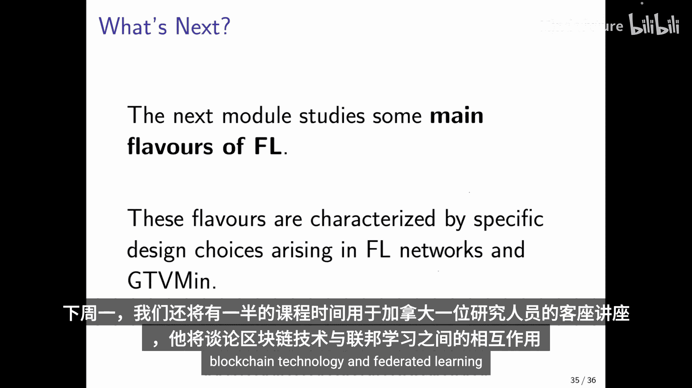

# 【阿尔托大学 - 中英】联邦学习 CS-E4740（Federated Learning，spring 2025） p32 P32 CS-E4740 Asynchronous FL Algorithms -BV1cojRzDEfQ_p32-

Okay， that was quite a lot to take in。 But yeah， let's， let's now。u。

Talk about the the last concept in this lecture， which is asynchronous algorithms。

And to explain or to introduce asynchronous algorithms， it's useful。To， to realize or， or to。

 to find out to formulate or to， to just， yeah， to realize that the algorithms I talked about so far。

 So federated gradient decentcent federated averaging， federated productss。

Federator stochastic gradients they are all algorithms of the same type in the sense。

 They are all based on a fixed point iteration。 So you can， for them。

 find operator So you can write those algorithms as a fixed point iteration in each iteration you apply some operator and this operator can be different for different nodes。

 You apply this operator to all the local model parameters that are currently used at the nodes。

 So these arguments here are the current local model parameters at all nodes。

 and you apply some some operator calligraph F superscript I。 So each each node I。

 the update at each node can be represented mathematically by an operator。

And it might be a nice exercise to work out what， what is this operator for federated gradient descent。

 What is this operator for federated averaging， What is it exactly for federated pros。

 So Did a showed example here。 Yeah， I worked out the example here for gradient descent。

 So for gradient descent。 The operator looks like this。 It uses the gradient。Of course。

 the gradient of the local loss function and these coupling terms。 So this is an explicit。

 This is one possible choice for this operator F I。 And if you use this choice。

 the algorithm that you obtain is federated gradient descent。

 If you replace this choice with some other choice， you get federated averaging。

 So all this algorithms that I have talked about so far are based on this。

 I call it synchronous fixed pointiteration， because they compute this fixed puniteration at each node simultaneously or synchronously。

😊，And yeah， so an Feerated learning algorithm is determinedd by its fixed point operators。

 So instead of writing down a pseudo code Feerated learning algorithm， you can just say。

 what are your fixed point operators， And you have clearly defined or you have determined Feerated learning algorithm。

Okay， but。This is challenging for several reasons。 So implementing this synchronous update is intractable in many applications。

 For example， these devices that that carrying out this updates might be very different。

 So some of them might be a laptop with a 2。4 gigHz processor while other nodes。

 I might be a small raspberry pi with I don't know a clock of 1 MHz， extremely slow。

On the other hand， to， to implement this it this synchronous updates。

 you need to have these current local motor parameters available。 So note I， in principle。

 needs to know the local motor parameters of all its neighbors or in in the extreme case of all other nodes。

So you always need， after each iteration， you need to submit。

 You need to update all your neighbors with your new model parameters。

And this might not be possible if you have bandwidth constraints， or you might at some point。

 have no， no connectivity， no coverage。 if you use Bluetooth connections or a wireless link。

 For some reason， the wireless link is out of usage。So you might have only outdated information。

 You might only have the local model parameter at the at one of your neighbours from the previous 10th iteration。

 but not the current bomb， because there is no connection anymore since 10 iterations。

So we might want to use instead an asynchronous algorithm， which， which works like this。 So it。

 it looks very similar to the， the synchronous algorithm。 So it again， uses these fixed point its。

But in a slightly different manner， first of all， it uses this fixed penetrationit。

 not for using the current local model parameters， but it uses the local model parameters and other nodes from the past。

So in particular， we have a delay， a delay which is given by k。

 the current deterration counter minus this this variables here， S， this is a bit heavy notation。

 but I didn't find a way around it So this S superscript K I1 is the delay from node 12 node I in the K time step。

So this might vary with K， might vary with I M vary with the second superscript index here。

This gives a lot of， of， of freedom， actually。 So this is a very generic we very widely applicable model as synchronous model。

 You can cover a lot of applications or computational settings with this。And by the way， it's。

 it's not mine。 So I didn't invent this。 but this is covered or introduced。

 at least where I heard about it。 First thought it in this book of Bes。 And in general。

 I can highly recommend whenever you， you want to learn about a certain topic， a certain field。

 Try to find a textbook by Dtry bes。 and one of his textbooks is about this distributed or parallel and distributed computation where he introduces or explains this asynchronous computation model in in a very。

good detail。Okay， so。Yeah， in this asynchronous algorithm， we allow outdated information to be used。

 So each update at node I， then updated node I can use the model parameters at other nodes from 10 or 100 iterations ago。

 So this delay can be very large。 It turns out that for some algorithms。

 Some algorithms can tolerate unbounded large delay。

 So this delay can grow to infinity without bounds。 and still the algorithm works。😊，Yeah。

 second difference to the synchronous algorithm is that here we have this update only for for certain nodes at each time step on the or in different words。

 for node I node I uses this update operator only at certain time steps in particular。

 these time steps T superscript eye， which denote kind of the active times when this node was active when this node woke up or had battery again then it computes this update。

 Otherwise we assume that it just keeps the local model parameters， it had unchanged。

 So it just stores the model parameters until it is able to be again to do an update。Okay。And yeah。

 so I have shown here one one example for， for federated gradient isn't， I mean， and this。

 this designing isynchronous algorithms is now pretty straightforward。

 Youd first need to find out what are these fixed point operators。

 How do these fixed point operators look like。For federated gradient de they look like this。

 and then you just insert this outdated information。

 You just do this update using this outdated local model parameters。And only。

 you only do these updates when， when， when， when the node is active。

 So during these active times or time steps。Yeah， again， I also have prepared here a demo。

 which you can check out， and I strongly encourage you to run this demo for asynchronous gradient percent。

And yeah， when preparing these demos， I was so much made aware of how nice it is or how easy it is to implement asynchronous algorithms。

 because asynchronous means in the end， you don't have to ensure synchronous operation。

 So it's not like something you must do。 it means absence of synchronous synchronity yeah。

 synchronization requirements。 So it's way easier， much。

 much nicer to implement an asynchronous algorithm。Then a synchronous algorithm。 But then， of course。

 nice that you have an asynchronous algorithm。 Yes， there's a question。哦可啊。嗯，好好。Yeah， you。

 you have to， for example， if， yeah， you， you have to store when。

 whenever you get whenever node I here。 So we look at node I and this updates or their updates。

 Whenever this node gets an， an， an update from another node， it needs to store it somewhere。

It must not forget it。Yeah， this is， this is a requirement。 Yeah。

 which might be not not not reasonable。 Also， it might not have the memory， but in this model。

 we assume that whenever this node I receives a local model parameter from another node。

 it is able to store it until it gets a new update from this node， yeah。Very good point。

 So it must have some， some memory， and this memory must be non volatile。

 So this memory must also persist in times where it's not active。A very good point。Yeah， so。

 as I said， implementing asynchronous algorithm is like a piece of cake compared to synchronous algorithms because you need so much。

 so much overhead and and， and like in you need， in some sense。

 develop infrastructure for the synchronization， like a synchronization server。

 And if you don't need to do this， it becomes so much easier to implement these distributed algorithms。

 However， you might not have the， the performance as or the statistical properties。 So we。

 we have different notions of asynchronous algorithms depending on how much they can tolerate。

For example， an algorithm is called totally as synchronous。

 If it works in a sense that can be made precise in different ways。 For example。

 we say it works if it still converges in the end to a solution of G TVV minimization。

 Let's say this is our definition of works。 So then a totally as synchronous algorithm works。

If the set， the active set is infinite for each node。

 this means that there is no node that at some point stops， stops。 So if we wait sufficiently long。

 each node will， at some point again be active。 It will never。 There will be never a time point。

Beyond which the node stops doing。 So it will never die。 So to say。

 And this is quite a minimum requirement。 It must be participate as long as the algorithm runs。

And the second requirement is that these delayed update times are also unbounded， which means that。

There's always at some point where each node will send to every of its neighbors one update again。

 So there's no time step beyond which the one node doesn't send any updates to one of its neighbors anymore。

So these two requirements basically say the algorithm is。Poorly， but still working all the time。

So it basically says no node is dying。 So it always do at some point again doest update。

 and no connection is dying completely。 However， the connection might be very poor。

 relating to leading to a lot of delays So the amount of delay is。

 is not does not necessarily need to be bounded here。

 So this updated this delayed update times must be unbounded。

 but the delay So how much they can lag behind the actual time step K can be unbounded。But still。

 they must never stop to send once in a while an update to its neighbors。And yeah。

 totally aschron's algorithm works only if these two， I would say minimal assumptions are satisfied。

 There's a question。The latest one。 Yeah， whenever。

 whenever a node I prime sends an an update to node I， it overrs。The latest update from this node。

 It always keeps one local parameter for each of its neighbors。Yeah， so these。

 these updates are overwritten。 They overrite each other。For each， for each neighbor。Okay。

 and then there is a second notion of， of asynchronous algorithms， which is a bit more。

 what requires more。 It's kind of in between totally asynchronous and synchronous。

 There's partially asynchronous。 So we say an algorithm is partially asynchronous。

 if each node wakes up at least every B capital B time steps。 So this capital P is。

asynchronous measure， the larger is B， the more asynchronous their algorithmies。

 So in the extreme case， if， if B is B is1。Then this means synchronous is the extreme case。

 But B can be much larger than， much larger than one。🤧K。

Yeah so the requirements for partially asynchrons algorithm is that each worker wakes up during each B time steps or events at least once。

 and the delay from each node to each of each other nodes cannot be larger than B。

 so we have a pounded delay。Yeah， I show here this hierarchy of as synchronous algorithms。

 So we have this totally asynchronous， which is our large family， all kinds of algorithm。

 all a large class of algorithms can be totally asynchronous。呃。

And then we have this partially asynchronous algorithms with with different levels of。

 of asynchronous measure B， capital B。O。So another question is now that we have characterized these totally asynchronous and partially asynchronous algorithms。

niceice， but when do they work， So when does does an partial Eyn cor's algorithm converge to a solution of GTV minimization。

And this depends on on two things。 First of all， it depends on the on the fixed point operators and these fixed point operators。

 They are defined by the algorithm that you use and by the the loss functions or the edges。

 So by the federated learning network。 So I told you in the beginning。

 this federated learning network includes loss functions and edges as design choices and all these design choices have an influence in how these fixed point operators look like。

 So this fixed point operator， for example， for federated gradient descent involves a parameter of the algorithm。

 this step size Eta involves local loss functions and involves the the structure of the Feerated learning network via this neighborhoods and edge weights。

 So all these components。Determinine how these fixed point iterations look like。

 how this operator look like。And this， of course， the properties of this fixed point operators stay decide when does an algorithm work or not。

 But， of course， it not only depends on the fixed point operators。

 but it also depends on the asynchronous computation。 So how， how。

 how much asynchronous is the is the algorithm and this is characterized by the update events。

 T I and by the delays。So。We'll quickly go with it for the sake of time。 Were running out of time。

 So it turns out one way to characterize。Or to provide sufficient conditions on asynchronous algorithms is using the notion of pseudo contractions。

 So whenever these fixed point operators are pseudo contraction。

 which means that if you apply this operators to a given choice of local motor parameters。

 and this operator pushes them more towards the solution of G minimization， which is very natural。

 I mean， in the end， this federated learning algorithms， they rep apply fixed point operators。

 So of course， you want this the result of this fixed point operators to be close and closer to the solution of GV minimization。

 So this is a very natural requirement。 And it turns out that this if this fixed point operators are pseudo contraction。

 then you have one once you have proven that for whatever choice of local loss functions edges and algorithm。

 federated learning algorithm。The resulting fixed point operator F。A a pseudo contraction。

 You have one。 There's a beautiful recent paper from authors。

 I think they are from K T H Stockholm that shows that as soon as this is a pseudo contraction。

 it is totally asynchronous。😊，And you can also work out explicit convergence rates in terms of the asynchronous measure。

 so you can tell how fast， how quickly do this local model parameters of this federated learning algorithm converge to the solution of GV minimization and this convergence rate involves this asynchronous measure in in a very natural wave。

 So it's this B is here， the larger B the smaller you make this exponent and the slower is this convergence to to distance0。

 because in the end， you want your your model parameters to have distance0 to the solutions of GTV minimization。

After all， our our principle is that we learn model parameters that minimize GTV。

 we solve GTV minimization， so we want this iterates that we get out of this algorithm to get closer and closer to the solution of GTV minimization。

🤧。Okay， so the question is， how can we ensure this。 It's nice。

 So we found out that if if these fixed point operators are a fixed point， a pseudo contraction。

 it works。 but how can we make sure that it's a pseudo contraction。 Well， this is the hard work。

 This is the the hard work where you need to to analyze this fixed point operator for your specific choice of local loss functions of edge set in the federated learning federated learning network。

 all these properties or this design choices influence this the the or or influence if the resulting fixed point operator here is a pseudo contraction and what is this contraction parameter copper。

 which should be very small， the smaller this copper， the better。Okay。

 that was quite a lot to take in today。 I will skip now the questions for the sake of time this time。

 just to wrap up So we have introduced several widely known or popular federated learning algorithms。

 And it turns out they are all of the same of the same type or the same formalism and being fixed point iterations。

 So federated gradient descent， Feerated averaging， federated pros。

 You can write them as such a fixed point iteration。

And the fixed point of this operator F is a solution of is a solution of GTV minimization。

 and we want them to compute the solution by applying this F repeatedly repeatedly and the convergence of this fixed point iteration depends on the contraction properties of this operator F in particular if it's a pseudo contraction。

 and if it's a pseudo contraction， it turns out to be quite tolerant against asynchronous implementation effects in particular it can handle arbitrarily large delays between between these clients。

And it only requires。 So it's basically a it's totally asynchronous algorithm。

 It only requires that each client keeps on working for a while or after a while。

 So no client drops out completely of the federated learning algorithm after some time and that no connection between two neighbors in the federated learning network dies off completely after a certain time。

 So there's always after sufficiently long of period of time。

 and a node wakes up and does again an update and after a sufficient amount of time。

 a node is able to send its update to one of its to each of its neighbors again。Okay， what's next。

 the cliff hanger， So to say， for the next lecture is we will study some main flavors of federated learning。

 including horizontal and vertical federated learning。

 And we will see how those are nothing but special cases of G TV minimization again。

 So you will I hope you will appreciate more and more。

 the versatile and flexible use of G TV minimization for all kinds of federated learning models settings and algorithms。

 Yeah， and again， as I mentioned， as I announced， we will also have next Monday。

 one half of the lecture will be used for a guest talk by a researcher from Canada talking about the interplay between blockchain technology and federated learning。

😊。

Yeah， thanks for your attention。

