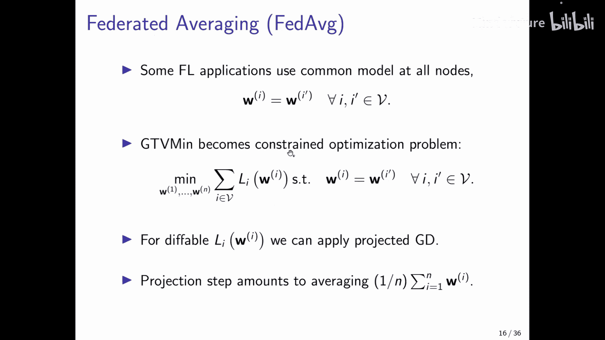
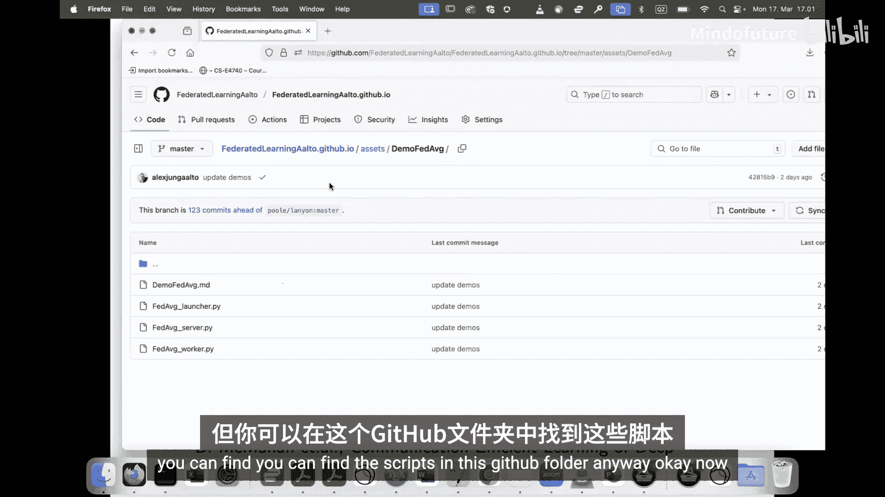
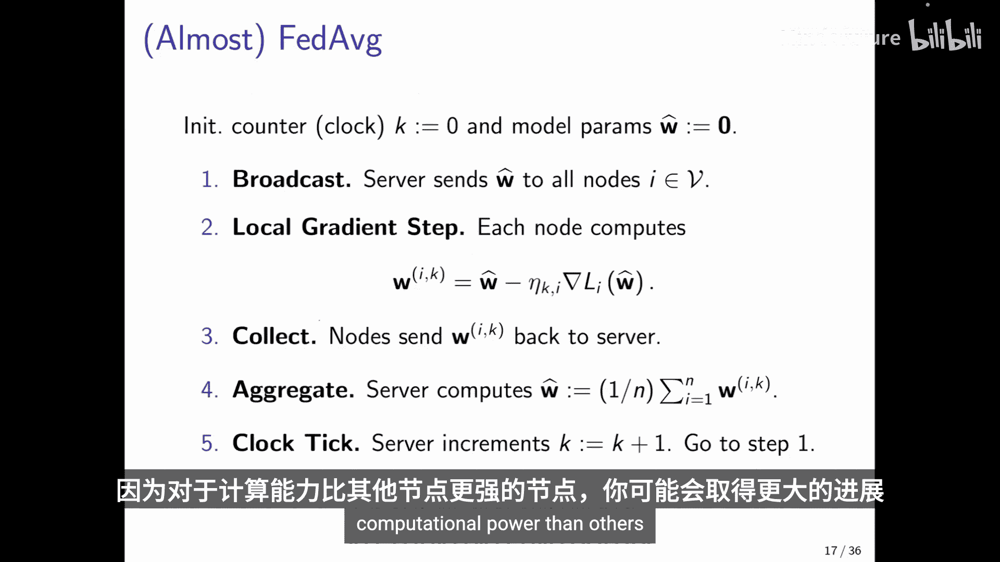

# 【阿尔托大学 - 中英】联邦学习 CS-E4740（Federated Learning，spring 2025） p33 P33 CS-E4740 FedProx -BV1cojRzDEfQ_p33-

The most widely known algorithm。In federated learning， which is federated averaging。

 So how many of you have heard the term federated averaging before。Let's look on the chat。So。

 at least one。Now， ugly 3。4。Yeah， we are reaching already a good percentage of all participants。Yes。

 so I would say。If， if you have to name one federated learning algorithm。

 the dominant answer will be federated averaging。 And I will now show you how federated averaging is actually a variant variation of federated gradient descent。

And it goes as follows。 So in in federated averaging， we。

 we say we want to learn the same model parameter at each node period。

 We want to learn one model that can be used for all nodes。

 But we want to learn this model by using the information in in distributed local data sets。

 And we don't want to collect all the local data sets together to train this one single model。

 So one way to do it is。To， to use G TVV G TVV mini minimization， using hard constraints。

 So in G TVV mini minimization， we， we only penalize differences between。

 between two nodes or connected nodes。 But instead， we， we are very strict node。

 So we require that the local model parameters at any two nodes are exactly the same。

So you can show that training。A single model on all local data sets together is the same as minimizing this sum of local loss functions under these constraints。

 So for each possible choice of two nodes， we require that the local model parameters are identical。

 So this， this means all local model parameters must be the same。

And there there is a nice variant of gradient descent for such constrained optimization problems。

 which is called projected gradient descent。 So what it does。

 it basically computes a gradient step for this optimization problem。

And then projects into the set of allowed local model parameters。

 And the set of allowed local model parameters is those who are identical at all nodes。 So this。

 these constraints define a subset of all possible collections of local model parameters。

 in particular， these constraints define a subset of constant local model parameters。

And we can easily project on this subset by computing the average。 So this。

 this is the projection step in projected gradient Tscent， which I explain a bit in the。

 in the election notess， I think in， in chapterpter 4。嗯。Consists of。

 of minimizing or doing a gradient step for these local loss functions independently。

 But then projecting the resulting updated local model parameters on this， this constrain set。Yeah。

 and then we just write down the algorithm， we flesh out the algorithm。

 which first starts with a server。 so again， we need a server that coordinates the whole training algorithm or learning algorithm which which also maintains the global model parameters。

 so we have one set of global model parameters that we initialize with0。And with this。

 this is broadcasted to all clients or all nodes。 And each node node then does an independently does a gradient step。

 So this is the same as if each node would just train its model on its own local data locally。

But we couple those by having the server collecting all these updated model parameters and computing the average。

 And this average， hence the name averaging。This average is nothing but a projection step within projected gradient descent。

 So federated averaging is an instance of projected gradient descent。So， there's a question。Several。

 actually。So， but so we we are constraining the model， not the weight， right， in this case， by W。

 we refer to the local model， not the weight。 good point。 So this。

 these ws are the local model parameters。 So these are the model parameters at node I。

Which could be some， some vector， some vector in， in R 10， if we have 10 model parameters。

And as a question， how can we handle stragglers in this case？ So good question by， by stagla。

 we mean。Clients or nodes that fail to stick to this to to， to this rhythm。

 So let's say at some iteration， a node stops to do the update。 For example， it runs out of battery。

 It's a raspberry pie little mobile computer without any battery anymore。

 so it cannot do this gradient step， and it cannot send the the。The model。

 the updated model parameters back to the server。 So what happens？ Well， if the server is strict。

 So it requires all nodes to return the local model parameters， then the whole system breaks down。

So what， what we could do then is just to require that at least 10% of nodes return the local model parameters。

 And as soon as they have returned it。We do the update。But this might then， of course。

 break destroy convergence properties。 So these dragglers might not， might not crash the， the the。

 the system completely。 So you might still have a running algorithm that at some nodes updates model parameters。

 but the， the sequence of this local model parameters might not converge to the。

 the minimum of the of the optimization problem anymore。

Okay， you can find again here this demo on my Gi repository。

 which includes a little readme markdown explaining the individual parts， a launcher， Python script。

 a server and this worker， several instances of the worker script will then be executed to illustrate federated averaging。

 And yeah， I strongly encourage you to play around with this。With this。Scrip0。I need to fix。

 I guess I need to fix here some of the。Some of the links。

 but you find you can find the scripts in this Giub folder anyway。

Okay， now federated everythingveraging。😡，Bottom line is it is a form of projected gradient descent。

 and in the in the actual formulation or in this publication that coined the term federated averaging。

 they authors used some variations like they used stochastic approximations of the gradients。

 So instead of the exact gradient here， they computed stochastic approximations of the gradient。

And instead of， of running one single single gradient step here， they。

 they use several gradient steps because you might be able to， to get more progress for。

 for nodes that have more computational power than others。😊。

