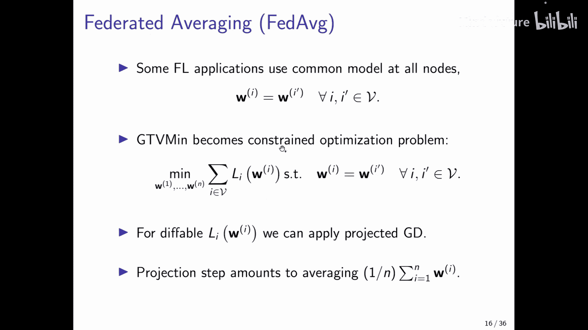
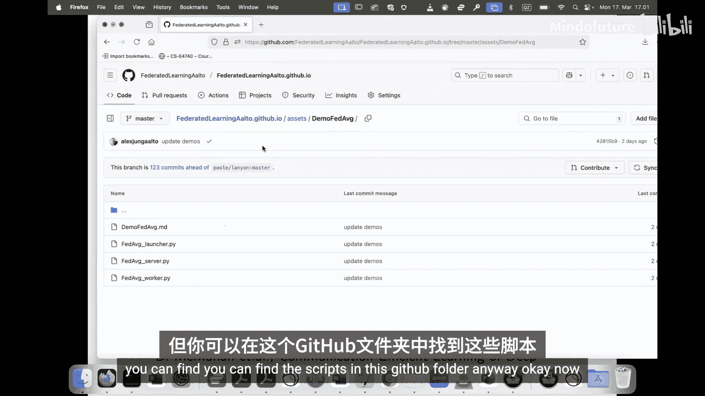
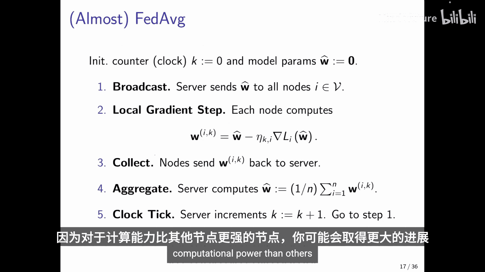

# 联邦学习 CS-E4740：P33：联邦平均算法 (FedAvg) 🧠

在本节课中，我们将要学习联邦学习领域最广为人知的算法——联邦平均算法。我们将了解其核心思想、数学原理、具体执行步骤，并探讨其在实际应用中的一些考虑。

## 概述

联邦平均算法是联邦学习中最具代表性的方法。它的核心目标是在不汇集各节点本地数据的前提下，协同训练一个统一的全局模型。本节将揭示联邦平均算法本质上是**投影梯度下降**的一种变体。

## 联邦平均：投影梯度下降的视角

上一节我们介绍了联邦学习的基本框架，本节中我们来看看最经典的联邦平均算法是如何工作的。

我们希望每个节点学习相同的模型参数，得到一个可供所有节点使用的统一模型。但我们希望利用分布式本地数据集中的信息来学习这个模型，而不希望将所有本地数据集集中起来训练这个单一模型。

实现此目标的一种方法是使用带有硬约束的全局总变差最小化。在GTVV最小化中，我们只惩罚两个相连节点之间的差异。但在这里，我们要求非常严格：我们要求任意两个节点的本地模型参数必须完全相同。

可以证明，在所有本地数据集上联合训练一个单一模型，等价于在这些约束条件下最小化本地损失函数之和。对于任意两个节点的可能组合，我们都要求其本地模型参数相同。这意味着所有本地模型参数必须一致。

对于这类带约束的优化问题，梯度下降法有一个很好的变体，称为**投影梯度下降**。它的基本步骤是：首先为这个优化问题计算一个梯度步长，然后将结果投影到允许的本地模型参数集合中。允许的本地模型参数集合就是那些在所有节点上都一致的参数集合。这些约束定义了所有可能的本地模型参数集合的一个子集，具体来说，它定义了恒定本地模型参数的子集。

我们可以通过计算平均值轻松地投影到这个子集。这个计算平均值的步骤，就是投影梯度下降中的投影步骤。

投影梯度下降的流程包括：独立地对这些本地损失函数进行梯度下降步骤以最小化损失，然后将更新后的本地模型参数投影到这个约束集合上。

## 联邦平均算法步骤

以下是联邦平均算法的具体执行流程：

1.  **初始化**：首先需要一个服务器来协调整个训练算法。服务器维护全局模型参数，并将其初始化为0。
2.  **广播**：服务器将当前的全局模型参数广播给所有客户端或节点。
3.  **本地计算**：每个节点独立地在其本地数据上执行一个梯度下降步骤。这类似于每个节点仅使用自己的本地数据训练模型。
4.  **聚合与平均**：服务器收集所有节点更新后的模型参数，并计算其平均值。这个“平均”步骤正是投影梯度下降中的投影操作。
5.  **更新与迭代**：服务器用计算出的平均值更新全局模型参数，然后重复步骤2-4，开始新一轮迭代。

因此，**联邦平均算法是投影梯度下降的一个实例**。

## 关键问题讨论

在算法实施中，有几个关键问题需要考虑：

*   **模型参数的定义**：公式中的 `W_i` 指的是节点 `i` 的本地模型参数，而不是权重。这些参数可以是一个向量，例如，如果我们有10个模型参数，它就是 R^10 空间中的一个向量。
*   **掉队者的处理**：“掉队者”指那些无法跟上算法节奏的客户端或节点。例如，某个节点在迭代中因电量耗尽而无法完成梯度计算或传回参数。如果服务器严格要求所有节点都必须返回参数，那么整个系统就会崩溃。一种可行的处理方式是，只要求一定比例（例如10%）的节点返回参数，一旦达到这个比例就进行更新。但这可能会破坏算法的收敛性。系统可能仍在运行，部分节点仍在更新参数，但参数序列可能不再收敛到优化问题的最优解。

## 实践与演示

你可以在我提供的GitHub仓库中找到相关的演示代码。该仓库包含一个解释各个部分的README文件、一个启动脚本、一个服务器脚本以及多个工作节点脚本。执行这些工作节点脚本可以演示联邦平均算法的运行。强烈建议你实际操作并探索这些脚本。

## 算法变体与总结

本节课中我们一起学习了联邦平均算法。其核心结论是：它是一种**投影梯度下降**的形式。

在实际的论文表述中，提出“联邦平均”这一术语的作者们使用了一些变体。例如，他们使用梯度的随机近似来代替精确梯度。此外，他们并非只执行单个梯度步长，而是使用了多个梯度步长，因为计算能力更强的节点可能可以取得更大的进展。

**总结**：联邦平均算法通过协调分布式节点进行本地计算，并在中央服务器进行参数平均，巧妙地实现了在数据隐私保护下的协同模型训练，其数学基础源于带约束优化的投影梯度下降方法。