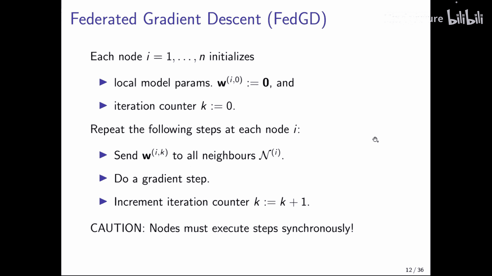
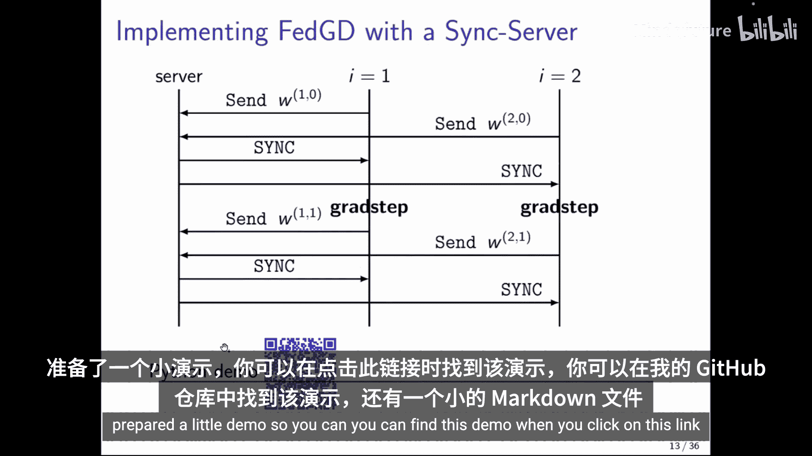
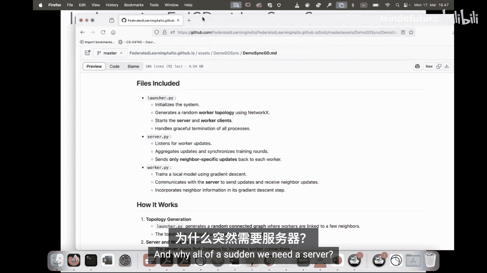
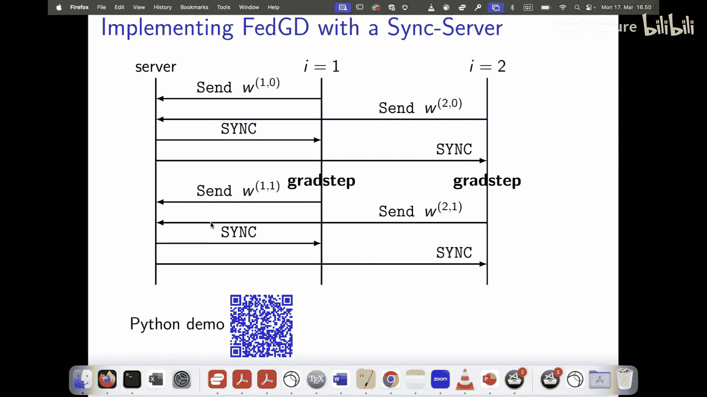
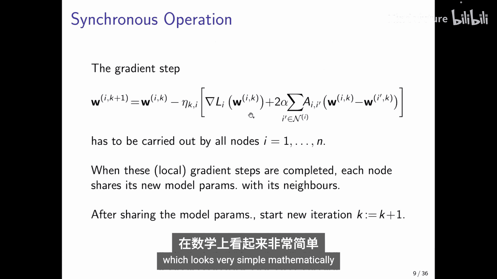
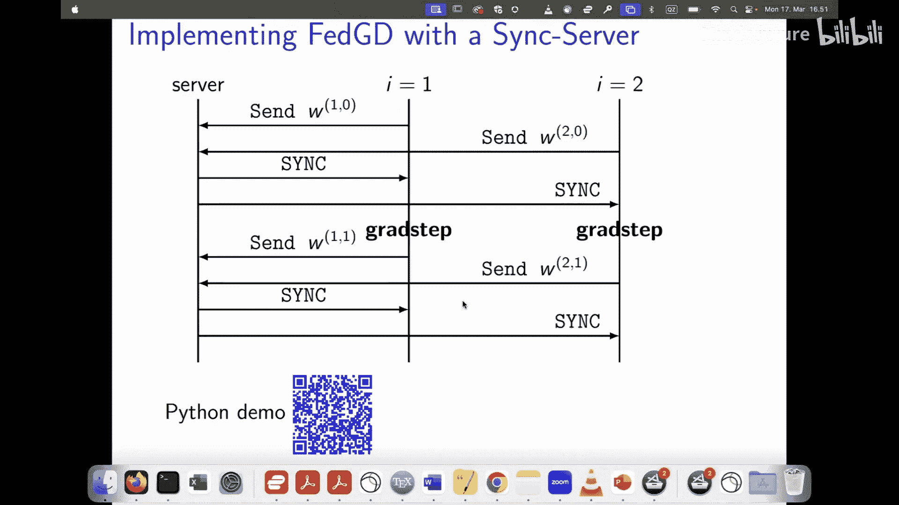
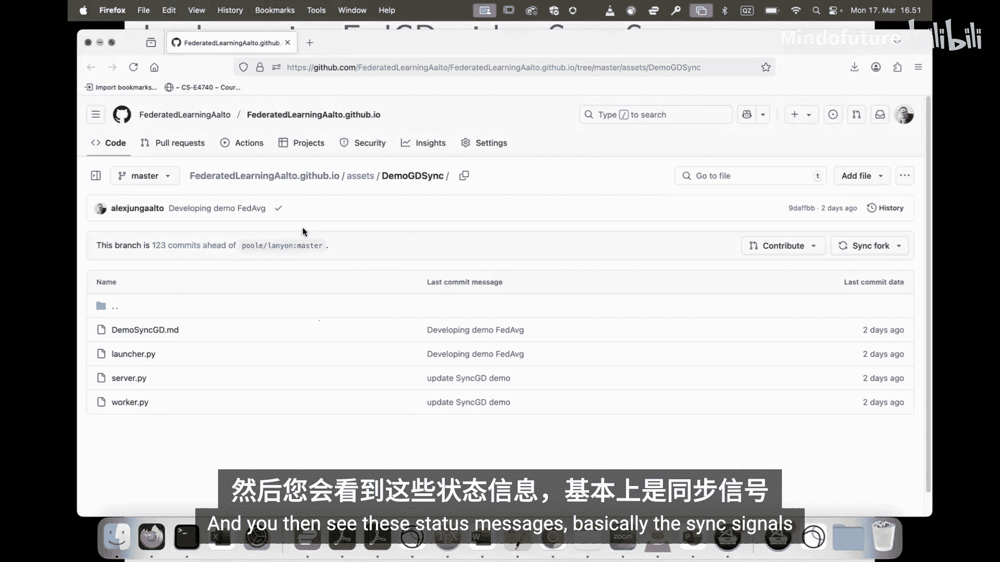
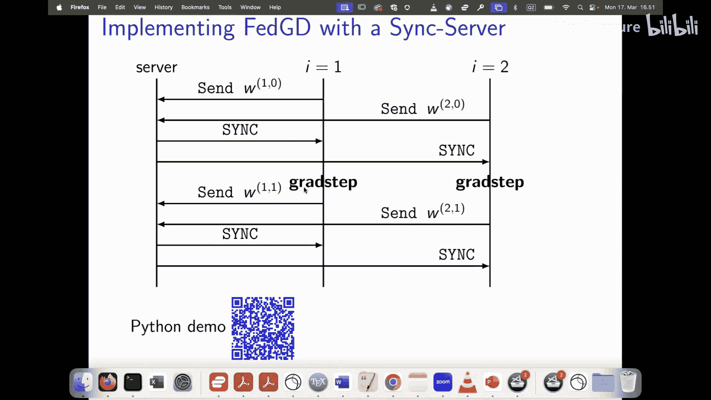
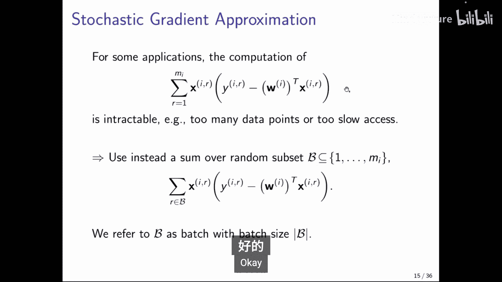

# 【阿尔托大学 - 中英】联邦学习 CS-E4740（Federated Learning，spring 2025） p34 P34 CS-E4740 FedSGD -BV1cojRzDEfQ_p34-

Okay， so to start， just here show the the gradient step this is just plain gradient descent for GTV minimization。

 So you you you you look at this optimization problem as a smooth。

 So you we assume that this loss function is a smooth differentiable loss function。

So we can compute gradients。 And as soon as you can compute the gradient of these loss functions。

 you can compute the gradient of the whole objective function because the second term here is by construction。

 always smooth。And and when you work out the gradient， you obtain an expression like this。

 So using basic calculus。And yeah， once you have the gradient， you can do a gradient step。 So we。

 we use the gradient。Using the current， the current choice of model parameters of local model parameters to update the current model parameter at at some node I。

 So this is one， one part of this gradient step。 The the whole gradient step consists of parallel updates like this for all nodes。

 So this update step here is applied synchronously or simultaneously to all nodes in the network。

And when you work out the gradient step like this， you， you get a nice interpretation here。

Which is based on two terms。 So we have this term here， the gradient of the local loss function。

 which means you want to， you want to push the， the current choice。

 or you want to change the current choice for this local model parameter more towards the minimum of this local loss function。

 So this is natural。 So this term drives or tries to push the local model parameter at node I towards the minimum local minimum of the loss function at node I。

 So this is， this is very much the， the basic idea of any machine learning。

Choose a motor parameter to make the loss minimum， to minimize the loss。So so far so good。 why。

 why could this be not enough。This principle， well。

 this loss function might not carry sufficient information， Sta information。

 because it might be computed from a too， too small sample size。

 So just minimizing this loss function is not sufficient or is not doesn't provide sufficient information。

To avoid overfitting。 So here， then when the second term kicks in， this helps us to。

 or this provides more information。 In particular， this provides information from the neighbors。

 So the second term ensures that you learn model parameters that are not too much too different from the neighbors model parameters。

 So this second term here drives the agreement of， of local model parameters over well connected nodes in the network。

 And in some sense， here， this term。Is equivalent to， to pooling local data sets from the neighbors。

But in a privacy friendly way。 So instead of of having node I asking all its neighbors。

 So the set of neighbors is this calligraphic N superscript I。

 This is the set of neighbors of node I。 instead of pooling all the local data sets at this neighbors to help node I to get a better gradient step。

 we use this term here， we use this coupling term， which involves only the local model parameters。

 So the only thing we share between neighbors are the model the current model parameters。And。

 of course， these typically carry information about the local data set。

 So you will have in inevitably， you inevitably， you will have a leakage of information。

 But often you can， you can choose this model parameters or this model parameters don't leak too much information about specific。

 very specific properties of the local data。 for example。

 a local data containing healthcare information， my healthcare information and my latest blood pressure values。

 So this is one very small aspect of a local data set。That is。Ha a tiny little bit of influence。

 or might have have a a tiny little bit of influence on these model parameters， but not too much。

So here， here， this second term is that， the privacy friendly way to share information among neighbors in this federated learning network。

Okay， and yeah this， this term here is alpha。This alpha times the edge weight。

 This steers the balance or provides the trade off between these two effects。

 So if alpha times the edge weight is very small。 So here is actually a typo。 This should be。I。

 I prime。If this product here is very small， then there is little coordination or cooperation between neighbors。

 and its mainly this federated learning algorithm， mainly does independent model training for each node。

And the larger you make this alpha， the larger you choose the alpha。

 the more you couple the training on over neighbors or at neighboring nodes。

 and at some point when you choose alpha very， very large。

 the second term here dominates and ensures that you end up with the same model parameters at or almost or nearly the same model parameters at all nodes。

Okay， any questions at this point？There's one question can you please explain the steering effects and how they are balanced once more so this gradient step here consists of or the gradient update consists of two components the first component is the gradient of the local loss function so this tells you how well is your current local model doing for your own private local data set and of course you want to make us you want to incur a small loss。

And this， this is ensured by taking a gradient or taking a step into the opposite of this gradient。

 So this steers the local model parameters to the minimum of the local loss function。

 And this is counteracted， in some sense， by this second term here。

 This second term doesn't care about the local model performance but cares only about the agreement or cooperation over neighbors。

 So this second term steers the the training or steers the the update of the local model parameters towards agreement among neighbors。

 So when we if if we would not have this second term。

 we we wouldn't care how much neighboring model parameters differ。 But since we have this term here。

 we we do not tolerate that the model parameters that neighboring notes are very different。Yeah。Okay。

 yeah， just want to point out that this， it's very easy to write down the gradient step。

 It's very easy to write down the gradient and just use the gradient to update the local model parameters and you do this in a nodewise fashion。

 So very easy to write down on pen and paper or or on a latex slide like here。

 but I just want to point out you need to do this in a synchronous fashion。

 you need to make sure that all nodes in your network and there might be millions or billions of nodes in your network when you work on an Io internet of things network。

 there might be millions and billion of devices that are poorly connected over low quality。

 lower reliability links and it might be simply impossible to ensure that this gradient step is executed synchronously in parallel。

 So all nodes have to complete this update step before you continue。

With the next gradient step at any node。Yeah， I have illustrated here also this message passing implementation because this gradient step。

 this gradient step at node I needs also information from its neighbors。

 So you cannot compute the gradient step at one node without exchanging information with your neighbors because you need those for this second term So you need to always before you do the gradient step。

 you need to exchange the current model parameters at each node with or among its neighbors。

 So each node has to send its current has to broadcast its current local model parameters to all its neighbors。

 So in this simple case， theres only one neighbor of node I， which is node I prime。

And on the other hand， node I Prime needs to submit its local model parameters to its neighbor。

 which is node I。And after these nodes have exchanged their model parameters。

 every node does this update step。 can do this update step simultaneously。

And then you the next detereration begins。 So you share the。

 the new model parameters with your neighbors and do the gradient step again， and so on and so forth。

Yeah， good question。 So the question was now that we have these two steering effects。

 what is the overall effect， What is the overall effect， and this is a very good question。

 this depends a lot on the overall network structure although these updates here。

 they only involve the local structure of the network that is the neighborhood of node I。

 what this resulting or what this gradient descent will deliver on each node depends also on the overall structure of the network in particular on the cluster structure of the network and we discussed this in the last lecture this cluster structure of the solutions depends on the connectivity between the nodes So for example。

 here， this gradient steps might then converge for this approximately same model parameters for these nodes and identical approximately identical model parameters for these nodes because they are very tightly connected by many edges。

Which have a large weight。 And there's only one，1 single edge between these two clusters。

 So what the overall effect is depends heavily on， on the actual network structure。And this。

 this cannot be， yeah， for this， you need to know something about the network structure。

 You cannot tell in general what their overall effect will be。Okay。

So now that we have discussed this gradient step。嗯。

Let us look at now at a few well known examples of。

 of federated learning algorithms that are based on this gradient step that use variation or extensions of this gradient step。

 The first one is， is federated gradient descent， which is just essentially。

Flelash out a full algorithm using this synchronous gradient steps。 So an。

 an algorithm typically consists of a precise ex description of the initialization。

 So how do you start the algorithm。 For example， we could initialize using a zero vectors for all model parameters。

 But this might not might not be the best choice。 You might also initialize the model parameters by some random choice randomly。

Or another choice could be you train the your own model locally on your own data set without any any coupling with neighbors and use this trained model as the initial choice。

 but this might be。Might not be optimal because you might overfit。

I just want to point out that there's no mathematically reason here or justification for using the zero initialization。

 It is just one， one in one possible initialization。Yeah。

 and then you start repeating this gradient steps。Yeah。

 but this is a bit sloppy formulation for an algorithm， or it's， it's a bit useless algorithm。

 or not practical algorithm because I didn't state as stopping criterion。

 So this is an algorithm that you only start once， but never stops。Which is， of course， not。

 not very practical。 So， and this is something people like to， to avoid or not talk about。

 And including me now， about the stopping criterion。 So， but do you have some， some intuition。

 How could we know when to stop this iterations， So how could we develop this。

 this algorithm or this sketch of an algorithm to a more practical algorithm that includes a stopping criterion。

H。What are possible stopping criteria for gradient methods or gradient decent methods。Yeah， you can。

 you can， you can track the progress。 so you can look after each gradient step。

 You see how much did it reduce， how much did it reduce the local loss function。

 You can monitor the local loss function。 Yes， so this would be one way to come up with a stopping criterion。

 Or if you have a sufficiently large local data， you could use part of the local data set as a validation set that you don't use for constructing the local loss function。

 and you stop when this validation error validation loss doesn't decrease anymore。

 And I would say it's actually the most widely used practical approach to stopping criteria。

What other options would there be？For stopping criteria。Yes。Yeah。

 so if the weights themselves don't change much anymore， then of course。

 there seems to be no point in continuing iterating because there's not much effect of more iterations。

Yes， that's also a possible stopping criterion。 Any else。

 Does anybody else know another stopping criterion。Well。

 you could come up with a mathematical analysis that bound the， the subopality of。

 of a specific iteration number of iterations。 And then you choose the。

 the minimum number of iterations such that you are within a certain range of the。

 of the actual optimal value of the G TV minimization objective function。 But for this。

 you would need your mathematical analysis and you need to make assumptions。

 So you need to assume that your local loss functions have certain convexity properties， for example。

Okay， but I just， just want again highlight this difficulty in implementing this step synchronously。

 So when I write here， do a gradient step， then this is very simplifying， very simplifying。

 It's almost almost disguising the complexity that you have to do this gradient step simultaneously at all notes。

So， I have。Prepaed a little demo。 so you can， you can find this demo。 when you click on this link。

 you find the demo on my Github repository。 There's also a small markdown。

 which explains the overall setting。 So here these demos。

 they consist of several Python scripts and launch a script。

 which then calls or starts executes a server script， one server and one on worker， several workers。

 So each worker corresponds to a node here。 And why， why all of a sudden， we need a server。

 I was talking about distributed optimization algorithms。 Why do you need a server。 Well， one。

 one reason why we wouldn't need a server is to provide a clock。

In order to synchronize these gradient steps， we would need we， we could use a clock。

 and this clock consists of sending a sync signal to all nodes。And each node only starts。

 only starts a gradient step after it has received the sync signal。

It does the gradient step and sends back the， the new updated local model parameters。

 And only after the server has received this updated local model parameters from all nodes。

It makes a clock tick and sends out a new sink。And yeah。

 I have demonstrated this here in this Python for the simple setting with two node， two nodes。

And if you implement this for， let's say， a million notess， you run already into many， many problems。

 First of all。To， to define this， this algorithm or this algorithm uses as a rule for the new sync that you must have received all updated model parameters。

 So this means you must know which how many clients do you have or how many notes do you have in your federated learning network。

 So you must do some bookkeeping some some administration。

 each node needs to register at the server and say， hello， I'm here。

 I want to also contribute or yeah， contribute to this federated learning algorithm。

And this might be very unpractical。 So sometimes you might。

 you might enjoy way more casual systems where there's no central server that that has a user database or a list of all node that that are part of the federated learning network。

There's a question on the question on the chat。 What happens if the sun signal does not reach the clients in general。

 what happens if any signal does not reach its destination。 Very good point。 So in my simple demo。

 as， as soon as one of these sun signals or as if any of these update update of the monoparmeters fails。

 the whole algorithm breaks down。So this is not something we can put into production soon or sell on an app store。

And this should also illustrate you how， how， how challenging this is to turn this innocent looking update rule here。

 this gradient step， which looks very simple mathematically。

Into a practical algorithm， you need to think of all these nittycr details。 For example。

 what happens if this sync signal， for some reason， this sync signal fails to be delivered。

 So for some reason， this sync signal is sent out by the server， but never reaches this node。

This means that this node I 1 will never continue with another gradient step。

 and in turn will never send back another update， which in turn means that the server will wait indefinitely for the clock tick because it doesn't get this update from node 1 anymore。

So this， this， we should avoid。 But this is， of course。

 this in how to implement this algorithm in real hardware and software is waying beyond the scope of this course。

 So I guess at least here out have courses like mobile computing or or Eon where you。

 I guess where you will learn this。But yeah， just to point out the。

 the neatty gritty details of putting this mathematical model into a real federated learning system。

Okay， yeah， I strongly encourage you to， to play around with this demo。 So download， copy this。

 this folder ideally and try to run this launcher Python script。And you then see this。

 these status messages， basically these sun signals and these updates of the。

 of the localcom model parameters are， are printed out in the， in the Python console。

Okay。

Yeah， just， I want to point out here， this， this variant federated stochastic gradient descent。

 which is just a little variation of， of federated gradient descent in the sense that instead of。

 of gradients， instead， instead of this gradient， we。

We use estimations for the gradient because computing the gradient might require， for example。

 in a linear regression setting to compute sums like this here。

 and this sum might involve a lot of data points。 And even if there are not so many data points。

 but the computation itself might be costly because the device might be a small raspberry pi computer。

 and these feature vectors might be vectors of an image， including millions of entries。

 So actually computing this sum for small number of data points might be challenging。

 and also the access accessing these data points might be challenging because this would require this raspberry pi to read in weather measurements from a weather sensor it is attached to And for this and other reasons。

 it might be useful to use approximations of the gradient。

 So instead of of the gradient that we use here in this gradient step， we。UseAn approximation。

 And one way to compute an approximation is if you use a randomly chosen subset of data points in the training set or a batch。

 So we call this a batch in stochastic gradient descent。 And yeah。

 you just replace this sum in the gradient computation by a sum over this random subset or batch。

Andvoa， you get federated stochastic gradient descent。So not much of additional challenge here。Okay。

 any question at this point？

