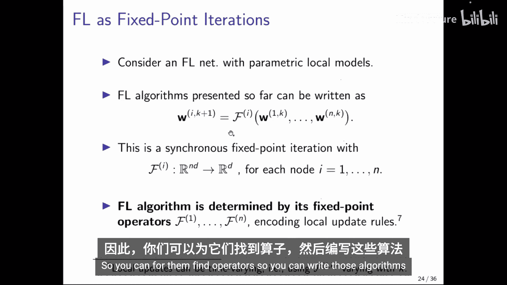
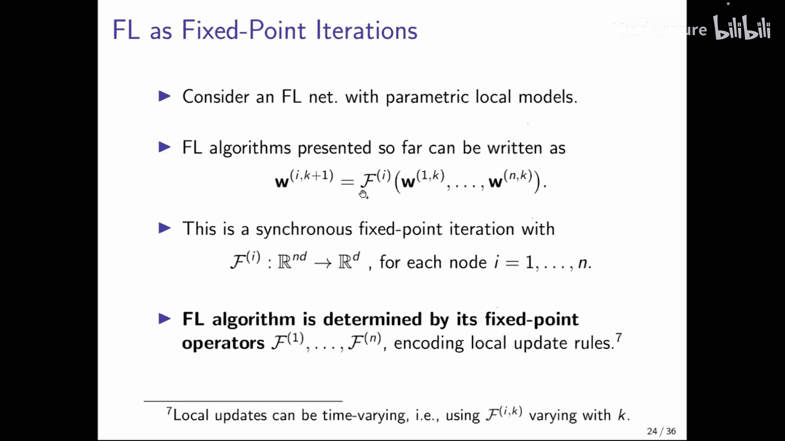
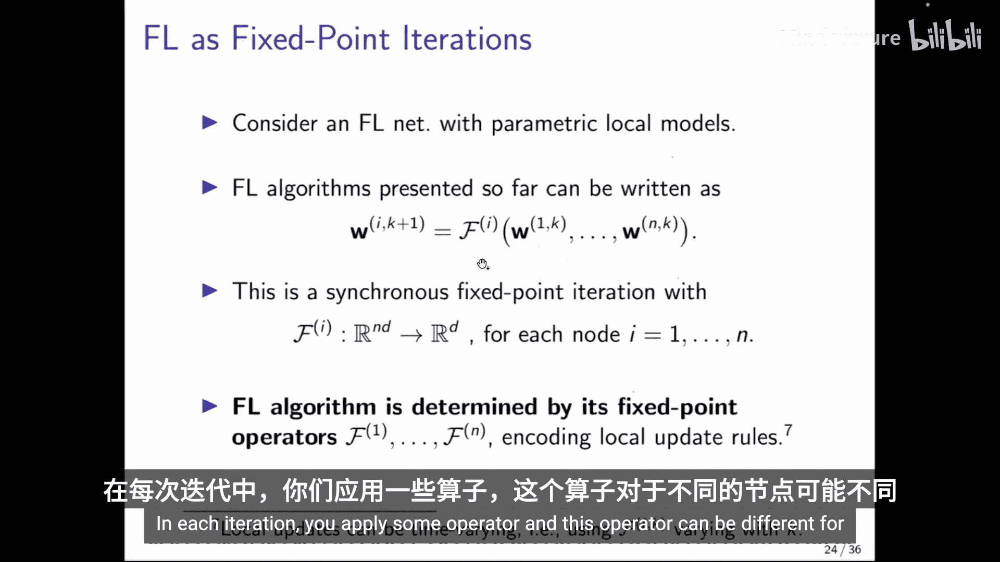
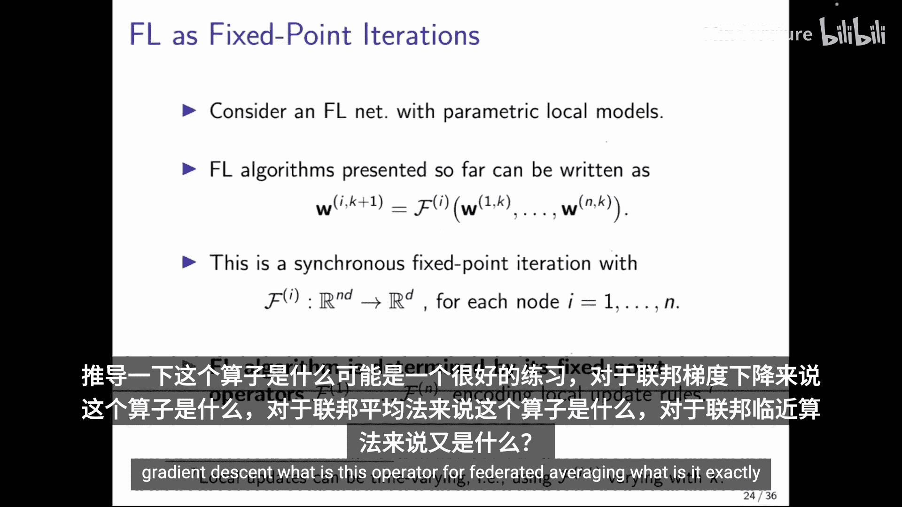
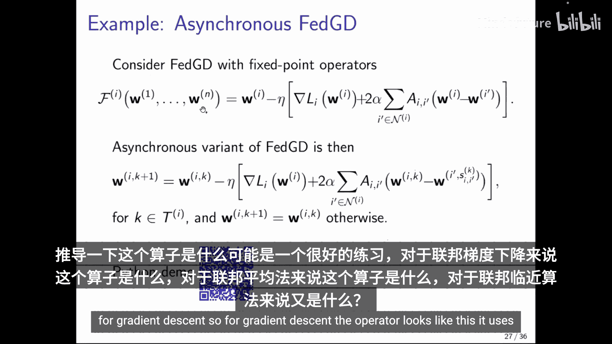
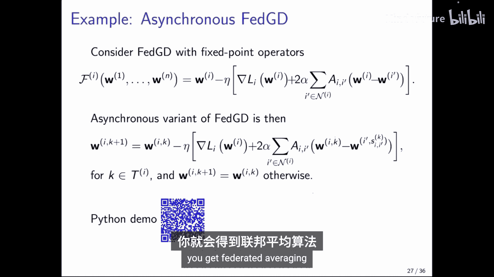
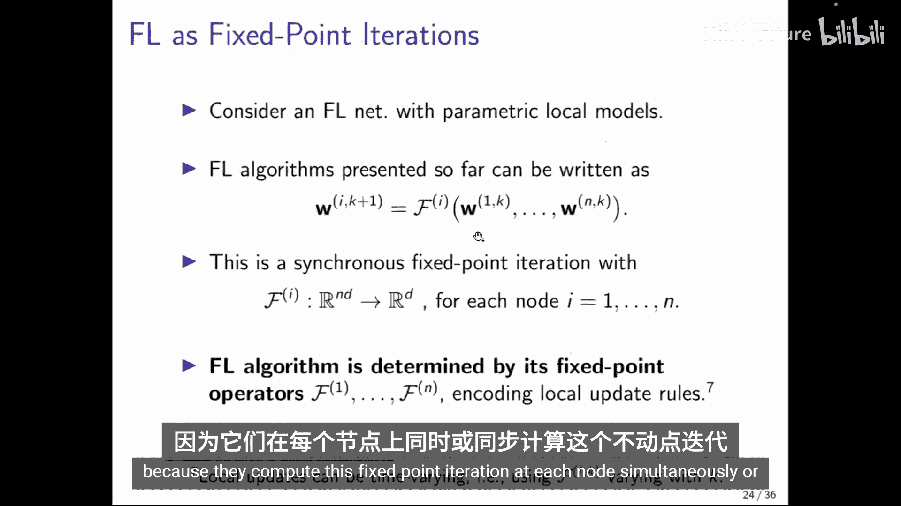

# 【阿尔托大学 - 中英】联邦学习 CS-E4740（Federated Learning，spring 2025） p35 P35 Federated Learning as Synchronous Fixed-Point Iteration -BV1cojRzDEfQ_p35-

You， to realize that the algorithms I talked about so far。

 So federated gradients and federated averaging， federated productss。

Federator stochastic gradient isn they are all algorithms of the same type in the sense。

 They are all based on a fixed point iteration。 So you can， for them， find operator。

 So you can write those algorithms as a fixed point iteration in each iteration you apply some operator and this operator can be different for different nodes。

 you apply this operator to all the local model parameters that are currently used at the node。

 So this arguments here are the current local model parameters at all nodes。 and you apply some。

 some operator calligraphic F superscript I。 So each each node I。

 the update at each node can be represented mathematically by an operator。

And it might be a nice exercise to work out what， what is this operator for federated gradient descent。

 What is this operator for federated averaging， What is it exactly for federated pros。

 So did a short an example here。 Yeah， I worked out the example here for gradient descent。

 So for gradient descent。 The operator looks like this。 It uses the gradient。

Of course， the gradient of the local loss function and this coupling terms。 So this is an explicit。

 This is one possible choice for this operator F I。 And if you use this choice。

 the algorithm that you obtain is federated gradient decentcent。

 If you replace this choice with some other choice， you get federated averaging。

 So all this algorithms that I have talked about so far are based on this。

 I call it synchronous fixed point iteration， because they compute this fixed point iteration at each node simultaneously or synchronous。

😊。

