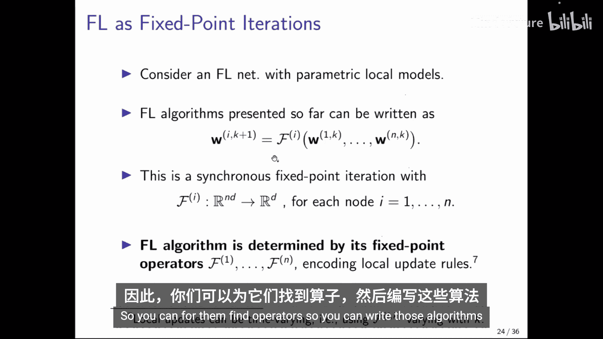
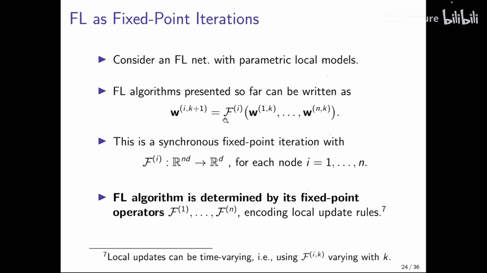
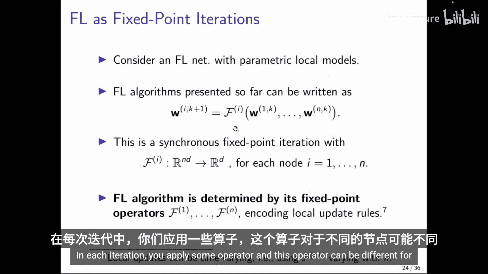
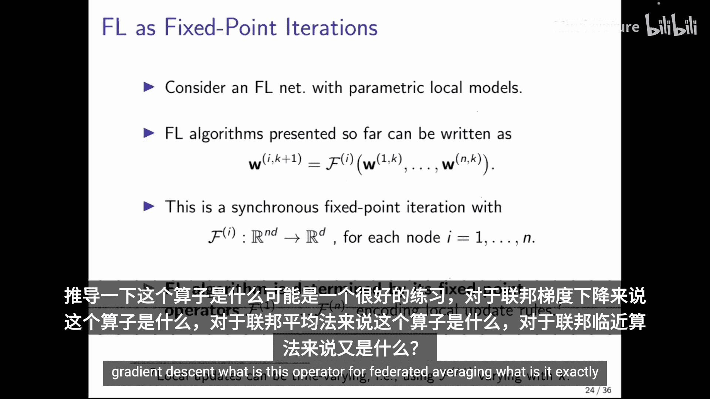
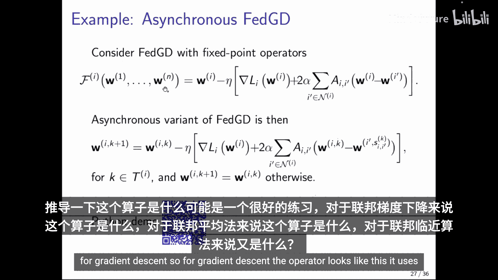
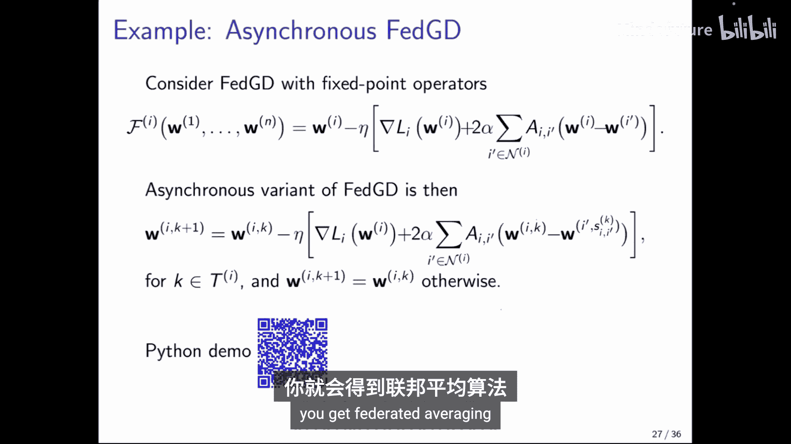
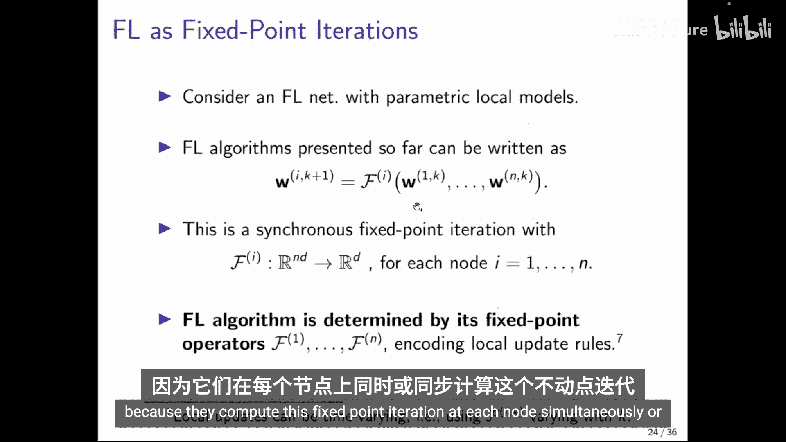

# 联邦学习 CS-E4740：P35：作为同步定点迭代的联邦学习


在本节课中，我们将学习如何将联邦学习算法统一理解为一种**同步定点迭代**过程。我们将看到，之前讨论的联邦梯度下降、联邦平均等算法，都可以用这种统一的数学框架来描述。

## 核心概念：同步定点迭代

上一节我们介绍了多种联邦学习算法。本节中我们来看看它们背后的共同数学原理。

到目前为止讨论的算法，例如联邦梯度下降、联邦平均和联邦乘积，都属于同一类型。它们都基于**定点迭代**。这意味着，可以为这些算法找到一个**算子**，将算法表示为一种迭代过程。在每次迭代中，应用某个算子，这个算子在不同节点上可以不同。



该算子作用于节点当前使用的所有本地模型参数。这里的参数是所有节点当前的本地模型参数。每个节点 `i` 的更新，在数学上都可以用一个算子 `F^(i)` 来表示。






以下是定点迭代的通用形式：
```
w_i^{k+1} = F^(i)(w_1^k, w_2^k, ..., w_n^k)
```
其中，`w_i^k` 表示节点 `i` 在第 `k` 轮迭代时的模型参数，`F^(i)` 是定义节点 `i` 更新规则的算子。

## 示例：联邦梯度下降的算子

理解这个概念的一个很好的练习是推导出联邦梯度下降、联邦平均等算法的具体算子形式。





这里我们以梯度下降为例。对于梯度下降，算子形式如下：
```
F^(i)(w) = w_i - η * [∇f_i(w_i) + (w_i - w̄)]
```
它使用了本地损失函数的梯度 `∇f_i(w_i)` 以及一个耦合项 `(w_i - w̄)`，其中 `w̄` 是全局平均参数。这是一个显式表达式，是算子 `F^(i)` 的一种可能选择。

如果使用这个选择，得到的算法就是**联邦梯度下降**。如果将这个选择替换为其他形式，就会得到**联邦平均**。

因此，到目前为止讨论的所有算法都基于这种框架。我称之为**同步定点迭代**，因为所有节点同时（或同步地）计算这个定点迭代。

## 总结






本节课中我们一起学习了如何用**同步定点迭代**的数学框架来统一理解联邦学习算法。我们了解到，联邦梯度下降、联邦平均等算法都可以表示为对一个特定算子 `F^(i)` 的迭代应用。这个统一的视角有助于我们分析和比较不同联邦学习算法的性质。