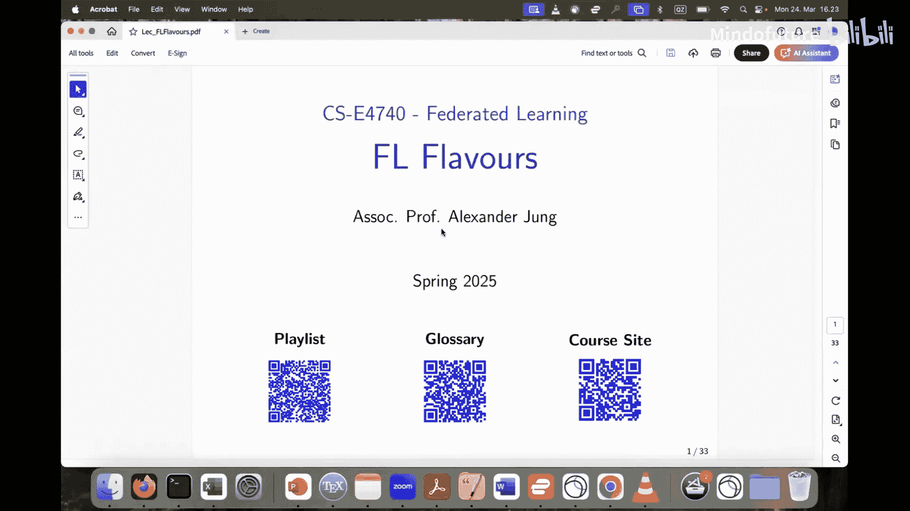
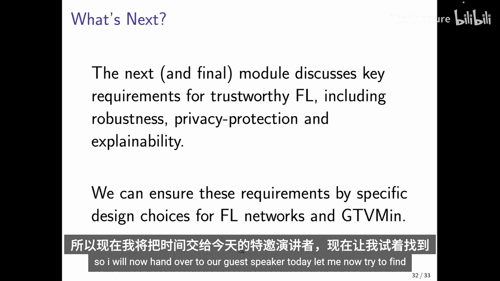

# 【阿尔托大学 - 中英】联邦学习 CS-E4740（Federated Learning，spring 2025） p36 P36 CS-E4740 Lecture FL Flavors -BV1cojRzDEfQ_p36-

Yeah。Yes， it's very good Yeah， before we start with the actual lecture today。

 which put me on some main flavors of federated learning。😊，few。Bits of information about the course。

In general， so we will have now。Two garage sessions。

So I have now scheduled two slots similar to this lectures starting at quarter past 4 at the 14th April and 21s of April。

 both will be only in soon。And in these exercise garages。

 you can stop by and ask questions about the project。 Just a reminder。 this year。

 we have the project as a mandatory part of the basic course variant。

So you find already some information or most information on this course site on the project。Yeah。

 maybe the most important information is the deadline。 The submission deadline will be 30 April。

 So the end of April。 So you have the whole the entire April to work on your project report。

 You can now also find a template。 for the project report with detailed instructions。

 What should be included in the report already here。 Yeah， you have to prepare this Pdf。

 or you have to prepare your report using this structure So don't change the the section titles and the choice of sections。

 This is fixed by us。 Also another requirement is the font size must not be smaller than 9 points。

And the whole report can be maximum 5 pages， and the fifth page can only include references。

 So content is different from references must fit within four pages。

 And this is a similar format requirement as for ITP conferences， like the。At Triee conference。

 I gasp。Which is a role model for this。Pormat of this project。 And then。Yeah。

 I have also provided the， the tech file。 So you are strongly encouraged to use latette。

 also to practice the use of latette to， to type set mathematical texts or， or technical reports。

So I strongly encourage to use latetex。 and you can use this report template here in this folder here。

 you also find some auxiliary files that you might need style files that you should put into the same folder as the tech file。

 the latex file。 then you should be able to compile the the late file。 If not。

 please reach out by email or on the select discussion forum to the course stuff。😊，Yeah。

 what else you also find here on this side the， the review sheets。 So you can already now look。

What or see what what will be asked to you because you then review the reports of others that's called peer review you already see here the questions that we will ask and these are very specific questions like does the report clearly define the nodes and weighted edges of the federated learning network and then depending on how well this is explained or defined。

 you give two points， one point or zero point？And in total， we have some。

 I don't know some 20 questions。Oh no，12 around 12 questions， not so many。

 which you have then to answer。 And we will use Currently。

 the plan is to use two different submission systems。 So for。

 for those who prefer who are auto of students and register to this course。

 you will have the chance to。To do this peer this project submission and review in my courses。

 So this is the Alto E learning platform。 But in general， for all participants， we offer。

 and this is also available for nonalto students to submit and review the the reports via E chair。

 So I have I have got a license for a conference and this conference is called Alto 25。 this。

 this is similar to what Ae conferences or the scientific conference is use for peer review。

 and you will here practice like a full the the the full workflow of conference paper submission。

And I also offer this for alto students。 So if you say you don't want to use this kind of protected playground in my courses。

 but you want to also see what what nonalto students are submitting the project reports。

 then I also welcome you to to submit via this easy chair conference submission system。

 it's not open yet。 So don't worry if if you， if you do not find the submission yet because it's not there yet。

 we hope to be ready with all the all the configurations for this conference。

 So this is a pretty powerful conference management tool。

 and to set all the the switches the right way by end of this week。

 So we will then release or we will open the submission site by next week， However。

 we expect you to only start at the project maybe after after next week。

 when we finish the basic modules and lectures。Are there any questions at this point regarding the project。

Yes。Yes。Yes， so yeah， I， I， I had to change。 I had to adapt the。

 the original plan for the garages was。To have them one week earlier on the2 and 7 April。 But I。

 I learned that there's an exam week。That's why I have now shifted。 I will send an update by email。

 Yeah， this， this has changed。 So sorry for the confusion。

 I have announced yesterday these garages with different dates， but I have been made aware by。

 by students that this would then fall exactly into the exam week。 And this should not be the case。

 So I have now risk it out those garages。 However， you have very welcome to。

 to reach out to course staff to me and the T As also on slack any time or send me an email。

 We can also， I'm also happy to arrange meetings。 one on one meetings in Zoom。

 So this should not be any any problem。 There should be no lack of support and guidance for the project。

Okay， any other questions regarding the project so far。Okay， if not。

 then I will now start with the actual course topic today， which is Feerated learning flavors。

So。If you remember， we have。We have modeled federated learning within this course。

As an optimization problem that is defined on or over a federated learning network。

 so a federated learning network is already itself a mathematical model that is an approximation of real worldorl federated learning systems and this approximation or model consists of nodes that represent devices in a very abstract sense device。

 a device could be a person， could be a human， could be a supercomputer。

 could be the smartphone of a human， could be the smartwatch of a human could be the light bulb。

 the intelligent light bulb in your living room， as I understand now light bulbs have some intelligence。

So all this could be a potential note。 and you have to， for example， in your project report。

 you have to tell us what are these notes， what do they represent in your specific project application。

And some of these nodes are connected by Hs。 That's basically a design choice within this course。

 So we， we， we choose which nodes we want to connect。 And also today， I will talk a bit about how。

 how this choice results in different flavors， like classed federated learning。

And each device can generate data and has their computational ability to train a model。And how， how。

 how do we train a model？ Well， if we have parametric models。

 then we solve G TVV minimization in this form here， which means we， we minimize the。

 the sum of local loss functions。Plus， alpha， a regularization parameter times the sum over edges。

 And the sum over edges here is what I call generalized total variation。

 Or you can also call it total variation。嗯。Yeah， a special case here。 If we choose alpha equal to0。

 this G TVV minimization breaks down into individual training problems。 So we would have one。

 one machine learning problem for each node。 But since we use alpha， if we use alpha larger than0。

 all of a sudden， they are coupled。These learning problems。

 And today we will see how how these different design choices for the local loss functions。

 for the local models， for the edges and for the local data sets that are used to to compute the loss function。

 how this different， how different design choices result in different flavors of federated learning in these flavors are single model federated learning。

 horizontal federated learning， vertical federated learning。

Clased federated learning and personalizedized Feerated learning。Okay。

 to start with the single model federated learning， which was also the， the。

 maybe the starting point， the starting point of federated learning boss or the first。

Works on federated learning who define the field。 So to say they consider a single model。

 So you want to train a single model。 let's say a large language model。

 which is trained at some big computer that could be a server， a web server， but to train a model。

 you need data。 machine learning is based on data。 We need data to train a model。

 and this data could be often distributed over many different clients。 So in this single model。

 Feerated learning， we want to train a single global model， having parameters W superscript K case。

 the iteration index， to an iterative process K indexes time steps。

And we want to improve these global model parameters using local data sets。And one basic approach。

 maybe the first approach was infeerated learning was。

Take the current guess for global model parameters at time K。Broadcast it to all clients。

 and each client who has some small chunks of local data computes a local update。 So it。

 it gets a current guess for the model parameters， and it uses its local data set to improve it。

And then after each one or each of these clientss has done as local updates。

 these updated local model parameters are sent back to the server， which aggregates them somehow。

Yeah， there's a question here？Can you think of specific implementations of this update。

 So what could we do to update a current choice for motor parameters based on data。

What are widely used update techniques。To improve model parameters using a bit of data。

So I give you a model current choice for model parameters。

 You have your own local data set that you have collected labeled data points。

 How can you use your own local data set to improve the model parameters。Any guesses， ideas。Well。

 one， one trivial update would be to do nothing。 so to use as new updated model parameter the same one as before。

But， I mean， the advantage of this is it doesn't use much computation。But the disadvantage is。

 it doesn't pick up any of the information that is in your own local data set。

 So how can we transform the information in in a local data into an improved bottle parametermeter。

How can we extract the fuel in the data， So to say or turn the， the fuel， the data fuel into work。

In to do something useful， finding a better choice for model parameters。

What's the elementary transforming step in machine learning or one of the this elementary transformational steps。

Well， gradient descent or stochastic gradient descent。 That's exactly it is。

 So gradient descent is a way that is is a procedure or a technique to turn a data set into a model update。

 model parameter update。And these updated model parameters are then sent back to the server。

 which are aggregated。For example， computing the average。Or some more fancy average。

 like a trimmed mean， which could be useful for， for cyber securitycur to compute the new estimate for the global model parameters。

And here， here' is this server client implementation of the single model federated learning algorithm。

Which is， yeah。Based on a single server， the disadvantage is， of course。

 the server is a single point of failure。 So if somebody gets the server down。

 the whole federated learning system doesn't work anymore。

That's why it might be better to use something more distributed or decentralized。

 which is exactly what what what we do when we use G TVV minimization。 And actually， we can。

 we can translate these server client setting into an equivalent G TVV mean instance using a federated learning network。

 which is connected。 All we need to do is we need to make sure that the network is connected。

 This is already the case by a star graph and choose alpha large enough。

 if we choose alpha large enough。 The solutions of G TVV minimization will be constant will be the same。

 So they we can and interpret interpret these solutions as copies。

 copies of the global model parameter。Okay， so this was。The first main flavor。

 which is single model federated learning。 And it turns out it's just a special case of GTV minimization。

😊，Using a connected graph and a very large choice for alpha。Or large。

 large value for this regularization parameter of。Okay， then let's move on to the next one。

 which is called horizontal Feerated learning。 And in horizontal Feerated learning， we。

 we use local data sets or horizontal federated learning uses local data sets that actually are subsets of some underlying。

Global data set。Or pick， yeah， underlying global data set。And the devices。

The nodes in the Feerated learning network have access only to different subsets of these data points。

 However， they have access to all features of each data point， but different subsets of data points。

 And these subsets might be overlapping。So where could horizontal federated learning be used。

 for example， in healthcare， think of a local data set。

 one of this D1 is the patient database in Helsinki， whose hospital。Another local data set is the。

 the argument Raranken House in Vienna， through a hospital in Vienna。

And they'd say they somewhat standardized what they measure。

 So they use the same features in Finland and in Austria， they measure blood pressure， temperature。

 He， weight。 So it's pretty， pretty similar。 As I can say from our own experience。

 It's pretty similar。 They experience when you go to a doctor in Helsinki and in Vienna。

 they measure pretty much the same。呃。But they typically measure different populations。

 So not everybody was in Vienna and in Helsinki。 So I might be one one of one of this few in the overlap between D1 and D I。

Okay， so that's， that's my main example for horizontal federated learning。

I've also listed here some others from finance， condition monitoring， smart grids and restaurants。

And yeah， I mean。We can， we can use horizontal federated learning or horizontal federated learning means a specific way or corresponds to a specific choice for these loss functions。

 in particular， these loss functions are are the average loss on these local dataset sets and these local data sets they are partially overlapping and here we could also use a specific choice for the edge weights。

 I mean it seems natural to train similar model for two hospitals。

 let's say these two local dataset sets are to hospitals。

 if they have many patients in common in common。So if they have many patients， common patients。

 then we might use a s we might train a similar predictive healthcare care model。

 If two hospitals have very， have records about very different populations。

They might not bond to you train a similar predictive healthcare model。

 So in horizontal federated learning， we might use this overlap of the local data sets。

As as a measure or as a choice for the edge weights。So in horizontal federated learning。

 we use the overlaps of local data sets to construct the edge weights， and we。

 we put larger edge weights between two local data sets if they have many data points in common。O。

Any questions at this point。So horizontal federated learning seems rather straightforward。 We。

 we just use different subsets of data points， but all data points。

 all local data sets use the same sets of features。Okay。Yeah， and this might also be one， one way to。

 to construct the edge weights in your project。 So if you find in your， in your project。

 the federated learning application is actually a horizontal federated learning application。

 then you could say， I choose edge weights based on the overlaps of， of this data。

And you can also use variations here。 I mean， instead of just counting how many data points to local data sets have in common。

 you could also use more， more coursear statistics of of the data sets。

 like you could say if this data has 60% more female patients。

And another data also has this split 60% female patients。Then you consider them similar。

So you can use the statistics of certain features or labels or the relative distributions of labels or features as a as an indicator for。

 for putting an edge between two local data sets。Or， for example。

 you would have one hospital has 90% patients being children entered below 10 years and another data set would also have mostly children as patients。

 I mean， of course， this would be maybe clear at first because they are both pediatric pediatric hospitals。

 So then you would say， okay， they are more similar than general hospitals or hospitals specialized for females or elderly people。

But instead of of directly implementing this or enforcing these similarities。

 you could read it from the data， so you could say based on the frequency of a certain disease in this healthcare provider and that healthcare provider。

 we consider them similar or not similar。K has a question。怎么个是在吃哩？😔。

What should we do if node have all the features， but there is no common subset。Among them， I mean。

 fully non I how to aggregate the local models。Yes， good point。 Yeah， what I just said。

 not using the intersection of of these local data sets， but just the the statistics。

 This is one way。 So you， you can compare the statistics of two local data sets。

 even if they have no data points in common。This would be one way。 also to。

 to avoid coupling two nodes that have very different distributions。 I mean， this。

 the statistics of what， what diseases or age groups is one way to characterize the statistical distribution。

Another question， is there a way to measure how much two data sets are similar。

 the amount of overlap in a privacy preserving fashion。 Yeah， very good point。

 So I don't know actually how how， how to compute the overlap between two hospitals。In。

 in a most privacy friendly way， they， they would need somehow。

 they would need to know something about the other hospitals patients in order to find out if they have common patients。

 But how to do this in a most privacy friendlyri way， I don't know。

 And I would say this is also beyond the scope of of the student project。 But if you。

 if you do it and if you discuss it and explain it， then this would be excellent， of course。

Very good point。 Yeah it's it's important to not overlook this privacy leakage that doesn't occur in the actual federated learning algorithm。

 which is， for example， a distributed optimization method solving this G mean。

 but already at the step where you where you construct this optimization problem where you construct the edge weights。

 you must be careful not already there in this preprocessing steps to leak private information。

 for example， here， when you want to construct the edge weight based on the overlap。I mean， one。

 one trivial way would be each hospital shares its full patient database with the other hospital。

And then you can， then you can determine this overlap easily。

 But then you might have leaked too much privacy。Okay， another question here。Yeah。

 in in this example， one， one node in the federated learning network could could represent one hospital。

And then you have a network of different hospitals。 For example， all hospitals across Europe。

 all pa hospitals across Europe。Is there the next question。

 is there any difference between aggregation methods in horizontal and fedical federated learning。

 Yeah， I will discuss vertical federated learning in a second。 They are different。 Yes。

 next question for the weights of the edges， There is no limitation。

 Can we consider different ways to construct the edge weights。 Yes。

 so this is an important design choice。 how you， how you choose these edge weights。 First of all。

 where to place edges between which node and how large the edge weight is And this is a design choice。

 And you can try out two different constructions for this edge weights。

 and you get two different federated learning methods。 Str speaking。Okay。

 let's move on to the next one， which is conceptually at least for me a bit more challenging。

 at least how how to how to reduce it， how to beat it down to an instance of GV minimization。

 and this is called vertical federated learning in vertical federated learning all local data sets consider or one special case of vertical federated learning。

 all local data sets have data about the same data points。Consider， for example。

 all people who have a finished Social Security number， including me and。

All those people have have information that is stored at different locations， for example。

There is my bank。 My home bank has information about me， which doesn't。

 which is not available to the， I hope， not too much available to the tax office。

Then there is another a bunch of properties of me that is available to the。

To the Kala or to my healthcare provider， Tavistalo。

 which I hope is not fully available to my employer， which is Alto university。

 So you see each one of us contributes or makes a contribution to different data silos。

 and yeah another example very， very important example is like loyalty cards。 So， for example。

 if it would have this escortee， which I'm regularly asked for。

 but still resisted that there would be S markets， the company behind S markets would be another local data。

 So all the notes here are now these different institutions or organizations or companies in Finland that all have different kinds of information or properties about finish about the Finnish population。

And then there's this。 I mean， maybe you have heard this of of how's it called cross cross referencing information。

 So this is vertical federated learning。 How can we train a model by exploiting all this information without privacy leakage。

 So how can we train an optimal shopping advisorr for S market or little or any other K market or aPA。

 Now， I have to name all all retailers。How can we develop such an app by using information from KA。

 using information from tax officials and so on and so forth without breaking privacy laws？

Or in the other direction， for example， the government wants to， wants to cut down health care costs。

 So the best way would be， as I understood， one good way to sell health care costs is to motivate the。

 the population to eat healthy。So how， how to leverage all these different data silos to develop a government based shopping advisorr or shopping recommender。

Yeah， so this is vertical federated learning。 All local data sets have the same contain the same data points。

 but they use different features。And maybe even the labels might be available only to one of these nodes。

 So only one of these nodes knows the labels like the， the， the。Health status of the population。Okay。

 but I have shown here， I have worked out a bit the reduction of vertical federated learning also to another special case of G TVV minimization。

 And I was only able to do this somewhat nicely， if I assume that all devices or all nodes or in this case。

 all kinds of retail shops。 Kala， they all also have access to the labels。

 So the label is known to all the participants in the federated learning network。

 And this might be a restrictive assumption。 but I needed it for my argument。😊，That's why I made it。

 And for some applications， it might be actually not too unreasonable to assume that all nodes which have data about the same population。

 they， they know something about the population。 They。

 they have common knowledge about the population。And this means that they all know the labels。

 And if you work out， then this example here of linear regression。

It turns out you can write this linear regression problem。😮，As a form of， of consensus problems。

 So you want to learn， I have introduced here this this auxiliary model parameters S。

 and this model parameters S should be a copy of the of the predictions delivered by the global linear model。

 So you， you， you train under， you want to train a global linear model。

 but you want to train it in a distributed fashion。 So how how do I do it。 Well。

 I say I copy this global linear model using this artificial or auxiliary auxiliary model parameters S I。

And to， to ensure that these auxiliary motor parameters are all the same。

I put them at the notes of a well connected Feerated learning network and make alpha for large enough。

So if I choose alpha for large and have a connected network， then when I minimize， when I。

 when I minimize this G TVV minimization problem， as we have shown already or discussed in previous lectures。

 the result will be that this auxiliary variables S superscript I。

 one auxiliary model parameter for each for each node， they will become the average。Of。

 of all the the network the， the parameters at the network nodes。 and this average is exactly the。

 the prediction delivered by the global linear model。

So I have walked down these steps in somewhat more detail in the slides。

 which I very much welcome you to try to follow。Yourself。Yeah， so the， the basic idea is to。

 to write this linear regression problem。As a distributed or a consensus problem。 So instead of。

 instead of having one single motor parameter。S， that is actually this S here are the predicted labels。

 the predictions that we get from a linear model， we copy。

 we copy this S for each node in the in the network。But then we forced these copies to agree。

To being consensus and this is a nice trick which is not invented by me。

 this has been started also for decades in distributed convex optimization when you want to to solve an optimization problem that involves information distributed over network when you want to solve this in a distributed session formulate a hypothetical centralized problem and then copy it or clone this centralized problem to all nodes and force them to agree。

So this is a very versatile design pattern for distributed optimization methods。

 And if you apply this trick or this design pattern here。

 it turns out you can write vertical federated learning Taar as an instance of G TVV minimization。😊。

However， I must emphasize that this， this G TVV minimization trick works only if each node。

 each node in the network has access to the to the labels。

 because I need the labels here to formulate the local loss function for G TVV minimization if。

 if note I doesn't have access to the labels， note I cannot construct cannot implement this loss function and my whole construction is useless。

 So at least when you have the same when when each node in vertical federated learning has access to the labels。

 you can write。train you can train a linear model bar in a distributed fashion by solving a GTV mini GTV minimization problem。

Okay， there was a question。I think which I will try to catch now。Isn't so the common is。

 isn't this just a form of dimensional understanding Like we use different combinations of features to get the results closest。

Possible to using all features。 Yeah， I， I've， I have not heard about。

 from about this term dimensional understanding。 So I don't know。I just came across this。

 this approach of， of reducing vertical federated learning to a distributed optimization problem。

In the context of consensus， average consensus or network consensus methods。

Yeah let me let me now move on because I need to hand over then add five sharp to the guest speaker So the next flavor or one one of the main flavors which also has received a lot of attention recently is class at federated learning so in classed federated learning we assume that the notes of a federated learning network they form a naturally formed clusters and one way to think about this clusters is。

That they， they are approximately I I D。 So all the nodes， all the nodes， like。

 let's say one node here is a hospital。 and the data set it has is its healthcare records。

And some of the hospitals have very similar statistical distributions of their local dataset sets。

 For example， they' are all hospitals from Finland。 Let's say they have similar statistics。

 or it could be all hospitals that are considered during the same period of time when everybodys just hit by a wave of flu influenza。

So for some node， the statistics or the distribution of the local dataset sets is very similar。

 And then we say these former cluster。And this can be formulated by a simple probabilistic model where you say all nodes in the same cluster。

 the local data sets are drawn I ID from the same distribution。The problem is， in practice。

 you don't know which devices belong to the same cluster。 You only observe small。

 small sized local data sets， and you would need to find out which one belong to the same cluster。

And yeah， here has mentioned some some application domains in healthcare when you want to。

 when you want to train personalized models for hospitals or even on the individual level for you want to train the same model for patients that are similar or same personal training advisor。

 for persons that are similar to me。 for example， I。

 I have a certain hate weight body mass index preference for sports activities。 So maybe my。

 my smartphone based training planner should take into account the the measurements or the data collected by others that have similar physical properties than I have。

So here we get this， this intrinsic cluster structure。

And it turns out that G TVV minimization is well suited also for clustered federated learning。

 because as we have discussed earlier， the， the solutions of G TVV minimization。

 they tend to be clustered。 So depending on how large you make alpha。The larger subsets of。

 of notes will end up with。Model parameters that are approximately similar。 And in particular。

 if you choose for this variation measures for this measuring the difference between。

 if you measure the difference of of model parameters at connected nodes using a norm。

 which is not our main choice。 So in this course， we use as our main choice。

 we use the the squared Euclidean norm here。 But if you would use here the norm。

Then it turns out they are exactly identical over large subset of nodes。

 And this was one one of the recent topics of our own very own research。

 So I ci here one of our recent journal papers that characterize this cluster structure。 However。

 the cluster structure of G TVV mean only depends on the local data sets and the network structure。

 So that's why I denote this cluster here by C hat instead of C。 because this C hat。

 That's what we get out of G TV minimization might be different from this cluster our clustering assumption。

Because this clustering assumption is like an oracle based information。 Somebody tells you， yeah。

 these three data sets， these three nodes belong really to the same cluster。

 but the data they they observe is are noisy realizations of the distribution and based on on how lucky you are。

 you really see that they are identical distributed or you're very unlucky。

 and you just see one one of these local dataset sets just by bad luck has a very different shape。

 This one realization。 So there will be some some estimation error involved。But how。

 how can we reduce this minimizeise this estimation error。 Yeah。

 we can use statistical tests so you we can， we can try to test if one local data set is sampled from the same distribution as another local dataset。

 I mean， I guess this is one of the， the mothers of statistical testing problems。

 You have two data sets and want to know， are they drawn from the same distribution。

And I guess this is a well started。 I'm sure this is a wellstar problem with a lot of results and and methods methods studied for or studied methods for finding out or testing。

 if these two local dataset sets come are derived from the same distribution。 and if they are。

 So if this test results in yes， they can they are from the same distribution， then we put an edge。

We can and also use some measures of， of distance between probability distribution。

 like a KL divergence to choose the edge weight。 So using the KL divergence between the empirical distributions because the the actual distributions we typically don't know。

 or we can use the gradients so we can use the gradients of， of some deep neural network。

Evaluated for a given model parameter。 So you， you could。

 you could interpret gradients also as a way to translate a local data set into a vector。

And if these vectors are similar， you say， okay， there should be an edge with a large edge weight between these two nodes。

Okay， in the interest of time， I will now。Very briefly go over the last one。

 which is personalized federated learning。 So in personalized federated learning。

 we allow each local model to be different。 We do not enforce any cluster structure anymore。

 and how do we allow them to be different Well， we say we couple only parts of the local models。

 So I have shown here local models being an artificial neural network。

 And we only use the parameters from the input layer， for example。

 So the weights between input neuron and hidden layer neurons。

 only those model parameters we use for constructing the tu total variation term。

 we do not use at all the parameters of the output layer。

 So this means we when we use GV minimization here， we couple the input layers， for example。

 they should be identical， we want to use the same input layers。

 the same input transformation from features to hidden layer but。The output layer is free。

 so the output， how the output is then obtained from the hidden layer is depends on the local data set。

 on the individual node。And by this， we obtain a form of personalized federated learning。Okay。

Just a quick wrap up， we have now discussed different flavors of federated learning or some of the main flavors that you might have come across already in the literature or media。

 and it turns out they are all special cases， they can be all obtained a special cases of GTV minimization using specific choices for the edges of the of the federated learning network or the edge structure by using specific choices for the local loss function。

 how we construct the local loss function and how we construct the penalty term that measures the difference between model parameters。

Okay， so。I will now hand over to our guest speaker today。 Let me now try to find him。

