# 【阿尔托大学 - 中英】联邦学习 CS-E4740（Federated Learning，spring 2025） p37 P37 CS-E4740 Clustered FL -BV1cojRzDEfQ_p37-

Isn't so the common is， isn't this just a form of dimensional understanding like we use different combinations of features to get the results closest。

Possible to using all features。 Yeah， I， I've， I have not heard about from about this term dimensional understanding。

 So I don't know。 I just came across this， this approach of。

 of reducing vertical federated learning to a distributed optimization problem。

In the context of consensus， average consensus or network consensus methods。

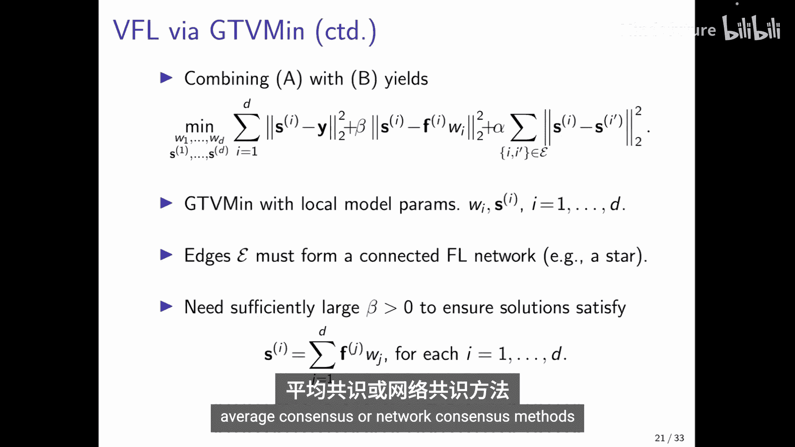

Yeah， let me， let me now move on because I， I need to hand over then add 5 sharp to the guest speaker。

So the next flavor or one one of the main flavors， which also has received a lot of attention recently is class at federated learning。

 So in class at federated learning， we assume that the nodes of a federated learning network。

 they form a naturally form clusters。 and one way to think about this clusters is that they they are approximately IID。

 So all the nodes， all the notes， like， let's say one node here is a hospital and the data set it has is it's healthcare records。

And some of the hospitals have very similar statistical distributions of their local dataset sets。

 For example， they' are all hospitals from Finland。 Let's say they have similar statistics。

 or it could be all hospitals that are considered during the same period of time when everybodys just hit by a wave of flu influenza。

So for some node， the statistics or the distribution of the local dataset sets is very similar。

 And then we say these former cluster。And this can be formulated by a simple probabilistic model where you say all nodes in the same cluster。

 the local data sets are drawn I I D from the same distribution。The problem is， in practice。

 you don't know which devices belong to the same cluster。 You only observe small。

 small sized local data sets， and you would need to find out which one belong to the same cluster。

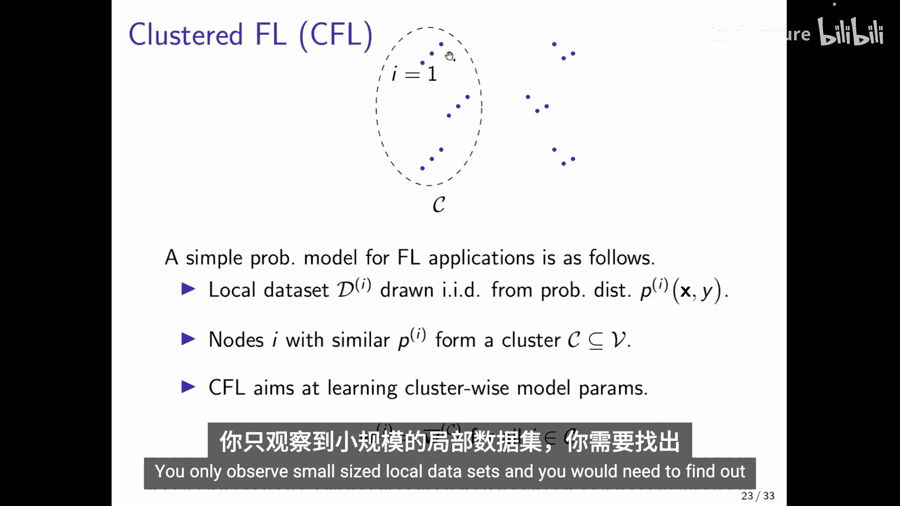

And yeah， here has mentioned some some application domains in healthcare when you want to。

 when you want to train personalized models for hospitals or even on the individual level for you want to train the same model for patients that are similar or same personal training advisor for persons that are similar to me。

 for example， I I have a certain hate weight body mass index preference for sports activities。

 So maybe my， my smartphone based training planner should take into account the the measurements or the data collected by others that have similar physical properties than I have。

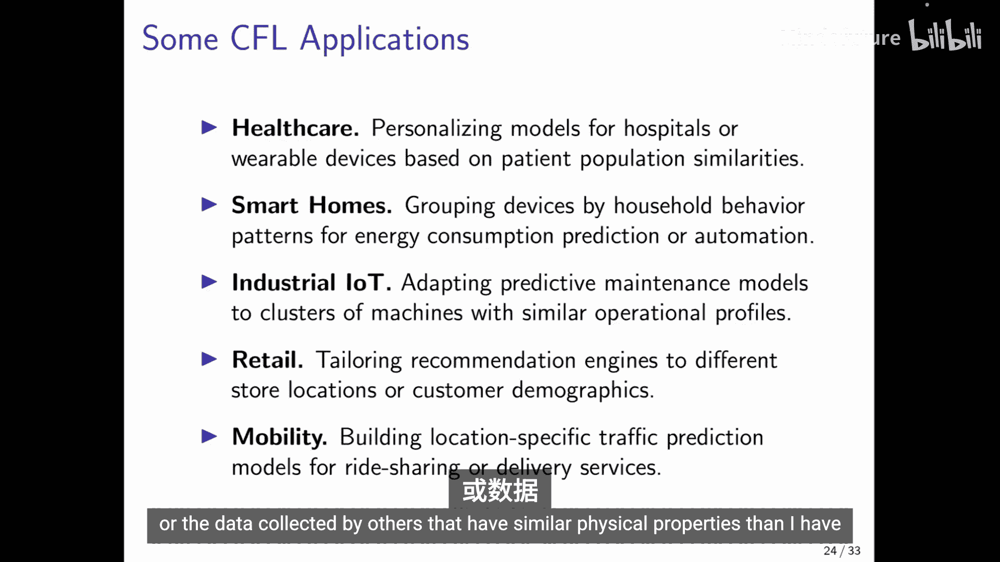

So here we get this， this intrinsic cluster structure。

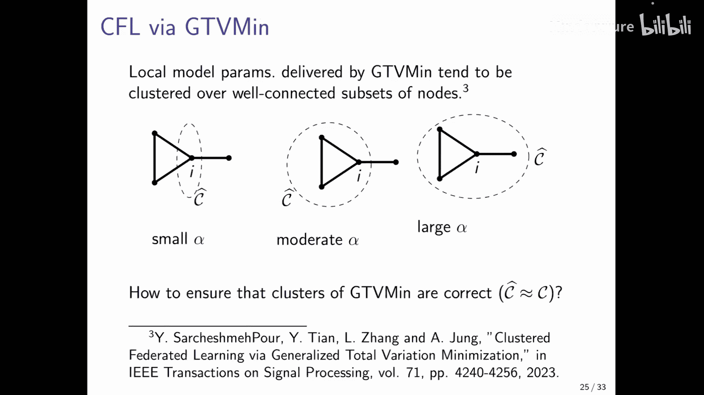

And it turns out that G TVV minimization is well suited also for clustered federated learning because as we have discussed earlier。

 the， the solutions of G TVV minimization， they tend to be clustered。

 So depending on how large you make alpha。The larger subsets of of nodes will end up with model parameters that are approximately similar。

 And in particular， if you choose for this variation measures。

 for this measuring the difference between if you measure the difference of of model parameters at connected nodes using a norm。

 which is not our main choice。 So in this course， we use as our main choice。

 we use the the squared Euclidean norm here， but if you would use here the norm。

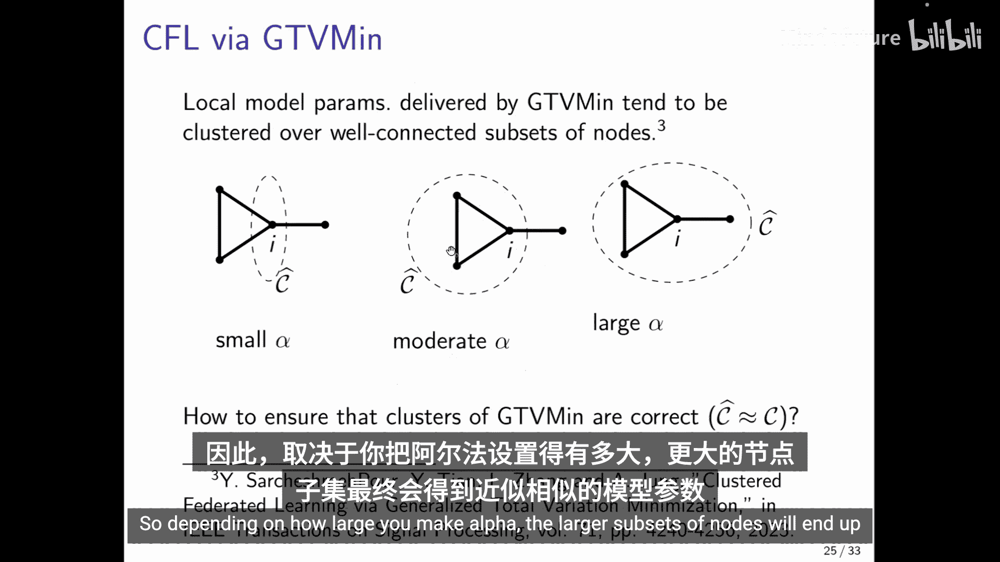

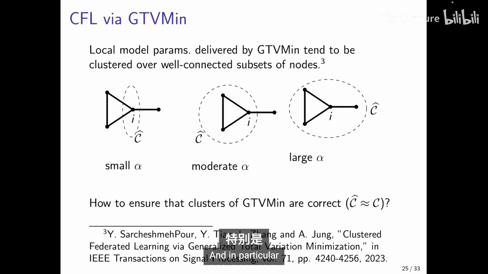

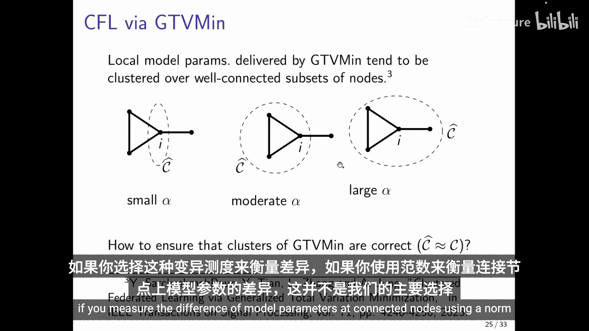

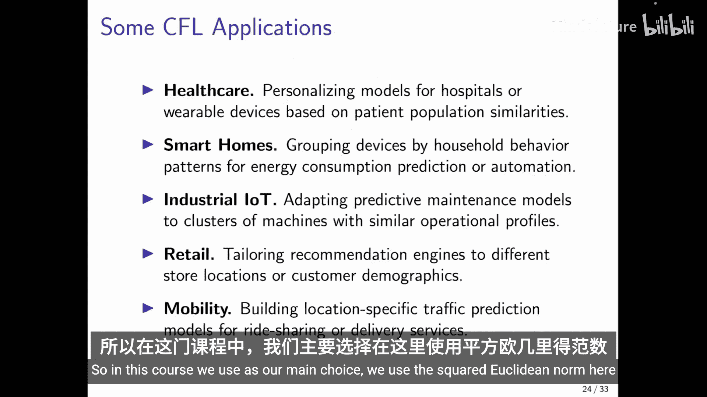

Then it turns out they are exactly identical over a large subset of nodes。

 And this was one one of the recent topics of our own very own research。

 So I ci here one of our recent journal papers that characterize this cluster structure。 However。

 the cluster structure of G TVV mean only depends on the local dataset sets and the network structure。

 So that's why I denote this cluster here by C hat instead of C。

 because this C hat That's what we get out of G TV minimization might be different from this cluster our clustering assumption。

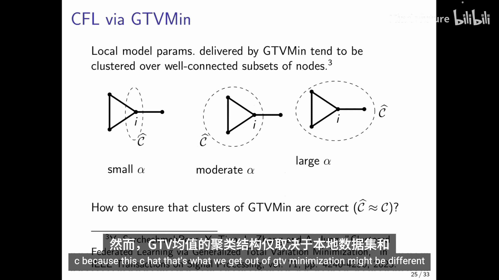

Because this clustering assumption is like an oracle based information。 Somebody tells you， yeah。

 these three data sets， these three nodes belong really to the same cluster。

 but the data they they observe is are noisy realizations of the distribution and based on on how lucky you are。

 you really see that they are identical distributed or you're very unlucky。

 and you just see one one of these local dataset sets just by bad luck has a very different shape。

 This one realization。 So there will be some some estimation error involved。

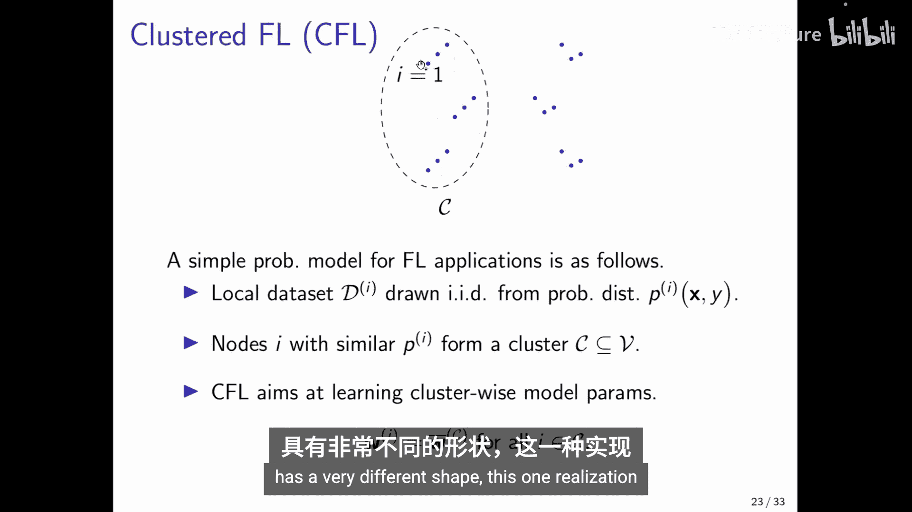

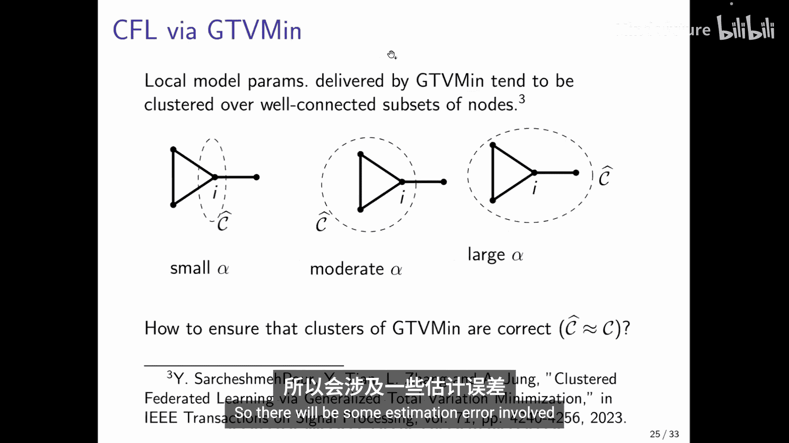

But how， how can we reduce this minimizeise this estimation error。 Yeah。

 we can use statistical tests so you we can， we can try to test if one local data set is sampled from the same distribution as another local dataset。

 I mean， I guess this is one of the the mothers of statistical testing problems。

 You have two data sets and want to know， are they drawn from the same distribution。

And I guess this is a well started。 I'm sure this is a wellstar problem with a lot of results and and methods methods studied for or studied methods for finding out or testing。

 if these two local dataset sets come are derived from the same distribution。 And if they are。

 So if this test results in yes， they can they are from the same distribution， then we put an edge。

We can also use some measures of of distance between probability distribution like a KL divergence to choose the edge weight。

 So using the KL divergence between the empirical distributions because the the actual distributions we typically don't know。

 or we can use the gradients so we can use the gradients of of some deep neural network。

Evaluated for a given model parameter。 So you， you could。

 you could interpret gradients also as a way to translate a local data set into a vector。

And if these vectors are similar， you say， okay， there should be an edge with a large edge weight between these two nodes。

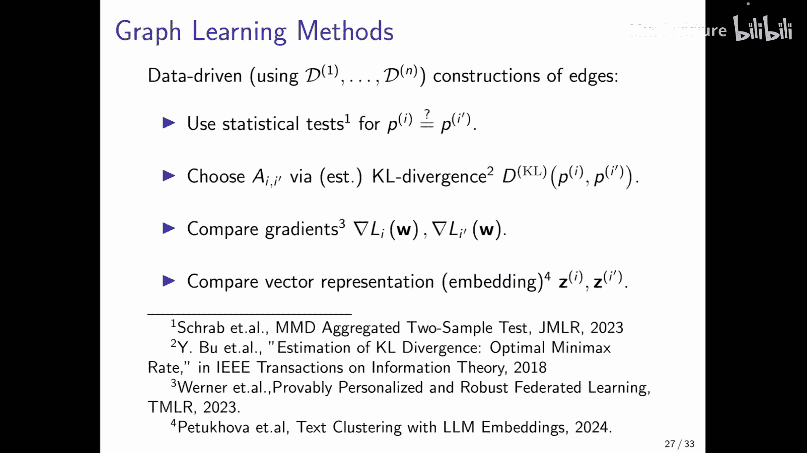

Okay， in the interest of time， I will now。

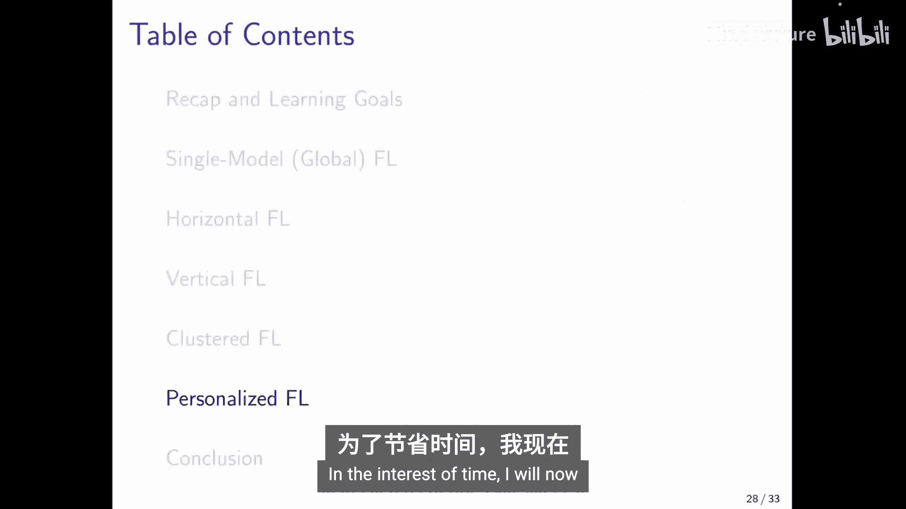