# 联邦学习 CS-E4740：第37讲：聚类联邦学习 🧩

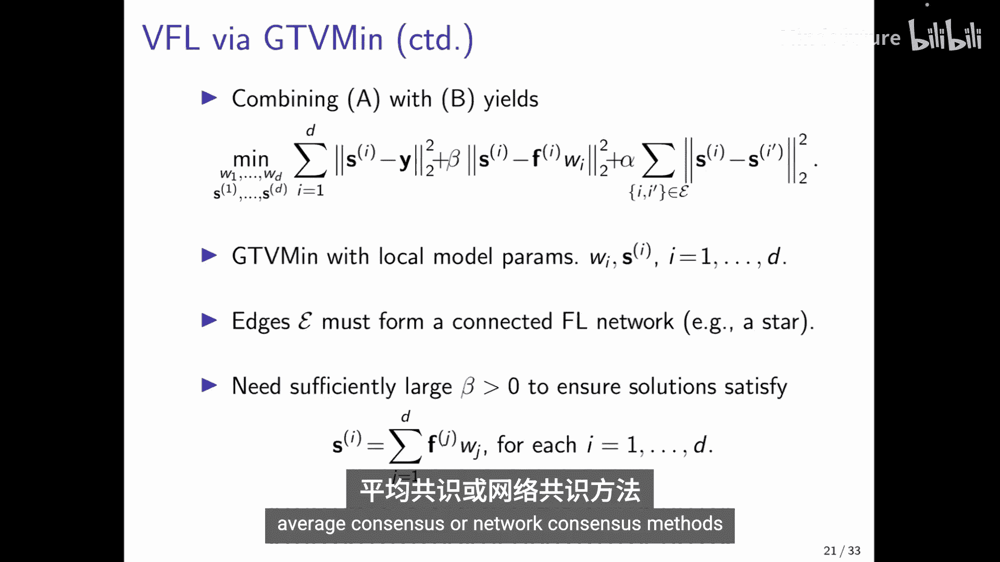

在本节课中，我们将要学习联邦学习的一个重要变体——聚类联邦学习。我们将探讨其基本概念、应用场景以及如何通过图总变差最小化等方法来实现它。

---

## 概述

上一节我们讨论了联邦学习的基本框架。本节中，我们来看看一种考虑数据分布自然分组的联邦学习范式，即聚类联邦学习。在这种设置下，我们假设联邦网络中的节点会自然地形成多个簇，每个簇内的数据分布近似独立同分布。

## 聚类联邦学习的基本概念

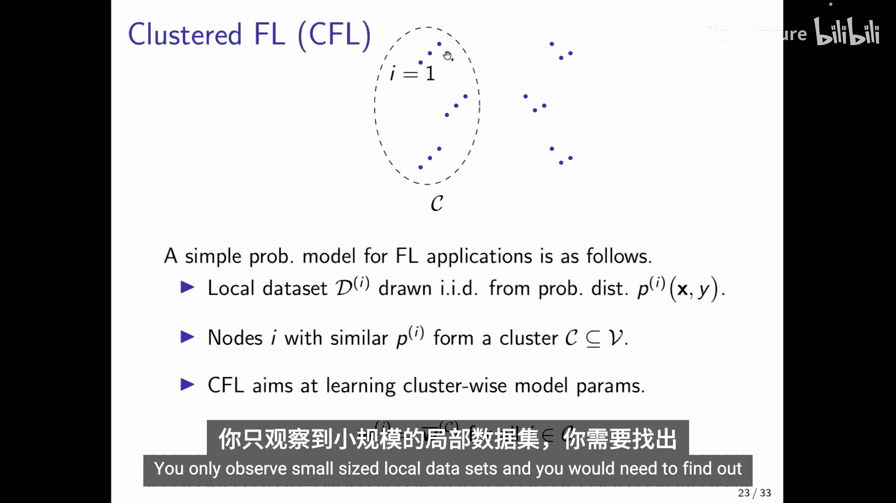

聚类联邦学习的核心假设是：联邦网络中的节点会自然地形成多个簇。例如，一个节点可能代表一家医院，其本地数据集是医疗记录。来自同一地区（如芬兰）的所有医院，或在同一流感爆发期间收集数据的医院，其本地数据集的统计分布可能非常相似。这些节点就形成了一个簇。

这可以通过一个简单的概率模型来表述：**同一簇内的所有节点，其本地数据集都是从同一分布中独立同分布地抽取的**。

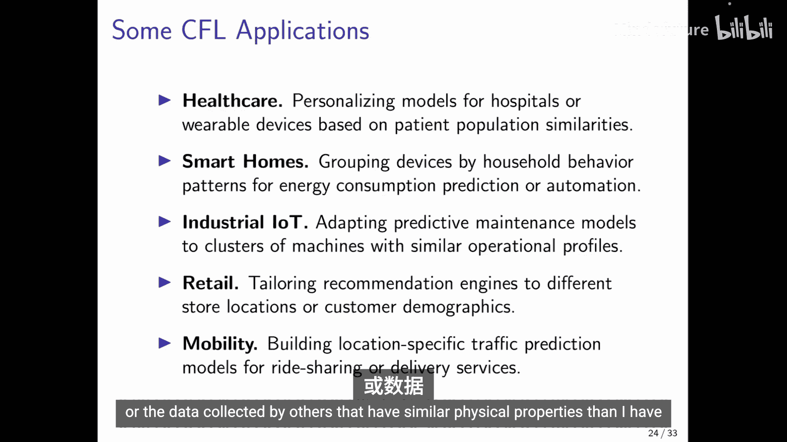

然而，在实际应用中，我们并不知道哪些设备属于同一个簇。我们只能观察到小规模的本地数据集，因此需要找出哪些节点属于同一簇。

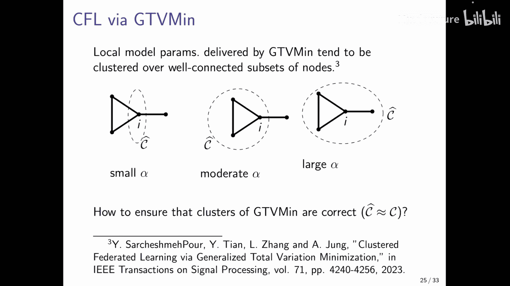

以下是聚类联邦学习的一些关键应用领域：
*   **医疗健康**：为具有相似患者群体的医院训练个性化模型。
*   **个性化推荐**：为具有相似身体质量指数、运动偏好的用户训练相同的智能手机健身计划模型。

## 通过图总变差最小化实现聚类

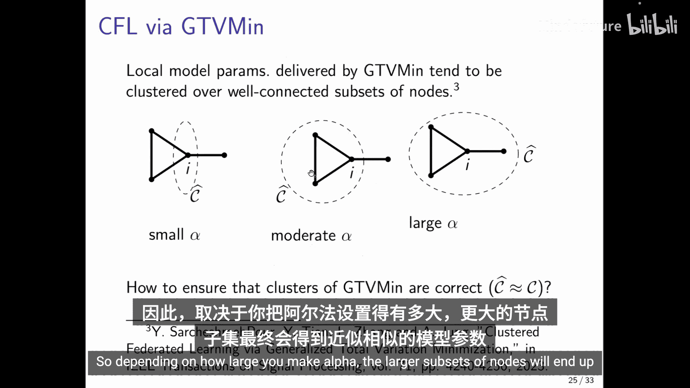

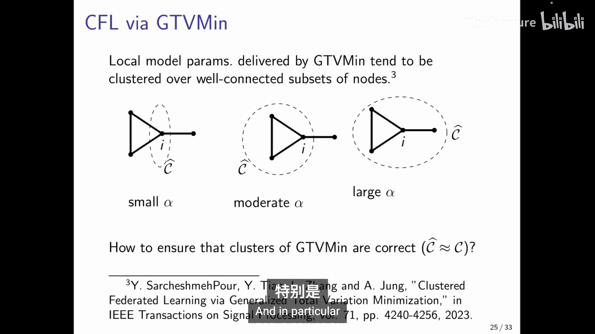

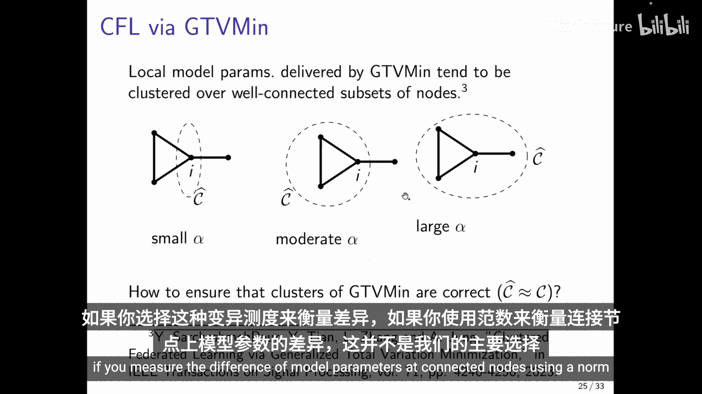

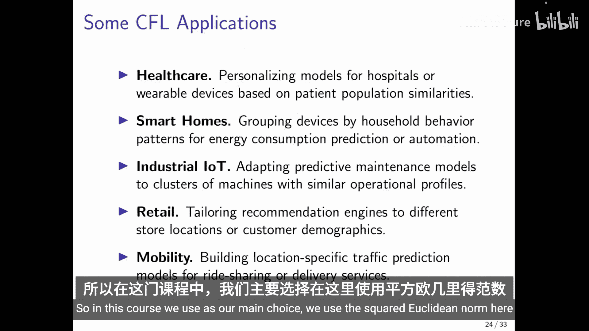

我们之前讨论过的图总变差最小化方法，也非常适合用于聚类联邦学习。这是因为GTV最小化的解本身就倾向于呈现聚类结构。

GTV最小化问题的公式通常如下：
`min_{x} ∑_{i} f_i(x_i) + α ∑_{(i,j)∈E} w_{ij} ||x_i - x_j||^2`
其中，`f_i(x_i)`是节点`i`的本地损失函数，`α`是正则化参数，`w_{ij}`是边权重，`||·||^2`表示欧几里得范数的平方。

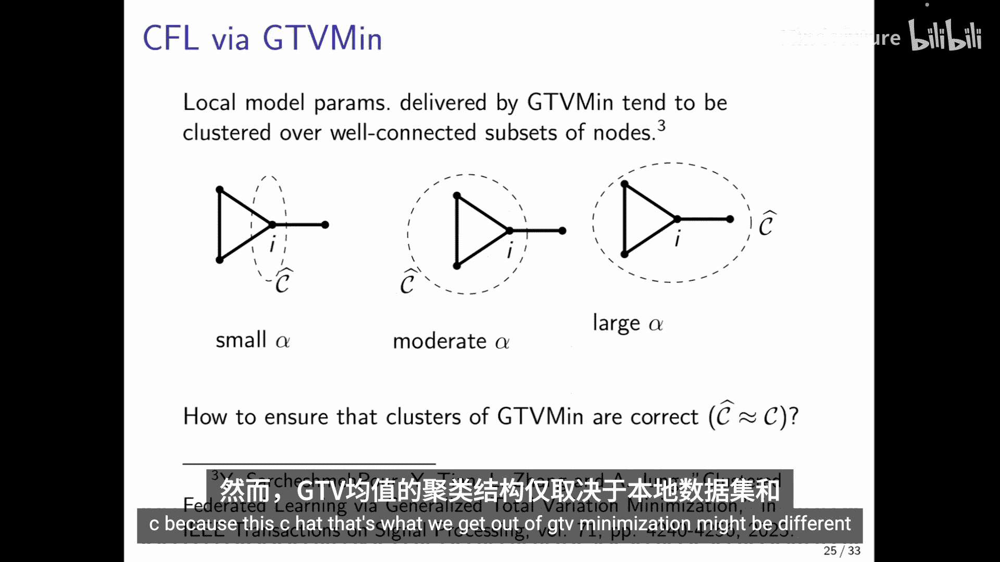

调整参数`α`的大小可以控制聚类程度：`α`越大，最终模型参数近似相似的节点子集就越大。有趣的是，如果我们使用某些特定的范数（而非平方欧几里得范数）来衡量相连节点间模型参数的差异，那么同一簇内节点的模型参数将变得完全一致。

需要指出的是，通过GTV最小化得到的簇结构`Ĉ`，仅依赖于本地数据集和网络结构，可能与真实的簇假设`C`有所不同。这是因为真实的簇信息是一种“先知”信息，而我们只能通过有噪声的数据样本来进行估计，这必然会引入估计误差。

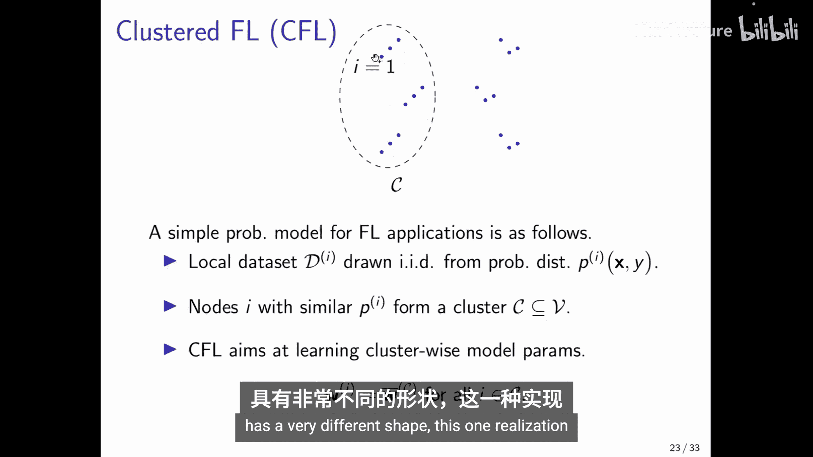

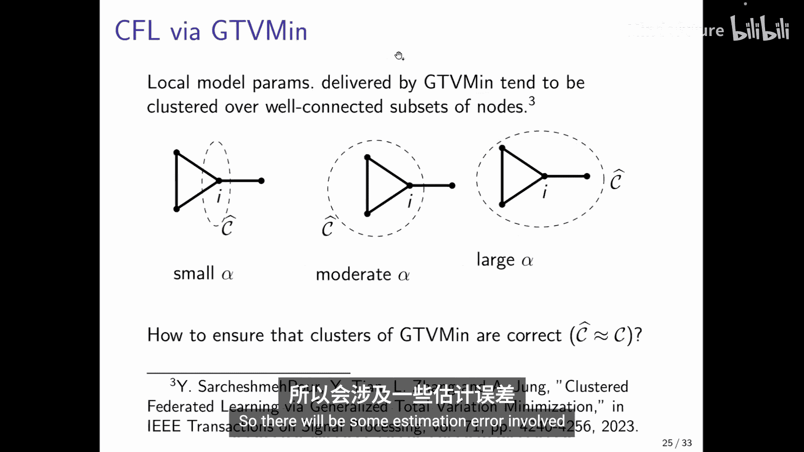

## 如何减少簇估计误差

为了最小化这种估计误差，我们可以借助统计学方法。核心问题是：判断两个本地数据集是否来自同一分布。

以下是几种可行的方法：
*   **统计检验**：使用假设检验来判断两个数据集是否源自同一分布。这是一个统计学中的经典问题，已有大量成熟的方法。
*   **分布距离度量**：使用概率分布之间的距离度量，如KL散度，来设置图中的边权重。由于我们通常不知道真实分布，因此可以使用经验分布来计算。
*   **梯度相似性**：将本地数据集通过某个模型参数下的深度神经网络梯度“翻译”成一个向量。如果两个节点的梯度向量相似，则认为它们之间应有一条权重较大的边。

---

## 总结

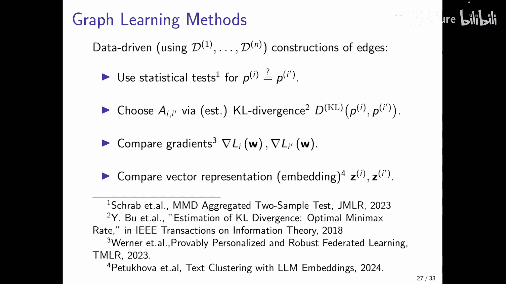

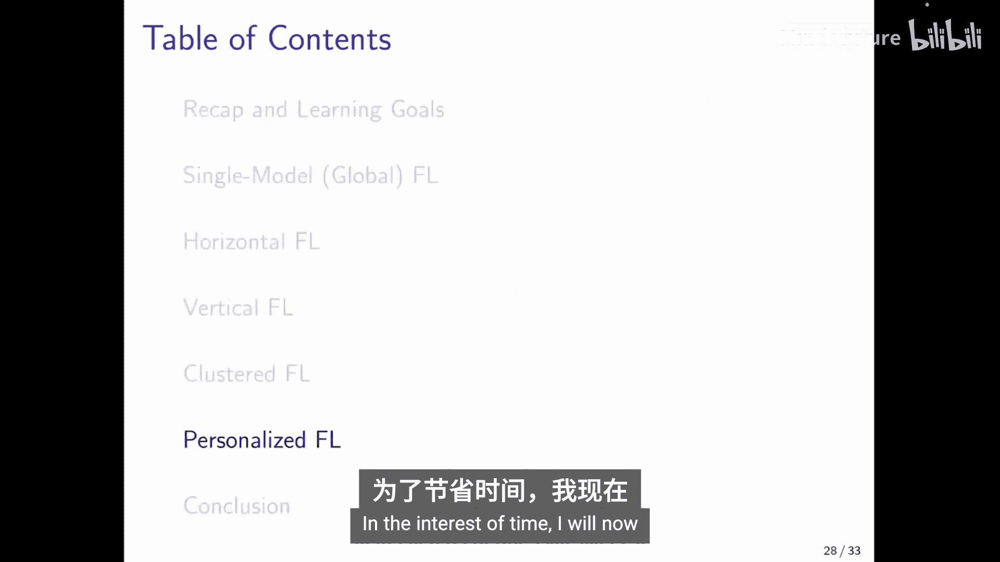

本节课中，我们一起学习了聚类联邦学习。我们了解到，在这种范式中，节点会根据其数据分布的相似性自然形成簇。我们探讨了如何利用图总变差最小化方法来促进这种聚类结构，并介绍了使用统计检验、分布距离度量和梯度相似性等方法来识别和构建节点间连接，以减少簇估计的误差。这为在数据非独立同分布且存在自然分组的场景下进行有效的联邦学习提供了思路。